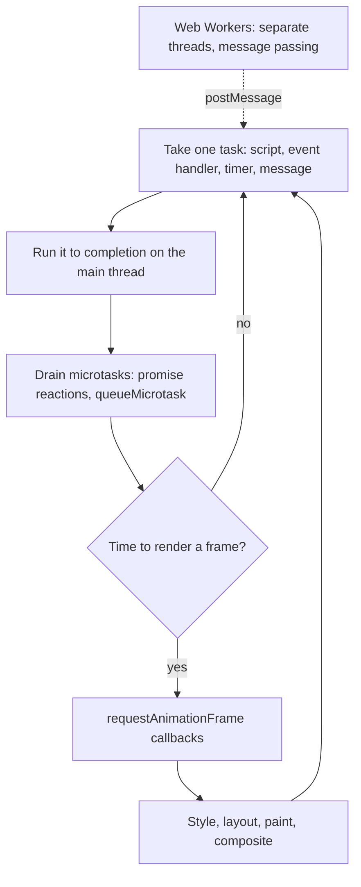
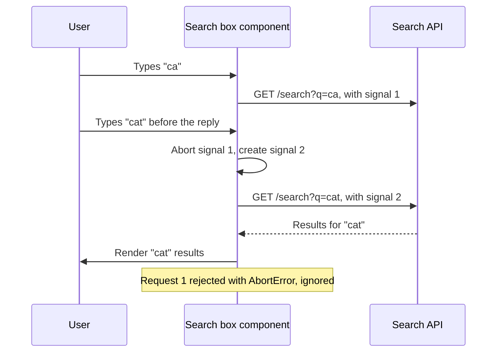

## TL;DR

- JavaScript is a dynamically typed, prototype-based language with first-class functions and a **single-threaded event loop** — concurrency comes from asynchronous I/O, not threads.
- Master the fundamentals interviewers probe: **scope and closures**, **`this` binding**, **prototypes**, **type coercion**, and the **event loop** (tasks, microtasks, rendering).
- Use modern syntax: `let`/`const`, arrow functions, destructuring, optional chaining (`?.`), nullish coalescing (`??`), modules (ESM), `async`/`await`, iterators and generators.
- Async pitfalls cause many bugs: floating promises, sequential awaits where parallel was intended, unhandled rejections, race conditions — use `Promise.all`/`allSettled`, `AbortController` and lint rules.
- At scale, JS cost is **bytes shipped and parsed/executed on the main thread** — bundle size, code splitting and avoiding long tasks matter as much as algorithmic efficiency.

## Core Concepts

### Scope, hoisting and the temporal dead zone

- `var` is function-scoped and hoisted (initialised to `undefined`); `let`/`const` are block-scoped and hoisted but uninitialised until declaration — accessing them earlier throws (the **temporal dead zone**).
- `const` prevents reassignment, not mutation of the object.
- Function declarations are hoisted with their body; function expressions aren't.

```js
for (var i = 0; i < 3; i++) setTimeout(() => console.log(i)); // 3 3 3 — one shared i
for (let j = 0; j < 3; j++) setTimeout(() => console.log(j)); // 0 1 2 — new binding per iteration
```

### Closures

A function keeps access to variables from the scope where it was created, even after that scope has finished.

```js
function createCounter() {
  let count = 0;                      // private state
  return { increment: () => ++count, value: () => count };
}
const c = createCounter(); c.increment(); c.value(); // 1
```

Uses: private state, factories, memoisation, callbacks, partial application. Pitfalls: stale closures (React hooks capturing old state), memory leaks when closures retain large objects.

### `this`

`this` is determined by **how a function is called**, not where it's defined:
- Method call `obj.fn()` → `obj`.
- Plain call `fn()` → `undefined` in strict mode (modules and classes are strict).
- `new Fn()` → the new object.
- `fn.call/apply/bind(x)` → `x`.
- **Arrow functions** don't have their own `this` — they capture it lexically, which is why they're convenient for callbacks.

### Prototypes and classes

Objects inherit via a **prototype chain**: property lookups walk up `[[Prototype]]` links. `class` syntax is sugar over prototypes, adding fields, private `#members`, static blocks and `super`. Prefer composition over deep inheritance.

### Types, equality and coercion

- Primitives: `string`, `number`, `bigint`, `boolean`, `undefined`, `null`, `symbol`; everything else is an object.
- `===` compares without coercion; `==` coerces (`'' == 0` is true). Use `===` except `x == null` to check both null and undefined.
- Numbers are IEEE 754 doubles: `0.1 + 0.2 !== 0.3`; safe integers up to 2^53 − 1 — use `BigInt` or integer minor units for money.
- `NaN !== NaN`; use `Number.isNaN`; `Object.is` distinguishes `-0` and `NaN`.

### The browser event loop

1. Run a **task** (macrotask): script execution, event callbacks, timers, message events.
2. Drain the **microtask queue**: promise reactions, `queueMicrotask`, `MutationObserver`.
3. Possibly **render**: `requestAnimationFrame` callbacks, style, layout, paint.
4. Repeat.

Long tasks (over ~50 ms) block input and rendering, hurting INP. Break work up (`scheduler.yield()` where supported, `setTimeout`, `requestIdleCallback`), or move it to Web Workers.

```js
console.log('1 sync');
setTimeout(() => console.log('4 timer task'));
Promise.resolve().then(() => console.log('3 microtask'));
queueMicrotask(() => console.log('3b microtask'));
console.log('2 sync');
```

### Worked example: predicting the event loop's order

What does this print?

```js
console.log('A');
setTimeout(() => console.log('B'), 0);
Promise.resolve().then(() => {
  console.log('C');
  setTimeout(() => console.log('D'), 0);
});
(async () => {
  console.log('E');
  await null;
  console.log('F');
})();
queueMicrotask(() => console.log('G'));
console.log('H');
```

Trace it with three queues in mind: the current synchronous run, the **microtask** queue, and the **task** (timer) queue.

| Step | What runs | Output | Queued afterwards |
|---|---|---|---|
| 1 | `console.log('A')` | A | — |
| 2 | `setTimeout(B)` | — | Tasks: B |
| 3 | `.then(C)` on an already-resolved promise | — | Microtasks: C |
| 4 | The async function runs synchronously until its first `await` | E | Microtasks: C, F (the code after `await`) |
| 5 | `queueMicrotask(G)` | — | Microtasks: C, F, G |
| 6 | `console.log('H')`, and the script ends | H | — |
| 7 | Drain microtasks in order: C, which schedules D, then F, then G | C F G | Tasks: B, D |
| 8 | Next task: B, then microtasks (none), then the next task: D | B D | — |

**Output: A E H C F G B D.**

What to take away:
- An `async` function runs **synchronously until its first `await`**. That's why E prints before H.
- Everything after an `await` is a **microtask**, so it runs before any timer, even a `setTimeout(…, 0)` scheduled earlier.
- The **whole microtask queue drains** before the next task. A microtask that keeps queueing microtasks starves timers, input and rendering, just like a long synchronous loop.
- `setTimeout(fn, 0)` means "as a later task", not "now". Browsers also clamp nested timers to at least 4 ms.

### Async patterns

```js
// Sequential (slow) vs parallel (fast)
const user = await getUser(id);          // independent calls awaited one after another...
const orders = await getOrders(id);
const [u, o] = await Promise.all([getUser(id), getOrders(id)]); // ...vs in parallel

// Partial failures without rejecting everything
const results = await Promise.allSettled(urls.map((u) => fetch(u)));

// Timeouts and cancellation
const res = await fetch(url, { signal: AbortSignal.timeout(3000) });
```

- `Promise.all` rejects on the first failure; `allSettled` waits for all; `race` resolves/rejects with the first settled; `any` resolves with the first fulfilled.
- Limit concurrency for large fan-outs (pools) to avoid overwhelming servers.
- Always handle rejections; a forgotten `await` (floating promise) swallows errors and creates races.

### Modules

- **ES modules (ESM):** `import`/`export`, static structure (enables tree shaking), asynchronous loading, strict mode, top-level `await`. The standard in browsers and modern Node.
- **CommonJS:** `require`/`module.exports`, synchronous, Node's legacy format. Interop has rough edges (default exports, dual packages).

### Memory

Garbage collection frees objects that are no longer reachable. Leaks happen when references persist unintentionally: global caches without eviction, event listeners and timers never removed, detached DOM nodes held in variables, closures capturing large objects. `WeakMap`/`WeakRef` help associate data without preventing collection.

## How It Works



Everything on the main thread — your code, React rendering, layout — competes for the same time slices. Keeping tasks short keeps the page responsive.

### Cancelling a stale search request



## When to Use / Trade-offs

| Feature / approach | Use when | Avoid when | Trade-off |
|---|---|---|---|
| `async`/`await` | Most asynchronous code | Need fine-grained concurrency control (combine with `Promise.all`, pools) | Readability vs accidental serialisation |
| Classes | Encapsulated state with behaviour, framework expectations | Simple data or utility functions | Familiar OO vs heavier than functions/objects |
| Closures/factories | Private state, configurable functions | Large numbers of instances where prototypes share methods more efficiently | Encapsulation vs memory per instance |
| Web Workers | CPU-heavy work in the browser | Small tasks (messaging overhead) | Responsiveness vs complexity and data copying |
| ESM | All new code | Legacy tooling requiring CJS | Standard and tree-shakeable vs interop friction |
| TypeScript on top | Any non-trivial codebase | Tiny scripts | Safety and tooling vs build step |

## Common Pitfalls & Anti-patterns

- **Floating promises** — `doAsync()` without `await` or `.catch`; errors vanish.
- **Sequential awaits in loops** where parallel requests were intended — or unbounded parallelism where limits were needed.
- **`==` surprises** and truthiness bugs (`0`, `''` treated as missing — use `??` instead of `||` for defaults).
- **Losing `this`** when passing methods as callbacks (`button.onclick = obj.method`).
- **Floating-point money.**
- **Mutating shared objects/arrays** unexpectedly (sort mutates; use `toSorted`).
- **Long tasks on the main thread** — janky UI and poor INP.
- **Memory leaks** from listeners and caches.
- **Prototype pollution** when merging untrusted objects.
- **Relying on object key order or `for…in`** over inherited properties.

## Real-world Scenario

**Context:** A dashboard page froze for 1–2 seconds when filters changed; INP field data was around 900 ms at the 75th percentile. Error logs also showed intermittent "Cannot read properties of undefined" after fast filter changes.

**Investigation:** A performance profile showed a long task: filtering and sorting 40,000 rows synchronously, then `JSON.parse` of a large cached payload, all in the input handler. The undefined errors came from a race: responses for older filter requests arrived after newer ones and overwrote state.

**Decision:** Moved filtering/sorting to a Web Worker with transferable data; debounced input and yielded to the main thread before heavy updates; virtualised the table; added `AbortController` to cancel superseded requests and ignored stale responses by request id; replaced `||` defaults with `??` where `0` was a valid value.

**Outcome:** INP dropped to ~120 ms at p75; the race-condition errors disappeared.

**What I'd do differently:** Add long-task and INP monitoring (RUM) from the start, and lint for floating promises — both problems were visible in data long before users complained.

## Interview Questions

### Explain scope, hoisting and the temporal dead zone. {#scope-hoisting}

**Level:** Foundation

**Model answer:**
- **Scope:** `var` is function-scoped; `let` and `const` are block-scoped. Closures capture the bindings of their enclosing scopes.
- **Hoisting:** declarations are processed before code runs. `var` declarations are hoisted and initialised to `undefined`; function declarations are hoisted with their bodies; `let`, `const` and `class` are hoisted but **not initialised**.
- **Temporal dead zone (TDZ):** the period between entering a block and the `let`/`const` declaration; accessing the variable there throws a `ReferenceError`.

Practical consequences: the classic `for (var i…)` + `setTimeout` bug prints the final value because all callbacks share one `i`; `let` creates a new binding per iteration. Prefer `const` by default, `let` when reassigning, never `var` in modern code.

**What the interviewer is looking for:**
Accurate scope and hoisting rules, TDZ, and the loop example.

**Follow-ups:**
- What does `typeof undeclaredVar` return vs `typeof tdzVar`?
- Does `const` make objects immutable?

**Red flags:**
- "let isn't hoisted at all."

### What is a closure, and where would you use one? {#closures}

**Level:** Foundation

**Model answer:**
A closure is a function together with references to the variables of the scope in which it was created. The function can read and update those variables later, even after the outer function has returned.

Uses:
- **Private state:** counters, caches, module patterns without classes.
- **Factories and configuration:** `makeRateLimiter({ max: 10 })` returning a function that remembers its config.
- **Callbacks and event handlers** that need context.
- **Memoisation:** caching results in an enclosed map.
- **Partial application/currying.**

Pitfalls: stale closures (e.g. a React effect capturing an old state value), and memory retention — closures keep referenced variables alive, which can leak if long-lived callbacks hold large objects.

**What the interviewer is looking for:**
Correct definition, practical uses and pitfalls.

**Follow-ups:**
- Show a stale closure bug in React and how to fix it.
- How do closures affect memory?

**Red flags:**
- Defining closures as "functions inside functions" without the captured environment.

### How is `this` determined in JavaScript? {#this-binding}

**Level:** Foundation

**Model answer:**
`this` depends on the **call site**:
- **Method call** `obj.method()` → `obj`.
- **Plain function call** `fn()` → `undefined` in strict mode (modules, classes), or the global object in sloppy mode.
- **Constructor** `new Fn()` → the newly created object.
- **Explicit binding** `fn.call(x, …)`, `fn.apply(x, [...])`, `fn.bind(x)` → `x` (bind creates a new function permanently bound).
- **Arrow functions** have no own `this`; they use `this` from the surrounding scope at definition time — and can't be rebound.
- **Event handlers** (DOM `addEventListener` with a regular function) → the element.

Common bug: passing `obj.method` as a callback loses `this`. Fixes: arrow function wrapper, `bind`, or class fields with arrow functions.

**What the interviewer is looking for:**
All binding rules, arrow function behaviour and the callback pitfall.

**Follow-ups:**
- What's `this` inside a class method used as a callback?
- Why can't you use arrow functions as constructors?

**Red flags:**
- "this refers to where the function is defined."

### Explain `==` vs `===` and JavaScript's type coercion pitfalls. {#equality-coercion}

**Level:** Foundation

**Model answer:**
- `===` (strict equality) compares type and value without coercion.
- `==` (loose equality) converts operands using complex rules: `'' == 0` → true, `'0' == false` → true, `null == undefined` → true, but `null == 0` → false.

Guidance: always use `===`, with the common exception `x == null` to test for both `null` and `undefined` (or use `x ?? fallback`).

Other coercion pitfalls:
- **Truthiness:** `0`, `''`, `NaN`, `null`, `undefined`, `false` are falsy — `count || 10` replaces a valid `0`; use `??`.
- **`+` with strings** concatenates: `'5' + 1 === '51'`.
- **NaN:** `NaN !== NaN`; use `Number.isNaN`.
- **Floating point:** `0.1 + 0.2 !== 0.3`; use integers in minor units or decimal libraries for money.
- **`typeof null === 'object'`** (historical bug).

**What the interviewer is looking for:**
Clear rules, practical guidance and common traps including `||` vs `??`.

**Follow-ups:**
- What's `[] + {}`? (and why it doesn't matter in real code)
- How do you compare objects for equality?

**Red flags:**
- Using `==` habitually.

### Describe the browser event loop, including microtasks and rendering. {#browser-event-loop}

**Level:** Senior

**Model answer:**
The main thread runs one **task** at a time (script evaluation, event callbacks, timers, `postMessage`). After each task, it drains **all microtasks** (promise reactions, `queueMicrotask`, `MutationObserver` callbacks) — microtasks queued by microtasks also run before moving on. Then the browser may **render** a frame: run `requestAnimationFrame` callbacks, recalculate styles, layout, paint and composite (typically aiming for 60+ fps, ~16 ms per frame).

Implications:
- **Long tasks** (> 50 ms) block input handling and rendering, increasing Interaction to Next Paint (INP). Split work (`scheduler.yield()` where supported, `setTimeout(0)`, `requestIdleCallback`) or use **Web Workers**.
- Infinite microtask chains can starve rendering.
- Use `requestAnimationFrame` for visual updates; batch DOM reads before writes to avoid layout thrashing.
- `setTimeout(fn, 0)` runs after microtasks and possibly after a render.

**What the interviewer is looking for:**
Task/microtask/render ordering and performance implications for responsiveness.

**Follow-ups:**
- What's layout thrashing?
- How does React 18+ concurrent rendering interact with the event loop?

**Red flags:**
- Unaware that promise callbacks run before timers.

### What are the common pitfalls with promises and async/await? {#async-pitfalls}

**Level:** Senior

**Model answer:**
- **Floating promises:** calling an async function without `await`/`.catch` — errors become unhandled rejections and ordering bugs appear. Use lint rules (`no-floating-promises`).
- **Accidental serialisation:** `await` in a loop for independent operations; use `Promise.all` (with a concurrency limit for large sets).
- **Unbounded parallelism:** `Promise.all` over 10,000 requests overwhelms servers; use pools (`p-limit`).
- **`Promise.all` fail-fast semantics:** one rejection rejects all; use `allSettled` when partial results are acceptable.
- **`forEach` with async callbacks** doesn't await; use `for…of` or `Promise.all(map(...))`.
- **Race conditions:** later responses overwriting newer state — cancel with `AbortController` or ignore stale results.
- **No timeouts:** network calls without `AbortSignal.timeout` can hang.
- **Mixing callbacks and promises** incorrectly; forgetting to `return` a promise in a `.then` chain.
- **Error handling:** `try/catch` only catches awaited promises.

**What the interviewer is looking for:**
A range of real pitfalls with concrete remedies.

**Follow-ups:**
- How do you implement a concurrency-limited map?
- How would you cancel an in-flight fetch when the user types again?

**Red flags:**
- `array.forEach(async ...)` expecting it to wait.

### How do prototypes work, and how do classes relate to them? {#prototypes}

**Level:** Senior

**Model answer:**
Every object has an internal `[[Prototype]]` link (accessible via `Object.getPrototypeOf`). When you read a property, JavaScript looks at the object, then its prototype, then up the chain until `null`. Methods shared via prototypes save memory: all instances reference one function.

`class` syntax builds the same structure: methods go on `Class.prototype`; `extends` sets up the prototype chain between constructors and prototypes; `super` calls the parent. Classes add conveniences: fields (public and `#private`), static members and blocks, getters/setters, and they're always strict mode. Instances created with `new` get the class prototype.

Practical points:
- Prefer composition over deep inheritance hierarchies.
- Don't modify built-in prototypes.
- `Object.create(null)` creates objects without a prototype — useful for dictionaries and avoiding prototype pollution.
- `#private` fields are truly private (unlike `_convention` or TypeScript `private`).

**What the interviewer is looking for:**
Prototype chain lookup, class sugar mapping, and practical guidance.

**Follow-ups:**
- What's the difference between `#private` and TypeScript's `private`?
- How does `instanceof` work?

**Red flags:**
- Believing JavaScript classes work like Java classes internally.

### Compare ES modules and CommonJS. {#modules}

**Level:** Senior

**Model answer:**
**ES modules (ESM):**
- `import`/`export`, statically analysable — enables tree shaking and better tooling.
- Asynchronous loading, live bindings (imports reflect exported variable updates), strict mode by default, top-level `await`.
- The standard for browsers and modern Node (`"type": "module"` or `.mjs`).

**CommonJS (CJS):**
- `require`/`module.exports`, synchronous, dynamic (can require conditionally).
- Node's original module system; still common in older packages and tooling.

Interop issues: importing CJS from ESM (default vs named exports), loading ESM from CJS (historically only via dynamic `import()`; newer Node versions allow `require()` of synchronous ESM, unflagged in Node 22.12, 20.19 and 23+), dual-package hazards (two copies of a library loaded), `__dirname` not available in ESM (use `import.meta.dirname`/`import.meta.url`).

Guidance: write ESM for new code; publish libraries with proper `exports` maps; be careful with dual packages.

**What the interviewer is looking for:**
Differences, tree shaking, interop pitfalls and modern guidance.

**Follow-ups:**
- What's the dual-package hazard?
- What are package `exports` maps for?

**Red flags:**
- Unaware of interop issues when migrating.

### How do memory leaks happen in JavaScript applications, and how do you find them? {#memory-management}

**Level:** Senior

**Model answer:**
Garbage collection reclaims objects that are no longer reachable from roots (globals, the stack, active closures). Leaks happen when references persist unintentionally:
- **Event listeners** added and never removed (especially in SPAs on navigation).
- **Timers/intervals** not cleared.
- **Detached DOM nodes** kept in variables or caches.
- **Unbounded caches/maps** keyed by ever-growing values.
- **Closures** holding large objects longer than needed.
- **Subscriptions** (stores, observables, WebSockets) without unsubscribe.

Finding them (browser): Chrome DevTools Memory panel — take heap snapshots before and after repeating an action (e.g. open/close a modal 20 times), compare, inspect retainers; allocation timelines; Performance monitor for JS heap and DOM node counts. In Node: heap snapshots and `--inspect`.

Prevention: cleanup functions (React effect cleanups, `AbortController` for listeners: `addEventListener(..., { signal })`), bounded caches (LRU), `WeakMap`/`WeakRef` for metadata associated with objects.

**What the interviewer is looking for:**
Common causes, a concrete detection workflow and prevention techniques.

**Follow-ups:**
- How does `WeakMap` help?
- How do you remove many listeners at once?

**Red flags:**
- "JavaScript has GC, so leaks can't happen."

### How do you handle immutability and copying in JavaScript? {#immutability}

**Level:** Senior

**Model answer:**
- **Primitives are immutable; objects and arrays are mutable references.** Assigning or passing an object shares the reference.
- **Shallow copies:** spread (`{...obj}`, `[...arr]`), `Object.assign` — nested objects remain shared.
- **Deep copies:** `structuredClone(value)` (handles Dates, Maps, Sets, cycles; not functions or class prototypes); avoid `JSON.parse(JSON.stringify())`, which drops `undefined`, Dates and Maps.
- **Non-mutating array methods:** `toSorted`, `toReversed`, `toSpliced`, `with` (ES2023), alongside `map`, `filter`, `slice`; note that `sort`, `reverse` and `splice` mutate.
- **Freezing:** `Object.freeze` is shallow; useful in development to catch mutations.
- **Immutable update patterns** matter for UI frameworks (React compares references) — use spread updates or libraries like Immer for complex nested updates.
- **Equality:** objects are compared by reference; deep equality requires utilities, or design state so reference equality is meaningful.

**What the interviewer is looking for:**
Reference semantics, shallow vs deep copying, structuredClone, non-mutating methods and relevance to UI state.

**Follow-ups:**
- Why does React need immutable updates?
- When is mutation acceptable for performance?

**Red flags:**
- Using `JSON.stringify` cloning everywhere without knowing its limits.

### How do you keep JavaScript performant in a large web application? {#js-performance}

**Level:** Architect

**Model answer:**
In browsers, JS cost is mostly **download, parse, compile and execute on the main thread**:
- **Ship less JS:** code splitting by route and interaction, lazy loading, tree shaking (ESM), removing unused dependencies, analysing bundles, avoiding heavy libraries for small tasks; set **performance budgets** in CI.
- **Render on the server where it helps** (SSR/streaming, static generation, server components) to reduce client JS and improve LCP.
- **Avoid long tasks:** break up work, yield to the main thread, defer non-critical scripts, move heavy computation to Web Workers.
- **Third-party scripts:** audit, load asynchronously, isolate (or move to workers), measure their impact.
- **Efficient DOM work:** batch reads/writes, virtualise long lists, avoid layout thrashing, use CSS for animations.
- **Caching:** long-lived immutable asset caching with content hashes, HTTP/2/3, preloading critical resources.
- **Measure in the field:** RUM for Core Web Vitals (LCP, INP, CLS), long-task monitoring; lab profiling for diagnosis.

**What the interviewer is looking for:**
Focus on bytes and main-thread time, splitting, SSR, long tasks, third parties, DOM efficiency and measurement.

**Follow-ups:**
- How would you enforce a bundle-size budget across 20 teams?
- What's the cost of hydration?

**Red flags:**
- Micro-optimising loops while shipping 3 MB of JavaScript.

### What JavaScript-specific security issues should architects consider? {#js-security}

**Level:** Architect

**Model answer:**
- **XSS:** injecting untrusted HTML/JS — rely on framework escaping, sanitise rich HTML (DOMPurify), avoid `innerHTML`/`eval`/`new Function`, adopt Content Security Policy and Trusted Types.
- **Prototype pollution:** merging untrusted objects can set `__proto__` properties affecting all objects — use safe merge utilities, validate input with schemas, use `Object.create(null)` maps, freeze prototypes where feasible.
- **Supply chain:** npm's large dependency trees — lockfiles, curated registries, SCA, provenance, minimal dependencies, reviewing install scripts, Subresource Integrity for CDN scripts.
- **Third-party scripts** (analytics, tag managers) running with full page privileges — limit, audit, isolate in iframes or sandboxes, CSP allow-lists.
- **Client-side secrets:** anything in the bundle is public — no API keys with privileges; tokens kept out of `localStorage` (prefer HttpOnly cookies via a BFF).
- **ReDoS:** catastrophic regexes on user input (server and client).
- **postMessage** without origin checks; **open redirects**; **clickjacking** (frame-ancestors).
- **Server-side JS (Node):** command injection, SSRF, deserialisation, `vm` not being a sandbox.

**What the interviewer is looking for:**
Breadth of JS-specific risks with concrete mitigations.

**Follow-ups:**
- How does Trusted Types work?
- How would you safely embed a third-party widget?

**Red flags:**
- "Secrets are safe if minified."

### How do you choose between JavaScript runtimes such as Node.js, Deno, Bun and edge runtimes? {#runtimes}

**Level:** Architect

**Model answer:**
- **Node.js:** the most mature ecosystem, LTS releases, broad library and tooling compatibility, enterprise support — the default for most backend JavaScript.
- **Deno:** secure-by-default permissions, built-in TypeScript, standard library and tooling (formatter, linter, test runner), web-standard APIs; good Node/npm compatibility now. Strong for scripts, tooling and greenfield services valuing security defaults.
- **Bun:** fast startup and built-in tooling (bundler, test runner, package manager), aiming at Node compatibility; consider maturity and compatibility gaps for production-critical services.
- **Edge runtimes** (Cloudflare Workers, Vercel Edge, Deno Deploy): V8 isolates close to users with very fast cold starts, web-standard APIs, but limited Node APIs, CPU time and memory; ideal for routing, auth checks, personalisation and lightweight APIs near users.

Decide by: ecosystem and library compatibility, operational maturity and support, performance needs (cold start vs throughput), security model, team skills, and deployment platform. Writing code against **web-standard APIs** (fetch, Request/Response, Web Crypto) improves portability across runtimes.

**What the interviewer is looking for:**
Pragmatic comparison, constraints of edge runtimes and portability strategy.

**Follow-ups:**
- What can't you do in an edge runtime?
- Would you run a payment service on Bun today?

**Red flags:**
- Choosing a runtime by benchmark headlines alone.

### How do you adopt new JavaScript language features safely across a large codebase? {#language-evolution}

**Level:** Architect

**Model answer:**
- **Understand the TC39 process:** proposals move through stages (0–4); stage 4 features are in the yearly ECMAScript edition. Adopt stage-4 features freely (with appropriate targets); be cautious with earlier-stage proposals (syntax may change — e.g. decorators changed significantly before standardisation).
- **Define browser/runtime support targets** (browserslist, Node versions) and let tools transpile/polyfill (TypeScript, SWC/Babel, core-js) only where needed — over-polyfilling bloats bundles.
- **Lint rules and codemods** to roll out new idioms (e.g. `??`, `?.`, `toSorted`, `Array.prototype.at`) consistently; automated migrations rather than manual edits.
- **Baseline features** (web-features "Baseline" status) indicate cross-browser availability — "newly available" once a feature works in all core browsers, "widely available" 30 months after that.
- **Monitor usage** of old patterns and deprecations; upgrade toolchains regularly.
- **Document conventions** in the engineering handbook so new features are used consistently.

**What the interviewer is looking for:**
TC39 stages, support targets, minimal polyfilling, codemods and lint-driven rollout.

**Follow-ups:**
- How did the decorators standard differ from TypeScript's legacy decorators?
- How do you decide your browser support matrix?

**Red flags:**
- Shipping stage-2 syntax to production without understanding the risk.

### How does concurrency work in JavaScript beyond the event loop? {#concurrency}

**Level:** Architect

**Model answer:**
- **Event loop concurrency:** one thread interleaves many asynchronous operations — sufficient for I/O-bound work.
- **Web Workers / Node worker threads:** true parallelism in separate threads with their own event loops; communicate by **message passing** (structured clone copies data) or **transferable objects** (ArrayBuffers moved without copying).
- **SharedArrayBuffer + Atomics:** shared memory between workers with atomic operations and `Atomics.wait/notify` for synchronisation. In browsers, requires cross-origin isolation (COOP/COEP headers) due to Spectre mitigations.
- **WebAssembly threads** use the same shared memory model for compute-heavy work.
- **Service Workers:** a separate thread for network proxying/caching (offline, PWA), not general computation.
- **Worklets** for audio and rendering pipelines.

Design guidance: keep the main thread for UI; offload parsing, compression, image processing, large data transformations to worker pools (e.g. Comlink for ergonomic RPC); minimise data transfer; prefer message passing over shared memory unless performance demands it.

**What the interviewer is looking for:**
Workers, transfer vs copy, SharedArrayBuffer requirements, service workers' role and design guidance.

**Follow-ups:**
- What are COOP and COEP, and why are they required?
- How would you parse a 200 MB file in the browser?

**Red flags:**
- Believing `async` functions run in parallel threads.

### What's the difference between `null` and `undefined`, and how do `??` and `?.` help? {#null-undefined}

**Level:** Foundation

**Model answer:**
- **`undefined`** means "no value has been assigned": an uninitialised variable, a missing property, a missing function argument, or a function with no `return`.
- **`null`** is an intentional "no value", set explicitly by code or returned by APIs (`document.querySelector` finding nothing, JSON `null`).
- `typeof undefined` is `'undefined'`, while `typeof null` is `'object'`, a historical quirk. `null == undefined` is `true` and `null === undefined` is `false`, so `x == null` is a handy check for both.

The operators:
- **Optional chaining `?.`** stops and returns `undefined` if the value on its left is `null` or `undefined`, instead of throwing. `user?.address?.city` and `callback?.()`.
- **Nullish coalescing `??`** uses the right side only when the left is `null` or `undefined`. Unlike `||`, it keeps legitimate "falsy" values:

```js
const pageSize = options.pageSize || 20;   // 0 becomes 20: a bug
const pageSize2 = options.pageSize ?? 20;  // 0 stays 0
const title = input.title ?? 'Untitled';   // '' stays '' (decide whether that's what you want)
```

- `??=` assigns only if the target is nullish: `config.retries ??= 3`.

Advice: pick one convention per codebase (many use `undefined` for "absent" and avoid `null` except where APIs or JSON require it), and let TypeScript's `strictNullChecks` force every possibly missing value to be handled.

**What the interviewer is looking for:**
The semantic difference, the `typeof` quirk, loose equality between them, and `??` versus `||` with falsy values.

**Follow-ups:**
- Why can `||` cause bugs with numeric settings?
- What does JSON.stringify do with `undefined` properties?

**Red flags:**
- Using `||` for defaults where 0 or an empty string are valid.
- Overusing `?.` so that missing data silently becomes `undefined` everywhere instead of being handled.

### How do you cancel asynchronous work properly in JavaScript? {#cancellation}

**Level:** Senior

**Model answer:**
Promises themselves can't be cancelled. The standard mechanism is **`AbortController` and `AbortSignal`**: the code that starts the work passes a signal, and anyone holding the controller can abort it.

```js
const controller = new AbortController();
const signal = AbortSignal.any([controller.signal, AbortSignal.timeout(5000)]); // user cancel OR timeout

try {
  const res = await fetch(url, { signal });
  const data = await res.json();
} catch (err) {
  if (err.name === 'AbortError' || err.name === 'TimeoutError') return; // expected: not an error to report
  throw err;
}

// Elsewhere: controller.abort();
```

Where it matters:
- **Superseded requests**: search-as-you-type, fast filter changes and route changes. Abort the old request so a late reply can't overwrite newer data.
- **Component unmounts**: abort in a React effect's clean-up function.
- **Timeouts**: `AbortSignal.timeout(ms)` instead of hand-rolled `setTimeout` races.
- **Combining reasons**: `AbortSignal.any([...])` aborts when any input does.

Make your own async functions cancellable:
- Accept a `signal` option and pass it down to `fetch`, streams and other APIs that support it.
- Check `signal.aborted` (or call `signal.throwIfAborted()`) between steps of long work, and listen for the `abort` event to clean up timers or sockets.
- Event listeners can be removed by a signal too: `addEventListener('scroll', fn, { signal })`.

Remember that aborting stops the *client* from waiting. The server may still complete the work, so operations with side effects need idempotency, not just cancellation.

**What the interviewer is looking for:**
AbortController usage, timeouts and combined signals, handling AbortError, propagating signals through your own APIs, and the server-side caveat.

**Follow-ups:**
- How would you cancel a long CPU-bound loop?
- How do you cancel work running in a Web Worker?

**Red flags:**
- Ignoring stale responses with ad hoc flags everywhere instead of aborting.
- Reporting every AbortError as a production error.

### What are iterators, generators and async iterators, and when are they useful? {#iterators-generators}

**Level:** Senior

**Model answer:**
- An **iterator** is an object with a `next()` method returning `{ value, done }`. An object is **iterable** if it has a `[Symbol.iterator]()` method returning an iterator. Arrays, strings, Maps and Sets are iterable, which is what makes `for…of`, spread and destructuring work.
- A **generator** (`function*`) is an easy way to write an iterator: it pauses at each `yield` and resumes on the next `next()` call, keeping its local state.
- An **async iterator** has a `next()` that returns a promise. **Async generators** (`async function*`) and `for await…of` consume them.

Why they're useful:
- **Laziness**: values are produced on demand, so you can represent large or infinite sequences and stop early without computing the rest.
- **Streaming data**: process records page by page or chunk by chunk as they arrive, with constant memory. Web streams and Node streams are async-iterable.
- **Clean pagination**:

```js
async function* allOrders(client, { signal } = {}) {
  let cursor;
  do {
    const page = await client.listOrders({ cursor, signal });
    yield* page.items;          // hand items out one at a time
    cursor = page.nextCursor;
  } while (cursor);
}

for await (const order of allOrders(client)) {
  if (order.total > 10_000) { await flag(order); }
  if (shouldStop()) break;      // stops fetching further pages
}
```

- **Iterator helpers** (ES2025) add `map`, `filter`, `take`, `drop`, `flatMap`, `reduce` and `toArray` to iterators, so lazy pipelines no longer need arrays in between: `iter.filter(isActive).take(10).toArray()`.

Watch out for: generators are single-use, and `break` calls the iterator's `return()`, so put clean-up in a `finally` block.

**What the interviewer is looking for:**
The iterator protocol, generators as pausable functions, async iteration for streams and pagination, laziness, and the newer iterator helpers.

**Follow-ups:**
- How would you process a 2 GB file line by line in Node.js?
- What happens to an async generator when the consumer breaks out of the loop?

**Red flags:**
- Loading every page into an array before processing.
- Not knowing that `for…of` relies on the iterator protocol.

### Design error handling for a large JavaScript or TypeScript application, front end and back end. {#error-handling-strategy}

**Level:** Architect

**Model answer:**
**Separate kinds of errors, because they need different handling:**
- **Expected domain outcomes** (validation failed, item out of stock, not authorised): part of normal behaviour. Model them explicitly as typed results or specific error classes, and show users a helpful message. Don't page anyone.
- **Operational failures** (timeouts, a dependency down, network loss): retry where safe, degrade gracefully, and alert on rates.
- **Programming errors** (bugs, invariants broken): fail fast, report with full context, and fix the code.

**Conventions in code:**
- Throw `Error` subclasses, never strings, so stack traces survive. Wrap lower-level errors with **`cause`**: `throw new PaymentError('Charge failed', { cause: err })`, to keep the chain.
- In TypeScript, treat `catch (e)` as `unknown` and narrow it. Consider a `Result` type for expected outcomes in domain code, while keeping exceptions for the unexpected.
- **No floating promises**: lint rules (`no-floating-promises`), and `unhandledrejection` handlers (browser) and `process.on('unhandledRejection')` (Node) that report, not swallow.

**Boundaries:**
- **Back end**: one error-handling layer per service maps errors to responses, such as RFC 9457 Problem Details with a stable `type`, the right status code, and no internal details. Unknown errors become a 500 with a correlation id.
- **Front end**: React **error boundaries** around independent regions of the page, so one broken widget doesn't blank the app, plus a global handler for errors outside React. Show retry options for operational failures.

**Observability:**
- Report errors with context (user action, route, release version, feature flags, trace id) to an error-tracking tool, with **source maps** uploaded per release.
- Group, deduplicate and route alerts by owner. Alert on error *rates* tied to SLOs, not on every exception.
- Scrub personal data and secrets from error reports.

**What the interviewer is looking for:**
Distinguishing expected, operational and programming errors, `Error` subclasses with `cause`, no floating promises, boundaries on both sides, and observability with context and privacy.

**Follow-ups:**
- When would you use a Result type instead of exceptions?
- How do you make sure an error in a third-party script doesn't take down your page?

**Red flags:**
- `catch (e) {}` that swallows errors.
- Stack traces and SQL errors returned to users.

### Design a browser client for a real-time feed (prices, chat or live updates) that stays correct through disconnects. {#realtime-client}

**Level:** Architect

**Model answer:**
**Choose the transport:**
- **Server-Sent Events** for server-to-client streams over HTTP. They're simple, work through most proxies, and reconnect automatically with `Last-Event-ID`.
- **WebSockets** when the client also sends frequent messages, such as chat or collaborative editing.
- **WebTransport** is emerging for low-latency, unordered or multi-stream needs, where supported.

**Connection management:**
- **Reconnect with exponential backoff and jitter**, capped. Many clients reconnecting at once after a server deploy is a self-inflicted thundering herd.
- **Heartbeats** in both directions to detect dead connections, which TCP alone can take minutes to notice.
- React to **visibility and network changes**: pause or slow down in background tabs, and reconnect promptly when `online` fires.
- One connection per tab or shared across tabs (via a SharedWorker or BroadcastChannel) to limit server load.

**Correctness through gaps:**
- Every message carries a **sequence number or version** per stream or entity. The client tracks the last applied one.
- On reconnect, **resume from the last sequence** (if the server keeps a buffer), or fetch a **fresh snapshot** and then apply only messages newer than it.
- **Ignore duplicates and out-of-order** messages by version, so replays are harmless.
- Use **idempotency keys** for messages the client sends, so retries after an uncertain disconnect don't double-post.

**User experience:**
- Show connection state honestly ("Reconnecting…"), mark data as possibly stale, and queue outgoing actions with clear pending states.
- **Throttle rendering**: batch bursts of updates per animation frame, so 200 price ticks a second don't block input.

**Operations:** metrics on connection counts, reconnect rates and message lag. Server deploys that drain connections gradually, and load tests with realistic reconnect storms.

**What the interviewer is looking for:**
Transport choice, backoff with jitter and heartbeats, sequence-based resume or snapshot and catch-up, deduplication, idempotent sends, honest UI and render throttling.

**Follow-ups:**
- The server keeps only 60 seconds of buffered messages. What happens after a 5-minute disconnect?
- How do you test this client's behaviour under flaky networks?

**Red flags:**
- Reconnecting immediately in a tight loop.
- Applying every message blindly, with no ordering or versioning.

## Cheat Sheet

### Language
- **let/const vs var** — block scope with TDZ vs function scope hoisted as undefined.
- **Closure** — function plus captured variables from its creation scope.
- **this** — set by call site; arrow functions capture lexical `this`.
- **Prototype chain** — property lookup walks `[[Prototype]]` links; classes are sugar.
- **=== over ==** — except `x == null`; use `??` not `||` for defaults.
- **Numbers** — IEEE 754 doubles; integers in minor units or BigInt for money.
- **structuredClone** — deep copy incl. Dates, Maps, cycles; not functions.
- **Non-mutating arrays** — `toSorted`, `toReversed`, `with`; `sort` and `splice` mutate.

### Async and runtime
- **Event loop order** — task, then all microtasks, then maybe render.
- **Long task** — over ~50 ms on the main thread; hurts INP.
- **Promise.all vs allSettled vs race vs any** — fail-fast, all results, first settled, first fulfilled.
- **Floating promise** — un-awaited async call; errors vanish; lint for it.
- **AbortController** — cancel fetches and remove listeners via signals.
- **ESM vs CommonJS** — static, tree-shakeable, async vs dynamic synchronous require.
- **Web Workers** — parallel threads via message passing or transferables.

### Revisit

- **Event loop order** — synchronous code first (an async function runs until its first `await`), then all microtasks in order, then the next task. `A E H C F G B D`.
- **Stale requests** — abort the previous request with AbortController when a new query starts, and ignore AbortError.
- **`??` vs `||`** — `??` replaces only `null` and `undefined`. `||` also replaces 0 and `''`.
- **Cancellation** — pass signals down, combine them with `AbortSignal.any` and `AbortSignal.timeout`, and remember the server may still finish the work.
- **Generators** — lazy, pausable iterators. Async generators plus `for await` stream pages and chunks. ES2025 added iterator helpers.
- **Error strategy** — expected, operational and programming errors handled differently, `Error` subclasses with `cause`, boundaries in UI and API, reports with context.
- **Real-time client** — backoff with jitter, heartbeats, resume by sequence or snapshot and catch-up, deduplicate by version, throttle rendering.

## Further Reading

- [MDN JavaScript Guide](https://developer.mozilla.org/en-US/docs/Web/JavaScript/Guide) — the authoritative practical reference.
- [MDN: The event loop and concurrency model](https://developer.mozilla.org/en-US/docs/Web/JavaScript/Reference/Execution_model) — tasks, microtasks and the call stack.
- [ECMAScript specification (TC39)](https://tc39.es/ecma262/) — the language standard.
- [TC39 proposals](https://github.com/tc39/proposals) — stages of upcoming language features.
- [web.dev: Optimize long tasks](https://web.dev/articles/optimize-long-tasks) — yielding and main-thread responsiveness.
- [You Don't Know JS Yet (Kyle Simpson)](https://github.com/getify/You-Dont-Know-JS) — deep dives into scope, closures and types.
