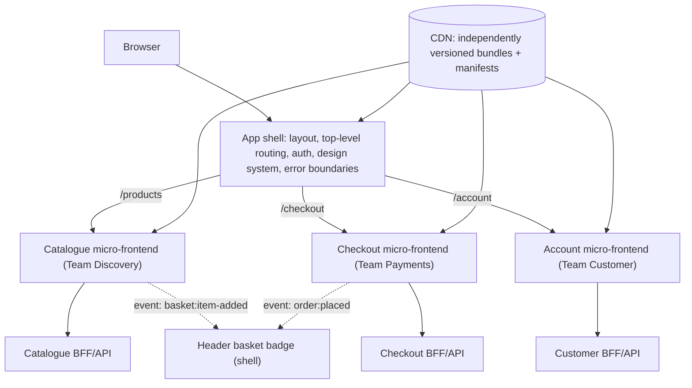

## TL;DR

- Micro-frontends split a web front end into **independently developed, tested and deployed parts owned by different teams**, composed into one user experience — the frontend equivalent of microservices.
- They solve an **organisational problem** (many teams blocked on one frontend codebase and release train), not a technical one. With few teams, a well-structured modular monolith or monorepo is simpler and faster.
- Composition options: **build-time** (packages), **server-side** (edge/server includes, fragments), **client-side runtime** (Module Federation, import maps, Web Components) and **route-based** splitting (separate apps per path).
- The costs are real: duplicated dependencies and larger bundles, inconsistent UX, cross-app communication, routing, testing and operational complexity. A strong **platform/shell team**, a **design system** and **contracts** are prerequisites.
- Draw boundaries along **business domains and user journeys** (bounded contexts), keep shared state minimal, and integrate via the URL, events and platform services.

## Core Concepts

### Why teams adopt them

- **Independent deployment:** each team ships on its own schedule without coordinating a monolithic release.
- **Team autonomy and ownership:** a team owns a vertical slice end to end (UI, BFF/API, data) for a business capability.
- **Incremental modernisation:** new parts can use newer frameworks while legacy parts are strangled gradually.
- **Isolation of failures and complexity:** one team's code can't break another's build.

### Composition approaches

| Approach | How | Strengths | Weaknesses |
|---|---|---|---|
| Build-time (npm packages in a monorepo) | Teams publish packages; one app bundles them | Simple, optimised bundle, type-safe | Not independently deployable — still one release |
| Route-based (separate SPAs per path) | `/checkout` served by one app, `/account` by another; shared shell or links | Strong isolation, simple mental model | Full page transitions; duplicated shells |
| Server-side composition | Server/edge assembles fragments (SSI, ESI, fragment services, framework-level composition) | Good performance and SEO, progressive enhancement | Infrastructure complexity, caching strategy |
| Client-side runtime (Module Federation, import maps, single-spa) | Shell loads remote modules at runtime | Independent deploys, SPA navigation, shared dependencies | Runtime coupling, version mismatches, complexity |
| Web Components | Teams expose custom elements | Framework-agnostic, encapsulation | SSR, styling and React interop considerations |
| iframes | Embed apps in frames | Strongest isolation (security, styles) | Poor UX integration, accessibility and performance issues |

### Module Federation

Webpack 5's Module Federation (and successors/implementations for Rspack and Vite — VERIFY: Module Federation 2.0 tooling) lets a **host** (shell) load **remote** modules from separately deployed builds at runtime via a manifest (`remoteEntry`). Dependencies such as React can be **shared** as singletons to avoid duplicate copies, with version negotiation.

```js
// shell (host) – module federation config (simplified)
new ModuleFederationPlugin({
  name: 'shell',
  remotes: {
    checkout: 'checkout@https://cdn.example.com/checkout/remoteEntry.js',
    account: 'account@https://cdn.example.com/account/remoteEntry.js',
  },
  shared: { react: { singleton: true, requiredVersion: '^19.0.0' }, 'react-dom': { singleton: true } },
});

// usage in the shell
const CheckoutApp = React.lazy(() => import('checkout/App'));
```

### Integration contracts

- **Routing:** the shell owns top-level routes; each micro-frontend owns its sub-routes.
- **Communication:** URL parameters, custom DOM events or a typed event bus for notifications (`basket:updated`), platform services for auth/session, feature flags and analytics — no shared mutable stores.
- **Design system:** shared, versioned components and tokens for consistent UX and accessibility.
- **Contracts are versioned and tested** (event schemas, mount/unmount APIs).

## How It Works



Each team deploys its bundle and updates the manifest; the shell picks up new versions without redeploying. Rollback means pointing the manifest back to the previous version.

## When to Use / Trade-offs

| Situation | Recommendation | Why |
|---|---|---|
| 1–3 teams on one product | Modular monolith / monorepo with clear boundaries | Micro-frontend overhead outweighs benefits |
| Many teams blocked by a shared release train | Micro-frontends aligned to domains | Independent deployment and ownership |
| Large legacy frontend to modernise | Route-based or runtime composition with strangler fig | Incremental migration |
| SEO-critical, performance-sensitive public pages | Server-side composition or route-based apps | Avoid heavy client-side runtime composition |
| Embedding third-party or untrusted apps | iframes | Security isolation |
| Need consistent UX across teams | Mandatory design system + shell | Prevents fragmentation |

## Common Pitfalls & Anti-patterns

- **Micro-frontends for a small team** — complexity with no organisational benefit.
- **Splitting by technical layer or component** (a "header team", "button team") rather than business capability.
- **Shared global state** between micro-frontends — hidden coupling and coordinated deploys.
- **Dependency chaos** — several React versions loaded, bloated bundles; or singleton sharing that forces lockstep upgrades.
- **Inconsistent UX and accessibility** without a shared design system.
- **Chatty cross-app communication** — a sign the boundaries are wrong.
- **No shell ownership** — routing, auth and error handling duplicated or conflicting.
- **Testing only in isolation** — integration breaks discovered in production.
- **Ignoring performance** — multiple runtimes and waterfalls of remote loads.

## Real-world Scenario

**Context:** An online travel company had 14 teams contributing to one React SPA. Releases happened weekly via a release train; a broken test in one area blocked everyone; build time was 40 minutes; teams waited days for releases.

**Decision:** Defined boundaries by user journey and domain — search, booking/checkout, account, trip management — each owned by a team with its BFF. Built a shell (layout, routing, auth session, error boundaries, analytics, feature flags) owned by a platform team, and a design system with tokens and accessible components. Used route-based composition for most areas, with Module Federation for a few cross-cutting widgets (header basket, search box). React was shared as a singleton with a policy of coordinated major upgrades twice a year. Contract tests covered events and mount APIs; synthetic end-to-end tests ran across composed apps post-deploy.

**Outcome:** Teams deployed independently multiple times per day; lead time fell from about a week to under a day; incidents from cross-team breakages dropped. Bundle size grew slightly; a performance budget per micro-frontend kept it in check.

**What I'd do differently:** Invest in the shell and design system before splitting the first app — early micro-frontends diverged visually and had to be reworked.

## Interview Questions

### What are micro-frontends, and what problem do they solve? {#what-are-micro-frontends}

**Level:** Foundation

**Model answer:**
Micro-frontends decompose a web application's front end into smaller applications, each owned by an autonomous team and **independently developed, tested and deployed**, then composed into one user experience.

The main problem they solve is **organisational scaling**: when many teams work on one frontend codebase, they block each other through shared builds, coordinated releases, merge conflicts and unclear ownership. Micro-frontends give teams end-to-end ownership of a business capability (often including its backend/BFF) and their own release cadence. They also enable incremental migration of legacy frontends.

They're not primarily a performance or code-quality technique, and they add significant complexity.

**What the interviewer is looking for:**
Definition and the organisational motivation, with awareness of costs.

**Follow-ups:**
- How do micro-frontends relate to microservices and team topologies?
- At what organisation size do they start to make sense?

**Red flags:**
- Presenting them as a default modern architecture.

### What ways are there to compose micro-frontends? {#composition-approaches}

**Level:** Foundation

**Model answer:**
- **Build-time integration:** micro-frontends published as packages and bundled by a host app. Simple and fast at runtime, but deployments are coupled — not truly independent.
- **Route-based composition:** each micro-frontend is a separate app serving certain URL paths; a shared shell or plain links connect them. Strong isolation; navigation between apps may reload pages.
- **Server-side/edge composition:** the server or CDN assembles HTML fragments from different services (includes, fragment composition). Good for SEO and performance.
- **Client-side runtime composition:** a shell loads remote bundles at runtime — Module Federation, import maps (with single-spa), or Web Components — enabling SPA navigation and independent deploys.
- **iframes:** strongest isolation, poor integration (accessibility, responsiveness, performance) — suitable for third-party or untrusted content.

Many systems combine approaches (route-based for most areas, runtime composition for shared widgets).

**What the interviewer is looking for:**
Each approach with strengths, weaknesses and combinations.

**Follow-ups:**
- Which approach suits an SEO-heavy e-commerce site?
- What are import maps?

**Red flags:**
- Knowing only Module Federation.

### When should you not use micro-frontends? {#when-not-micro-frontends}

**Level:** Foundation

**Model answer:**
- **Small number of teams** (roughly fewer than four or five on the same frontend): coordination costs are low, and micro-frontends add more complexity than they remove.
- **No clear domain boundaries:** if features cut across the whole UI, splitting creates chatty dependencies.
- **Strong need for a uniform, highly integrated UX** without the capacity to build a design system and shell.
- **Performance-critical experiences** where duplicated runtimes and extra requests are unacceptable.
- **Lack of platform capacity:** no team to own the shell, tooling, shared dependencies and standards.
- **The real problem is code quality or slow builds** — fix those with modularisation, monorepo tooling (affected builds, caching) and better CI.

Alternatives: a modular monolith frontend with enforced boundaries, a monorepo with independent packages and fast CI, or route-based separate apps only where needed.

**What the interviewer is looking for:**
Clear contra-indications and alternatives.

**Follow-ups:**
- How would you fix slow frontend releases without micro-frontends?
- What signals would make you revisit the decision?

**Red flags:**
- No situation in which they'd advise against them.

### What is Module Federation, and how does it work? {#module-federation}

**Level:** Foundation

**Model answer:**
Module Federation (introduced in webpack 5, now available for other bundlers such as Rspack and via plugins for Vite) lets separately built and deployed applications **share and load code at runtime**:
- A **remote** exposes modules (e.g. `checkout/App`) and publishes a manifest/entry file.
- A **host** (shell) declares remotes and imports their modules dynamically, as if they were local async imports.
- **Shared dependencies** (React, design system) can be configured as singletons with version ranges, so only one copy loads when compatible; incompatible versions can fall back to separate copies (or fail, if strict).

Benefits: independent deployments with SPA-style integration and dependency sharing. Risks: runtime failures if a remote is unavailable or incompatible (handle with error boundaries and fallbacks), version negotiation complexity, harder debugging and type sharing (needs generated types).

**What the interviewer is looking for:**
Host/remote model, runtime loading, shared singletons and risks.

**Follow-ups:**
- What happens if a remote's entry fails to load?
- How do you share TypeScript types across federated modules?

**Red flags:**
- Thinking federation removes the need for compatibility management.

### How do you manage shared dependencies like React across micro-frontends? {#shared-dependencies}

**Level:** Senior

**Model answer:**
Two tensions: **bundle size/consistency** (share one copy) vs **independence** (each team upgrades on its own schedule).

Options:
- **Shared singletons** (Module Federation `shared`, import maps) for React, the design system and core libraries — one copy loaded; requires compatible versions across teams. Agree a **version policy**: e.g. shell defines the React major; teams upgrade within windows; minor/patch updates flexible.
- **Isolated dependencies** per micro-frontend (each bundles its own) — maximum independence at the cost of size and potential conflicts (multiple React roots are fine; mixing React instances within one tree is not).
- **Platform-provided libraries** exposed by the shell as a stable API (design system, auth client).

Practices: automated dependency update PRs, compatibility tests against the shell, monitoring bundle sizes per micro-frontend, and coordinated major upgrades planned by the platform team.

**What the interviewer is looking for:**
The trade-off, concrete mechanisms and a versioning policy.

**Follow-ups:**
- How would you upgrade from React 18 to 19 across 12 micro-frontends?
- What breaks if two React copies end up in one component tree?

**Red flags:**
- No version policy.

### How do you keep a consistent user experience across micro-frontends? {#design-consistency}

**Level:** Senior

**Model answer:**
- **Shared design system** (tokens, components, patterns, accessibility built in) as a versioned package or federated module, owned by a dedicated team with contribution processes.
- **Shell-owned global elements:** header, navigation, footer, notifications/toasts, error pages, consent banners, loading patterns — implemented once.
- **Design tokens** for theming so updates propagate.
- **UX guidelines** documented with examples (copy tone, forms, empty states, error handling).
- **Visual regression and accessibility testing** of composed pages.
- **Design reviews across teams** and a design guild.
- **Version drift monitoring:** dashboards of design-system versions in use; deprecation policies.

**What the interviewer is looking for:**
Design system ownership, shell responsibilities, tokens, guidelines and testing across apps.

**Follow-ups:**
- How do you roll out a brand refresh across 15 micro-frontends?
- Should the design system be a federated module or an npm package?

**Red flags:**
- Each team building its own components.

### How should routing work across micro-frontends? {#routing}

**Level:** Senior

**Model answer:**
- **The shell owns top-level routing:** maps path prefixes to micro-frontends (`/search/*` → search, `/checkout/*` → checkout), handles 404s and redirects.
- **Each micro-frontend owns its sub-routes** under its prefix, using its own router instance (with the shell providing a base path) or the shell's routing API.
- **Navigation across micro-frontends** goes through the shell's navigation API or standard links, so history and analytics stay consistent; avoid micro-frontends manipulating history directly in conflicting ways.
- **Deep links and SSR:** routes must work on full page loads (server knows which app to render) as well as client navigation.
- **Lazy loading** micro-frontends per route; prefetch likely next ones.
- **Contracts:** a route registry (configuration) maintained by the platform; changes reviewed to avoid collisions.

**What the interviewer is looking for:**
Shell vs app routing responsibilities, cross-app navigation, deep links and lazy loading.

**Follow-ups:**
- How do you handle a route that shows content from two micro-frontends?
- How do you avoid route collisions?

**Red flags:**
- Several routers fighting over `window.history`.

### How should micro-frontends communicate with each other? {#communication}

**Level:** Senior

**Model answer:**
Minimise communication — frequent communication suggests boundaries are wrong. When needed:
- **URL as shared state:** parameters and routes (product id, filters) — shareable and decoupled.
- **Events:** custom DOM events or a lightweight typed event bus for notifications ("basket:item-added" with a versioned payload schema); fire-and-forget, consumers decide what to do.
- **Platform services from the shell:** auth/session, user profile, feature flags, analytics, i18n — stable APIs injected at mount time.
- **Backend as integration point:** each micro-frontend reads authoritative data from its own BFF/APIs rather than passing data around the browser (e.g. the header basket badge queries the basket API after an event).
- **Avoid:** shared global stores, direct imports of another team's internals, window globals without contracts.

Version and test contracts (event schemas, mount API), and document them in a catalogue.

**What the interviewer is looking for:**
Minimal, contract-based communication via URL, events, platform services and backends.

**Follow-ups:**
- How would the header know the basket count changed?
- How do you version event payloads?

**Red flags:**
- A shared Redux store across apps.

### What are the performance concerns with micro-frontends, and how do you address them? {#mfe-performance}

**Level:** Senior

**Model answer:**
Concerns:
- **Duplicate dependencies** (multiple framework copies, utility libraries) inflating bundles.
- **Loading waterfalls:** shell → manifest → remote entry → chunks → data.
- **Multiple runtimes and hydration** competing for the main thread (hurting INP).
- **Inconsistent caching** and many small requests.
- **Layout shifts** as micro-frontends mount at different times.

Mitigations:
- Shared singletons for heavy libraries; one framework per page where possible.
- Server-side or edge composition for initial render; streaming.
- Preload/prefetch remote entries for likely routes; HTTP/2/3; long-term caching of hashed bundles.
- **Performance budgets per micro-frontend** enforced in CI; RUM attribution by micro-frontend.
- Reserved space/skeletons to avoid CLS; error boundaries and timeouts so a slow remote doesn't block the page.
- Avoid loading micro-frontends not needed for the current view.

**What the interviewer is looking for:**
Specific performance risks and concrete mitigations including budgets and attribution.

**Follow-ups:**
- How would you attribute an INP problem to a specific micro-frontend?
- Server composition vs client composition for performance?

**Red flags:**
- Ignoring bundle duplication.

### How do you test and deploy micro-frontends safely? {#mfe-testing-deployment}

**Level:** Senior

**Model answer:**
**Testing:**
- Unit and component tests within each micro-frontend.
- **Contract tests** for integration points: mount/unmount API, props from the shell, event schemas, shared dependency versions.
- **Integration tests** of each micro-frontend inside a test shell (or the real shell in a preview environment).
- **End-to-end smoke tests** of critical journeys across composed apps, run post-deploy and as synthetic monitors.

**Deployment:**
- Each micro-frontend deploys independently to a CDN with **immutable versioned bundles**; a **manifest/registry** points the shell to the active version per environment.
- **Progressive rollout:** canary by percentage or user segment (manifest selects version), with automated health checks (errors, Web Vitals) and instant rollback by switching the manifest.
- **Preview environments** per PR that compose the changed micro-frontend with current production versions of others.
- **Compatibility gates:** a deploy fails if it breaks contracts or requires an unavailable shared dependency version.

**What the interviewer is looking for:**
Layered testing with contract tests, independent versioned deploys via manifests, progressive rollout and previews.

**Follow-ups:**
- How do you roll back a single micro-frontend?
- How do you test a change in the shell against 15 micro-frontends?

**Red flags:**
- Independent deploys with no contract tests or rollback.

### How do you decide the boundaries of micro-frontends? {#mfe-boundaries}

**Level:** Architect

**Model answer:**
Use the same thinking as service boundaries:
- **Business domains and user journeys:** align micro-frontends with bounded contexts and capabilities (search, product details, checkout, account), owned by stream-aligned teams that also own the related BFF/APIs.
- **Team topology and cognitive load:** one team per micro-frontend (a team may own several); boundaries reflect who changes what together.
- **Change coupling:** analyse which UI areas change together (git history, feature backlogs); keep them in one micro-frontend.
- **Page vs widget level:** prefer **page/route-level** boundaries (clear ownership, fewer integration points); use widget-level composition sparingly for genuinely shared, independently owned pieces (header basket, search box).
- **Avoid** splitting by technical layer or generic components.
- **Validate** with user journeys: a journey crossing many micro-frontends with lots of shared state suggests wrong cuts.

Document in a context map showing micro-frontends, owners and integration contracts.

**What the interviewer is looking for:**
Domain/journey alignment, team ownership, change coupling, page-level preference and validation.

**Follow-ups:**
- Who owns the product page if three teams contribute content to it?
- How do boundaries evolve as the organisation changes?

**Red flags:**
- A "components team" micro-frontend.

### How would you migrate a large monolithic frontend to micro-frontends? {#mfe-migration}

**Level:** Architect

**Model answer:**
1. **Confirm the need** (team scaling and release coupling) and set goals (independent deploys, lead time).
2. **Prepare foundations:** design system extraction, a shell (or turn the monolith into the initial shell) with routing, auth, error boundaries, analytics; CI/CD and hosting for independent bundles; contracts.
3. **Modularise inside the monolith first** (feature folders with enforced boundaries); this reveals coupling cheaply.
4. **Strangler fig:** extract one area with clear boundaries and an engaged team (often a new feature or a self-contained route) into a micro-frontend; route traffic through the shell; keep the rest in the monolith.
5. **Repeat** per domain, removing code from the monolith as areas move; measure outcomes after each extraction.
6. **Govern shared dependencies and design** from the start.
7. **Stop** when the remaining monolith is small and stable — it can remain one "legacy" micro-frontend.

**What the interviewer is looking for:**
Justification, foundations first, internal modularisation, strangler approach and measured progression.

**Follow-ups:**
- How do you handle shared state that lives in the monolith's global store?
- How long would you expect such a migration to take?

**Red flags:**
- Rewriting everything into micro-frontends at once.

### What does the platform or shell team own in a micro-frontend architecture? {#shell-platform}

**Level:** Architect

**Model answer:**
- **The shell application:** layout, top-level routing, global navigation, authentication/session, error boundaries and fallback pages, loading strategies, accessibility of global elements.
- **Integration infrastructure:** micro-frontend registry/manifests, composition mechanism (Module Federation config, import maps, server composition), version management and rollout tooling.
- **Shared platform services:** auth client, feature flags, analytics/telemetry SDK, i18n, configuration — with stable, versioned APIs.
- **Developer experience:** templates for new micro-frontends, local development setup (run one app against deployed others), preview environments, documentation.
- **Standards and guardrails:** dependency policies, performance budgets, security headers/CSP, accessibility checks, contract tests.
- **Observability:** RUM and error tracking with attribution per micro-frontend; release dashboards.
- **Coordination:** shared dependency upgrades, design-system integration (with the design system team), incident support.

The platform team treats product teams as customers; the shell should remain thin — no business logic.

**What the interviewer is looking for:**
Clear platform responsibilities across shell, infrastructure, services, DX, standards and observability, with a thin-shell principle.

**Follow-ups:**
- How do you stop the shell accumulating business features?
- How large should the platform team be?

**Red flags:**
- No dedicated owner for the shell.

### How do you govern micro-frontends across many teams without killing autonomy? {#mfe-governance}

**Level:** Architect

**Model answer:**
- **Mandatory, minimal contracts:** mount API, routing registration, event schemas, security requirements (CSP, auth handling), accessibility baseline, performance budgets, telemetry.
- **Paved road:** templates and shared tooling that make compliance the default.
- **Guardrails automated in CI:** bundle size budgets, dependency policy checks (allowed framework versions), contract tests, accessibility checks.
- **Autonomy inside the boundary:** teams choose internal structure, state management and libraries within the policy.
- **Technology radar** for frameworks; deviations via ADR (e.g. a team using a different framework must still meet contracts and budgets).
- **Design governance** via the design system and UX reviews.
- **Visibility:** dashboards of versions, budgets, errors and Web Vitals per micro-frontend; regular platform forums.

**What the interviewer is looking for:**
A small set of enforced contracts, automation, paved roads and freedom inside boundaries.

**Follow-ups:**
- A team wants to use Svelte in a React-based platform. What do you require?
- How do you handle a team consistently exceeding its performance budget?

**Red flags:**
- Either no standards or central approval for every change.

### What alternatives to micro-frontends would you consider? {#mfe-alternatives}

**Level:** Architect

**Model answer:**
- **Modular monolith frontend:** one app with strong internal module boundaries (feature folders, enforced dependency rules, ownership via CODEOWNERS). One build and release, but clean separation.
- **Monorepo with independent packages and fast CI:** Nx/Turborepo affected builds, remote caching, per-package tests — solves slow builds and ownership without runtime composition.
- **Continuous deployment of the monolith:** trunk-based development, feature flags and fast pipelines remove the release-train bottleneck — often the actual pain.
- **Route-based separate apps** only for clearly separate products (marketing site, admin console, customer app).
- **Server-driven UI** for content-heavy areas where many teams contribute configuration.
- **Better team topology:** fewer, larger stream-aligned areas or a platform team improving DX.

Choose micro-frontends when independent deployment of UI parts by many teams is clearly the bottleneck and these alternatives aren't enough.

**What the interviewer is looking for:**
Practical alternatives addressing the same pains with less complexity.

**Follow-ups:**
- How would continuous deployment change the case for micro-frontends?
- What tooling makes a large frontend monorepo fast?

**Red flags:**
- Unaware of alternatives.

## Cheat Sheet

- **Micro-frontends** — independently deployable frontend parts owned by different teams.
- **Organisational solution** — they solve team scaling and release coupling, not code quality.
- **Composition types** — build-time, route-based, server/edge, client runtime, iframes.
- **Module Federation** — hosts load remote modules at runtime; shared singletons for React and design system.
- **Shell** — thin app owning layout, routing, auth, global UI, error boundaries.
- **Boundaries** — business domains and user journeys; prefer page-level over widget-level.
- **Communication** — URL, typed events, platform services, backends; no shared stores.
- **Dependency policy** — shared singletons need coordinated major upgrades.
- **Design system** — prerequisite for consistent UX and accessibility.
- **Manifest-based deploys** — immutable bundles; switch manifest to roll out or roll back.
- **Contract tests** — mount API, events, shared versions.
- **Performance budgets** — per micro-frontend, with RUM attribution.
- **When not to** — few teams, unclear boundaries, no platform capacity.
- **Alternatives** — modular monolith, fast monorepo CI, continuous deployment.

## Further Reading

- [Micro Frontends (Cam Jackson, martinfowler.com)](https://martinfowler.com/articles/micro-frontends.html) — the widely cited introduction with integration approaches.
- [micro-frontends.org (Michael Geers)](https://micro-frontends.org/) — techniques and principles for micro-frontends.
- [webpack: Module Federation](https://webpack.js.org/concepts/module-federation/) — concepts and configuration.
- [Module Federation documentation](https://module-federation.io/) — VERIFY: link path; Module Federation 2.0 and bundler support.
- [single-spa documentation](https://single-spa.js.org/docs/getting-started-overview) — runtime orchestration of micro-frontends.
- [Team Topologies](https://teamtopologies.com/key-concepts) — aligning teams and boundaries.
