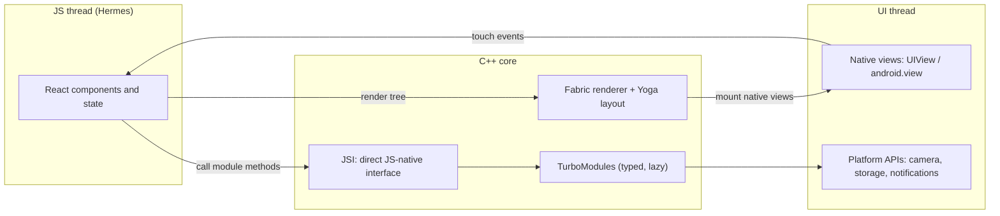

## TL;DR

- React Native lets you build **truly native iOS and Android apps with React and TypeScript**: components render to native views, not a web view, and one codebase targets both platforms (and more via out-of-tree platforms).
- The **New Architecture** (JSI, Fabric renderer, TurboModules, bridgeless mode) is the default in recent versions, replacing the asynchronous JSON bridge with direct, synchronous-capable calls between JavaScript and native code.
- **Expo** is the recommended way to start: managed native configuration, a rich SDK, cloud builds (EAS) and over-the-air updates — while still allowing custom native code.
- Performance depends on **keeping the JS thread free**, efficient lists (FlashList/FlatList), animations on the UI thread (Reanimated), minimal re-renders and the Hermes engine.
- Mobile releases are different from the web: app store reviews, staged rollouts, **OTA updates for JS changes**, backward-compatible APIs for old app versions and crash monitoring.

## Core Concepts

### How it works

- Your React components describe UI with primitives like `View`, `Text`, `Image`, `Pressable`, `ScrollView`; React Native maps them to native views (`UIView`, Android `View`).
- JavaScript runs on a JS engine — **Hermes** by default (optimised for mobile: bytecode precompilation, fast startup, lower memory).
- Threads: the **JS thread** (React logic), the **UI/main thread** (native rendering and gestures), and background threads for layout (Yoga, a Flexbox implementation in C++).
- **New Architecture:**
  - **JSI (JavaScript Interface):** C++ API letting JS hold references to native objects and call them directly — no JSON serialisation bridge.
  - **Fabric:** the new renderer with a C++ core, enabling concurrent React features and synchronous layout reads when needed.
  - **TurboModules:** lazily loaded, type-safe native modules generated from typed specs (Codegen).
  - **Bridgeless mode:** removes the legacy bridge entirely.

### Expo

Expo is a framework and platform around React Native: the Expo SDK (camera, notifications, file system, secure storage…), **Expo Router** (file-based navigation), **config plugins** and **prebuild** to generate native projects from configuration, **EAS Build** (cloud builds and signing), **EAS Submit** and **EAS Update** (OTA updates). Custom native code is supported through development builds and native modules.

### Styling and layout

- Styles are JavaScript objects (`StyleSheet.create`) with a subset of CSS; layout uses **Flexbox** (default `flexDirection: 'column'`).
- Dimensions are density-independent points; handle different screen sizes, notches and safe areas (`react-native-safe-area-context`), dynamic type/font scaling, dark mode.
- Platform differences via `Platform.OS`, `.ios.tsx`/`.android.tsx` files, and native look-and-feel expectations (navigation patterns, back button on Android).

```tsx
import { FlashList } from '@shopify/flash-list';
import { Pressable, StyleSheet, Text, View } from 'react-native';

export function OrdersScreen({ orders, onOpen }: { orders: Order[]; onOpen: (id: string) => void }) {
  return (
    <FlashList
      data={orders}
      keyExtractor={(o) => o.id}
      estimatedItemSize={72}                  // recycling list for long data sets
      renderItem={({ item }) => (
        <Pressable onPress={() => onOpen(item.id)} accessibilityRole="button" style={styles.row}>
          <Text style={styles.title}>Order {item.reference}</Text>
          <Text style={styles.meta}>{item.status} · {item.totalFormatted}</Text>
        </Pressable>
      )}
    />
  );
}

const styles = StyleSheet.create({
  row: { paddingVertical: 12, paddingHorizontal: 16, borderBottomWidth: StyleSheet.hairlineWidth },
  title: { fontSize: 16, fontWeight: '600' },
  meta: { marginTop: 4, opacity: 0.7 },
});
```

### Navigation

React Navigation (stack, tab, drawer navigators with native stack for performance) or **Expo Router** (file-based, built on React Navigation, with deep linking and typed routes). Deep links and universal/app links connect URLs and notifications to screens.

### Native capabilities

Use existing libraries (Expo SDK, community modules) where possible. Write native modules (Swift/Kotlin) with TurboModules or the **Expo Modules API** for platform features not covered, keeping a typed interface in TypeScript.

### Data, storage and offline

- Server state with TanStack Query (with persistence) or similar; offline-first apps use local databases (SQLite via `expo-sqlite`, WatermelonDB, sync engines).
- Small key-value data: MMKV or AsyncStorage; secrets in **Keychain/Keystore** (`expo-secure-store`), never AsyncStorage.
- Handle connectivity changes, background fetch limits and app lifecycle states.

## How It Works



## When to Use / Trade-offs

| Option | Use when | Avoid when | Trade-off |
|---|---|---|---|
| React Native (with Expo) | Product apps on iOS and Android, React/TS team, shared logic with web | Heavy 3D/games, very platform-specific UX, extreme performance needs | One codebase and fast iteration vs some native expertise still needed |
| Fully native (Swift/Kotlin) | Platform-specific UX, deep OS integration, performance-critical apps | Small teams needing both platforms quickly | Best platform fidelity vs two codebases |
| Flutter | Pixel-consistent custom UI across platforms, Dart-friendly team | Teams invested in React/TS and web code sharing | Consistent rendering vs separate ecosystem |
| Progressive Web App | Content and simple tools, no store distribution needed | Deep device APIs, iOS push and background limitations matter | Single web codebase vs platform limits |
| Brownfield RN in native app | Adding cross-platform features to existing native apps | Small apps where full rewrite is simpler | Incremental adoption vs integration complexity |

## Common Pitfalls & Anti-patterns

- **Blocking the JS thread** with heavy computation or large JSON parsing — janky gestures and animations.
- **`ScrollView` for long lists** — renders everything; use FlashList/FlatList.
- **JS-driven animations** that stutter — use Reanimated worklets on the UI thread or native driver.
- **Ignoring platform conventions** — iOS-only UX patterns on Android, missing back-button handling.
- **Secrets in AsyncStorage or the JS bundle** — bundles can be extracted.
- **Breaking API changes** that crash old app versions still in use.
- **OTA updates that change native-dependent code** without a compatible native build (runtime version mismatch).
- **Untested on real low-end Android devices.**
- **Too many unmaintained native dependencies** blocking React Native upgrades.

## Real-world Scenario

**Context:** A retailer maintained separate iOS and Android apps with two small teams; features shipped months apart and the apps diverged. Web was already React/TypeScript.

**Decision:** Rebuilt the app in React Native with Expo (New Architecture enabled), Expo Router for navigation and deep links, TanStack Query for server state with offline persistence, shared TypeScript domain logic and API clients with the web app in a monorepo, and a design system with platform-adapted components. Native modules were written for a barcode-scanning SDK. Releases used EAS Build with staged store rollouts and EAS Update for JS-only fixes, with runtime versions preventing incompatible OTA updates. Crash and performance monitoring tracked app start time and frame drops.

**Outcome:** Feature parity across platforms; release cadence went from monthly per platform to weekly for both; several critical bug fixes shipped via OTA within hours; app store ratings improved.

**What I'd do differently:** Budget for native expertise from the start — the barcode SDK integration and an Android memory issue needed native skills the team initially lacked.

## Interview Questions

### How does React Native render native UI from JavaScript? {#how-react-native-works}

**Level:** Foundation

**Model answer:**
You write React components using React Native primitives (`View`, `Text`, `Image`, `Pressable`). React computes a component tree on the **JS thread** (running on Hermes). The **renderer** (Fabric in the New Architecture) turns that tree into a shadow tree, computes layout with **Yoga** (a Flexbox engine), and mounts real **native views** on the UI thread — `UIView` on iOS, Android `View`s. User input events flow back to JavaScript handlers.

Native capabilities (camera, storage) are accessed through native modules. In the New Architecture, **JSI** lets JavaScript call native code directly via C++ instead of sending serialised messages over the old asynchronous bridge.

So it's not a web view: the result looks and feels native, though it's driven by JavaScript logic.

**What the interviewer is looking for:**
Threads, renderer, native views, native modules and the difference from web views.

**Follow-ups:**
- What runs on the UI thread vs the JS thread?
- What is Hermes?

**Red flags:**
- "React Native runs a website inside the app."

### How do you choose between React Native, native development and Flutter? {#rn-vs-alternatives}

**Level:** Foundation

**Model answer:**
- **React Native:** one TypeScript/React codebase for iOS and Android with native UI; strong fit for teams with React web skills, code sharing with web (logic, API clients, sometimes UI via React Native Web), fast iteration and OTA updates. Still needs some native knowledge for integrations and debugging.
- **Native (Swift/SwiftUI, Kotlin/Jetpack Compose):** best platform fidelity, immediate access to new OS APIs, top performance for demanding apps; requires two codebases and teams.
- **Flutter:** Dart with its own rendering engine — consistent pixel-perfect UI across platforms and good performance; separate ecosystem from web React; less native look-and-feel by default (custom rendering).

Decide on: team skills, need for platform-specific UX, performance and device integration, code sharing with web, time to market and long-term maintenance.

**What the interviewer is looking for:**
Balanced comparison driven by team, product and platform needs.

**Follow-ups:**
- When would you go fully native?
- What can be shared between a React web app and a React Native app?

**Red flags:**
- Dogmatic "always cross-platform" or "always native".

### What is Expo, and why is it the recommended starting point? {#expo}

**Level:** Foundation

**Model answer:**
Expo is a framework and set of services around React Native:
- **Expo SDK:** well-maintained modules for device features (camera, location, notifications, secure storage, file system).
- **Expo Router:** file-based navigation with deep linking.
- **Prebuild and config plugins:** generate and configure native iOS/Android projects from app config, so native project files don't need to be hand-maintained.
- **Development builds:** include custom native code while keeping Expo's tooling.
- **EAS:** cloud builds and signing (EAS Build), store submission (EAS Submit), over-the-air updates (EAS Update).

The React Native docs recommend using a framework like Expo for new apps. Older objections ("you can't use custom native code") no longer apply — development builds and the Expo Modules API support native code.

**What the interviewer is looking for:**
What Expo provides and awareness that it supports custom native code.

**Follow-ups:**
- What does `expo prebuild` do?
- When might you not use Expo?

**Red flags:**
- Thinking Expo apps can't include native modules.

### How do styling and layout work in React Native? {#styling-layout}

**Level:** Foundation

**Model answer:**
- **Styles** are JS objects (`StyleSheet.create`) using a CSS-like subset with camelCase properties; no cascade or selectors — styles apply per component (composition via arrays).
- **Layout** uses **Flexbox** via Yoga, with `flexDirection: 'column'` by default; dimensions are density-independent points.
- **Responsive design:** `useWindowDimensions`, percentage/flex layouts, different layouts for tablets; **safe areas** for notches and home indicators.
- **Text:** must be inside `<Text>`; support dynamic type/font scaling for accessibility.
- **Platform specifics:** `Platform.select`, platform-specific files, platform shadows/elevation, Android back behaviour, iOS gestures.
- **Theming and dark mode:** `useColorScheme`, design tokens.
- Libraries (NativeWind/Tailwind-style, Tamagui, Restyle, Unistyles) add theming and utility styles — choose one for consistency.

**What the interviewer is looking for:**
Styling model differences from web, Flexbox defaults, responsiveness, safe areas, accessibility and platform nuances.

**Follow-ups:**
- How do you handle the iPhone notch and Android navigation bar?
- How would you share design tokens with the web app?

**Red flags:**
- Expecting CSS cascade and selectors to work.

### What is the React Native New Architecture, and why does it matter? {#new-architecture}

**Level:** Senior

**Model answer:**
The New Architecture replaces the legacy asynchronous **bridge** (which serialised messages as JSON between JS and native) with:
- **JSI:** a C++ interface letting JavaScript hold references to native (C++) objects and call methods directly, including synchronously when needed.
- **Fabric:** a new renderer with a shared C++ core — enables React concurrent features (transitions, Suspense), synchronous layout measurement, and better consistency across platforms.
- **TurboModules:** native modules loaded lazily and called through JSI with type-safe interfaces generated by **Codegen** from typed specs.
- **Bridgeless mode:** removes the bridge entirely.

Benefits: lower overhead for native calls, faster startup (lazy modules), smoother interactions, modern React features, type safety across the JS/native boundary. It's the default in recent React Native versions (enabled by default from 0.76, and from 0.82 the legacy architecture can no longer be turned back on). Migration considerations: third-party libraries must support it (most popular ones do; check compatibility), and custom native modules need updating to TurboModules or the Expo Modules API.

**What the interviewer is looking for:**
JSI, Fabric, TurboModules, bridgeless, benefits and migration considerations.

**Follow-ups:**
- How would you check if your dependencies support the New Architecture?
- What does Codegen generate?

**Red flags:**
- Still describing the bridge as the current architecture.

### How do you optimise React Native app performance? {#rn-performance}

**Level:** Senior

**Model answer:**
- **Measure:** startup time, frame rates (JS and UI thread FPS), memory, with Flipper alternatives/React Native DevTools, Perfetto/Instruments, and production monitoring (Sentry, Firebase Performance).
- **Startup:** Hermes bytecode, lazy-loading screens and modules (TurboModules are lazy), minimise work before first render, optimise splash-to-content time.
- **Lists:** FlashList or properly tuned FlatList (`keyExtractor`, `getItemLayout`, memoised rows, avoid inline heavy work), never ScrollView for long lists.
- **Re-renders:** colocated state, memoisation where profiled, selector-based stores, stable callbacks.
- **Animations and gestures:** Reanimated worklets and Gesture Handler run on the UI thread, so they stay smooth when the JS thread is busy.
- **Images:** properly sized and cached (expo-image), avoid huge images in lists.
- **Keep the JS thread free:** move heavy work to native modules or background threads/worklets; batch state updates.
- **Bundle and dependencies:** remove unused libraries; avoid heavy polyfills.
- **Test on low-end Android devices.**

**What the interviewer is looking for:**
Measurement, startup, lists, re-renders, UI-thread animations, images and real-device testing.

**Follow-ups:**
- Why do JS-driven animations stutter?
- How do you diagnose a memory leak in an RN app?

**Red flags:**
- Optimising without measuring on real devices.

### How do you handle navigation and deep linking? {#navigation}

**Level:** Senior

**Model answer:**
- **Libraries:** React Navigation (native stack for platform-native transitions, tabs, drawers) or **Expo Router**, which adds file-based routes, automatic deep linking and typed routes on top of React Navigation.
- **Structure:** root stacks for auth flows vs app flows (conditionally rendered based on session), tab navigators for main sections, modals for focused tasks.
- **Deep linking:** URL schemes and **universal links (iOS) / App Links (Android)** mapped to routes; handle links when the app is cold-started, backgrounded or not logged in (store intent, redirect after login).
- **Notifications** open specific screens via deep links.
- **State persistence:** restore navigation state carefully after app restarts.
- **Platform behaviour:** Android hardware back button, iOS swipe-back gestures.
- **Accessibility:** screen titles announced, focus moved appropriately.

**What the interviewer is looking for:**
Library choices, navigation structure, deep and universal links with auth handling and platform behaviour.

**Follow-ups:**
- How do you handle a deep link to a screen that requires login?
- How do you test deep links?

**Red flags:**
- No plan for cold-start deep links.

### When and how do you write native modules? {#native-modules}

**Level:** Senior

**Model answer:**
**When:** a platform feature or third-party native SDK isn't available through Expo SDK or a maintained community library, or performance-critical work must run natively (image processing, cryptography, Bluetooth, payment terminals, proprietary SDKs).

**How:**
- Prefer the **Expo Modules API** (Swift/Kotlin with a concise DSL, works with and without Expo) or **TurboModules** with Codegen in the New Architecture.
- Define a **typed TypeScript interface** as the contract; keep the native surface small and focused.
- Handle threading (don't block the main thread), lifecycle (app background/foreground), permissions and errors (reject promises with meaningful codes).
- For native UI, use native components (Fabric components / Expo views).
- Test on both platforms; document setup steps; include config plugins so prebuild configures native projects automatically.
- Track the maintenance cost — each native module must be updated with React Native and OS upgrades.

**What the interviewer is looking for:**
Justification, modern APIs, typed contracts, threading and lifecycle, config plugins and maintenance awareness.

**Follow-ups:**
- How do you expose events from native to JS?
- How does a config plugin help?

**Red flags:**
- Writing native modules for things the SDK already provides.

### How do you implement offline support and local storage in a mobile app? {#offline-storage}

**Level:** Senior

**Model answer:**
- **Classify data:** reference data (cache), user data (sync), drafts (local first), secrets (secure storage).
- **Storage options:**
  - **Secure storage** (Keychain/Keystore via `expo-secure-store`) for tokens and credentials.
  - **Key-value** (MMKV, AsyncStorage) for small preferences and flags.
  - **SQLite** (`expo-sqlite`, WatermelonDB, op-sqlite) for structured data and queries; sync engines for offline-first.
  - **File system** for media and documents.
- **Server state caching** with TanStack Query persistence for read-heavy offline viewing.
- **Writes offline:** queue mutations with ids and retries; sync when connectivity returns; resolve conflicts (last-writer-wins, server-authoritative or CRDTs).
- **Connectivity awareness:** NetInfo for status, but treat requests as able to fail anyway.
- **Background sync limits** on iOS/Android — sync on app foreground and with background tasks where permitted.
- **Migrations and encryption** for local databases; clear data on logout.

**What the interviewer is looking for:**
Data classification, appropriate storage per type, offline write queues, conflicts, platform limits and security.

**Follow-ups:**
- Where would you store a refresh token?
- How do you migrate a local SQLite schema in an app update?

**Red flags:**
- Tokens in AsyncStorage.

### How do you test a React Native app? {#rn-testing}

**Level:** Senior

**Model answer:**
- **Unit tests** with Jest for logic, hooks and utilities.
- **Component tests** with React Native Testing Library — query by role/label/text, simulate user events, assert on output; mock native modules at the boundary and the network with MSW.
- **End-to-end tests** on simulators/emulators and real devices with **Detox** (grey-box, synchronises with the app) or **Maestro** (YAML flows, simple and robust) for critical journeys: login, checkout, deep links, push-notification flows.
- **Device coverage:** cloud device farms for a matrix of OS versions and low-end Android devices.
- **Visual and accessibility checks:** screenshots for key screens; accessibility labels and roles verified in component tests; manual VoiceOver/TalkBack testing.
- **Release testing:** internal tracks (TestFlight, Play internal testing), staged rollouts with crash monitoring.

**What the interviewer is looking for:**
Layered testing with RN-specific tools, device coverage and release validation.

**Follow-ups:**
- Detox vs Maestro — how do you choose?
- How do you test push notifications?

**Red flags:**
- Only manual testing on one developer's phone.

### How do you design the release strategy, including OTA updates? {#ota-releases}

**Level:** Architect

**Model answer:**
- **Native binary releases** through the stores on a regular cadence (e.g. weekly or fortnightly release trains), built in CI (EAS Build/Fastlane), signed securely, with internal testing tracks and **staged rollouts** (phased release on iOS, percentage rollout on Google Play). Monitor crash-free sessions and key metrics; halt rollouts on regressions.
- **Over-the-air updates** (EAS Update or similar) for JavaScript and asset changes: fast bug fixes and small improvements without store review. Rules:
  - Use **runtime versions** so OTA updates only reach binaries with compatible native code.
  - Comply with store policies (no changing the app's primary purpose or adding significant new features that bypass review).
  - Roll out OTA updates gradually with channels/branches and support rollback.
- **Backward compatibility:** APIs must support older app versions; track version adoption; minimum supported version with forced-upgrade screens for critical issues.
- **Feature flags/remote config** to enable features independently of releases and kill broken features.
- **Monitoring:** crash reporting with source maps, performance metrics, release health dashboards.

**What the interviewer is looking for:**
Release trains, staged rollouts, OTA with runtime compatibility and policy awareness, backward-compatible APIs and flags.

**Follow-ups:**
- What happens if an OTA update requires a newer native module?
- How do you force users onto a new version safely?

**Red flags:**
- Shipping native changes via OTA.

### How do you share code between a React web app and a React Native app? {#code-sharing}

**Level:** Architect

**Model answer:**
In a monorepo (pnpm/yarn workspaces with Turborepo/Nx):
- **Shared freely:** TypeScript types, domain logic, validation schemas (Zod), API clients (generated from OpenAPI), state management and data-fetching hooks, utilities, i18n strings, design tokens.
- **Shared selectively:** UI components via **React Native Web** or cross-platform UI libraries (Tamagui, NativeWind, Expo Router's web support) — good for apps with similar UIs; trade-offs in web bundle size, SEO and platform-native feel.
- **Platform-specific:** navigation, platform integrations (push notifications, payments), screens with platform-specific UX; use `.native.tsx`/`.web.tsx` files for divergent implementations behind shared interfaces.
- **Architecture:** a shared "core" package with no platform dependencies; app packages for web and mobile; clear boundaries enforced by lint rules.
- **Teams and releases:** shared code is versioned with the monorepo; changes tested on both platforms in CI.

Aim for sharing logic broadly and UI where product experiences genuinely align.

**What the interviewer is looking for:**
What to share at each layer, React Native Web trade-offs, monorepo structure and boundaries.

**Follow-ups:**
- Would you use React Native Web for an SEO-heavy marketing site?
- How do you prevent web-only dependencies leaking into the mobile bundle?

**Red flags:**
- Forcing identical UI on web and mobile regardless of platform conventions.

### What are the key security considerations for React Native apps? {#mobile-security}

**Level:** Architect

**Model answer:**
- **Assume the client is hostile:** JS bundles and binaries can be extracted and inspected; never embed secrets (API keys with privileges) — use a backend.
- **Secure storage** for tokens (Keychain/Keystore); short-lived access tokens and refresh token rotation; OAuth with PKCE via the system browser (AppAuth/Expo AuthSession), not embedded web views for third-party login.
- **Transport:** HTTPS everywhere; consider certificate pinning for high-risk apps (with careful rotation plans).
- **Deep link and intent validation:** treat incoming links as untrusted input; avoid sensitive actions triggered directly by links.
- **WebViews:** restrict origins, disable JS bridges unless needed, validate messages.
- **Biometrics** for re-authentication of sensitive actions, backed by server-side checks.
- **Jailbreak/root and tampering detection** (risk signals, not absolute protection) and app attestation APIs (App Attest, Play Integrity) for high-value services.
- **OTA update integrity:** signed updates and trusted channels (code signing for EAS Update).
- **Privacy:** minimal permissions, platform privacy disclosures, secure logging (no PII in logs/crash reports).
- **Dependency security** for npm and native dependencies.

**What the interviewer is looking for:**
Client-is-hostile mindset, token storage, OAuth practices, link and WebView safety, attestation and OTA integrity.

**Follow-ups:**
- What are the risks of certificate pinning?
- How would you protect a fintech app's API from scripted abuse?

**Red flags:**
- API secrets in the app bundle.

### How would you introduce React Native into large existing native apps (brownfield)? {#brownfield}

**Level:** Architect

**Model answer:**
- **Start with a contained feature** (a new section, settings, a content-driven flow) rendered as a React Native screen inside the native app, rather than rewriting everything.
- **Integration:** embed React Native views/screens in native navigation; define a clean bridge of native modules for shared services (auth/session, analytics, navigation callbacks, feature flags) with typed contracts.
- **Shared design language:** a component library matching native design so users don't notice transitions.
- **Build and release:** integrate RN bundling into native builds; decide whether OTA updates apply to the RN parts (runtime version alignment); keep CI for both.
- **Performance:** preload the React Native runtime to avoid delays when opening RN screens; measure memory.
- **Team model:** a platform team owns the integration layer and upgrades; feature teams build in RN; native experts remain essential.
- **Evaluate after pilots:** delivery speed, quality, performance and developer experience before expanding.

**What the interviewer is looking for:**
Incremental adoption, integration contracts, design consistency, build/release alignment, performance and team structure.

**Follow-ups:**
- How do you share authentication state between native and RN parts?
- What's the cost of maintaining two stacks during the transition?

**Red flags:**
- Big-bang rewrite of a mature native app.

### Your organisation is debating rewriting its mobile apps — into React Native or away from it. How do you decide? {#rn-migration-decision}

**Level:** Architect

**Model answer:**
**Clarify the problem:** slow delivery (two teams, feature drift), quality issues, performance complaints, hiring difficulties, outdated codebase, or strategic needs (code sharing with web, new platforms).

**Evaluate options with evidence:**
- **Keep and improve** the current stack (refactor, modernise, better tooling) — often cheapest.
- **Move to React Native** if: team has React/TS skills, features are mostly business UI, both platforms need parity, web code sharing matters.
- **Move to native** if: the app needs deep platform integration, cutting-edge OS features, top performance (camera/AR/graphics), or React Native pain points are fundamental.
- **Flutter** if custom consistent UI and Dart are acceptable.

**De-risk:**
- Prototype the hardest screens/features (performance-sensitive lists, native SDKs).
- Consider brownfield/incremental migration rather than big bang.
- Estimate total cost: rewrite effort, dual maintenance, retraining, hiring, and opportunity cost.
- Plan for store-related constraints and user migration (data, sessions).

Record the decision in an ADR with measurable success criteria (release cadence, crash rate, performance metrics).

**What the interviewer is looking for:**
Problem-first evaluation, criteria per option, de-risking through prototypes and incremental paths, and documented decisions.

**Follow-ups:**
- What would make you stop a migration halfway?
- How do you measure success six months in?

**Red flags:**
- Rewriting because a technology is fashionable.

## Cheat Sheet

### Fundamentals
- **React Native** — React components rendered to real native views, not a web view.
- **Hermes** — default JS engine optimised for mobile startup and memory.
- **Threads** — JS thread for React logic, UI thread for native rendering and gestures.
- **New Architecture** — JSI, Fabric renderer, TurboModules, bridgeless mode; replaces the JSON bridge.
- **Expo** — SDK, Expo Router, prebuild/config plugins, EAS Build/Submit/Update; supports custom native code.

### Building
- **Styling** — JS style objects, Flexbox with column default, no cascade; handle safe areas.
- **Lists** — FlashList/FlatList with stable keys; never ScrollView for long lists.
- **Animations** — Reanimated worklets on the UI thread stay smooth when JS is busy.
- **Secure storage** — Keychain/Keystore for tokens; never AsyncStorage.
- **Native modules** — Expo Modules API or TurboModules with typed contracts.
- **Testing** — Jest + RN Testing Library; Detox or Maestro for end-to-end; real low-end Android devices.

### Shipping
- **OTA updates** — JS and asset fixes without store review; runtime versions guard native compatibility.
- **Staged rollouts** — phased store releases with crash monitoring and halt option.
- **Backward compatibility** — APIs must serve old app versions; minimum version and forced upgrade.
- **Brownfield** — embed RN screens in existing native apps incrementally.

## Further Reading

- [React Native documentation](https://reactnative.dev/docs/getting-started) — core concepts, components and platform guides.
- [React Native: About the New Architecture](https://reactnative.dev/architecture/landing-page) — JSI, Fabric and TurboModules.
- [Expo documentation](https://docs.expo.dev/) — SDK, Expo Router, EAS Build and EAS Update.
- [React Navigation documentation](https://reactnavigation.org/docs/getting-started) — navigators and deep linking.
- [FlashList documentation](https://shopify.github.io/flash-list/) — high-performance lists.
- [React Native Reanimated](https://docs.swmansion.com/react-native-reanimated/) — animations on the UI thread.
