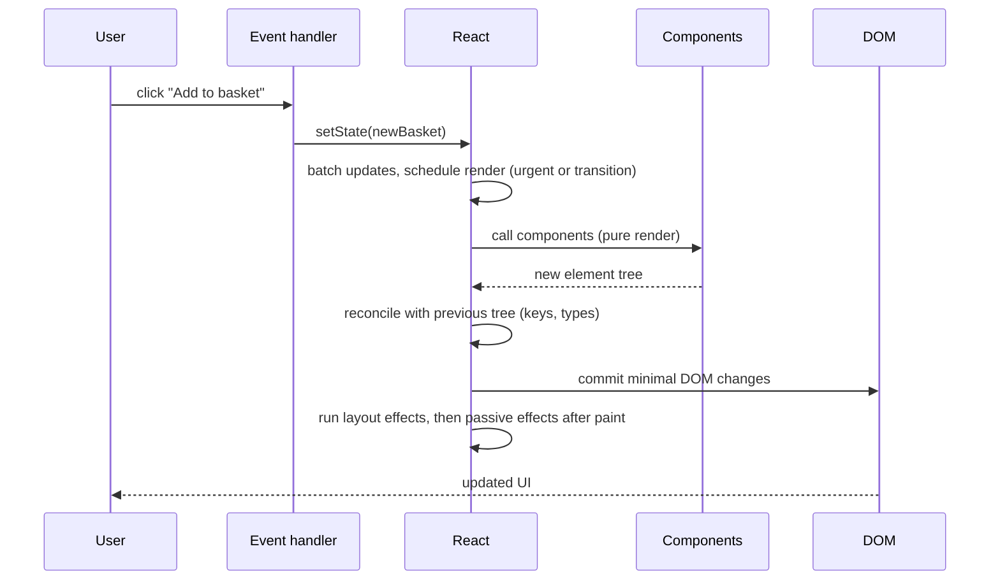

## TL;DR

- React builds UIs from **components**: functions that take **props** and return UI, re-rendering when **state** changes. UI is a function of state.
- **Hooks** (`useState`, `useEffect`, `useMemo`, `useRef`, `useContext`…) must be called unconditionally at the top level; effects are for **synchronising with external systems**, not for deriving data.
- React renders, diffs (reconciliation) and commits changes; **keys** identify list items; re-renders are usually cheap — measure before memoising (the React Compiler can automate memoisation).
- Modern React (18/19) adds **concurrent rendering** (transitions, Suspense), **Server Components**, **Actions** and form helpers (`useActionState`, `useOptimistic`) — mostly used through frameworks such as Next.js or React Router.
- Architecture at scale: clear separation of **server state** (data fetching libraries) and **client state**, a design system, colocated state, code splitting and good testing with Testing Library.

## Core Concepts

### Components, props and state

```tsx
type Props = { product: Product; onAdd: (id: string, qty: number) => void };

export function ProductCard({ product, onAdd }: Props) {
  const [qty, setQty] = useState(1);                 // local state
  const total = product.priceMinor * qty;            // derived during render — no effect needed
  return (
    <article>
      <h3>{product.name}</h3>
      <label>
        Quantity
        <input type="number" min={1} value={qty} onChange={(e) => setQty(Number(e.target.value))} />
      </label>
      <p>{formatMoney(total, product.currency)}</p>
      <button onClick={() => onAdd(product.id, qty)}>Add to basket</button>
    </article>
  );
}
```

- **Props** flow down and are read-only; **state** is owned by a component and updated via setters (asynchronously batched).
- **Lift state up** to the closest common parent when siblings need it; **colocate** state as low as possible otherwise.
- **Derive, don't duplicate:** compute values from props/state during render instead of storing copies.

### Rendering model

1. **Trigger:** initial render or a state/prop/context change.
2. **Render:** React calls components to produce a new element tree (must be pure — no side effects).
3. **Reconcile:** compare with the previous tree; **keys** identify list items; element type changes remount subtrees.
4. **Commit:** apply DOM changes, run layout effects, then (after paint) passive effects.

A parent re-render re-renders its children by default; usually fine. Optimise with `React.memo`, `useMemo`, `useCallback` only where profiling shows cost — or let the **React Compiler** memoise automatically (stable since React Compiler 1.0 in October 2025, and it can be adopted incrementally).

### Hooks rules and essentials

- Call hooks **at the top level** of components or custom hooks — never in conditions, loops or after early returns — so React can match hook state by call order.
- `useEffect` synchronises with **external systems** (subscriptions, timers, imperative widgets, non-React code); return a cleanup function. Dependencies must list every reactive value used.
- `useRef` holds mutable values that don't trigger renders (DOM nodes, timers).
- `useMemo`/`useCallback` cache expensive computations and stable references.
- **Custom hooks** extract reusable stateful logic (`useOnlineStatus`, `useDebouncedValue`).

### You might not need an effect

Effects are often misused. Don't use them to:
- Derive state from props/state → compute during render (or `useMemo`).
- Respond to user events → do it in the event handler.
- Reset state when a prop changes → use a `key` on the component.
- Fetch data in large apps → use a data-fetching library or framework loaders (effects cause waterfalls, race conditions and no caching).

### Concurrent features

- **Transitions** (`startTransition`, `useTransition`) mark updates as non-urgent so typing stays responsive while a heavy list re-renders.
- **`useDeferredValue`** renders a lagging version of a value.
- **Suspense** shows fallbacks while components wait for code or data (with Suspense-enabled data sources), and enables streaming server rendering.

### React 19 additions (high level)

- **Actions:** async functions passed to forms/transitions with pending and error handling; `useActionState`, `useFormStatus`, `useOptimistic` for optimistic UI.
- **`use()`** to read promises and context during render (with Suspense).
- **Server Components and Server Functions** (via frameworks): components that run on the server, send serialised UI to the client and never ship their code to the browser.
- `ref` as a regular prop for function components; improved hydration error messages; document metadata support.

### Rendering strategies

| Strategy | How | Strengths | Costs |
|---|---|---|---|
| CSR (client-side) | Browser downloads JS, renders everything | Simple hosting, rich interactivity | Slow first load, SEO limits, big bundles |
| SSR (server-side) | Server renders HTML per request, client hydrates | Fast first paint, SEO | Server cost, hydration cost, complexity |
| SSG / ISR | Pre-render at build or revalidate periodically | Very fast, cacheable on CDN | Stale data, build times |
| Streaming SSR + Server Components | Stream HTML progressively; server-only components | Less client JS, data fetching close to data | Framework coupling, new mental model |

## How It Works



## When to Use / Trade-offs

| Choice | Use when | Avoid when | Trade-off |
|---|---|---|---|
| Plain React SPA (Vite) | Internal tools, apps behind login, simple hosting | SEO-critical public content, slow devices with heavy pages | Simplicity vs first-load performance |
| Framework (Next.js, React Router framework mode, Remix-style) | Public sites, SEO, SSR/streaming, Server Components | Tiny widgets, teams wanting minimal tooling | Capabilities vs framework coupling |
| Server Components | Data-heavy pages, reducing client JS | Highly interactive client-only apps | Less JS vs new architecture constraints |
| Local state | UI state used by one component subtree | Widely shared data | Simplicity vs prop drilling |
| Context | Low-frequency global values (theme, auth, locale) | High-frequency updates to many consumers | Convenience vs re-render cost |
| Memoisation | Measured expensive renders, stable references for memoised children | Everything by default | Fewer renders vs complexity |

## Common Pitfalls & Anti-patterns

- **Effects for derived state** — extra renders and stale data.
- **Missing or wrong effect dependencies** — stale closures, infinite loops; don't silence the lint rule.
- **Fetching in effects without cancellation** — race conditions, waterfalls, no caching.
- **Index as key** in reorderable lists — state attached to the wrong items.
- **Mutating state** (`state.items.push`) — React doesn't see the change.
- **Giant contexts** that re-render the whole app on every change.
- **Premature memoisation everywhere** — complexity without measurable benefit.
- **Huge components** mixing data fetching, business logic and presentation.
- **`dangerouslySetInnerHTML` with untrusted HTML** — XSS.
- **Hydration mismatches** — rendering differently on server and client (dates, random values, `window` checks).

## Real-world Scenario

**Context:** A React SPA for a retailer had a 1.8 MB JavaScript bundle, LCP around 4.5 s on mobile and typing lag in the product filter. Data fetching happened in `useEffect` across nested components, causing request waterfalls and occasional stale results.

**Decision:** Migrated public pages to a framework with server rendering and Server Components for product listing and detail pages (product data rendered on the server; only the interactive filter, basket and gallery as client components); route-level code splitting; replaced effect-based fetching with framework loaders and a data-fetching library for client interactions; used `useTransition` for filter updates; virtualised long lists; fixed index keys and derived-state effects found by profiling.

**Outcome:** Client JS on product pages dropped by ~60%; mobile LCP improved to ~2.2 s; INP dropped below 200 ms; stale-result bugs disappeared.

**What I'd do differently:** Establish clear server/client component boundaries and a data-fetching standard before migrating — early pages mixed patterns and needed rework.

## Interview Questions

### What are components, props and state in React? {#components-props-state}

**Level:** Foundation

**Model answer:**
- **Components** are functions that return UI (JSX) describing what should be on screen for given inputs. They compose into trees.
- **Props** are inputs passed from parent to child — read-only from the child's perspective; changing them means the parent re-renders with new values.
- **State** is data owned by a component that changes over time (form input, toggles), managed via `useState`/`useReducer`. Updating state schedules a re-render.

Principles: UI = f(state); keep components pure during render; lift state to the nearest common ancestor when shared; derive values instead of duplicating state; data flows down, events flow up via callbacks.

**What the interviewer is looking for:**
Clear definitions, unidirectional data flow and derived state.

**Follow-ups:**
- When would you use `useReducer` over `useState`?
- What happens when you call a state setter twice in one handler?

**Red flags:**
- Mutating props or state directly.

### What are the rules of hooks, and why do they exist? {#rules-of-hooks}

**Level:** Foundation

**Model answer:**
1. **Only call hooks at the top level** of a function component or custom hook — not inside conditions, loops, nested functions or after early returns.
2. **Only call hooks from React functions** (components or custom hooks), not regular JavaScript functions.

Why: React associates hook state with components **by call order**. If the order changes between renders (a hook called conditionally), React would mismatch state to the wrong hook. The ESLint plugin (`eslint-plugin-react-hooks`) enforces the rules and checks effect dependencies.

Custom hooks (named `useSomething`) let you extract and reuse stateful logic while following the same rules. (The `use()` API in React 19 is an exception: it can be called inside conditions and loops, but still only from a component or hook, and not inside a try/catch block.)

**What the interviewer is looking for:**
Both rules and the call-order rationale; lint enforcement.

**Follow-ups:**
- How would you conditionally run an effect?
- What makes a function a custom hook?

**Red flags:**
- Calling hooks inside `if` statements.

### Why do keys matter when rendering lists? {#keys}

**Level:** Foundation

**Model answer:**
Keys tell React which list item is which between renders during reconciliation. With stable keys (e.g. database ids), React can reorder, insert and remove items efficiently and keep each item's **state and DOM** attached to the right item.

Using the **array index** as a key breaks when items are reordered, inserted or removed: React reuses components by position, so input values, focus or component state end up attached to the wrong item, and more DOM work is done.

Keys must be **stable, unique among siblings and predictable** — not random values generated on each render (that remounts everything). Keys can also be used deliberately to **reset** a component's state (`<Editor key={documentId} />`).

**What the interviewer is looking for:**
Reconciliation role, index-key bug, stability, and key-based resets.

**Follow-ups:**
- When is index as a key acceptable?
- How would you reset a form when the selected user changes?

**Red flags:**
- `key={Math.random()}`.

### What's the difference between controlled and uncontrolled form inputs? {#controlled-uncontrolled}

**Level:** Foundation

**Model answer:**
- **Controlled:** React state is the source of truth; the input's `value` comes from state and `onChange` updates it. Enables instant validation, conditional UI and formatting, at the cost of a re-render per keystroke (usually fine).
- **Uncontrolled:** the DOM holds the value; you read it when needed via refs or `FormData` on submit (`defaultValue` sets the initial value). Less code and fewer renders; well-suited to simple forms and React 19 form Actions that receive `FormData`.

Form libraries (React Hook Form uses uncontrolled inputs with refs; others use controlled state) combine the approaches with validation schemas (Zod). Choose based on interactivity needs; avoid switching a single input between controlled and uncontrolled (React warns).

**What the interviewer is looking for:**
Definitions, trade-offs and modern form handling.

**Follow-ups:**
- How do React 19 Actions change form handling?
- How would you validate a large form efficiently?

**Red flags:**
- Not knowing what `defaultValue` vs `value` does.

### When should you use useEffect, and when don't you need it? {#effects}

**Level:** Senior

**Model answer:**
`useEffect` is for **synchronising a component with an external system** after render: subscriptions (WebSocket, event listeners), timers, imperative third-party widgets, analytics, and — in simple apps — data fetching with cleanup. Always return a cleanup and list all reactive dependencies.

You usually **don't** need an effect to:
- **Derive data** from props/state — compute during render (`const total = items.reduce(...)`), with `useMemo` if expensive.
- **Handle user events** — do it in the event handler (e.g. send the POST in `onSubmit`, not in an effect watching a flag).
- **Reset state when a prop changes** — use a `key`.
- **Sync two pieces of state** — restructure so one is derived.
- **Fetch data at scale** — use framework loaders or a data library (caching, deduplication, cancellation, no waterfalls).

Bugs from misuse: extra renders, flicker, stale data, infinite loops, race conditions. In Strict Mode, React mounts components twice in development to surface missing cleanups.

**What the interviewer is looking for:**
Correct purpose of effects, concrete alternatives and awareness of Strict Mode double-invocation.

**Follow-ups:**
- Why does my effect run twice in development?
- How do you avoid race conditions when fetching in an effect?

**Red flags:**
- Effects chains that set state based on other state.

### How do you identify and reduce unnecessary re-renders? {#rerenders}

**Level:** Senior

**Model answer:**
First **measure**: React DevTools Profiler (which components render, why, how long), Performance panel for long tasks and INP. Many re-renders are cheap; optimise only measured hotspots.

Techniques:
- **Colocate state** lower so updates affect smaller subtrees; split components so frequently changing parts are isolated.
- **Pass children/JSX as props** ("lifting content up") so a stateful wrapper doesn't re-render static children.
- **`React.memo`** for expensive child components with stable props; **`useMemo`/`useCallback`** to keep props referentially stable or cache expensive computations.
- **Split contexts** by update frequency; use selectors (external stores with `useSyncExternalStore`, or libraries like Zustand) to subscribe to slices.
- **Virtualise** long lists.
- **Transitions/`useDeferredValue`** to keep input responsive during heavy renders.
- **React Compiler** can automatically memoise components and values, reducing manual `useMemo`/`useCallback` (stable since 1.0 in October 2025).

**What the interviewer is looking for:**
Measurement first, structural fixes before memoisation, context strategies and modern tools.

**Follow-ups:**
- Why might `React.memo` not prevent a re-render?
- When is `useCallback` pointless?

**Red flags:**
- Wrapping everything in `useMemo` without profiling.

### What are the performance implications of React Context, and how do you manage them? {#context}

**Level:** Senior

**Model answer:**
When a context provider's `value` changes (by reference), **every consumer re-renders**, regardless of which part of the value it uses. Passing a new object each render (`value={{ user, setUser }}`) triggers re-renders even if contents didn't change.

Management:
- Use context for **low-frequency, widely needed values**: theme, locale, authenticated user, feature flags.
- **Memoise the value** (`useMemo`) and split state and dispatch into separate contexts.
- **Split contexts** by concern and update frequency.
- For **high-frequency or large shared state**, use an external store with selector subscriptions (`useSyncExternalStore`, Zustand, Redux Toolkit, Jotai) so components re-render only when their slice changes.
- Keep providers as low in the tree as practical.

**What the interviewer is looking for:**
Re-render behaviour, memoisation, splitting and when to choose stores with selectors.

**Follow-ups:**
- How does `useSyncExternalStore` help?
- Is Context a state management solution?

**Red flags:**
- A single giant context for all app state updated frequently.

### What do Suspense and transitions do? {#concurrent-rendering}

**Level:** Senior

**Model answer:**
React 18+ can prepare renders in the background and interrupt them (concurrent rendering):
- **Transitions** (`startTransition`, `useTransition`) mark state updates as **non-urgent**. Urgent updates (typing, clicks) render first; transition renders can be interrupted and restarted, keeping input responsive. `isPending` lets you show subtle loading indicators while the old UI stays visible.
- **`useDeferredValue`** gives you a lagging copy of a value so expensive children render with the old value while the input updates immediately.
- **Suspense** lets components "wait" for something — lazy-loaded code (`React.lazy`), or data from Suspense-enabled sources (framework loaders, libraries, `use(promise)`) — showing a fallback for that boundary. On the server, Suspense enables **streaming SSR**: sending HTML for ready parts first and streaming the rest.

Design: place Suspense boundaries around meaningful UI regions; avoid fallbacks flashing for fast loads (transitions keep old UI); combine with error boundaries.

**What the interviewer is looking for:**
Urgent vs non-urgent updates, deferred values, Suspense for code/data and streaming.

**Follow-ups:**
- How do transitions improve INP?
- Where would you place Suspense boundaries on a dashboard?

**Red flags:**
- Thinking Suspense fetches data by itself.

### What data-fetching patterns do you recommend in React apps? {#data-fetching}

**Level:** Senior

**Model answer:**
- **Server state is different from UI state:** it's owned remotely, can be stale, needs caching, revalidation, deduplication and error/loading handling.
- **Framework loaders/Server Components:** fetch on the server or at the route level in parallel, avoiding client waterfalls; stream with Suspense.
- **Client data libraries** (TanStack Query, SWR, RTK Query, Apollo/Relay for GraphQL): caching by key, background refetching, deduplication, retries, pagination, optimistic updates, cancellation, devtools.
- **Avoid hand-rolled `useEffect` fetching** in large apps — it causes waterfalls (child fetches after parent), race conditions and no caching.
- **Mutations:** invalidate or update affected queries; optimistic UI with rollback (`useOptimistic` or library support).
- **Prefetch** on hover/route transitions; **parallelise** independent requests.
- **Error and loading states** designed per region (Suspense + error boundaries).

**What the interviewer is looking for:**
Server state concept, loaders/RSC, client libraries' capabilities, avoiding effect-based fetching and mutation handling.

**Follow-ups:**
- How do you prevent request waterfalls?
- How would you implement optimistic "like" buttons?

**Red flags:**
- Storing all fetched data in a global Redux store manually.

### How do you test React components effectively? {#testing-react}

**Level:** Senior

**Model answer:**
- **React Testing Library** with Vitest/Jest: render components and interact like a user — query by role and accessible name (`getByRole('button', { name: 'Save' })`), use `user-event` for realistic interactions, assert on visible output and behaviour, not internal state or implementation details.
- **Mock at the network boundary** with MSW so data fetching code runs for real; cover loading, empty and error states.
- **Test custom hooks** through components or `renderHook` for complex logic; test pure logic (reducers, formatters) as plain functions.
- **Accessibility checks** (axe) in component tests.
- **End-to-end tests** (Playwright) for a few critical journeys.
- **Visual regression** for design-system components (Storybook + visual diff).
- Avoid shallow rendering and large snapshots.

**What the interviewer is looking for:**
User-centric testing, network mocking, appropriate levels and accessibility.

**Follow-ups:**
- How do you test a component using React Query?
- Why query by role rather than test ids?

**Red flags:**
- Tests asserting on state variables or CSS classes.

### Compare CSR, SSR, SSG and React Server Components. {#rendering-strategies}

**Level:** Architect

**Model answer:**
- **CSR:** the browser downloads JS and renders everything. Simple hosting, good for authenticated apps; slower first load, weaker SEO, larger bundles.
- **SSR:** the server renders HTML per request; the client **hydrates** (attaches event handlers by re-running components). Better first paint and SEO; costs server compute and hydration time (the page may look ready but not respond).
- **SSG/ISR:** pre-render at build time or periodically revalidate; served from CDN — excellent performance for content that doesn't change per request.
- **Streaming SSR with Suspense:** send HTML progressively as data resolves; improves time to first byte and LCP.
- **React Server Components (RSC):** components that run only on the server, can access data directly, and send a serialised UI description to the client — their code isn't shipped to the browser. Client components handle interactivity. Reduces client JS and moves data fetching next to data sources; requires framework support and a new mental model (serialisation boundaries, `'use client'`).

Choose per route: marketing and product pages (SSG/ISR/RSC), personalised dashboards (SSR/RSC with streaming), highly interactive tools behind login (CSR or RSC with heavy client components).

**What the interviewer is looking for:**
Clear trade-offs, hydration costs, RSC's distinctive benefit and per-route decisions.

**Follow-ups:**
- What causes hydration mismatches?
- What is partial/selective hydration?

**Red flags:**
- "SSR is always better."

### How do React Server Components change application architecture? {#server-components}

**Level:** Architect

**Model answer:**
- **Component boundaries become network boundaries:** Server Components run on the server (can query databases, call internal services, use secrets) and stream serialised output; Client Components (`'use client'`) run in the browser for interactivity. Props passed from server to client must be serialisable.
- **Less client JavaScript:** server-only code (formatting libraries, data access) never ships to the browser.
- **Data fetching moves into components on the server** — close to data, parallelised, with Suspense streaming; reduces client waterfalls and API surface.
- **Server Functions/Actions** let clients call server-side mutations directly (with framework-provided endpoints) — they are **public endpoints**: validate input and authorise every call.
- **Caching and revalidation** become central framework concerns (per request, per data source, on mutation).
- **Security:** avoid leaking secrets in props passed to client components; use server-only modules; treat serialised data as public.
- **Team implications:** frontend engineers own more server-side logic; observability and performance budgets span server and client.

Adopt incrementally: start with read-heavy routes, keep interactive islands as client components, define conventions for data access and caching.

**What the interviewer is looking for:**
Server/client boundary, serialisation, data fetching, Actions as endpoints, caching and security implications.

**Follow-ups:**
- How do you authorise a Server Action?
- When would you not use Server Components?

**Red flags:**
- Passing secrets or full database records as props to client components.

### How would you architect a large React application used by many teams? {#app-architecture}

**Level:** Architect

**Model answer:**
- **Framework and routing** chosen deliberately (SSR/RSC needs, deployment), with **route-based code splitting**.
- **Feature-based structure:** organise by domain/feature (`features/checkout`) rather than technical type; clear public APIs per feature; dependency rules enforced by lint (e.g. features can't import each other's internals).
- **Design system:** shared, accessible components and tokens (theming), documented in Storybook, versioned; enforces consistency and accessibility.
- **State strategy:** server state via a data-fetching library or framework loaders; local UI state colocated; minimal global client state for truly global concerns.
- **Type safety end to end:** TypeScript strict, API clients generated from contracts, runtime validation at boundaries.
- **Quality gates:** testing standards, accessibility checks, performance budgets (bundle size, Core Web Vitals in CI and RUM).
- **Ownership:** CODEOWNERS per feature; monorepo tooling (Nx/Turborepo) for builds and affected tests; micro-frontends only if team autonomy demands independent deployment.
- **Observability:** error tracking, RUM, feature flags.

**What the interviewer is looking for:**
Feature-based modularity, design system, state strategy, type safety, quality gates and ownership model.

**Follow-ups:**
- How do you prevent the design system becoming a bottleneck?
- Monorepo or micro-frontends?

**Red flags:**
- `components/`, `hooks/`, `utils/` folders shared by 20 teams with no boundaries.

### How do you keep a large React application fast over time? {#react-performance-at-scale}

**Level:** Architect

**Model answer:**
- **Budgets and monitoring:** per-route JS budgets in CI, Core Web Vitals from real users (RUM) segmented by route and device, alerts on regressions.
- **Ship less JS:** route and component-level splitting, lazy-loading heavy widgets (charts, editors, maps), Server Components/SSR where appropriate, removing unused dependencies, analysing bundles on every PR.
- **Render efficiently:** colocated state, selector-based stores, virtualisation, transitions for heavy updates, profiling hot paths, React Compiler adoption.
- **Data:** parallel fetching, caching, prefetching, avoiding waterfalls; streaming with Suspense.
- **Assets:** image optimisation (responsive sizes, modern formats, lazy loading, priority for LCP image), font loading strategies.
- **Third-party scripts** governed and measured.
- **Culture:** performance is part of the definition of done; dashboards visible to teams; performance reviews for new features.

**What the interviewer is looking for:**
Budgets, field measurement, less JS, rendering techniques, data patterns, assets, third parties and culture.

**Follow-ups:**
- How do you attribute a performance regression to a specific PR?
- What's your approach to third-party tag managers?

**Red flags:**
- Performance work only when users complain.

### How would you modernise a legacy React codebase? {#react-migration}

**Level:** Architect

**Model answer:**
Typical legacy: class components, Create React App or old webpack config, Redux for everything including server data, old React version, little TypeScript, enzyme tests.

Plan (incremental, measured):
1. **Tooling first:** move the build to Vite or a framework; upgrade React (follow upgrade guides, codemods), enable Strict Mode to surface issues.
2. **TypeScript adoption** incrementally (`allowJs`, strictness ratchets).
3. **Tests:** migrate from enzyme to Testing Library as components are touched; add characterisation tests for critical flows.
4. **Data fetching:** replace Redux-managed server data with a data-fetching library, shrinking Redux to genuine client state (or removing it).
5. **Components:** convert class components to function components with hooks when they change ("boy scout"), not in a big bang; codemods for mechanical parts.
6. **Routing/rendering:** adopt a modern router or framework; consider SSR/RSC for public pages where it pays off.
7. **Design system** consolidation and accessibility fixes.

Measure progress (percent TS, bundle size, test coverage of critical flows, Web Vitals) and keep feature delivery going throughout.

**What the interviewer is looking for:**
Incremental sequencing, tooling and upgrades, testing migration, server-state extraction and metrics.

**Follow-ups:**
- Would you rewrite in a new framework instead?
- How do you upgrade across multiple React majors safely?

**Red flags:**
- Freezing features for a six-month rewrite.

## Cheat Sheet

### Fundamentals
- **UI = f(state)** — components render from props and state; data down, events up.
- **Derive, don't duplicate** — compute values during render instead of syncing state.
- **Rules of hooks** — top level only, from components or custom hooks; order must not change.
- **Keys** — stable ids, not indexes, for dynamic lists; change a key to reset state.
- **Controlled vs uncontrolled** — React state as source of truth vs DOM/FormData.

### Effects and rendering
- **useEffect** — synchronise with external systems; always clean up; list all dependencies.
- **You might not need an effect** — derived data, event handling and resets don't need effects.
- **Strict Mode double render** — development-only check for impure renders and missing cleanups.
- **Context re-renders** — every consumer re-renders when the value changes; split or use selectors.
- **Memoisation** — measure first; React Compiler can automate.
- **Transitions** — non-urgent updates that keep input responsive.
- **Suspense** — fallbacks while code or data loads; enables streaming SSR.

### Architecture
- **Server state vs client state** — use data libraries/loaders for server data.
- **Hydration** — attaching interactivity to server-rendered HTML; mismatches cause bugs.
- **Server Components** — run only on the server, ship no JS; Server Actions are public endpoints.

## Further Reading

- [react.dev: Learn React](https://react.dev/learn) — the official documentation and mental model.
- [react.dev: You Might Not Need an Effect](https://react.dev/learn/you-might-not-need-an-effect) — when effects are the wrong tool.
- [react.dev: React 19 release notes](https://react.dev/blog/2024/12/05/react-19) — Actions, `use`, Server Components and more.
- [React Compiler documentation](https://react.dev/learn/react-compiler) — automatic memoisation.
- [Testing Library: React](https://testing-library.com/docs/react-testing-library/intro/) — user-centric component testing.
- [TanStack Query documentation](https://tanstack.com/query/latest) — server-state management patterns.
