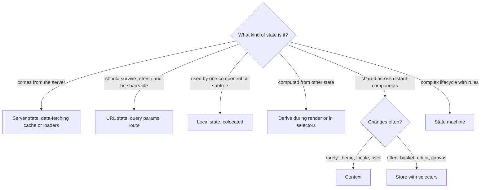
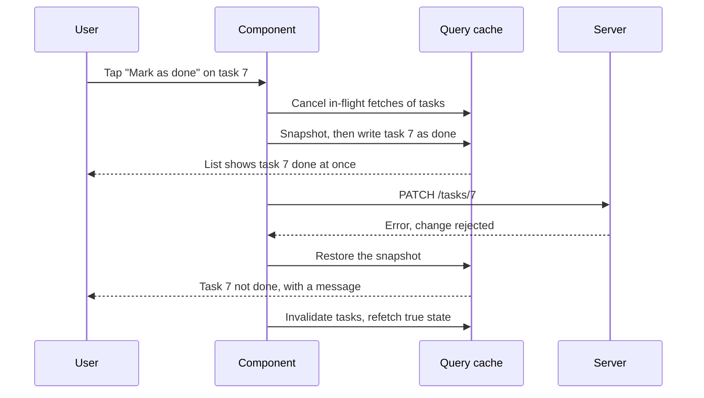

## TL;DR

- Most "state management" problems come from treating different kinds of state the same way. Distinguish **server state** (remote data cached on the client), **client/UI state** (open menus, form drafts), **URL state** (filters, pagination, selected tab) and **derived state** (computed from others).
- **Server state** belongs in a data-fetching library or framework loaders (caching, revalidation, deduplication). **UI state** should be **colocated** as close as possible to where it's used. **URL state** makes views shareable and back-button friendly.
- Use global stores (Redux Toolkit, Zustand, Jotai, signals) only for genuinely shared client state; subscribe with **selectors** to avoid unnecessary re-renders.
- **Derive, don't duplicate:** store the minimal source of truth and compute the rest.
- For complex flows (wizards, checkout, media players), **explicit state machines** prevent impossible states; for offline and collaboration, use sync engines or CRDTs.

## Core Concepts

### Kinds of state

| Kind | Examples | Where it should live |
|---|---|---|
| Server state | Products, orders, user profile | Data-fetching cache (TanStack Query, SWR, RTK Query, Apollo) or framework loaders/Server Components |
| UI/local state | Modal open, hover, input draft, accordion | Component state (`useState`/`useReducer`), colocated |
| Shared client state | Shopping basket before checkout, theme, auth session info, multi-step wizard | Context (low-frequency) or a store with selectors |
| URL state | Search query, filters, sort, page, selected tab | Query string / route params |
| Form state | Field values, validation, dirty/touched | Form library or uncontrolled inputs + schema validation |
| Persistent client state | Preferences, drafts | `localStorage`/IndexedDB, synced if needed |
| Derived state | Totals, filtered lists, permissions | Computed during render or in selectors |

### Colocation and lifting state

Start with state in the component that uses it. When siblings need it, **lift it** to their nearest common parent. If props must travel through many layers (prop drilling), consider component composition (passing children), context for low-frequency values, or a store for frequently changing shared data — not a global store by default.

### Server state is a cache

Remote data can change without the client knowing. Libraries manage:
- **Caching by key** and deduplicating concurrent requests.
- **Staleness and revalidation** (on focus, interval, mutation).
- **Loading and error states**, retries, pagination and infinite queries.
- **Mutations** with invalidation, optimistic updates and rollback.

```tsx
const { data, isPending, error } = useQuery({
  queryKey: ['orders', { status, page }],
  queryFn: ({ signal }) => api.listOrders({ status, page }, { signal }),
  staleTime: 30_000,
});

const queryClient = useQueryClient();
const cancel = useMutation({
  mutationFn: api.cancelOrder,
  onSuccess: () => queryClient.invalidateQueries({ queryKey: ['orders'] }),
});
```

### Global client stores and selectors

- **Redux Toolkit:** predictable reducers, devtools, middleware, RTK Query for server state; more structure, good for large teams needing conventions.
- **Zustand:** minimal API, hooks with selectors, little boilerplate.
- **Jotai/Recoil-style atoms:** fine-grained state units composed bottom-up.
- **Signals** (Preact signals, Solid, Angular, MobX-style observables): fine-grained reactivity updating only dependents.

Whichever you choose, components should **subscribe to the smallest slice** they need (selectors), and derived data should be computed in memoised selectors.

```ts
import { create } from 'zustand';

type BasketState = { lines: Line[]; add: (l: Line) => void; remove: (sku: string) => void };
export const useBasket = create<BasketState>((set) => ({
  lines: [],
  add: (l) => set((s) => ({ lines: [...s.lines, l] })),
  remove: (sku) => set((s) => ({ lines: s.lines.filter((x) => x.sku !== sku) })),
}));

// Subscribe to a derived slice only — re-renders when the count changes, not on every basket change.
const itemCount = useBasket((s) => s.lines.reduce((n, l) => n + l.qty, 0));
```

### Worked example: counting re-renders, Context vs a selector store

A shop keeps its basket in **one React Context** provided at the root: `{ lines, add, remove, isOpen, setOpen }`. 120 components consume it: 100 product cards (each shows "In basket" for its own product), the header badge, the mini-basket drawer, and some others.

A Context consumer re-renders whenever the context **value** changes, whatever part of it the component reads:

| Event | Components that actually need to change | Renders with one Context | Renders with a selector store |
|---|---|---|---|
| User opens the mini-basket (`isOpen` flips) | 1 (the drawer) | **120** | **1** |
| User adds product 42 | 3 (header badge, drawer, product 42's card) | **120** | **3** |
| Background refresh replaces `lines` with equal data | 0 | **120** | **0** (if selectors return equal values) |

With a store such as Zustand, each component subscribes to the **slice it reads**: the product card uses `useBasket((s) => s.lines.some((l) => l.sku === sku))`, which is a boolean, so it only re-renders when that boolean changes for its product.

Whether 120 re-renders matter depends on their cost. Usually they're cheap, and measuring with the React Profiler comes first. When they do matter (large lists, slow devices, frequent updates), the fixes are:
- **Split the context** by how often each part changes: actions in one context (stable), `isOpen` in another, `lines` in a third.
- **Memoise the context value**, so it only changes when its contents do.
- **Move frequently changing shared state into a store with selectors**, and keep Context for low-frequency values such as theme, locale and the signed-in user.
- **Derive in selectors** (counts, "is this item in the basket"), returning primitives or memoised values so equality checks work.

### State machines for complex UI

Explicit states and transitions (XState or a reducer with a discriminated union) make impossible states unrepresentable: a payment form can't be both `submitting` and `succeeded`; retries and cancellations are defined transitions.

```ts
type CheckoutState =
  | { step: 'details' }
  | { step: 'payment'; addressId: string }
  | { step: 'submitting'; addressId: string; paymentMethodId: string }
  | { step: 'done'; orderId: string }
  | { step: 'failed'; reason: string; retryable: boolean };
```

## How It Works



### An optimistic update that has to roll back



## When to Use / Trade-offs

| Tool | Use when | Avoid when | Trade-off |
|---|---|---|---|
| `useState`/`useReducer` | Local and moderately complex component state | Widely shared state | Simplicity vs prop drilling |
| Context | Low-frequency global values | Frequently updated large state | Built-in vs re-render cost |
| Redux Toolkit | Large apps needing conventions, devtools, middleware | Small apps; using it as a server-data cache manually | Predictability vs boilerplate |
| Zustand / Jotai | Shared client state with minimal ceremony | Teams needing strict conventions and middleware ecosystem | Simplicity vs fewer guardrails |
| TanStack Query / SWR | Any server data | Purely local data | Caching and sync for free vs another concept |
| URL state | Filters, pagination, tabs | Sensitive data, large blobs | Shareability vs URL length and encoding |
| XState / state machines | Complex flows, many edge cases | Simple toggles | Correctness vs learning curve |
| CRDT/sync engines | Offline-first, real-time collaboration | Simple online CRUD | Powerful sync vs complexity |

## Common Pitfalls & Anti-patterns

- **Everything in a global store** — server data copied into Redux, manual loading flags, stale caches.
- **Duplicated state** — storing `filteredItems` alongside `items` and `filter`, then forgetting to update one.
- **Syncing state with effects** instead of deriving.
- **Context for high-frequency updates** re-rendering the whole tree.
- **Subscribing to the whole store** instead of a selected slice.
- **Boolean soup** — `isLoading`, `isError`, `isSuccess`, `isSubmitting` allowing impossible combinations.
- **Losing URL state** — filters not reflected in the URL; refresh resets the view; links can't be shared.
- **Storing derived or sensitive data in `localStorage`** without versioning or security consideration.
- **Ignoring stale data** after mutations (no invalidation).

## Real-world Scenario

**Context:** A B2B dashboard used Redux for everything: API responses, loading flags, form drafts and UI toggles — 140 action types. Bugs included stale data after edits, inconsistent loading spinners and slow typing because every keystroke updated the global store and re-rendered large parts of the app.

**Decision:** Moved server data to TanStack Query (queries keyed by resource and filters, invalidation on mutations, optimistic updates for quick edits); moved filters, sorting and pagination into the URL; colocated form state with a form library and Zod validation; kept a small Zustand store for genuinely global client state (current workspace, UI preferences); modelled the multi-step import wizard as a state machine.

**Outcome:** Redux was removed entirely over two quarters; code related to state shrank by about half; stale-data bugs and typing lag disappeared; shared links reproduced exact dashboard views.

**What I'd do differently:** Classify state types in an ADR at the start of the migration — early PRs moved some UI state into the query cache before the team agreed the categories.

## Interview Questions

### What different kinds of state exist in a frontend application? {#types-of-state}

**Level:** Foundation

**Model answer:**
- **Server state:** data owned by a backend and cached on the client — products, orders, profiles. It can become stale, needs fetching, caching, revalidation and mutation handling.
- **Local UI state:** ephemeral state for one component or subtree — open/closed, hover, input drafts.
- **Shared client state:** UI state used across distant parts of the app — basket before checkout, theme, current workspace.
- **URL state:** state that should be shareable and survive refresh — search, filters, sort, pagination, selected tab.
- **Form state:** values, validation, touched/dirty flags.
- **Persistent client state:** preferences and drafts in storage.
- **Derived state:** values computed from other state (totals, filtered lists).

Each kind has a natural home; mixing them (e.g. server data in a global store) causes most state management pain.

**What the interviewer is looking for:**
A clear taxonomy and the insight that each type needs different handling.

**Follow-ups:**
- Where would you put the current page number of a table?
- Is a JWT "state"? Where does it belong?

**Red flags:**
- "Put it all in Redux."

### How do you decide between local and global state? {#local-vs-global}

**Level:** Foundation

**Model answer:**
Default to **local** state, colocated in the component that uses it. Move it up only when needed:
1. If a sibling needs it, **lift** it to the nearest common parent.
2. If many distant components need it and it **changes rarely** (theme, locale, user), use **context**.
3. If it's **widely shared and changes often** (basket, editor document, canvas), use a **store with selectors**.
4. If it's **server data**, use a data-fetching cache, not global client state.
5. If it should be **shareable/bookmarkable**, put it in the URL.

Benefits of colocation: simpler reasoning, fewer re-renders, easier deletion of features. Global state is a dependency every part of the app can reach — use it deliberately.

**What the interviewer is looking for:**
A principled escalation path from local to global, with alternatives.

**Follow-ups:**
- How do you avoid prop drilling without global state?
- When does state colocation hurt?

**Red flags:**
- Global state by default.

### What is prop drilling, and how do you avoid it sensibly? {#prop-drilling}

**Level:** Foundation

**Model answer:**
Prop drilling is passing props through several intermediate components that don't use them, just to reach a deep child. A few levels are fine and explicit; deep drilling makes refactoring tedious and components coupled.

Options, in order:
1. **Restructure with composition:** pass components as `children` or render props so the parent that owns the data renders the deep component directly, skipping intermediates.
2. **Move state closer** to where it's used.
3. **Context** for values many components need that change rarely.
4. **A store with selectors** for frequently changing shared data.
5. **Server state libraries** — components fetch (from cache) what they need by key instead of receiving it through props.

**What the interviewer is looking for:**
Understanding that drilling isn't always bad, and composition as the first remedy.

**Follow-ups:**
- Show how passing `children` avoids drilling.
- What are the downsides of context here?

**Red flags:**
- Jumping to a global store for any prop passed twice.

### Why and how should you keep state in the URL? {#url-state}

**Level:** Foundation

**Model answer:**
URL state (query parameters, route segments) makes views **shareable, bookmarkable, refresh-safe** and compatible with browser back/forward. Good candidates: search terms, filters, sort, pagination, selected tab, opened item id, map viewport.

How:
- Read state from the URL as the source of truth (router search params hooks, framework loaders), and update it with navigation (replace for frequent changes like typing, push for meaningful steps).
- **Validate and parse** parameters with a schema (Zod) — they're user input — with defaults for invalid values.
- Debounce updates from text input.
- Keep URLs readable and stable; avoid storing sensitive or large data.
- Server-rendered pages can render the right state directly from the URL.

**What the interviewer is looking for:**
Benefits, candidate state, validation, push vs replace and limits.

**Follow-ups:**
- How do you sync a search box with the URL without lag?
- What about state that's too large for a URL?

**Red flags:**
- Filters that reset on refresh in a data-heavy app.

### How do you choose between Redux Toolkit, Zustand, Jotai and Context? {#library-choice}

**Level:** Senior

**Model answer:**
First remove what doesn't belong in a client store (server data → query cache; URL state → router). For what remains:
- **Context:** built-in, fine for low-frequency values; poor for frequently changing data consumed widely (all consumers re-render).
- **Redux Toolkit:** opinionated structure (slices, reducers), excellent devtools (time travel), middleware, predictable updates, RTK Query for server state. Suits large teams wanting conventions and complex client-side logic. More concepts and boilerplate than lighter options.
- **Zustand:** small API, hooks with selectors, minimal boilerplate, works outside React too; good default for modest shared state.
- **Jotai (atoms):** fine-grained, bottom-up state composed from atoms; great for many independent pieces of state and derived atoms.
- **Signals/observables (MobX, signals):** fine-grained reactivity with automatic dependency tracking.

Decide by team size and conventions needed, complexity of client logic, devtools needs, performance (selectors/fine-grained updates), and ecosystem — and standardise one choice per codebase.

**What the interviewer is looking for:**
Elimination of misplaced state first, then informed trade-offs and standardisation.

**Follow-ups:**
- How do selectors prevent re-renders?
- Would you ever use two state libraries in one app?

**Red flags:**
- Library choice by popularity with no criteria.

### What do server-state libraries like TanStack Query solve? {#server-state}

**Level:** Senior

**Model answer:**
They treat remote data as a **cache** with lifecycle management:
- **Fetching and caching by key**, sharing data between components without prop drilling or global stores.
- **Deduplication** of simultaneous requests.
- **Staleness and background revalidation** (on window focus, reconnect, intervals, after mutations).
- **Loading/error states, retries with backoff, cancellation** via `AbortSignal`.
- **Pagination and infinite queries.**
- **Mutations** with invalidation of affected queries, optimistic updates and rollback.
- **Prefetching** and SSR hydration integration.
- **Devtools** to inspect cache state.

Without them, teams hand-roll these in effects and global stores, producing race conditions, stale data and duplicated requests. Similar tools: SWR, RTK Query, Apollo/Relay (GraphQL), and framework loaders/Server Components for server-side fetching.

**What the interviewer is looking for:**
Concrete capabilities and the problems they replace.

**Follow-ups:**
- How do you choose `staleTime` values?
- How do query keys work with filters?

**Red flags:**
- Treating the query cache as a general global store for UI state.

### How do you handle derived state and selectors? {#selectors}

**Level:** Senior

**Model answer:**
**Derived state** is anything computable from other state: totals, filtered/sorted lists, counts, permissions, formatted values. Store only the minimal source of truth and **compute derived values**:
- In components during render (cheap computations), with `useMemo` for expensive ones.
- In **selectors** for stores: functions that select and compute slices (`selectVisibleTodos(state)`), memoised (Reselect/`createSelector`, or library-provided) so components only re-render when the result changes.
- In data-fetching libraries, `select` options transform cached data per component.

Benefits: no synchronisation bugs (derived values can't drift from sources), less state to persist and migrate, fewer re-renders with fine-grained subscriptions.

Watch: memoised selectors returning new objects/arrays each time defeat memoisation; normalise state (entities by id) to make selectors efficient.

**What the interviewer is looking for:**
Derive-don't-store principle, memoised selectors, normalisation and re-render benefits.

**Follow-ups:**
- Why does returning a new array from a selector cause re-renders?
- What is state normalisation?

**Red flags:**
- Storing `filteredItems` and syncing it with effects.

### How do you implement optimistic updates safely? {#optimistic-updates}

**Level:** Senior

**Model answer:**
Optimistic updates show the expected result immediately, then reconcile with the server:
1. **Snapshot** the current cached data.
2. **Apply the change** to the cache/UI immediately (e.g. mark a task done, add a comment with a temporary id).
3. **Send the mutation** with an idempotency key.
4. On **success**, replace temporary data with the server response (real ids, timestamps) or invalidate and refetch.
5. On **failure**, **roll back** to the snapshot and show an error with a retry option.
6. Cancel in-flight refetches that might overwrite the optimistic state.

Tools: TanStack Query's `onMutate`/`onError` rollback pattern; React 19 `useOptimistic` for UI-level optimism during Actions.

Use for low-risk, high-success-rate actions (likes, toggles, reordering, comments). Avoid for actions where failure is likely or consequences are significant (payments, irreversible operations) — show pending states instead.

**What the interviewer is looking for:**
Snapshot/apply/confirm/rollback flow, idempotency, cancellation and choosing when to be optimistic.

**Follow-ups:**
- How do you handle conflicting optimistic updates from two tabs?
- How do you reorder a list optimistically?

**Red flags:**
- Optimistic UI for payments.

### How do you manage complex form state? {#form-state}

**Level:** Senior

**Model answer:**
- **Use a form library** (React Hook Form, TanStack Form, or framework form Actions) for values, validation, touched/dirty state, field arrays and submission state — avoids re-rendering the whole form on each keystroke.
- **Schema validation** (Zod/Valibot) shared with the server where possible, giving one source of truth and typed values; validate on blur/submit with clear messages.
- **Server validation remains authoritative;** map server errors back to fields.
- **Drafts and persistence:** autosave long forms to the server or storage; warn on unsaved changes.
- **Multi-step forms:** model steps as a state machine; keep data in one form state; validate per step.
- **Accessibility:** labels, error associations (`aria-describedby`), focus management to the first error, not relying on colour alone.
- **Performance:** uncontrolled inputs or field-level subscriptions for large forms.

**What the interviewer is looking for:**
Library use, schema validation, server authority, multi-step handling, accessibility and performance.

**Follow-ups:**
- How do you handle dependent fields (country → state)?
- How do React 19 form Actions fit in?

**Red flags:**
- One giant `useState` object updated on every keystroke for a 60-field form.

### When are state machines worth using for UI state? {#ui-state-machines}

**Level:** Senior

**Model answer:**
Use them when a feature has **multiple states with rules about transitions** and edge cases — checkout and payment flows, upload pipelines with retries, media players, onboarding wizards, connection status (connecting/connected/reconnecting/offline), complex modals.

Benefits:
- **Impossible states become unrepresentable** (no `isLoading && isError`).
- Transitions are explicit: you see which events are valid in each state; unhandled events are ignored safely.
- Easier to visualise, review with designers/product and test exhaustively.
- Side effects (invoke services, timers) are attached to states/transitions.

Implementation: a discriminated union + reducer for moderate complexity; XState for hierarchical/parallel states, actors and visual tooling.

Avoid for trivial toggles — the ceremony isn't worth it.

**What the interviewer is looking for:**
Appropriate use cases, benefits and lightweight vs library options.

**Follow-ups:**
- Model an upload with pause/resume/retry.
- How do you test a state machine?

**Red flags:**
- Boolean soup for complex flows.

### Design the state architecture for a large single-page application. {#state-architecture}

**Level:** Architect

**Model answer:**
Write it down (ADR) and give each category a home:
- **Server state:** one data-fetching library (or framework loaders/RSC); query key conventions per domain; mutation and invalidation patterns; prefetching on navigation; cache persistence for offline if needed.
- **URL state:** filters, sort, pagination, selected entities; typed and validated search params.
- **Local UI state:** colocated by default.
- **Shared client state:** a single store library, organised by domain slices, with selectors; no server data in it.
- **Forms:** one form library + schema validation shared with the backend.
- **Complex flows:** state machines.
- **Persistence:** what's persisted (preferences, drafts), where, with versioning and migration.
- **Cross-cutting:** auth/session in a provider, feature flags, i18n.

Guardrails: lint rules preventing direct cross-domain store access, code review checklists, devtools in development, and documentation with examples. Measure: re-render hotspots, bundle impact, defect categories related to state.

**What the interviewer is looking for:**
Category-based architecture, conventions, guardrails and documentation.

**Follow-ups:**
- How do you handle auth tokens and session expiry across state categories?
- How do you avoid store coupling across domains?

**Red flags:**
- No distinction between categories.

### How would you build offline-first state synchronisation? {#offline-sync}

**Level:** Architect

**Model answer:**
- **Local-first storage:** IndexedDB (via libraries) or SQLite (WASM) as the client's primary store; the UI reads locally for instant responses.
- **Outbox of changes:** queue user actions as operations with ids, timestamps and idempotency keys; sync when online (Background Sync where supported, or on reconnect).
- **Conflict handling:** decide per data type — last-writer-wins with version vectors for simple fields, server-authoritative merges with conflict UI, or **CRDTs** (Yjs, Automerge) for collaborative structures that merge automatically.
- **Incremental sync:** fetch changes since a cursor/version; tombstones for deletes.
- **Schema versioning and migrations** for local stores.
- **Security:** encrypt sensitive local data, handle logout (clear data), respect retention.
- **Sync engines/services** (e.g. Replicache and its successor Zero, ElectricSQL and PowerSync for syncing Postgres data to the client, Firestore offline persistence, or CouchDB/PouchDB replication) can provide much of this.
- **UX:** show sync status, pending changes and conflicts clearly.

**What the interviewer is looking for:**
Local-first reads, operation outbox, conflict strategies including CRDTs, incremental sync, migrations and UX.

**Follow-ups:**
- When is last-writer-wins unacceptable?
- How do CRDTs avoid conflicts?

**Red flags:**
- Treating offline as caching GET responses only.

### How do you manage state for real-time collaborative features? {#real-time-state}

**Level:** Architect

**Model answer:**
- **Transport:** WebSockets or managed real-time services for low-latency bidirectional updates; Server-Sent Events for one-way streams.
- **Consistency model:**
  - Simple shared state (presence, cursors, notifications): broadcast updates, last-writer-wins, ephemeral.
  - Shared documents/canvases: **CRDTs** (Yjs, Automerge) or **operational transformation** so concurrent edits merge without conflicts; a server relays and persists updates.
  - Business records (orders, tickets): server-authoritative updates with versioning; clients receive change events and update caches (invalidate or patch the query cache).
- **Presence and awareness** separate from document state.
- **Reconnection:** resync from a version/cursor; idempotent update application; handle out-of-order messages.
- **Authorisation** on every message (room membership, permissions), rate limits.
- **Scaling:** pub/sub between socket servers (Redis, managed services), sharding rooms.
- **Client integration:** apply remote changes to the same state store as local changes; batch updates to avoid render storms.

**What the interviewer is looking for:**
Transport choice, consistency strategy per data type (CRDT/OT/server-authoritative), reconnection, auth and scaling.

**Follow-ups:**
- How would you build collaborative text editing?
- How do you avoid re-rendering on every cursor move?

**Red flags:**
- Naively broadcasting full documents on every keystroke.

### How would you migrate a large app off a legacy global store such as Redux? {#migrating-redux}

**Level:** Architect

**Model answer:**
1. **Classify state** currently in the store: server data, URL state, local UI state, shared client state — record in an ADR.
2. **Introduce target tools** alongside Redux: a data-fetching library, URL state helpers, a lighter store if needed.
3. **Migrate server data first** (highest value): replace thunks/sagas and manual loading flags with queries and mutations per feature; delete reducers as they empty.
4. **Move URL-worthy state** to search params; **colocate** local UI state back into components.
5. **Keep remaining shared client state** in Redux Toolkit (modernised) or move it to the lighter store.
6. **Bridge during transition:** selectors or adapters so legacy and new code coexist; avoid dual sources of truth for the same data.
7. **Track progress** (actions, reducers and connected components remaining) and remove Redux when empty — or keep a slim RTK if it still earns its place.

Do it feature by feature alongside delivery, with tests around critical flows.

**What the interviewer is looking for:**
Classification, server-data-first migration, coexistence without dual truth, incremental tracking.

**Follow-ups:**
- What would make you keep Redux?
- How do you handle middleware like sagas during migration?

**Red flags:**
- Big-bang rewrite of all state at once.

### How should state be shared across micro-frontends? {#state-micro-frontends}

**Level:** Architect

**Model answer:**
Minimise shared state — micro-frontends are meant to be independent.
- **Each micro-frontend owns its state** and fetches its own server data (sharing a backend cache via HTTP caching, not a shared JS store).
- **Share context through the URL** (route params, query) and **platform-provided services** with stable contracts: authentication/session, user profile, feature flags, locale, theme.
- **Communicate via events** (custom DOM events or a lightweight event bus with typed contracts) for cross-app notifications ("basket updated"), not shared mutable stores.
- **Avoid shared singletons of state libraries** across independently deployed apps — version coupling and hidden dependencies.
- **Versioned contracts** for events and shared services; test them.
- If two micro-frontends need lots of shared state, the boundary is probably wrong — merge or redraw them.

**What the interviewer is looking for:**
Independence, URL and platform services, event-based communication with contracts and boundary rethinking.

**Follow-ups:**
- How does the basket count in the header update when another micro-frontend adds an item?
- How do you share authentication?

**Red flags:**
- A global Redux store shared by all micro-frontends.

### How do you persist client state safely across reloads? {#persisted-state}

**Level:** Foundation

**Model answer:**
Some client state should survive a reload or a later visit: preferences, a half-written draft, a basket for signed-out users, offline data.

**Choosing the storage:**
- **`localStorage`**: simple key–value strings, a few megabytes per origin, and **synchronous**, so large reads and writes block the main thread. Fine for small preferences.
- **IndexedDB**: asynchronous, much larger, stores structured data and blobs. Use it for offline data and anything big, usually through a small wrapper library.
- **Cookies** only for what the server needs on every request, such as a session cookie (HttpOnly). They're sent with every request, so keep them small.
- **The server**, for anything that should follow the user across devices, such as preferences for signed-in users.

**Doing it safely:**
- **Version the stored shape** and migrate it. The app will change, and yesterday's stored data must not crash today's code. Store libraries' persistence helpers support a `version` and a `migrate` function.
- **Validate on read**: treat stored data as untrusted input. It may be old, corrupted or edited by the user.
- **Never store secrets or tokens** in `localStorage`. Any script running on the page (including injected XSS) can read it. Avoid personal data, or clear it on sign-out.
- Handle **failures**: storage can be full, disabled or unavailable in some private modes. Wrap access in try/catch and keep the app usable.
- **Sync across tabs** if needed, with the `storage` event or BroadcastChannel, so two tabs don't overwrite each other's changes.

**What the interviewer is looking for:**
Choosing storage by size, sync behaviour and audience, versioning and migration, validation, security of tokens, failure handling and cross-tab sync.

**Follow-ups:**
- A release changes the shape of the persisted basket. What happens to existing users?
- Where would you keep an access token in a browser app?

**Red flags:**
- Tokens in `localStorage`.
- Persisted state read with no version or validation.

### What are signals, and how do they differ from React's state model? {#signals}

**Level:** Senior

**Model answer:**
A **signal** is a reactive value container. Code that reads a signal is automatically registered as depending on it, and when the signal changes, **only those dependents** update.

```ts
const count = signal(0);
const doubled = computed(() => count.value * 2);   // recomputes only when count changes
effect(() => console.log(doubled.value));           // re-runs when doubled changes
count.value = 5;                                    // logs 10
```

Signals are used by Solid, Preact Signals, Angular (since its signals APIs), Vue's refs (a similar idea), Qwik and others. A TC39 proposal to standardise signals in JavaScript exists, at an early stage.

**How React differs:**
- React's state triggers a **re-render of the component** (and, by default, its children). React then works out the DOM changes by comparing trees. Updates are coarse-grained, and fine-grained efficiency comes from memoisation, now increasingly automated by the React Compiler.
- With signals, a change can update **one text node directly**, without re-running the component function. There's no virtual DOM diff for that update.

**Trade-offs:**
- **Signals**: fine-grained updates with very little re-render overhead, and derived values are naturally efficient. But dependencies are implicit, behaviour can be harder to trace in large graphs, and mixing signals into React needs adapters that work against React's model.
- **React's model**: easy to reason about (UI is a function of state, recomputed), with great tooling. But it needs attention to re-render cost in large trees.

In practice: inside React, use React state, stores with selectors, and the compiler. Choose signals when using a framework built on them, or for isolated high-frequency widgets.

**What the interviewer is looking for:**
What signals are, automatic dependency tracking, fine-grained versus component-level updates, which frameworks use them, and balanced trade-offs.

**Follow-ups:**
- Why hasn't React adopted signals?
- How would you integrate a signal-based library into a React app?

**Red flags:**
- Claiming signals make re-render problems impossible in any framework.
- Mixing several reactivity models in one app without a reason.

### A mutation affects data shown in several cached queries. How do you keep them all correct? {#cache-invalidation-client}

**Level:** Senior

**Model answer:**
Example: renaming a project changes the project detail, the project list, the search results and the sidebar, which are four cached queries.

**Options, from simplest:**
1. **Invalidate by key prefix**: design query keys hierarchically (`['projects']`, `['projects', id]`, `['projects', 'list', filters]`) and invalidate `['projects']` after the mutation. Every matching query refetches when next used. Simple and correct, at the cost of extra requests.
2. **Update the cache directly from the response**: the mutation returns the updated project, so write it into the detail query with `setQueryData`, and patch it into lists where it appears. That means fewer requests, but you must find every place it appears and update it correctly.
3. **Normalised caches** (Apollo, Relay, some RTK Query setups) store each entity once by id. Updating the entity updates every query referencing it automatically. That's powerful, but it adds conceptual weight and is less natural for REST.
4. **Server-driven invalidation**: the server publishes change events (WebSocket or server-sent events) with entity ids, and the client invalidates the matching keys. That's needed when **other users or systems** change the data.

**Guidelines:**
- **Design query keys deliberately**, as a hierarchy that mirrors how data relates, so invalidation can be broad or precise.
- **Prefer invalidation by default**, and add direct cache updates where the extra request is noticeable.
- Combine **optimistic updates** with invalidation when settled, so the cache ends up matching the server.
- Remember queries that aren't on screen: invalidated inactive queries refetch when they're next used, which is usually what you want.

**What the interviewer is looking for:**
Hierarchical keys and prefix invalidation, direct cache updates, normalised caches, server-driven invalidation, and sensible defaults.

**Follow-ups:**
- How do you handle a mutation that changes the sort order of a paginated list?
- When would you choose a normalised cache?

**Red flags:**
- Manually copying data into many caches with no settled invalidation.
- Flat, ad hoc query keys that can't be invalidated as a group.

### With Server Components and server rendering, which state belongs on the server and which on the client? {#server-components-state}

**Level:** Architect

**Model answer:**
Server Components change the default: much data that once went through a client-side cache can be **fetched and rendered on the server**, with no client state at all.

**On the server (Server Components, loaders):**
- Data needed for the initial render: product details, lists, the user's profile. It's fetched close to the database, rendered to HTML, and **no data-fetching code ships to the browser**.
- Authorisation-dependent content, so decisions stay server-side.

**In the URL:**
- Filters, sort, pagination, selected tabs and search terms. Server components read them from the request, so links, refresh and back buttons all work, and the server renders the right view.

**On the client (Client Components):**
- **Interaction state**: open menus, input drafts, drag positions, local optimistic states.
- **Highly interactive or live data**: infinite scroll, polling dashboards, collaborative editing, where a client cache (TanStack Query, SWR) or a sync engine still fits better.
- A **few shared client values** (a basket badge, theme), through small stores or Context.

**Mutations:**
- Server Functions (or API calls) change data, then **revalidate** the affected server-rendered data (by path or cache tag), so server components re-render with fresh data. `useOptimistic` covers the gap while that happens.

**Hybrid patterns:**
- Prefetch on the server and **hydrate a client query cache** for pages that need both a fast first render and rich client interactivity.
- Keep the **boundary small and explicit**: pass Client Components the minimal serialisable data they need, not whole records.

**Common mistakes:** copying server data into a global client store "to have it everywhere", which creates two sources of truth. Making whole pages client components because one widget needs state. Forgetting to revalidate after mutations, which leaves stale server-rendered UI.

**What the interviewer is looking for:**
Server-first data with URL state for view parameters, client state for interaction and live data, revalidation after mutations, hybrid prefetch and hydrate, and a small boundary.

**Follow-ups:**
- A dashboard needs data updating every 5 seconds. Server or client?
- How would you migrate a Redux-heavy app to this model?

**Red flags:**
- Duplicating server data in a global client store.
- Marking the whole tree `'use client'`.

### Design the client state for an AI assistant with streaming replies, tool calls and editable messages. {#chat-state}

**Level:** Architect

**Model answer:**
**The data model:**
- **Conversations** contain **messages stored by id**, each with a `parentId`. Editing an earlier message creates a **new branch** from its parent instead of overwriting history, so the conversation is a tree, and the UI shows the active path with a way to switch between branches.
- Each assistant message has a **status** as a discriminated union: `streaming`, `complete`, `stopped`, or `error` (with a retry option).
- **Tool calls** are part of a message, each with their own state (`pending`, `running`, `succeeded` with a result, `failed` with an error) and, where needed, `awaiting-approval` for actions the user must confirm.

**Streaming without jank:**
- Append incoming tokens to a **buffer** and flush it to the message at most once per animation frame. Re-rendering the whole message list on every token is the classic performance problem.
- Render the streaming message in its own component, so the rest of the list doesn't re-render. Memoise completed messages (or let the compiler do it).
- **Stop** uses an AbortController, marking the message `stopped` with its partial content kept.

**Server as source of truth:**
- User messages appear **optimistically** with a client-generated id, reconciled with the server id when acknowledged.
- Persist conversations on the server, so a reload or another device shows the same history. Support **resuming** an in-progress stream after a reload where the backend allows it, or show the result once complete.

**Other state:**
- The input draft per conversation (persisted locally, so it survives navigation), attachments with upload progress, and model or settings choices.
- The conversation list as server state (a client cache with invalidation when titles change).

**Accessibility and observability:** announce completed replies, not tokens, and record the timing (time to first token, total time) and errors per message for quality monitoring.

**What the interviewer is looking for:**
Messages as a tree for branching, explicit status unions for messages and tool calls, frame-batched streaming with isolated rendering, stop and resume, optimistic user messages and server persistence.

**Follow-ups:**
- How would you show and approve a tool call that sends an email?
- How do you handle two tabs open on the same conversation?

**Red flags:**
- Re-rendering every message on every token.
- Editing a message by overwriting history.

## Cheat Sheet

- **State categories** — server, local UI, shared client, URL, form, persistent, derived.
- **Server state is a cache** — use TanStack Query/SWR/RTK Query or loaders, not a global store.
- **Colocate first** — lift to the nearest common parent only when needed.
- **Composition beats drilling** — pass `children` before reaching for context or stores.
- **Context** — for low-frequency global values; all consumers re-render on change.
- **Selectors** — subscribe to the smallest slice; memoise derived results.
- **Derive, don't duplicate** — compute totals and filtered lists instead of storing them.
- **URL state** — filters, sort, pagination; validate params like user input.
- **Optimistic updates** — snapshot, apply, confirm, roll back on failure; not for payments.
- **Boolean soup** — use discriminated unions or state machines instead.
- **Form state** — form library plus shared schema validation; server stays authoritative.
- **CRDTs** — data structures that merge concurrent edits without conflicts.
- **Micro-frontend state** — own your state; share via URL, platform services and typed events.
- **Normalisation** — store entities by id to simplify updates and selectors.

### Revisit

- **Context vs selectors** — every Context consumer re-renders when the value changes (120 renders to open a drawer). Selector stores re-render only the components whose slice changed.
- **Optimistic rollback** — cancel in-flight fetches, snapshot, apply, restore on error, and always invalidate once settled.
- **Persisted state** — localStorage for small sync data, IndexedDB for large or offline data. Version and migrate, validate on read, no tokens.
- **Signals** — values that track their dependents automatically and update only those. React instead re-renders components and relies on memoisation and the compiler.
- **Invalidating many queries** — hierarchical keys with prefix invalidation by default, direct cache updates where needed, server events for other users' changes.
- **Server vs client state** — server-render data, keep view parameters in the URL, client state for interaction and live data, revalidate after mutations.
- **Assistant UI state** — a message tree for branches, status unions for messages and tool calls, token buffers flushed per frame, optimistic user messages.

## Further Reading

- [react.dev: Managing State](https://react.dev/learn/managing-state) — choosing state structure, lifting and context.
- [TanStack Query: Overview](https://tanstack.com/query/latest/docs/framework/react/overview) — server state concepts.
- [Redux Toolkit documentation](https://redux-toolkit.js.org/) — modern Redux patterns and RTK Query.
- [Zustand documentation](https://zustand.docs.pmnd.rs/) — minimal store with selectors.
- [XState documentation](https://stately.ai/docs) — state machines and statecharts.
- [Yjs documentation](https://docs.yjs.dev/) — CRDTs for collaborative applications.
