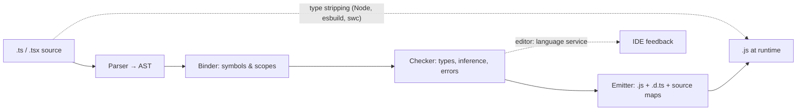

## TL;DR

- TypeScript is a **compile-time** tool: types are erased, so every trust boundary (HTTP, queues, storage, `JSON.parse`) still needs runtime validation.
- The type system is **structural**, not nominal. Two types with the same shape are interchangeable, which is convenient until an `OrderId` is accepted where a `UserId` was expected; use branded types for identifiers.
- The highest-leverage features are **discriminated unions + exhaustive checks**, `unknown` at boundaries, and `strict` mode. Clever conditional types are rarely where the value is.
- At scale, TypeScript is a **build-performance and module-boundary** problem: project references, `isolatedDeclarations`, and keeping type-only imports cheap.
- The toolchain is shifting: TypeScript 7 is a native (Go) port of the compiler, and Node.js can now run `.ts` files by stripping types. Both reward "erasable-only" syntax (no `enum`, no `namespace`).

## Core Concepts

### Structural typing and its escape hatches

A value is assignable to a type if it has *at least* the required members. That makes mocking and adapters easy, but it means the compiler cannot tell two semantically different strings apart.

```ts
type Brand<T, B extends string> = T & { readonly __brand: B };
type UserId = Brand<string, 'UserId'>;
type OrderId = Brand<string, 'OrderId'>;

const asUserId = (raw: string): UserId => raw as UserId; // the only place a cast is allowed

function cancelOrder(id: OrderId) { /* ... */ }
cancelOrder(asUserId('u_123')); // ✖ compile error: UserId is not assignable to OrderId
```

Excess-property checks are the one place TypeScript behaves "nominally-ish": object **literals** with unknown keys are rejected, but the same object passed through a variable is not.

### `any`, `unknown` and `never`

- `any` switches the checker off *and spreads*: anything derived from `any` is `any`.
- `unknown` is the type-safe top type. You must narrow it before use, so it is the right type for data you don't control.
- `never` is the empty type. It is what's left after you've handled every case, which is why it powers exhaustiveness checks.

### Discriminated unions and exhaustiveness

Model states so illegal combinations cannot be represented, then let the compiler prove every state is handled.

```ts
type Payment =
  | { status: 'pending'; createdAt: Date }
  | { status: 'settled'; settledAt: Date; reference: string }
  | { status: 'failed'; reason: 'card_declined' | 'fraud' | 'timeout' };

function describe(p: Payment): string {
  switch (p.status) {
    case 'pending': return `Pending since ${p.createdAt.toISOString()}`;
    case 'settled': return `Settled (${p.reference})`;
    case 'failed':  return `Failed: ${p.reason}`;
    default: {
      const unreachable: never = p; // adding a new status breaks the build here
      return unreachable;
    }
  }
}
```

### Validate at the boundary, infer inside

Types describe what you *believe*; a schema library checks what you *receive*. Derive the type from the schema so the two cannot drift.

```ts
import { z } from 'zod';

const OrderEvent = z.object({
  orderId: z.string().min(1),
  total: z.number().nonnegative(),
  currency: z.enum(['GBP', 'EUR', 'USD']),
});
type OrderEvent = z.infer<typeof OrderEvent>;

export function parseOrderEvent(body: unknown): OrderEvent {
  return OrderEvent.parse(body); // throws with a precise path on bad input
}
```

### Generics, constraints and inference

Good generics *relate* inputs to outputs. If a type parameter appears only once, it is usually not needed.

```ts
// The key type K links the argument to the return type.
function pluck<T, K extends keyof T>(items: readonly T[], key: K): T[K][] {
  return items.map((i) => i[key]);
}

// `satisfies` checks a value against a type without widening it.
const routes = {
  home: '/',
  topic: '/topics/:id',
} satisfies Record<string, `/${string}`>;
type RouteName = keyof typeof routes; // 'home' | 'topic', not string
```

### Erasable syntax and the changing toolchain

Node.js can execute TypeScript directly by **stripping** type annotations. Type stripping is enabled by default from Node.js 23.6 and was backported to 22.18. Stripping cannot handle syntax that generates runtime code: `enum`, `namespace` with values, and constructor parameter properties. TypeScript 5.8 added `--erasableSyntaxOnly` to forbid those constructs. Prefer union literal types or `as const` objects over `enum`.

TypeScript 7 is the native port of the compiler and language service, giving large speed-ups on big codebases. TypeScript 7 removes options that 6.0 deprecated (for example `target: ES5` and `moduleResolution: node10`). Check your `tsconfig` against the release notes before upgrading.

## How It Works

The compiler parses, binds symbols, type-checks, then emits. Type information is used only up to the checker; everything after that is plain JavaScript.



Bundlers (esbuild, swc, Vite) usually only *strip* types per file for speed and run `tsc --noEmit` separately for checking. That is why `isolatedModules` matters: each file must be transpilable without whole-program type information.

## When to Use / Trade-offs

| Technique | Use when | Avoid when | Cost |
|---|---|---|---|
| `strict: true` | Always on new code | — | Migration effort on legacy code |
| Branded types | IDs, money, units, sanitised strings | Values with no mix-up risk | Constructor/cast functions at the boundary |
| Runtime schemas (Zod, Valibot) | Any untrusted input | Purely internal calls | Bundle size, small runtime cost |
| Conditional / mapped types | Library-level APIs, deriving types from config | App code where a plain type is clearer | Readability, slower type-checking |
| `enum` | Rarely; legacy code | Code run via type stripping | Runtime object, not erasable |
| Project references | Monorepos, more than ~100k LOC | Small single packages | Build configuration complexity |

## Common Pitfalls & Anti-patterns

- **Casting instead of validating** — `as User` on `await res.json()` lies to the compiler; the bug surfaces far from the cause.
- **`any` leakage** — one `any` in a shared util silently disables checking for every caller. Lint with `no-explicit-any` and `no-unsafe-*`.
- **Optional-everything types** — `{ a?: X; b?: Y }` instead of a union of valid states. The code then fills with defensive checks.
- **Type-level over-engineering** — 40-line conditional types that only one person understands; they also slow down the editor for everyone.
- **Trusting `strictNullChecks` with arrays** — `arr[0]` is typed `T`, not `T | undefined`, unless `noUncheckedIndexedAccess` is on.
- **Barrel files everywhere** — `index.ts` re-exports defeat tree-shaking in some setups and cause slow type-checking and circular imports.

## Real-world Scenario

**Context:** A payments platform team (12 engineers, ~300k LOC TypeScript) had repeated production incidents where webhook payloads from a provider changed shape. Types said `amount: number`; the provider started sending strings for some currencies.

**Decision:** Every inbound adapter got a Zod schema as the single source of truth, with the TS type inferred from it. Parsing failures went to a dead-letter queue with the schema error path attached. Money became a branded `Minor<'GBP'>` integer type.

**Outcome:** The next provider change produced 40 DLQ messages with exact error paths instead of corrupted ledger entries. Type-check time grew ~8%, offset by moving to project references.

**What I'd do differently:** Generate the schemas from the provider's OpenAPI spec and run a contract test nightly, so drift is found before production does.

## Interview Questions

### What is the difference between `any`, `unknown` and `never`, and when do you use each? {#unknown-any-never}

**Level:** Foundation

**Model answer:**
`any` opts out of type checking and is contagious: results of operations on `any` are also `any`. `unknown` is the safe top type: anything is assignable to it, but you must narrow it (`typeof`, `instanceof`, a schema parse) before using it. `never` is the bottom type with no values. It appears after exhaustive narrowing, as the return type of functions that throw or never return, and in conditional types to filter members out.

Use `unknown` for untrusted input (`catch (e)`, `JSON.parse`, API bodies), `never` for exhaustiveness checks, and `any` only as a temporary migration aid behind a lint rule.

**What the interviewer is looking for:**
That `unknown` is the default for the edges of a system and `any` is a deliberate, tracked exception. Strong candidates mention `useUnknownInCatchVariables` (on under `strict`).

**Follow-ups:**
- How would you find and reduce `any` usage across a large codebase?
- Why does `catch (e)` give you `unknown` under `strict`?

**Red flags:**
- "`unknown` and `any` are basically the same."
- Using `any` to "fix" a compile error without explaining the risk.

### How do discriminated unions help model domain state, and how do you guarantee every case is handled? {#discriminated-unions}

**Level:** Senior

**Model answer:**
A discriminated union is a union of object types sharing a literal property (the discriminant, e.g. `status`). Narrowing on that property gives access to the fields valid only in that state, so illegal combinations (a `failed` payment with a `settledAt`) cannot be represented.

To guarantee exhaustiveness, assign the value to a `never` variable in the `default` branch, or use a helper `assertNever(x: never)`. Adding a new variant then fails compilation everywhere it isn't handled. The compiler does the impact analysis for you.

**What the interviewer is looking for:**
"Make illegal states unrepresentable" as a design principle, not just syntax. Bonus: the same idea applied to API responses and reducer actions, and the caveat that the data must still be validated at runtime to actually be in one of those states.

**Follow-ups:**
- How would you serialise and validate a discriminated union arriving over HTTP?
- When does a union become unwieldy and a class hierarchy or state machine library is better?

**Red flags:**
- Modelling state with several optional booleans (`isLoading`, `isError`, `isDone`).
- Not knowing how to make the compiler flag unhandled cases.

### TypeScript is structurally typed. Where does that bite you, and what do you do about it? {#branded-types}

**Level:** Senior

**Model answer:**
Any two types with compatible shapes are interchangeable, so `UserId` and `OrderId` (both `string`) can be swapped silently, as can `Celsius` and `Fahrenheit` numbers. Branded (or "opaque") types intersect the primitive with a unique phantom property, so values must come through a constructor function that validates or at least marks them.

Other structural surprises: methods are checked bivariantly (unless `strictFunctionTypes` applies to function *properties*), and excess-property checks only apply to fresh object literals.

**What the interviewer is looking for:**
Concrete examples of mix-up bugs, a branding technique, and keeping the cast in exactly one place.

**Follow-ups:**
- How do brands interact with JSON serialisation and schema libraries?
- Would you brand every string in the domain? Where do you stop?

**Red flags:**
- Believing TypeScript is nominal like Java or C#.
- Branding by sprinkling `as` casts throughout the codebase.

### Your service's types say a field is always present, yet production crashes reading it. How did that happen and how do you prevent it? {#runtime-validation}

**Level:** Senior

**Model answer:**
Types are erased at runtime. Somewhere data crossed a boundary (HTTP response, message, DB row, `localStorage`, a third-party SDK typed with `any`) and was *asserted* to have a type with `as` or an untyped return, never *checked*.

Prevention:
1. Treat every boundary as `unknown` and parse with a schema (Zod, Valibot, or generated validators from OpenAPI/JSON Schema).
2. Infer the TS type from the schema so there is one source of truth.
3. Fail loudly at the edge (reject the request, dead-letter the message) with the error path.
4. Lint against unsafe `any` flows (`@typescript-eslint/no-unsafe-*`), and enable `noUncheckedIndexedAccess`.

**What the interviewer is looking for:**
A clear mental model that TS is compile-time only, plus a systematic boundary strategy rather than "add more null checks".

**Follow-ups:**
- What is the performance cost of validating every message, and when would you skip it?
- How do you keep schemas in sync with another team's API?

**Red flags:**
- "Add optional chaining everywhere."
- Not realising `res.json()` returns `any`.

### You inherit a 500k-line JavaScript codebase with weak tests. How would you migrate it to strict TypeScript without freezing feature work? {#large-migration}

**Level:** Architect

**Model answer:**
Treat it as an incremental, measurable programme, not a big-bang rewrite:

1. **Enable TS with `allowJs` + `checkJs: false`** so the build accepts both; ship nothing new in JS (lint rule).
2. **Convert leaves first.** Utilities and domain models have the most dependants and the fewest dependencies, so types propagate upward.
3. **Strictness ratchet.** Turn on `strict` per directory using separate `tsconfig`s or project references, or use a tool that tracks error counts and only allows them to go down in CI.
4. **Boundaries early.** Add runtime schemas for API and DB edges first; that's where the real bugs are.
5. **Track it.** Count files converted, `any` and `@ts-expect-error` totals, and type-check time on a dashboard; review monthly.
6. **Codemods** for mechanical work (e.g. `ts-migrate`, or AI-assisted conversion reviewed by humans), and humans for domain modelling.

Expect type-checking to surface real latent bugs. Budget time to fix them and test around them.

**What the interviewer is looking for:**
Sequencing, risk management, measurable progress, and not stopping delivery. Architect-level answers talk about ownership (who converts what), CI enforcement, and communication of value to non-engineers.

**Follow-ups:**
- How would you prioritise which modules to convert first?
- How do you stop the `any` count from creeping back up?
- What would make you abandon or pause the migration?

**Red flags:**
- "Freeze features and rewrite it."
- Turning on `strict` globally on day one and littering `// @ts-ignore`.

### Type-checking in your monorepo takes 9 minutes in CI and editors are sluggish. What do you do? {#monorepo-build-performance}

**Level:** Architect

**Model answer:**
First measure: `tsc --extendedDiagnostics` and `--generateTrace` show which files and types dominate.

Then:
- **Project references** (`composite: true`) so packages build incrementally and editors load only what they need.
- **`isolatedDeclarations`** (TS 5.5+) so `.d.ts` files can be emitted per file by fast tools, without whole-program inference.
- **Explicit return types on exported functions** to stop expensive inference chains.
- **Simplify hot types**: huge unions, deep conditional types, and generic-heavy libraries (some ORMs and form libs) often dominate check time.
- **Remove barrel files** that force loading entire packages.
- **Cache** `tsbuildinfo` in CI.
- **Evaluate the TypeScript 7 native compiler.** Microsoft reported roughly 10x faster full builds on large projects such as VS Code.

**What the interviewer is looking for:**
Measure before optimising; knowing the levers at the architecture level (package boundaries) rather than only compiler flags.

**Follow-ups:**
- What trade-offs do project references introduce for developers?
- How would you prevent regressions in type-check time?

**Red flags:**
- "Turn off type checking in CI and rely on the editor."
- Jumping straight to a new tool without profiling.

### When do you use an `interface` and when a `type` alias? {#interface-vs-type}

**Level:** Foundation

**Model answer:**
Both describe object shapes, and for most object types they are interchangeable. The differences:

- **Only `type` can express** unions (`'a' | 'b'`), tuples, mapped and conditional types, and aliases of primitives or function types.
- **Only `interface` supports declaration merging:** two `interface Window` declarations merge. This is essential for augmenting library or global types (`declare module 'express' { interface Request { user?: User } }`), and a hazard if it happens by accident.
- **Extension:** `interface A extends B` reports incompatible members as errors at the declaration. Intersections (`type A = B & C`) can silently produce `never` members when properties conflict.
- **Performance:** for large, heavily composed object types, the TypeScript team recommends interfaces with `extends` over deep intersections, because the compiler caches interface relationships better.

A common convention: `interface` for object shapes that are public, extended or augmented; `type` for unions, utility compositions and everything else. Consistency within a codebase matters more than the choice itself.

**What the interviewer is looking for:**
The real capability differences (unions, merging), the intersection pitfall and a pragmatic convention.

**Follow-ups:**
- Show how you would add a `user` property to Express's `Request` type.
- What happens with `type A = { x: string } & { x: number }`?

**Red flags:**
- "They're exactly the same."
- Long arguments about style with no mention of merging or unions.

### How does type narrowing work, and how do you write your own type guards? {#narrowing}

**Level:** Foundation

**Model answer:**
TypeScript follows control flow and **narrows** a union to a more specific type inside branches:

- `typeof x === 'string'` for primitives; `x instanceof Date` for classes.
- `'kind' in x` for property checks; equality on a discriminant (`if (shape.kind === 'circle')`).
- Truthiness and `!= null` checks remove `null` and `undefined`.
- `Array.isArray(x)`, and early returns or throws that narrow the rest of the function.

For custom checks, write a **type predicate** or an **assertion function**:

```ts
function isApiError(e: unknown): e is { code: string; message: string } {
  return typeof e === 'object' && e !== null && 'code' in e && typeof (e as { code: unknown }).code === 'string';
}

function assertDefined<T>(v: T | undefined, name: string): asserts v is T {
  if (v === undefined) throw new Error(`${name} is required`);
}
```

The compiler trusts predicates blindly. A wrong `is` predicate is as unsafe as a cast, so keep them small and tested, or derive them from a validation schema. Since TypeScript 5.5, simple predicates can be **inferred** from functions like `x => x !== undefined` (so `.filter()` narrows array element types).

**What the interviewer is looking for:**
The built-in narrowing forms, predicates and assertion functions, and awareness that predicates are unchecked promises.

**Follow-ups:**
- Why doesn't narrowing survive inside a callback in some cases?
- When would you prefer an assertion function over a predicate?

**Red flags:**
- Using `as` casts everywhere instead of narrowing.
- Predicates whose implementation doesn't actually check what they claim.

### How do generics and constraints work? Give a practical example. {#generics}

**Level:** Foundation

**Model answer:**
Generics let a function or type work over many types while **preserving the relationship** between input and output types, instead of collapsing them to `any` or `unknown`.

```ts
function groupBy<T, K extends PropertyKey>(items: readonly T[], key: (item: T) => K): Record<K, T[]> {
  const out = {} as Record<K, T[]>;
  for (const item of items) (out[key(item)] ??= []).push(item);
  return out;
}

const byStatus = groupBy(orders, (o) => o.status); // Record<'paid' | 'pending', Order[]>
```

- **Constraints** (`K extends PropertyKey`, `T extends { id: string }`) restrict what callers can pass, and let the implementation use those members.
- **`keyof` and indexed access** connect types: `function get<T, K extends keyof T>(obj: T, key: K): T[K]` returns exactly the property's type.
- **Inference:** callers rarely write type arguments. TypeScript infers them from arguments. `const` type parameters (TypeScript 5.0) infer literal types: `<const T>`.
- **Defaults:** `type ApiResponse<T = unknown>`.

Guidelines: a type parameter should appear at least twice (relating things). If it's used once, a plain type or `unknown` is simpler. Avoid unnecessary generics that only make signatures harder to read.

**What the interviewer is looking for:**
Generics as relationships between types, constraints, `keyof`, inference, and restraint in using them.

**Follow-ups:**
- What does `<const T>` change?
- Why is `function f<T>(x: T): void` a code smell?

**Red flags:**
- Generics used purely as decoration.
- Reaching for `any` when a generic would preserve the types.

### Explain mapped and conditional types, including `infer`. Build a small utility. {#conditional-mapped-types}

**Level:** Senior

**Model answer:**
**Mapped types** transform each property of a type:

```ts
type Mutable<T> = { -readonly [K in keyof T]: T[K] };
type Getters<T> = { [K in keyof T & string as `get${Capitalize<K>}`]: () => T[K] }; // key remapping (4.1+)
```

**Conditional types** choose a type based on a test: `T extends U ? X : Y`. They **distribute** over unions when `T` is a naked type parameter: `NonNullable<A | null>` applies to each member. Wrap the parameter in a tuple (`[T] extends [U]`) to disable distribution.

**`infer`** captures part of a type inside a conditional:

```ts
type Awaited2<T> = T extends PromiseLike<infer U> ? Awaited2<U> : T;
type ElementOf<T> = T extends readonly (infer E)[] ? E : never;
type Handler<E> = E extends { type: infer K extends string; payload: infer P } ? (p: P) => void : never;

type DeepReadonly<T> = T extends (...args: never[]) => unknown
  ? T
  : T extends object
    ? { readonly [K in keyof T]: DeepReadonly<T[K]> }
    : T;
```

The built-ins (`Partial`, `Pick`, `Omit`, `ReturnType`, `Parameters`, `Awaited`) are written this way.

Use them with restraint. Heavy type-level programming slows the compiler, produces unreadable errors and is hard for teammates to maintain. Prefer simple explicit types in application code. Reserve clever types for library boundaries where they make many call sites safer.

**What the interviewer is looking for:**
Fluency with the mechanics (key remapping, distribution, `infer`), a working utility, and judgement about complexity.

**Follow-ups:**
- Why does `Omit` not distribute over unions, and how would you write a distributive version?
- How do you debug a slow type?

**Red flags:**
- Unable to read the built-in utility definitions.
- Type-level puzzles in everyday application code.

### What's the difference between an optional property and one typed `| undefined`, and why does it matter? {#optional-vs-undefined}

**Level:** Senior

**Model answer:**
- `{ name?: string }` means the property **may be absent**. Reading it gives `string | undefined`.
- `{ name: string | undefined }` means the property **must be present** but may hold `undefined`. Callers must write `name: undefined` explicitly.

By default, TypeScript also lets you *assign* `undefined` to an optional property, so the two blur together. With **`exactOptionalPropertyTypes`**, `name?: string` no longer accepts an explicit `undefined`. That matches runtime semantics that care about the difference:
- `'name' in obj` and `Object.keys` see an explicitly set `undefined` key.
- Spreading `{ ...defaults, ...overrides }` with `name: undefined` **overwrites** the default with `undefined`, a classic configuration bug.
- JSON serialisation drops `undefined` properties, while PATCH semantics may treat "absent" as "don't change" and `null` as "clear".

Design advice:
- Use optional for "may be omitted" and `| undefined` (or `| null`) for "present but empty" when the API distinguishes them.
- Turn on `exactOptionalPropertyTypes` in new code.
- Model PATCH payloads explicitly: absent means unchanged, `null` means clear.

**What the interviewer is looking for:**
The precise semantic difference, the compiler flag, and real bugs it prevents (spread overrides, PATCH semantics).

**Follow-ups:**
- How would you type a PATCH request body?
- Why might enabling `exactOptionalPropertyTypes` be painful in an existing codebase?

**Red flags:**
- Treating `?` and `| undefined` as identical.
- Not knowing that spreading `undefined` overrides defaults.

### How do you keep types consistent between the frontend and backend across an API boundary? {#end-to-end-types}

**Level:** Senior

**Model answer:**
Types are erased at runtime, so the boundary needs **one source of truth** plus **runtime validation**. Options:

- **Schema-first with code generation:** an OpenAPI (or GraphQL, or Protobuf) specification is the contract. Generate TypeScript clients and server types (openapi-typescript, GraphQL Codegen, buf). It suits polyglot systems and public APIs, and contract-diff tools can block breaking changes in CI.
- **Code-first with a shared schema library:** define Zod (or Valibot) schemas in a shared package, validate on the server, infer TypeScript types with `z.infer`, and optionally generate OpenAPI from the schemas. Good for TypeScript-only stacks.
- **End-to-end typed RPC** (tRPC, server functions in full-stack frameworks): the client imports the server router's *types*, so changes surface immediately as compile errors. It needs a monorepo or tightly coupled deploys, and it suits internal apps more than public APIs.

Whatever the choice:
- **Validate untrusted input at runtime** on the server, and validate responses from third parties too.
- **Version and evolve compatibly:** frontend and backend deploy at different times, and mobile clients may be months old. Additive changes only, with deprecation windows.
- **Don't share internal domain or database types directly** as API types. It couples the client to the persistence model.

**What the interviewer is looking for:**
Single source of truth, runtime validation, trade-offs between the approaches, and attention to deploy skew and versioning.

**Follow-ups:**
- A mobile app version from 6 months ago is still in use. How does that change your approach?
- How would you detect a breaking API change in CI?

**Red flags:**
- Hand-copying interfaces between repositories.
- Assuming the compile-time types protect the server from bad input.

### You're designing the public TypeScript API of a library used by 200 internal services. What principles guide you? {#library-type-design}

**Level:** Architect

**Model answer:**
- **Ergonomics first:** callers should rarely write type arguments. Design signatures so inference does the work (`const` type parameters, overloads only where they really help). Good autocompletion and short, clear error messages matter more than maximum type precision.
- **Accept wide, return narrow:** accept `readonly T[]` and interfaces describing only what you use. Return precise types, but avoid leaking internal types.
- **Model states explicitly:** discriminated unions for results (`{ ok: true; value } | { ok: false; error }`) and branded types for ids that must not be mixed.
- **Keep complexity behind the boundary:** clever generics in the internals are fine, but public types should be readable in a hover tooltip. Export named types callers may need (`export type CreateOrderInput`).
- **Treat types as API for semantic versioning:** narrowing a parameter type, widening a return type, adding a required property or renaming an exported type are **breaking changes**. Run type-level tests (`expectTypeOf`, `tsd`) and API-report tools (API Extractor) in CI to catch accidental changes.
- **Plan compatibility:** declare the supported TypeScript version range, and test against the minimum and latest compiler (and the new native compiler).
- **Ship types properly:** correct `exports` maps with `types` conditions, ESM and CommonJS as needed, `isolatedDeclarations` (TypeScript 5.5) for fast declaration emit, and no dependence on consumers' `skipLibCheck`.
- **Document with TSDoc** on exported members, marking deprecations with `@deprecated` so editors flag them.

**What the interviewer is looking for:**
Inference-friendly design, variance thinking (accept wide, return narrow), types as part of semantic versioning with automated checks, and packaging and compiler-version concerns.

**Follow-ups:**
- Is adding an optional property to an input type a breaking change? To an output type?
- How would you deprecate and remove an exported function across 200 consumers?

**Red flags:**
- Exposing deeply nested conditional types in every signature.
- No tooling to detect type-level breaking changes.

### Node.js can now run TypeScript by stripping types. Should your services drop the build step? {#type-stripping}

**Level:** Architect

**Model answer:**
Recent Node.js versions can execute `.ts` files directly by **type stripping**: removing type annotations without type-checking (unflagged from Node 23.6 and backported to 22.18). Deno and Bun run TypeScript natively too.

What changes:
- Only **erasable syntax** works. Enums, namespaces with runtime code, parameter properties (`constructor(private x)`) and legacy decorators need transformation. TypeScript's **`erasableSyntaxOnly`** flag (5.8) makes the compiler reject them, keeping code strippable.
- Imports must reference real file extensions (`./util.ts`), with `rewriteRelativeImportExtensions` or `allowImportingTsExtensions` configured to match.
- **Type checking doesn't disappear.** It moves to the editor and CI (`tsc --noEmit`). Running without a check step means type errors reach production.

Trade-offs for services:
- **Pros:** simpler development loops, no build output to manage, faster startup in development, fewer source-map problems.
- **Cons:** no bundling or minification (usually irrelevant on the server), no down-levelling, tooling and observability agents may not all support it yet, and code paths through `node_modules` still need JavaScript.
- **Libraries** should still publish compiled JavaScript plus `.d.ts` files. Node deliberately does not strip types inside `node_modules`.

A sensible approach: adopt it for scripts, tooling and new services, enable `erasableSyntaxOnly` estate-wide to keep options open, keep `tsc --noEmit` (or the faster native compiler) as a required CI check, and keep a build step where bundling, decorators or older runtimes require it.

**What the interviewer is looking for:**
Accurate understanding (stripping, not checking), syntax constraints, where checking moves, the library caveat and an incremental adoption plan.

**Follow-ups:**
- How would you migrate away from enums at scale?
- What happens to decorators-based frameworks like NestJS?

**Red flags:**
- Believing Node now type-checks code.
- Dropping the CI type-check step.

### How would you set and enforce TypeScript standards across 30 repositories and 12 teams? {#org-type-standards}

**Level:** Architect

**Model answer:**
- **Shared configuration packages:** `@acme/tsconfig` (a strict base: `strict`, `noUncheckedIndexedAccess`, `exactOptionalPropertyTypes`, `verbatimModuleSyntax`, `erasableSyntaxOnly`) and `@acme/eslint-config` with type-aware rules: `no-floating-promises`, `no-unsafe-*`, `switch-exhaustiveness-check`, `consistent-type-imports`. Versioned and updated by automated dependency PRs (Renovate).
- **A golden-path template** so new services start compliant.
- **Ratchets for existing code:**
  - Track `any` counts, `@ts-expect-error`s and `as` casts per repository.
  - CI fails if a count *increases*. Counts can only go down.
  - Enable stricter flags per directory or project reference as code is cleaned.
- **Runtime boundaries:** require schema validation at every input boundary (HTTP, messages, environment configuration) with a shared library, checked in code review and by lint rules where possible.
- **Compiler upgrades as a service:** a platform or guild owns TypeScript version upgrades, using codemods and fixing the shared configuration first, so teams aren't individually stuck on old versions.
- **Make it visible:** a dashboard of strictness levels and ratchet trends per repository, plus short guidance and examples in the engineering handbook.
- **Community:** a TypeScript guild with office hours and a decision log (ADRs) for why each rule exists, so rules can be challenged and changed.

**What the interviewer is looking for:**
Automation over policing, ratchets for legacy code, runtime-boundary standards, centralised upgrades and an explained rule set.

**Follow-ups:**
- A team says strict mode slows them down. How do you respond?
- How do you roll out a new lint rule that flags 4,000 existing violations?

**Red flags:**
- Mandating strict mode everywhere overnight.
- Rules without reasons, enforced only in code review.

## Cheat Sheet

### Types

- **`unknown` vs `any`** — `unknown` must be narrowed before use; `any` disables checking and spreads.
- **`never`** — the empty type; use for exhaustiveness checks via `const x: never = value`.
- **Discriminated union** — a union with a shared literal field; narrowing on it unlocks state-specific fields.
- **Branded type** — `T & { __brand: 'X' }` to make structurally identical types incompatible.
- **`satisfies`** — checks a value against a type but keeps the narrower inferred type.

### Configuration

- **`strict`** — turns on the strict family, including `strictNullChecks` and `useUnknownInCatchVariables`.
- **`noUncheckedIndexedAccess`** — index access returns `T | undefined`; catches off-by-one and missing-key bugs.
- **`isolatedModules`** — every file must be transpilable on its own; required by esbuild/swc/Vite.
- **`erasableSyntaxOnly`** — bans `enum`, value `namespace` and parameter properties so type stripping works.
- **Project references** — split a large codebase into incrementally built projects with `composite: true`.

### Runtime

- **Types are erased** — validate all untrusted input with a schema and infer the type from it.
- **Type predicate** — `x is T` return type; the compiler trusts it blindly, so keep the check honest.
- **`infer`** — captures part of a type inside a conditional type, e.g. `T extends Promise<infer U> ? U : T`.
- **`exactOptionalPropertyTypes`** — `a?: string` stops accepting an explicit `undefined`; catches spread-overrides-default bugs.

## Further Reading

- [TypeScript Handbook](https://www.typescriptlang.org/docs/handbook/intro.html) — the official language guide.
- [TSConfig reference](https://www.typescriptlang.org/tsconfig/) — every compiler option, with explanations.
- [TypeScript release notes](https://www.typescriptlang.org/docs/handbook/release-notes/overview.html) — what changed and what was deprecated, version by version.
- [Node.js: running TypeScript natively](https://nodejs.org/api/typescript.html) — type stripping and its limits.
- [Zod documentation](https://zod.dev/) — schema-first runtime validation with inferred types.
