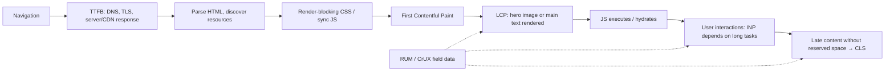

## TL;DR

- Web performance is about **user-perceived speed and responsiveness**, measured best by **Core Web Vitals** from real users: **LCP** (loading, ≤ 2.5 s), **INP** (responsiveness, ≤ 200 ms) and **CLS** (visual stability, ≤ 0.1), at the 75th percentile.
- The biggest levers: **send less** (JavaScript, images, fonts), **send it sooner** (server rendering, CDN, caching, priority hints), and **keep the main thread free** (no long tasks).
- Use **field data** (RUM, CrUX) to know where users suffer and **lab tools** (Lighthouse, DevTools, WebPageTest) to diagnose.
- Enforce **performance budgets** in CI and watch third-party scripts — performance regresses by default as features are added.
- Speed is a business metric: faster pages improve conversion, engagement and SEO; make that case with your own data.

## Core Concepts

### Core Web Vitals

| Metric | Measures | Good (p75) | Common causes of poor scores |
|---|---|---|---|
| **LCP** (Largest Contentful Paint) | When the main content (largest image/text block) renders | ≤ 2.5 s | Slow server response, render-blocking resources, late-discovered or unoptimised hero images, client-side rendering |
| **INP** (Interaction to Next Paint) | Latency from user input to the next frame, across the visit | ≤ 200 ms | Long tasks, heavy event handlers, large re-renders, third-party scripts |
| **CLS** (Cumulative Layout Shift) | Unexpected layout movement | ≤ 0.1 | Images/ads/embeds without dimensions, late-loading fonts, injected banners |

INP replaced First Input Delay as a Core Web Vital in March 2024. Supporting metrics: **TTFB** (server and network), **FCP** (first paint), **TBT** (total blocking time in lab tests, a proxy for INP).

### The critical rendering path

The browser fetches HTML, discovers CSS and JS, builds the DOM and CSSOM, runs scripts, computes layout and paints. **Render-blocking** CSS and synchronous scripts in the `<head>` delay first paint.
- Inline or prioritise critical CSS; load the rest without blocking.
- Use `defer` (ordered, after parsing) or `async` (whenever loaded) for scripts; type `module` scripts are deferred by default.
- Make the LCP resource discoverable in the initial HTML; boost it with `fetchpriority="high"` and preload when needed.
- Preconnect to critical third-party origins.

```html
<link rel="preconnect" href="https://images.example-cdn.com" crossorigin>
<link rel="preload" as="image" href="/hero-1200.avif" imagesrcset="/hero-800.avif 800w, /hero-1200.avif 1200w" imagesizes="100vw" fetchpriority="high">
<script type="module" src="/app.js"></script>


```

### Images

Usually the heaviest bytes: modern formats (AVIF, WebP), responsive `srcset`/`sizes`, correct dimensions (width/height to prevent CLS), compression, `loading="lazy"` for below-the-fold images (never for the LCP image), image CDNs for on-the-fly resizing.

### JavaScript

Every byte of JS costs download, parse, compile and execute time on the main thread. Reduce it with code splitting, tree shaking, removing unused dependencies, server rendering/Server Components, lazy-loading heavy widgets, and moving work to Web Workers. Break up long tasks (> 50 ms) by yielding to the main thread.

### Fonts

Subset and self-host or use a fast font CDN, use WOFF2, preload the critical font, `font-display: swap` or `optional`, and size-adjusted fallbacks (`size-adjust`, `ascent-override`) to reduce layout shift when fonts swap.

### Caching and delivery

- Static assets with **content-hashed filenames** cached for a year (`Cache-Control: public, max-age=31536000, immutable`); HTML cached briefly or revalidated.
- **CDN** at the edge for static and cacheable dynamic content; **HTTP/2 or HTTP/3**; **Brotli** compression.
- **Service workers** for offline and repeat-visit speed; the **back/forward cache** (avoid `unload` handlers and `Cache-Control: no-store` that block it).
- **Speculative loading** (prefetch/prerender, e.g. the Speculation Rules API in Chromium) for likely next navigations.

## How It Works



Each stage has its own fixes: server/CDN for TTFB, resource discovery and priority for LCP, less JS and shorter tasks for INP, reserved space for CLS.

## When to Use / Trade-offs

| Technique | Use when | Avoid when | Trade-off |
|---|---|---|---|
| SSR / static generation | Content pages, SEO, slow devices | Highly interactive apps behind login (CSR may be fine) | Faster LCP vs server cost and hydration |
| Code splitting / lazy loading | Large apps, rarely used features | Critical above-the-fold UI (don't lazy-load the LCP) | Smaller initial JS vs extra requests later |
| Preload | The LCP resource or critical font isn't discoverable early | Many resources (preloading everything delays the important ones) | Earlier fetch vs bandwidth contention |
| Image CDN | Many images, many sizes | Very few static images | Automatic optimisation vs vendor cost |
| Service worker caching | Repeat visits, offline needs | Simple sites where complexity isn't justified | Speed and offline vs update complexity |
| Prerender/speculation | Predictable next navigation | Expensive pages, analytics side effects | Instant navigation vs wasted resources |
| Web Workers | CPU-heavy client work | Small tasks | Responsiveness vs complexity |

## Common Pitfalls & Anti-patterns

- **Optimising lab scores only** — Lighthouse 100 on a fast laptop while real mobile users suffer.
- **Lazy-loading the LCP image** or hiding it behind client-side rendering.
- **Shipping huge JavaScript bundles** for mostly static content.
- **Unbounded third-party tags** — analytics, chat widgets and A/B testing scripts dominating main-thread time.
- **Images without dimensions** — layout shifts.
- **Preloading too much** — the important resources wait.
- **Blocking the bfcache** with `unload` listeners.
- **Averages instead of percentiles** — slow users hidden.
- **No budgets** — gradual regression with every feature.

## Real-world Scenario

**Context:** An e-commerce site saw mobile conversion lag desktop significantly. Field data (CrUX) showed mobile LCP p75 of 4.1 s, INP p75 of 380 ms and CLS of 0.22. The product page shipped 1.2 MB of JS, the hero image was a 900 KB JPEG discovered late via JavaScript, and 14 third-party scripts loaded synchronously.

**Decision:** Server-rendered product pages with the hero image in the initial HTML (AVIF/WebP, responsive sizes, `fetchpriority="high"`); route-level code splitting and removal of two heavy libraries; deferred non-essential third parties and moved some to a tag manager with consent gating and loading after interaction; reserved space for images, reviews widget and promo banner; font preload with size-adjusted fallback; RUM monitoring with per-template dashboards and CI budgets.

**Outcome:** Mobile LCP p75 dropped to 2.1 s, INP to 160 ms, CLS to 0.04. An A/B test on a subset of traffic showed a meaningful conversion uplift for the faster variant, which secured ongoing investment.

**What I'd do differently:** Establish third-party governance earlier — marketing re-added scripts within months until a review process and budget per script existed.

## Interview Questions

### What are the Core Web Vitals, and what do they measure? {#core-web-vitals}

**Level:** Foundation

**Model answer:**
Google's user-centric metrics, assessed at the **75th percentile** of real-user visits:
- **Largest Contentful Paint (LCP):** time until the largest visible content element (hero image, heading block) renders — perceived load speed. Good ≤ 2.5 s.
- **Interaction to Next Paint (INP):** responsiveness — the latency from user interactions (clicks, taps, key presses) to the next frame, considering interactions throughout the visit. Good ≤ 200 ms. It replaced First Input Delay in March 2024.
- **Cumulative Layout Shift (CLS):** visual stability — how much visible content moves unexpectedly. Good ≤ 0.1.

They matter for user experience, conversion and search ranking signals. Measure them with real-user data (CrUX, RUM libraries like `web-vitals`) and diagnose with lab tools.

**What the interviewer is looking for:**
Accurate definitions, thresholds, p75, INP replacing FID and field measurement.

**Follow-ups:**
- Why the 75th percentile?
- What's TTFB's relationship to LCP?

**Red flags:**
- Still citing FID as a Core Web Vital.

### Explain the critical rendering path and how to optimise it. {#critical-rendering-path}

**Level:** Foundation

**Model answer:**
To render, the browser: downloads HTML → parses it into the DOM, discovering CSS, JS, images and fonts → downloads CSS and builds the CSSOM (CSS is **render-blocking**) → executes scripts (synchronous scripts block parsing) → combines DOM and CSSOM into a render tree → computes layout → paints and composites.

Optimisations:
- **Fast TTFB:** CDN, caching, efficient server rendering.
- **Minimise render-blocking resources:** inline critical CSS, load non-critical CSS asynchronously, `defer`/`async`/`module` scripts.
- **Early discovery of key resources:** LCP image and fonts referenced in HTML; `preload` and `fetchpriority` where needed; `preconnect` to critical origins.
- **Reduce bytes:** compression (Brotli), minification, smaller images.
- **Avoid long main-thread work** before first render.

**What the interviewer is looking for:**
The pipeline, render-blocking behaviour and specific optimisations.

**Follow-ups:**
- Difference between `async` and `defer`?
- When would you inline CSS?

**Red flags:**
- Unaware that CSS blocks rendering.

### What's the difference between lab and field performance data? {#lab-vs-field}

**Level:** Foundation

**Model answer:**
- **Lab data:** measurements in a controlled environment (Lighthouse, WebPageTest, DevTools) with fixed device, network and location. Reproducible and great for **diagnosis** and CI regression checks, but it doesn't reflect real users' devices, networks, caches or interactions (INP can't really be measured in lab; TBT is a proxy).
- **Field data (RUM):** measurements from real users — Chrome UX Report (CrUX) for public data, or your own RUM via the `web-vitals` library or monitoring tools. Shows the **actual distribution** across devices, regions and pages; essential for priorities and for INP.

Use field data to decide what to fix and confirm impact; use lab data to understand why and to prevent regressions. Segment field data by page template, device class, country and connection.

**What the interviewer is looking for:**
Clear roles of each and how they complement.

**Follow-ups:**
- Your Lighthouse score is 98 but CrUX says LCP is poor. Why?
- How would you collect RUM data?

**Red flags:**
- Treating a Lighthouse score as the goal.

### How do you optimise images for the web? {#image-optimisation}

**Level:** Foundation

**Model answer:**
- **Right format:** AVIF or WebP for photos (with fallbacks if needed), SVG for icons/illustrations, PNG only where necessary.
- **Right size:** responsive images with `srcset` and `sizes` so devices download appropriately sized files; don't serve 3000 px images to 400 px slots.
- **Compression** tuned for quality vs size; strip metadata.
- **Dimensions:** always set `width`/`height` (or `aspect-ratio`) to reserve space and prevent CLS.
- **Loading strategy:** `loading="lazy"` for below-the-fold images; **never lazy-load the LCP image** — give it `fetchpriority="high"` and make it discoverable in HTML.
- **`decoding="async"`** for non-critical images.
- **Image CDNs** for automatic resizing and format negotiation; long-lived caching with hashed URLs.
- **CSS backgrounds** are discovered late — avoid them for LCP images.

**What the interviewer is looking for:**
Formats, responsive sizing, dimensions for CLS, lazy loading rules and LCP prioritisation.

**Follow-ups:**
- How does `sizes` affect which image is chosen?
- Why are CSS background images bad for LCP?

**Red flags:**
- Lazy-loading every image including the hero.

### How do you improve a poor LCP? {#improving-lcp}

**Level:** Senior

**Model answer:**
Break LCP into sub-parts (from field data or DevTools): **TTFB**, **resource load delay** (time until the LCP resource starts loading), **resource load duration** and **element render delay**.

- **TTFB:** CDN caching, edge rendering, faster server/database, fewer redirects, cache HTML where possible.
- **Load delay:** make the LCP image discoverable in the initial HTML (not injected by JS or CSS backgrounds), `fetchpriority="high"`, `preload` if needed, avoid lazy-loading it, preconnect to its origin.
- **Load duration:** smaller image (AVIF/WebP, right size), image CDN, HTTP/2/3, compression.
- **Render delay:** remove render-blocking CSS/JS, avoid client-side rendering for main content (SSR/SSG), reduce main-thread work before paint, ensure fonts don't block text rendering (`font-display`).

Validate with field data after deployment; segment by page template and device.

**What the interviewer is looking for:**
Sub-part breakdown and targeted fixes for each.

**Follow-ups:**
- The LCP element is text, not an image. What do you check?
- How does SSR affect LCP?

**Red flags:**
- Generic "make it faster" without diagnosis.

### How do you improve INP? {#improving-inp}

**Level:** Senior

**Model answer:**
INP is driven by **main-thread availability** and how much work interactions trigger:
1. **Find slow interactions** from field data (RUM attribution: which element, which event, input delay vs processing time vs presentation delay).
2. **Reduce input delay:** break up long tasks running when users interact — hydration, third-party scripts, timers; yield to the main thread (`scheduler.yield()` where supported, `setTimeout`), defer non-critical work.
3. **Reduce processing time:** make event handlers do less synchronously — update the UI first, defer analytics and heavy work; debounce; use transitions in React for non-urgent updates; avoid large synchronous re-renders (colocate state, memoise, virtualise lists).
4. **Reduce presentation delay:** keep DOM size reasonable, avoid layout thrashing, minimise expensive style recalculations.
5. **Move heavy computation to Web Workers.**
6. **Govern third-party scripts.**

**What the interviewer is looking for:**
Field attribution, the three phases of interaction latency and concrete techniques.

**Follow-ups:**
- What's a long task, and how do you find them?
- How does hydration affect INP?

**Red flags:**
- Focusing only on network speed for INP.

### How do you find and fix layout shifts? {#fixing-cls}

**Level:** Senior

**Model answer:**
**Find:** field data with attribution (which element shifted, on which page), DevTools Performance panel layout shift regions, the Layout Instability API.

**Common causes and fixes:**
- **Images/videos/iframes without dimensions** → set `width`/`height` or `aspect-ratio`.
- **Ads, embeds and banners injected late** → reserve space (min-height placeholders); avoid inserting content above existing content unless in response to user interaction.
- **Web fonts swapping** → preload critical fonts, `font-display: optional` or size-adjusted fallbacks to match metrics.
- **Dynamic content loading** (reviews, recommendations) → skeletons with the final size.
- **Animations** that change layout properties → animate `transform`/`opacity` instead.
- **Cookie banners** → overlay rather than pushing content.

Shifts within 500 ms after user input are excluded from CLS, so expanding sections on click is fine.

**What the interviewer is looking for:**
Detection tools, common causes with fixes and the user-input exclusion.

**Follow-ups:**
- How do size-adjusted font fallbacks work?
- Why animate transform instead of top/left?

**Red flags:**
- Ignoring third-party embeds as CLS sources.

### Describe an effective caching strategy for web assets. {#asset-caching}

**Level:** Senior

**Model answer:**
- **Hashed static assets** (JS, CSS, images, fonts with content hashes in filenames): `Cache-Control: public, max-age=31536000, immutable` — cache forever; a new deploy produces new URLs.
- **HTML documents:** short caching with revalidation (`no-cache` meaning revalidate, or short `max-age` plus `stale-while-revalidate` at the CDN) so users get new deploys quickly.
- **CDN caching** close to users, with cache keys designed carefully (vary only on what matters), and purging on deploys if HTML is cached.
- **API responses:** cache where possible (public data) with `ETag`/`Last-Modified` and appropriate `max-age`/`s-maxage`; never cache personalised data in shared caches without the right `Vary`/`private` directives.
- **Service workers** for repeat visits and offline (precache app shell, runtime caching strategies), with careful update flows.
- **Back/forward cache** eligibility for instant back navigation.
- **Compression** (Brotli/gzip) at the edge.

**What the interviewer is looking for:**
Immutable hashed assets, HTML revalidation, CDN keys, API caching safety, service workers and bfcache.

**Follow-ups:**
- What does `immutable` change?
- How do you avoid users getting a stale HTML file pointing to deleted assets?

**Red flags:**
- Long caching on HTML without versioning.

### How do you load web fonts without hurting performance? {#font-loading}

**Level:** Senior

**Model answer:**
- **Use fewer fonts and weights**; consider variable fonts to replace multiple files.
- **WOFF2** format, **subsetting** to needed character sets (e.g. Latin only).
- **Self-host or use a fast CDN** on the same connection; `preconnect` if third-party.
- **Preload** the one or two fonts used above the fold.
- **`font-display`:** `swap` shows fallback text immediately then swaps (risk of shift); `optional` uses the font only if it loads very quickly (best for CLS); avoid invisible text periods.
- **Size-adjusted fallback fonts** (`size-adjust`, `ascent-override`, `descent-override`) to match metrics and minimise layout shift on swap.
- **Cache** long-term with hashed URLs.
- Consider **system fonts** for UI text where branding allows.

**What the interviewer is looking for:**
Reducing font bytes, early loading, font-display trade-offs and metric-matched fallbacks.

**Follow-ups:**
- When would you choose `optional` over `swap`?
- How do variable fonts help?

**Red flags:**
- Loading eight font weights from a third-party CSS file synchronously.

### How do you reduce JavaScript bundle size? {#bundle-optimisation}

**Level:** Senior

**Model answer:**
- **Measure:** bundle analysers (rollup/webpack visualisers, source-map-explorer), per-route budgets in CI, coverage tool in DevTools for unused code.
- **Code splitting:** by route and by interaction (load the editor, charting or map only when needed) with dynamic `import()`.
- **Tree shaking:** ESM dependencies, avoid side-effectful imports, import specific functions (`lodash-es` per function or native equivalents).
- **Remove or replace heavy dependencies:** moment.js → native `Intl`/date-fns/Temporal polyfill as needed; large UI kits → targeted components; check bundlephobia-style cost before adding.
- **Modern output:** target modern browsers (no unnecessary polyfills/transpilation), differential builds only if needed.
- **Server rendering and Server Components** to move code off the client.
- **Avoid duplicate dependencies** (multiple versions of the same library).
- **Third-party scripts** count too.

**What the interviewer is looking for:**
Measurement, splitting, tree shaking, dependency hygiene, modern targets and server-side rendering.

**Follow-ups:**
- How would you enforce a 170 KB JS budget per route?
- What prevents tree shaking from working?

**Red flags:**
- Not knowing what's in the bundle.

### How do you set up performance budgets and governance across teams? {#performance-budgets}

**Level:** Architect

**Model answer:**
- **Define budgets per page template** tied to user outcomes: e.g. JS ≤ 170 KB compressed on product pages, LCP p75 ≤ 2.5 s, INP p75 ≤ 200 ms, CLS ≤ 0.1, third-party JS ≤ X KB.
- **Automate in CI:** bundle size checks per PR (fail or warn on increases), Lighthouse CI or WebPageTest runs on key templates with thresholds; comment results on PRs.
- **Monitor in production:** RUM dashboards per template/device/region with alerts on regressions; deploy markers to correlate releases.
- **Ownership:** each page template has an owning team accountable for its budget; a performance champion network or platform team supports.
- **Process:** performance considered in design reviews; exceptions require justification and a plan; quarterly reviews of trends.
- **Third-party governance** with per-script budgets and approval.
- **Make it visible:** share wins and the business impact.

**What the interviewer is looking for:**
Concrete budgets, CI automation, RUM alerts, ownership and process.

**Follow-ups:**
- A feature can't ship without exceeding the budget. What happens?
- How do you attribute regressions to releases?

**Red flags:**
- Budgets that exist only in a document.

### How do you govern third-party scripts? {#third-party-scripts}

**Level:** Architect

**Model answer:**
Third parties (analytics, ads, A/B testing, chat, tag managers) often dominate main-thread time and add security and privacy risk.
- **Inventory and ownership:** list every script, its owner, purpose, cost (bytes, main-thread time, requests) and data collected.
- **Approval process:** new scripts need a business case, performance and security review, consent integration, and a budget.
- **Loading strategy:** load after main content and interaction where possible (defer, `requestIdleCallback`, on user action — e.g. load chat widget on click via a facade), avoid synchronous scripts, use `async`, and consider moving to Web Workers (e.g. Partytown-style approaches — VERIFY: maturity) or server-side tagging.
- **Facades:** lightweight placeholders for heavy embeds (video players, maps, chat) that load the real thing on interaction.
- **Security:** CSP allow-lists, Subresource Integrity where versions are fixed, sandboxed iframes, minimal data sharing.
- **Measure continuously** with RUM attribution and periodic audits; remove unused scripts.

**What the interviewer is looking for:**
Inventory, approval and budgets, loading strategies, facades, security and continuous measurement.

**Follow-ups:**
- Marketing wants a new A/B testing tool that blocks rendering. How do you respond?
- What's server-side tagging?

**Red flags:**
- Tag managers where anyone can add scripts to production.

### How do you optimise performance for a global audience? {#global-performance}

**Level:** Architect

**Model answer:**
- **CDN and edge:** cache static assets and cacheable HTML at edge locations worldwide; use edge rendering/functions for personalisation close to users.
- **Reduce round trips:** HTTP/2 or HTTP/3 (QUIC, faster connection setup and better on lossy mobile networks), TLS 1.3, connection reuse, fewer origins, preconnect.
- **Regional backends** or read replicas for dynamic data where latency matters; avoid cross-ocean API calls on the critical path.
- **Optimise for low-end devices and slow networks:** many users are on mid-range Android devices — less JS, server rendering, smaller images, testing with throttling and real devices.
- **Adaptive loading:** respond to `Save-Data`, network quality hints, and device memory where appropriate.
- **Localisation assets:** subset fonts per script/language; avoid shipping all locales' bundles.
- **Measure by region and device** in RUM; set targets per market.

**What the interviewer is looking for:**
Edge delivery, protocol improvements, regional data, low-end device focus, adaptive loading and segmented measurement.

**Follow-ups:**
- How does HTTP/3 help mobile users?
- What should run at the edge vs origin?

**Red flags:**
- Testing only on fast laptops in one region.

### How do you make the business case for web performance work? {#performance-business-case}

**Level:** Architect

**Model answer:**
- **Correlate performance with outcomes in your own data:** conversion, bounce rate, engagement, revenue per session segmented by LCP/INP buckets. Public case studies help, but your data persuades most.
- **Run experiments:** A/B test performance improvements (or artificial delays on a small cohort, carefully) to show causal impact.
- **Quantify:** "Improving mobile LCP from 4 s to 2.5 s on product pages is associated with X% more conversions → £Y per month."
- **Include SEO:** Core Web Vitals are part of search page experience signals; organic traffic matters for many businesses.
- **Cost savings:** less bandwidth and compute, fewer support issues.
- **Frame performance as a feature** in roadmaps with owners and success metrics, plus ongoing budgets to prevent regression.

**What the interviewer is looking for:**
Data-driven, experiment-backed, business-language case with ongoing governance.

**Follow-ups:**
- How would you design an experiment to prove performance impact?
- What if the data shows weak correlation?

**Red flags:**
- Arguing from Lighthouse scores alone.

### Field data shows LCP regressed by 800 ms last week. How do you investigate? {#diagnosing-regression}

**Level:** Architect

**Model answer:**
1. **Scope it:** which pages/templates, devices, browsers, regions? Is it all traffic or a segment (a market, a campaign landing page, a new browser version)?
2. **Correlate with changes:** deploys (deploy markers), feature flags, third-party script changes, CDN/config changes, content changes (a new huge hero image), traffic mix changes (a campaign bringing slower devices).
3. **Break down LCP sub-parts** from RUM attribution: TTFB (server/CDN), load delay, load duration, render delay — this narrows the cause.
4. **Reproduce in the lab** with the same conditions (device, network, region); compare before/after builds with WebPageTest/Lighthouse and DevTools traces.
5. **Fix and verify:** roll back or fix the cause; confirm in field data over following days (CrUX lags; your RUM is faster).
6. **Prevent recurrence:** add a CI check, budget or alert that would have caught it; document in a short postmortem.

**What the interviewer is looking for:**
Segmentation, change correlation, sub-part analysis, lab reproduction, verification and prevention.

**Follow-ups:**
- The regression is only on Safari. What next?
- TTFB increased but the code didn't change. What could it be?

**Red flags:**
- Guessing fixes without segmenting data.

## Cheat Sheet

### Metrics
- **LCP** — main content render; good ≤ 2.5 s at p75.
- **INP** — interaction to next paint; good ≤ 200 ms; replaced FID in March 2024.
- **CLS** — unexpected layout shift; good ≤ 0.1.
- **TTFB** — server and network time; foundation of LCP.
- **Lab vs field** — Lighthouse diagnoses; RUM/CrUX decides priorities.

### Techniques
- **LCP image** — in initial HTML, `fetchpriority="high"`, never lazy-loaded.
- **Responsive images** — `srcset`/`sizes`, AVIF/WebP, explicit dimensions.
- **Render-blocking** — CSS and sync scripts in head; use `defer`/`async`/module scripts.
- **Long task** — > 50 ms on the main thread; break up and yield.
- **Immutable caching** — hashed assets with one-year `immutable`; revalidate HTML.
- **Fonts** — WOFF2 subsets, preload critical font, size-adjusted fallbacks.
- **bfcache** — avoid `unload` handlers and `no-store` to keep instant back navigation.

### Governance
- **Performance budget** — per-template limits enforced in CI and monitored in RUM.
- **Third-party governance** — inventory, approval, budgets, facades, deferred loading.
- **Business case** — correlate vitals with conversion in your own data; run experiments.

## Further Reading

- [web.dev: Web Vitals](https://web.dev/articles/vitals) — definitions and thresholds of Core Web Vitals.
- [web.dev: Optimize LCP](https://web.dev/articles/optimize-lcp) — sub-part breakdown and fixes.
- [web.dev: Optimize INP](https://web.dev/articles/optimize-inp) — diagnosing and improving responsiveness.
- [MDN: Web performance](https://developer.mozilla.org/en-US/docs/Web/Performance) — fundamentals of the critical rendering path, caching and loading.
- [web-vitals library](https://github.com/GoogleChrome/web-vitals) — collecting field metrics with attribution.
- [Chrome UX Report (CrUX)](https://developer.chrome.com/docs/crux) — public field data for real-world performance.
