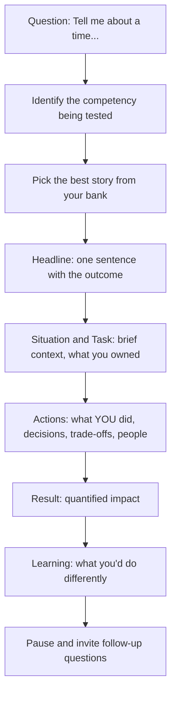
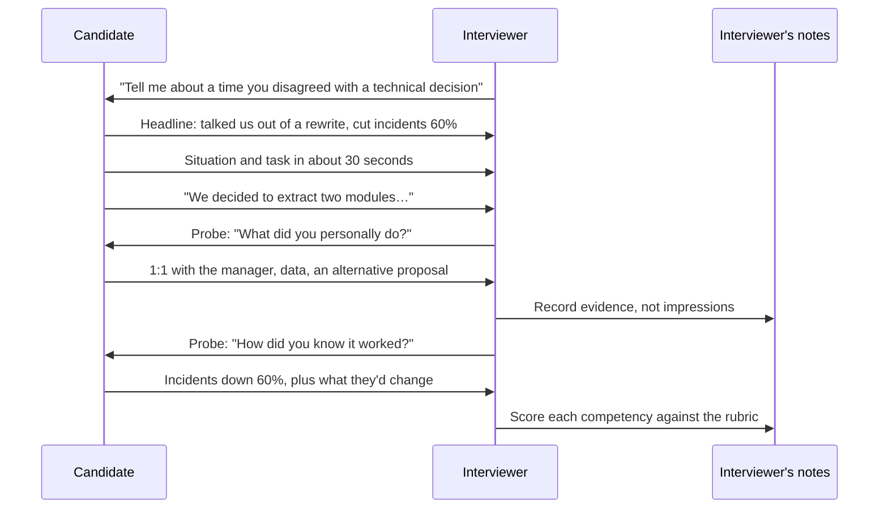

## TL;DR

- Behavioural interviews assume **past behaviour predicts future behaviour**. You'll be asked "Tell me about a time when…" and probed for specifics.
- Structure answers with **STAR**: **S**ituation, **T**ask, **A**ction, **R**esult — spending most time on *your* actions and the measurable result, then add what you **learned** (STAR+L).
- Prepare a **story bank** of 8–12 real, detailed stories that cover common competencies (conflict, failure, influence, leadership, ambiguity, delivery under pressure, mentoring) and can be adapted to many questions.
- At senior, staff and manager levels, interviewers look for **scope, judgement, influence and reflection**, not heroics. Say "I", quantify impact, and be honest about trade-offs and mistakes.
- Keep answers to **~2–3 minutes**, lead with a one-line summary, and invite follow-up rather than monologuing.

## Core Concepts

### The STAR structure

| Part | What to cover | Time | Common mistake |
|---|---|---|---|
| Situation | Context: team, company, stakes, constraints (1–2 sentences) | ~10% | Too much background |
| Task | Your responsibility or the goal; why it was hard | ~10% | Unclear what *you* owned |
| Action | What *you* did, how and why: decisions, trade-offs, conversations | ~60% | "We" everywhere; vague actions |
| Result | Outcome with numbers; what changed for users, business, team | ~20% | No result, or no evidence |
| (+ Learning) | What you'd do differently; how it changed your approach | brief | Skipping reflection |

Lead with a **headline**: "This is about how I got three teams to agree on a shared event schema, cutting integration incidents by 60%." Then tell the STAR story.

### What interviewers assess at senior+ levels

- **Scope and impact:** the size of the problem and the breadth of influence (team, multiple teams, organisation).
- **Ownership:** you saw something needed doing and did it.
- **Judgement:** how you weighed options and trade-offs, especially under uncertainty.
- **Influence and collaboration:** how you brought people along, handled disagreement, built alignment.
- **Leadership and growing others:** mentoring, delegating, raising the bar.
- **Self-awareness:** honest about mistakes, what you learned, how you changed.
- **Values:** customer focus, integrity, respect.

Many companies publish their values or leadership principles (e.g. Amazon's Leadership Principles); map your stories to them before the interview.

### Building a story bank

1. List 10–15 significant experiences from the last 3–5 years: projects, incidents, conflicts, failures, migrations, hires, mentoring.
2. For each, write STAR notes with **specific details and numbers** (latency from 800 ms to 120 ms, incidents down 40%, saved 2 engineer-months).
3. Tag each story with competencies it demonstrates (one story can cover several).
4. Check coverage: conflict, failure, influence without authority, leading change, ambiguity, prioritisation, mentoring, customer focus, delivering under pressure, disagreeing with leadership.
5. Practise aloud, timing to 2–3 minutes; prepare for likely follow-ups ("What would you do differently?", "What did your manager think?", "How did you measure it?").

### Example answer skeleton

> **Headline:** "I led the migration of our payments service off a shared database, which removed our biggest source of incidents."
> **S:** Payments shared a Postgres instance with four other services; 30% of our SEV2s came from other teams' schema changes or heavy queries.
> **T:** As tech lead, I owned the decision and the plan; I had no authority over the other four teams.
> **A:** I gathered incident data and presented the cost to my director and the other leads; wrote an RFC with three options; pre-wired each lead individually and changed the plan when two teams raised reporting needs; we used CDC to keep a read replica for their reports; I paired with a mid-level engineer who led the dual-write phase.
> **R:** Migrated in 10 weeks with no customer-facing incidents; payments SEV2s dropped from ~4/month to <1; the engineer I paired with was promoted.
> **L:** I'd involve the reporting stakeholders even earlier — their late requirements cost us two weeks.

### Worked example: rewriting a weak answer

The question: *"Tell me about a time you improved the reliability of a system."* Here is the same real experience told twice:

| Part | Weak version | Strong version | What changed |
|---|---|---|---|
| Headline | *(none: starts with the company's history)* | "I led the work that took our checkout API from 99.5% to 99.95% availability in a quarter." | The interviewer knows where the story is going and what to listen for |
| Situation | Two minutes on the architecture, the team and a reorg | "Checkout had 3–4 customer-facing outages a month, mostly from one payment provider timing out." | One or two sentences with the stakes |
| Task | "We needed to make it more reliable." | "As tech lead, I owned the reliability plan. Nobody had set a target." | Says what *you* owned and why it was hard |
| Action | "We added retries and some monitoring, and things got better." | "I set an SLO with product, so we had a target and an error budget. I found that 70% of the failures were provider timeouts, so I added a circuit breaker and a fallback provider. I paired a mid-level engineer on the load tests, and I made the trade-off explicit with product: two weeks of feature work for this." | "I", specific decisions, why, and the people involved |
| Result | "It went a lot better after that." | "Availability went from 99.5% to 99.95%, and outages fell from 3–4 a month to one in the next quarter. The circuit breaker pattern was adopted by two other teams." | Numbers, and impact beyond the immediate team |
| Learning | *(none)* | "I'd set the SLO first next time. Arguing about priorities without a target cost us three weeks." | Shows reflection, and gives the interviewer a natural next question |

The strong version is **shorter in total** (about two and a half minutes), because the situation is cut down and the time goes to actions and results. Nothing in it is invented: the difference is preparation. The numbers and decisions came from the candidate's brag document, not from memory on the day.

## How It Works

### The same story, from the interviewer's side

## When to Use / Trade-offs

| Choice | Use when | Avoid when | Trade-off |
|---|---|---|---|
| Recent story (last 2–3 years) | Most questions; shows current level | Only older stories show the competency | Relevance vs strength of example |
| Big, high-stakes story | Senior/staff/manager roles, impact questions | Question asks about a small everyday behaviour | Impressive vs harder to tell concisely |
| Failure story with real stakes | "Tell me about a failure" | Disguised humble-brag ("I work too hard") | Credibility vs vulnerability |
| Non-work example | Early career, or a genuinely unique experience | You have relevant work examples | Shows character vs less comparable |
| Reusing a story for two questions | Rarely, with a different angle | Same interviewer, same angle | Efficiency vs appearing to have few examples |

## Common Pitfalls & Anti-patterns

- **"We" stories** — the interviewer can't tell what you did; say "I" for your actions while crediting the team.
- **All situation, no action** — three minutes of background, thirty seconds of what you did.
- **No result or no numbers** — "it went well" instead of "error rate fell from 2% to 0.3%".
- **Hypothetical answers** — "I would…" when asked "Tell me about a time…".
- **Blaming others** — especially in conflict and failure stories.
- **Fake failures** — weaknesses that are strengths in disguise; interviewers see through them.
- **Rambling** — no headline, no structure; aim for 2–3 minutes.
- **Stories below the target level** — a staff candidate describing only individual coding tasks.
- **Inconsistency or exaggeration** — follow-up questions expose stories that aren't true or are inflated.

## Real-world Scenario

**Context:** A senior engineer preparing for staff-level interviews kept getting feedback that they "didn't demonstrate staff scope", despite strong technical rounds. Their stories focused on hard technical problems they had solved personally.

**Decision:** They rebuilt their story bank around **scope and influence**: the cross-team API standard they had driven, the incident they had led and the reliability programme that followed, a disagreement with their director about a rewrite, and how they had grown two engineers into tech leads. For each, they quantified impact and wrote down the stakeholders, trade-offs and what they'd do differently, then practised with a peer who probed with follow-ups.

**Outcome:** In the next two loops, behavioural feedback cited "clear cross-team influence" and "strong judgement under ambiguity"; they received a staff-level offer.

**What they'd do differently:** Start the story bank months earlier by keeping a running "brag document" of impact — reconstructing numbers and details from memory was the hardest part.

## Interview Questions

### What is the STAR method, and how do you use it well? {#star-method}

**Level:** Foundation

**Model answer:**
STAR structures answers to behavioural questions:
- **Situation:** brief context — team, stakes, constraints.
- **Task:** your responsibility or goal, and what made it challenging.
- **Action:** what **you** did — decisions, trade-offs, conversations, technical work. This should be the longest part.
- **Result:** measurable outcome for users, business or team.

Using it well: start with a one-line headline, keep situation and task short, use "I" for your actions, quantify results, and finish with a brief **learning** (what you'd do differently). Keep to 2–3 minutes and pause for follow-ups. Prepare a bank of real stories in advance rather than inventing answers on the spot.

**What the interviewer is looking for:**
Understanding of the structure, the emphasis on actions and results, conciseness and preparation.

**Follow-ups:**
- How long should a STAR answer be?
- What do you do if you can't think of an example?

**Red flags:**
- Long backstory with little action.
- No measurable result.

### "Tell me about yourself." How do you answer it? {#tell-me-about-yourself}

**Level:** Foundation

**Model answer:**
It's not a life story — it's a **90-second pitch** connecting your experience to this role:
1. **Present:** current role and scope ("I'm a senior engineer leading the payments platform team of six at X, responsible for…").
2. **Past highlights:** two or three achievements relevant to the role, with impact ("I led the migration off our shared database, cutting payment incidents by 75%"; "I set up our event-driven architecture standards across 8 teams").
3. **Future:** why this role, now ("I'm looking to grow into a staff role where I can shape architecture across multiple teams, which is why this position appeals").

Tailor it to the job description and company; end with an opening the interviewer can follow up on.

**What the interviewer is looking for:**
Concise, relevant narrative with impact and a clear link to the role.

**Follow-ups:**
- Which of those achievements are you proudest of?
- Why are you leaving your current role?

**Red flags:**
- A chronological CV recital.
- Nothing about why this role.

### "Tell me about a time you failed." {#failure-story}

**Level:** Foundation

**Model answer:**
Choose a **real failure with genuine stakes** that you owned, and show learning.

*Example (STAR):*
- **S:** We launched a new search service for 2 million users.
- **T:** As tech lead, I owned the launch plan.
- **A:** I skipped a load test against production-like data because we were behind schedule and staging tests looked fine — that was my call. On launch day, a query pattern we hadn't modelled caused p99 latency to hit 8 s, and we rolled back after 40 minutes. I led the incident, wrote the postmortem, and owned the decision publicly.
- **R:** We relaunched two weeks later with a fixed index strategy and a load test using sampled production queries; it's run without issues since.
- **L:** I now treat production-like load testing as non-negotiable for launches, and I make schedule-vs-risk trade-offs explicit with stakeholders instead of absorbing them silently. I added load-test gates to our launch checklist.

Keep the failure meaningful, take responsibility without self-flagellation, and spend time on what changed afterwards.

**What the interviewer is looking for:**
Ownership, honesty, real stakes, concrete learning and changed behaviour.

**Follow-ups:**
- What would you do differently today?
- How did your manager react?

**Red flags:**
- Humble-brag failures ("I cared too much").
- Blaming others or circumstances.

### "Why do you want this role?" / "Why are you leaving?" {#why-this-role}

**Level:** Foundation

**Model answer:**
**Why this role:** show you've researched the company and connect it to your goals and strengths:
- The **problem space** and why it interests you (scale, domain, mission).
- The **scope** of the role and how it fits your trajectory ("I want to work across teams on architecture; this staff role is explicitly that").
- What you'd **bring** (specific experience relevant to their challenges — e.g. you've led a similar migration).

**Why leaving:** be positive and forward-looking — focus on what you're moving **towards** (growth, scope, domain) rather than complaints about your current employer. If there's a genuine issue (reorg, company direction), state it briefly and neutrally.

**What the interviewer is looking for:**
Genuine motivation, research, fit between candidate goals and the role, professionalism.

**Follow-ups:**
- What do you know about our architecture/product?
- What would make you stay at your current company?

**Red flags:**
- Badmouthing the current employer.
- Generic answers that fit any company.

### "Tell me about a time you disagreed with your manager." {#disagreed-with-manager}

**Level:** Senior

**Model answer:**
Show respectful, evidence-based disagreement and a professional resolution.

*Example:*
- **S:** My manager wanted to rewrite our monolithic billing system as microservices within two quarters.
- **T:** As the senior engineer on billing, I believed a full rewrite was too risky and would stall features.
- **A:** I asked for a 1:1 rather than arguing in the planning meeting. I brought data: change frequency per module, incident sources, and estimates for both options. I proposed an alternative: extract the two modules causing 70% of incidents behind clear interfaces, keep the rest as a modular monolith. I acknowledged the problems motivating the rewrite and agreed on success metrics for my approach.
- **R:** My manager agreed to the incremental plan with a review after one quarter. We extracted both modules in 10 weeks; billing incidents dropped by 60% and feature delivery continued. The full rewrite was shelved.
- **L:** Disagreement went well because I came with options and data, raised it privately first, and focused on shared goals. Had we gone with the rewrite, I would have committed to it fully.

**What the interviewer is looking for:**
Respectful challenge, evidence, alternatives, shared goals, and willingness to disagree and commit.

**Follow-ups:**
- What if your manager had insisted on the rewrite?
- How did it affect your relationship?

**Red flags:**
- "I've never disagreed with a manager."
- Going over their head first or complying silently while undermining.

### "Tell me about a time you worked with a difficult colleague." {#difficult-colleague}

**Level:** Senior

**Model answer:**
Focus on understanding, behaviour and outcome — not on criticising the person.

*Example:*
- **S:** A senior engineer on a partner team repeatedly rejected our API change requests in public review threads, often harshly, blocking our roadmap.
- **T:** I needed their team's changes to ship our feature, without escalating into a team conflict.
- **A:** I asked for a 1:1 call and opened by asking about their constraints. I learned their team was under-staffed and had been burned by previous API changes that caused incidents. I proposed that we write the change ourselves with full tests and a backward-compatible rollout, and add contract tests so future changes would be safer for them. I also suggested we agree on a lightweight RFC template for cross-team API changes so discussions happened before PRs.
- **R:** They approved the change within a week; the contract tests caught two breaking changes over the next quarter; the RFC template was adopted by both teams. Our working relationship improved significantly.
- **L:** "Difficult" behaviour often has reasons; addressing the underlying constraint worked better than debating in PR comments.

**What the interviewer is looking for:**
Empathy, curiosity, direct but private conversation, creative solutions and a lasting improvement.

**Follow-ups:**
- What if they hadn't changed their behaviour?
- When would you involve managers?

**Red flags:**
- Describing the colleague as the villain.
- Escalating immediately.

### "Tell me about a time you had to deliver under a tight deadline." {#tight-deadline}

**Level:** Senior

**Model answer:**
Show prioritisation, trade-off communication and protection of quality where it matters.

*Example:*
- **S:** A regulator brought forward a reporting deadline by six weeks; our data pipeline needed new fields and audit trails.
- **T:** As tech lead, I had to deliver a compliant solution in four weeks instead of ten.
- **A:** I broke the work down with the team and compliance to separate the **regulatory minimum** from nice-to-haves. I proposed to the product owner deferring two dashboard features and a refactor, with a written plan for them afterwards. I front-loaded the riskiest part (the audit trail), paired engineers on it, and set up daily check-ins with compliance to validate outputs early. I kept testing and data validation non-negotiable.
- **R:** We delivered in 3.5 weeks; the submission passed regulator review without findings; the deferred items shipped the following month.
- **L:** Getting compliance involved daily avoided late surprises; explicit scope trade-offs, agreed in writing, prevented pressure to cut testing.

**What the interviewer is looking for:**
Scoping to the essential, explicit trade-offs with stakeholders, risk-first sequencing and protecting quality.

**Follow-ups:**
- What did you refuse to compromise on?
- How did you look after the team during the crunch?

**Red flags:**
- Heroics and all-nighters as the solution.
- Cutting testing silently.

### "Tell me about a mistake you made that affected production." {#production-mistake}

**Level:** Senior

**Model answer:**
Own it, show calm incident handling and systemic improvement.

*Example:*
- **S:** I deployed a configuration change that reduced a connection pool size for a service, intending to apply it only in staging.
- **T:** The change reached production because our config files weren't environment-separated properly.
- **A:** Within minutes, error rates rose; I recognised the correlation with my deploy, announced it in the incident channel, and rolled back. Errors recovered in 12 minutes. I wrote the postmortem openly as the person who made the change, focusing on why the system allowed it: shared config, no diff review for config, no canary.
- **R:** We separated environment configs, added config diffs to PR reviews, and introduced canary deploys for config changes. No similar incident happened in the following year.
- **L:** I learned to treat config as code with the same rigour, and that speaking up immediately about my own change shortened the incident.

**What the interviewer is looking for:**
Ownership, quick and transparent action, blameless systemic fixes and learning.

**Follow-ups:**
- How did you feel, and how did the team respond?
- What did you change in your own practices?

**Red flags:**
- Hiding involvement.
- No systemic improvement.

### "Tell me about a time you mentored someone." {#mentoring-example}

**Level:** Senior

**Model answer:**
*Example:*
- **S:** A mid-level engineer on my team was technically strong but avoided design discussions and wanted to grow towards senior.
- **T:** I agreed to mentor them, with the goal of leading a design end to end within two quarters.
- **A:** We set concrete goals and met fortnightly. I asked them to co-write the design doc for a notification service with me, then to lead the next one with me reviewing. Before the architecture review, we rehearsed likely questions. I gave specific feedback after each session and made sure their work was credited in leadership updates. When they hesitated to push back on a senior engineer's comment, we role-played the conversation.
- **R:** They led two designs that quarter, presented at the architecture forum, and were promoted to senior six months later. They now mentor others.
- **L:** Graduated responsibility (co-write, then lead with support) plus visibility worked better than advice alone.

**What the interviewer is looking for:**
Goal-oriented mentoring, stretch with support, feedback, sponsorship and measurable growth.

**Follow-ups:**
- What would you do differently?
- How did you balance mentoring with delivery?

**Red flags:**
- Mentoring described as "answering their questions".
- No outcome for the mentee.

### "Tell me about a time you influenced a decision without formal authority." {#influence-example}

**Level:** Senior

**Model answer:**
*Example:*
- **S:** Five product teams were each building their own feature-flag implementations, causing inconsistent behaviour and incidents.
- **T:** I wanted the organisation to adopt a single feature-flag platform, but I had no authority over the other teams.
- **A:** I gathered evidence: three incidents linked to flag inconsistencies and an estimate of duplicated effort. I wrote a short RFC comparing building our own vs a managed service, and pre-wired the tech leads individually, adjusting the proposal based on their concerns (latency, cost, migration effort). I found two teams willing to pilot, built a small SDK wrapper to make migration easy, and shared the pilot results at the engineering all-hands.
- **R:** Within two quarters, all five teams migrated; flag-related incidents went to zero; the platform team took over ownership of the wrapper.
- **L:** Pilots with willing teams and making adoption easy persuaded people more than the RFC did.

**What the interviewer is looking for:**
Evidence, pre-wiring, adapting to feedback, pilots, making the right path easy and measurable outcome.

**Follow-ups:**
- What objections were hardest to address?
- What if a team had refused?

**Red flags:**
- Influence through escalation only.
- No adaptation of the proposal.

### "Tell me about a time you led a major technical change across teams." {#led-major-change}

**Level:** Architect

**Model answer:**
*Example:*
- **S:** Our organisation of 120 engineers deployed a monolith weekly with a 4-hour release process; lead time was 9 days and change failure rate around 25%.
- **T:** As principal engineer, I was asked to lead the move to continuous delivery without stopping feature work.
- **A:** I baselined DORA metrics and mapped the value stream with teams to find where time went (manual regression, release coordination, long-lived branches). I wrote the strategy with three guiding policies — trunk-based development with flags, automated test gates, independent module deployments — and secured a VP sponsor and 15% capacity per team for two quarters. I formed a working group of tech leads, ran pilots with two volunteer teams, and built pipeline templates with the platform team. I published monthly progress and adjusted the plan when a team showed modularisation was harder than expected.
- **R:** In nine months, deployments went from weekly to ~15 per day, lead time dropped to under a day, and change failure rate fell to ~8%. Engineer survey scores on "ease of shipping" doubled.
- **L:** Securing capacity up front was decisive; I'd involve QA leads earlier, as their role change created anxiety we addressed late.

**What the interviewer is looking for:**
Organisational scope, diagnosis with data, strategy, sponsorship, coalition and pilots, adaptation and measured results.

**Follow-ups:**
- What resistance did you face and how did you address it?
- What would you have done if the sponsor withdrew support?

**Red flags:**
- A purely technical story with no people dimension.
- No measurable outcome.

### "Tell me about a decision you made with significant ambiguity." {#ambiguous-decision}

**Level:** Architect

**Model answer:**
*Example:*
- **S:** We needed to choose a strategy for multi-region support for an enterprise customer contract, with unclear future demand and a fixed deadline.
- **T:** As lead architect, I had to recommend an approach within three weeks.
- **A:** I clarified what was actually required (contractual RPO/RTO, data residency) vs assumed ("active-active everywhere"). I identified the irreversible parts (data partitioning model) vs reversible ones (traffic routing). I ran a one-week spike on the riskiest assumption (database replication lag under load). I wrote an ADR recommending active-passive with geo-partitioned customer data — meeting the contract, keeping the path to active-active open — with explicit revisit triggers (more than three enterprise customers needing it, or latency SLAs below 100 ms in a second region).
- **R:** We met the contract deadline at about 40% of the cost of active-active. Eighteen months later, a revisit trigger fired and we extended to active-active for two regions, building on the partitioning model without rework.
- **L:** Separating reversible from irreversible decisions and writing revisit triggers made it possible to decide quickly without over-engineering.

**What the interviewer is looking for:**
Clarifying requirements, separating reversibility, reducing uncertainty with targeted experiments, documented decisions and revisit triggers.

**Follow-ups:**
- What information did you wish you had?
- Who disagreed and how did you handle it?

**Red flags:**
- Waiting for certainty.
- Decisions without documented reasoning.

### "Tell me about a time you dealt with underperformance on your team." {#handling-underperformance-story}

**Level:** Architect

**Model answer:**
*Example (as engineering manager or tech lead):*
- **S:** A senior engineer's output and code review quality had dropped over three months; deadlines slipped and teammates were picking up their work.
- **T:** As their manager, I needed to address it fairly and quickly.
- **A:** I raised it privately with specific examples and asked what was going on. They revealed they were struggling with a new domain after a reorg and felt embarrassed to ask for help. We agreed a plan: pairing with the domain expert for two weeks, a smaller scoped project to rebuild confidence, clear expectations for the next six weeks, and weekly check-ins. I also adjusted the team's work so others weren't overloaded.
- **R:** Within two months their performance was back to expected; six months later they led a major feature in the new domain.
- **L:** I should have noticed earlier — I now check in specifically on people after reorgs and domain changes. Diagnosing the cause before jumping to formal processes made the difference.

**What the interviewer is looking for:**
Timely, private, specific feedback; diagnosing causes; a clear support plan; fairness to the team; reflection.

**Follow-ups:**
- What would you have done if it hadn't improved?
- How did you document it?

**Red flags:**
- Avoiding the issue for months.
- Moving straight to a formal process without diagnosis.

### "Tell me about a time you pushed back on senior leadership." {#pushed-back-leadership}

**Level:** Architect

**Model answer:**
*Example:*
- **S:** The executive team wanted to launch a new pricing feature in four weeks for a marketing campaign; it required changes to billing logic that had caused major incidents before.
- **T:** As the architect responsible for billing, I believed the date carried serious financial and customer-trust risk.
- **A:** I requested time with the CTO and VP Product. I presented the risk in business terms: the last billing incident cost ~£200k in refunds and two weeks of support load. I offered three options: launch the pricing page with manual approval of the new plans (low risk, four weeks); launch automated billing in eight weeks with full testing; or accept the risk with a feature flag and enhanced monitoring. I recommended the first. I made clear I'd commit to whatever they decided.
- **R:** They chose the manual-approval option; the campaign launched on time; automated billing followed six weeks later without incidents.
- **L:** Framing the risk financially and offering a way to hit the business goal turned a "no" into a better "yes".

**What the interviewer is looking for:**
Courage with professionalism, business framing, options with a recommendation, and commitment to the final decision.

**Follow-ups:**
- What if they had chosen the risky option?
- How did this affect your relationship with the executives?

**Red flags:**
- Pushing back without alternatives.
- Complying silently with something you believed was dangerous.

### "What's the most impactful thing you've done in your career?" {#biggest-impact}

**Level:** Architect

**Model answer:**
Pick the story that best shows **the scope expected for the role** — for staff/principal/manager roles, organisational impact and multiplying others rather than personal output.

How to structure it:
- **Headline with the impact:** "I designed and drove the platform that let 40 teams deploy independently, cutting lead time from two weeks to under a day."
- **Why it mattered** to the business (revenue, risk, speed, customers).
- **Your specific role:** what you initiated, decided, built, and how you brought others along.
- **Evidence:** metrics, adoption, what others say or did as a result (teams, promotions, standards adopted elsewhere).
- **Reflection:** what you learned and how it shapes how you work now.

Avoid listing several achievements superficially; go deep on one and be ready for detailed follow-ups.

**What the interviewer is looking for:**
Level-appropriate scope, clear personal contribution, business impact with evidence and reflection.

**Follow-ups:**
- What would have happened without you?
- What part are you least proud of?

**Red flags:**
- Impact that's purely personal output at a staff+ interview.
- Claims that collapse under follow-up questions.

### What questions should you ask at the end of an interview? {#questions-for-interviewer}

**Level:** Foundation

**Model answer:**
"Do you have any questions for me?" is part of the interview. Good questions show you've thought about the role, and they get you information you need to decide. "No, I think you've covered everything" wastes the chance.

Ask questions **this interviewer** can answer well, and that you actually want answered:
- **About the work:** "What would you want someone in this role to have achieved in the first six months?" "What's the hardest technical problem the team is facing right now?"
- **About how the team works:** "How do decisions like choosing a database get made here?" "What happened the last time a project fell behind?"
- **About growth:** "What does the path from senior to staff look like here? Who made that move recently, and what did they do?"
- **About the interviewer's experience:** "What made you join, and what would make you leave?" "What's something you'd change about how the team works?"

Questions that ask for **examples of what happened** ("the last time…") get more honest answers than questions about policy ("Do you value work-life balance?"), for the same reason behavioural interview questions work.

Avoid questions answered on the careers page, questions about salary or holiday in a technical round (save them for the recruiter), and anything that sounds like a closing pitch.

**What the interviewer is looking for:**
Preparation, genuine curiosity about the role, questions matched to the interviewer, and asking for concrete examples.

**Follow-ups:**
- How would your questions differ for the hiring manager and a future peer?
- What would make you turn down an offer from us?

**Red flags:**
- No questions at all.
- Only asking about perks and remote working in a technical interview.

### "Tell me about a time you received difficult feedback." {#critical-feedback-story}

**Level:** Senior

**Model answer:**
The interviewer wants to know whether you can **hear** criticism, **act** on it and **change**. Pick feedback that stung and was at least partly right.

*Example:*
- **S:** In my first year as a tech lead, my manager passed on feedback from a skip-level survey: two engineers on my team felt I made all the design decisions and only explained them afterwards.
- **T:** I needed to understand whether it was true, and fix it without swinging to the opposite extreme of design by committee.
- **A:** My first reaction was defensive, because I thought I'd been unblocking people. I asked my manager for specific examples rather than arguing, and found three designs in a quarter where I'd written the doc alone. I talked to both engineers 1:1 and asked what they'd wanted to happen. I changed how designs worked: the engineer picking up a piece of work drafts the design, I review it and only overrule with a written reason, and I hold my own opinion until others have spoken in design reviews.
- **R:** Over the next two quarters, the two engineers each led a design. Engagement scores on "my opinion counts" went from the lowest on the floor to above average, and design throughput went up, because I was no longer the bottleneck.
- **L:** I now ask for feedback on my own leadership in 1:1s every couple of months, so I don't have to wait for a survey.

Show the emotional reaction honestly, but briefly. The interesting part is what you did next.

**What the interviewer is looking for:**
Real criticism rather than a disguised compliment, curiosity instead of defensiveness, specific changes in behaviour, and evidence the change lasted.

**Follow-ups:**
- Was there any feedback you received and decided not to act on?
- How do you ask for feedback now?

**Red flags:**
- Feedback that is really praise ("I was told I work too hard").
- Explaining why the feedback was wrong.

### "Tell me about a time you had to choose between competing priorities." {#competing-priorities-story}

**Level:** Senior

**Model answer:**
Show that you made the trade-off **explicit**, used a clear basis for it, and told the people who lost out.

*Example:*
- **S:** In the same month, our largest customer asked for an SSO integration promised in their renewal, the security team needed a dependency upgrade to fix a critical vulnerability, and my product manager wanted a launch for a marketing campaign. My team of five couldn't do all three.
- **T:** As tech lead, I had to propose an order and get the three stakeholders to accept it.
- **A:** I estimated each item with the team, then wrote one page with the cost of delay of each: the vulnerability was being actively exploited elsewhere, the renewal was worth £400k with a date in six weeks, and the campaign date could move. I proposed: security fix first (three days), then SSO, then the launch two weeks later than planned. Before the meeting, I spoke to the product manager, who stood to lose the most, and we agreed a smaller version of the launch that could still go out with the campaign. I wrote down the decision and who agreed.
- **R:** The upgrade shipped in three days, SSO shipped a week before the renewal, which was signed, and the reduced launch hit the campaign date, with the rest two weeks later.
- **L:** Putting the costs side by side turned an argument about whose work mattered more into a decision the stakeholders made together.

**What the interviewer is looking for:**
A clear basis for the decision (cost of delay, risk, commitments), stakeholders brought into the trade-off rather than told afterwards, creative ways to reduce the loss, and a written outcome.

**Follow-ups:**
- What if the product manager had refused the reduced launch?
- How did you decide the security fix couldn't wait?

**Red flags:**
- "We worked weekends and did all three."
- Deciding alone and letting stakeholders find out when things slipped.

### "Tell me about a time you stopped a project or reversed your own decision." {#stopping-a-project}

**Level:** Architect

**Model answer:**
At senior levels, stopping things is as important as starting them. This question tests whether you can **see sunk cost for what it is** and change course publicly.

*Example:*
- **S:** I had proposed and championed moving our search from Elasticsearch to a newer managed vector-and-keyword search service. Six months in, two of four teams had migrated.
- **T:** As the principal engineer who'd made the case, I was also responsible for checking it was still the right call.
- **A:** I had set three success criteria in the original proposal: relevance at least as good, cost down 30%, and less operational work. At the six-month review, relevance had improved, but cost was **up 20%** at our real query volume, because the pricing model punished our traffic pattern, and the remaining two teams' use cases needed features the service didn't have. I wrote an honest update showing the data against the criteria, and recommended stopping: keep the two migrated teams, whose use cases worked well, and leave the others on Elasticsearch. I presented it at the architecture forum myself, rather than letting the project quietly fade away.
- **R:** We stopped the migration, saving roughly two engineer-quarters of remaining work and avoiding a cost increase across the whole estate. The two-system setup was documented as a deliberate decision, with criteria for revisiting it.
- **L:** Writing success criteria into the original proposal is what made stopping easy: we argued about the data, not about my judgement. I now put kill criteria into every large proposal.

**What the interviewer is looking for:**
Pre-agreed success or kill criteria, honest reporting against them, resisting sunk cost and ego, a clean stop that keeps what worked, and leading the communication personally.

**Follow-ups:**
- How did the teams who had already migrated react?
- How did it affect your credibility?

**Red flags:**
- Never having stopped or reversed anything.
- Letting a failing project drift on without a decision.

### How do you adjust your stories for a staff, principal or engineering manager interview? {#calibrating-stories-to-level}

**Level:** Architect

**Model answer:**
The questions often sound the same at every level. What changes is **the evidence the interviewer needs**, so the same experience has to be told with a different emphasis.

| Level | What the stories must show | Typical scope |
|---|---|---|
| Senior engineer | Owning a significant piece of work end to end, technical judgement, raising the team's quality | A team |
| Staff engineer | Finding problems nobody owns, setting technical direction, influence across teams without authority | Several teams |
| Principal engineer | Organisation-wide direction, multi-year bets, shaping strategy with executives | An organisation or company |
| Engineering manager | Building and growing a team, performance and hiring, delivery through others, managing up | The team's people and outcomes |

How to prepare:
- **Read the company's level guide** if it's published, and the job description's language. Map each story to the expectations of the level you're applying for.
- **Re-tell rather than re-pick.** A cross-team migration story at senior level emphasises your design and delivery. At staff, it emphasises how you got four teams to agree and what standard outlasted the project. At manager level, it emphasises how you staffed it and grew the person who led it.
- **Check that your actions match the level.** If, in a staff story, most of your actions are writing code, the interviewer will hear a senior engineer. Your actions should be framing the problem, aligning people, deciding and making others effective.
- **Show the level's trade-offs.** Staff and principal stories should include business and organisational trade-offs, not just technical ones. Manager stories should include people decisions that were hard.
- **For manager loops,** expect probing on underperformance, hiring decisions, and how you balanced team health with delivery. "We" is more natural here, but the interviewer still needs to hear what you did as the manager.
- **Be honest about your current scope.** If you're applying a level up, use your strongest stretch examples and say plainly where you operated beyond your role. Inflation collapses under follow-up questions.

**What the interviewer is looking for:**
An understanding of how expectations differ by level and track, re-framing the same experience for the target level, actions that match the level, and honesty about scope.

**Follow-ups:**
- Which of your stories would you use to show staff-level scope, and why?
- How would you answer "Why haven't you been promoted to staff already?"

**Red flags:**
- The same story, told the same way, for every level.
- Staff-level claims where every action is individual coding.

## Cheat Sheet

- **STAR** — Situation, Task, Action, Result; most time on your actions and the result.
- **STAR+L** — add a brief learning: what you'd do differently.
- **Headline first** — one sentence with the outcome before the story.
- **"I", not "we"** — make your contribution clear while crediting the team.
- **Quantify results** — latency, incidents, revenue, time saved, adoption.
- **2–3 minutes** — then pause and invite follow-up questions.
- **Story bank** — 8–12 real, detailed stories tagged by competency.
- **Brag document** — keep a running record of impact so stories have real numbers.
- **Failure stories** — real stakes, full ownership, concrete changed behaviour.
- **Conflict stories** — curiosity, private conversation, shared goals; no villains.
- **Disagreement with leadership** — business framing, options, recommendation, then commit.
- **Senior+ signals** — scope, judgement, influence, growing others, self-awareness.
- **Map to company values** — research published values or leadership principles and tag stories.
- **Tell me about yourself** — present, past highlights with impact, why this role; ~90 seconds.

### Revisit

- **Weak vs strong answer** — the strong version has a headline, a short situation, "I" with specific decisions, numbers in the result and a lesson. It's usually shorter.
- **Interviewer probes** — "What did you personally do?" and "How did you know it worked?" are normal. Prepare the answers in advance.
- **Evidence, not impressions** — interviewers note what you said and did, then score each competency against rubric anchors.
- **Questions at the end** — ask about the first six months, how decisions get made and "what happened the last time…".
- **Difficult feedback** — real criticism, a brief honest reaction, specific changes in behaviour and evidence they lasted.
- **Competing priorities** — compare cost of delay, involve the people who lose out before deciding, and write the decision down.
- **Stopping a project** — pre-agreed kill criteria, honest data, keep what worked, and announce the stop yourself.

## Further Reading

- [Amazon Leadership Principles](https://www.amazon.jobs/content/en/our-workplace/leadership-principles) — widely used as a model for behavioural interview competencies.
- [Google re:Work: A guide to structured interviewing](https://rework.withgoogle.com/intl/en/guides/a-guide-to-structured-interviewing-for-better-hiring-practices) — shows how interviewers design and score behavioural questions.
- [Staff Engineer: stories and guides](https://staffeng.com/stories/) — real examples of staff-level scope useful for calibrating your stories.
- [The STAR method (MIT Career Advising)](https://capd.mit.edu/resources/the-star-method-for-behavioral-interviews/) — concise explanation with examples.
