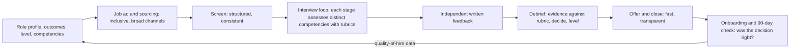

## TL;DR

- Hiring is the highest-leverage, longest-lasting decision a team makes. Treat it as an **engineering process**: defined requirements, consistent evaluation, data, and continuous improvement.
- Start with a **role profile** (outcomes, competencies, level) before writing a job ad or designing interviews.
- **Structured interviews** — same questions or problems per role, rubrics with defined anchors, independent scoring before discussion — are more predictive and fairer than unstructured chats.
- Design a loop where **each interview assesses distinct competencies**, mirrors real work, and gives candidates a good experience.
- Debrief on **evidence against the rubric**, watch for bias, and track metrics (pass-through rates, time to hire, quality of hire, diversity) to improve the process.

## Core Concepts

### Role profile first

Before anything else, agree with the hiring team:
- **Mission of the role:** why it exists and what success looks like after 6 and 12 months.
- **Level and scope:** e.g. senior engineer owning a service end to end; staff engineer driving cross-team architecture.
- **Competencies to assess:** technical depth in X, system design, code quality, collaboration, communication, ownership, mentoring, product sense — prioritised, with "must have" vs "nice to have".
- **Non-requirements:** things that don't matter (specific framework years, a degree) — removing these widens the pool without lowering the bar.

### Structured interviewing

Research on selection methods (e.g. Schmidt & Hunter's meta-analyses and later updates) consistently finds **structured interviews** among the more predictive methods; unstructured "chats" are less predictive and more prone to bias.

Structure means:
- **Standard questions/problems** per interview type, with known good, average and weak answers.
- **Rubrics with behavioural anchors** per competency (e.g. 1–4 with descriptions of what each score looks like).
- **Independent written feedback** submitted *before* the debrief to avoid anchoring on the loudest voice.
- **Trained interviewers**, calibrated periodically with shadowing and reverse-shadowing.

Example rubric for "system design" at senior level:

| Score | Anchor |
|---|---|
| 1 — No hire | Jumps to components without requirements; no consideration of scale, failure or trade-offs |
| 2 — Leaning no | Reasonable high-level design but shallow on data model or failure handling; needs heavy prompting |
| 3 — Hire | Clarifies requirements and NFRs, sensible design with justified trade-offs, handles 1–2 deep dives well |
| 4 — Strong hire | Drives the discussion, quantifies capacity, anticipates failure modes and evolution, explains alternatives clearly |

### Interview formats

| Format | Assesses | Good practice | Pitfalls |
|---|---|---|---|
| Recruiter/hiring manager screen | Motivation, logistics, rough fit | Consistent questions; sell the role | Gut-feel rejections |
| Technical screen / coding | Problem-solving, coding fundamentals | Realistic problems, collaborative, language of choice | Puzzle questions, trick algorithms unrelated to the job |
| Take-home / work sample | Real-world code quality | Short (2–4h max), paid or optional, reviewed with rubric, discussed after | Unbounded time; disadvantages candidates with caring duties |
| Pair programming / code review exercise | Collaboration, reading code, practical skills | Realistic codebase, candidate drives | Interviewer takes over |
| System design | Architecture, trade-offs, communication | Open problem matched to level | Expecting one "right" design |
| Behavioural | Past behaviour: ownership, conflict, influence, leadership | Structured questions, probe for specifics (STAR) | Hypotheticals only; accepting vague answers |
| Values / team fit (culture add) | Collaboration style, values alignment | Defined criteria | "Would I have a beer with them" bias |

### Bias and fairness

Common biases: affinity/similarity, halo/horn, confirmation, first impressions, contrast (comparing to the previous candidate), and stereotypes. Mitigations: structure, rubrics, diverse panels, independent scoring, blind CV review for some stages, inclusive job ads (fewer "must haves", gender-neutral language), accessible processes and reasonable adjustments.

## How It Works

## When to Use / Trade-offs

| Choice | Use when | Avoid when | Trade-off |
|---|---|---|---|
| Take-home exercise | Roles where realistic code quality matters; candidates prefer it to live coding | Candidates with limited time; when it would be long | Realism vs time burden and fairness |
| Live coding | Want to see thinking process and collaboration | Testing memorised algorithms irrelevant to the role | Insight into approach vs performance anxiety |
| Work trial (paid, days) | Small companies, very senior hires | Most cases (excludes employed candidates) | High signal vs high cost and exclusion |
| Bar-raiser / independent interviewer | Scaling hiring; consistent standards across teams | Very small teams | Consistency vs process overhead |
| Hiring committee | Large orgs needing consistency | Small teams; slows decisions | Fairness vs speed |
| Referral-heavy sourcing | Fast, trusted pipeline | As the only channel | Speed vs homogeneity |

## Common Pitfalls & Anti-patterns

- **No agreed role profile** — every interviewer assesses something different.
- **Unstructured interviews** — "tell me about yourself" chats and gut feel.
- **Puzzle and trivia questions** — reward preparation for interviews, not job performance.
- **Hiring for "culture fit"** as similarity — homogeneous teams and exclusion; prefer "culture add" against explicit values.
- **Debrief groupthink** — the most senior or loudest person speaks first and anchors everyone.
- **Lowering the bar under pressure** — a bad hire costs far more than a delayed one.
- **Slow processes** — strong candidates accept other offers while you schedule round four.
- **Long unpaid take-homes** — filters out people with less free time.
- **Not selling the role** — interviews are two-way; candidates evaluate you too.
- **Never measuring the process** — no idea which stages predict success.

## Real-world Scenario

**Context:** A company planned to grow engineering from 40 to 100 in a year. Interviews varied by interviewer; debriefs were dominated by senior engineers; offer acceptance was 55%; the team was very homogeneous; and two of the last eight hires had been let go within a year.

**Decision:** Defined role profiles per level with competency matrices; built a standard loop (screen → practical coding/pairing on a realistic codebase → system design → behavioural → hiring manager) with rubrics and question banks; required independent written feedback before debriefs, with the most junior interviewer speaking first; trained all interviewers (shadow, reverse-shadow); introduced a bar-raiser role; cut the process to 2 weeks from first call to offer; rewrote job ads (fewer requirements, salary ranges) and broadened sourcing.

**Outcome:** Over the next year, offer acceptance rose to ~80%, time to hire halved, interviewer score agreement improved markedly, and early attrition of new hires dropped to near zero. The share of hires from under-represented groups roughly doubled.

**What I'd do differently:** Introduce structured feedback tooling and metrics dashboards from the start — we spent months collecting data manually to prove what was working.

## Interview Questions

### What is a structured interview, and why does it matter? {#structured-interviews}

**Level:** Foundation

**Model answer:**
A structured interview asks every candidate for a role the **same (or equivalent) questions or problems**, evaluated against **predefined rubrics** with clear descriptions of what good, average and weak answers look like. Interviewers write **independent feedback** before discussing the candidate.

Why it matters:
- **Predictive validity:** research on selection methods consistently shows structured interviews predict job performance better than unstructured conversations.
- **Fairness:** consistent criteria reduce the influence of bias (similarity, first impressions, halo effect) and make decisions defensible.
- **Comparability:** candidates can be compared on the same competencies.
- **Better candidate experience:** clear, relevant questions rather than random topics.

Structure doesn't mean robotic — interviewers can probe and follow up — but the core questions and evaluation criteria are consistent.

**What the interviewer is looking for:**
Definition, rubrics, independent scoring, and the evidence and fairness rationale.

**Follow-ups:**
- How do you keep questions from leaking?
- How do you structure a system design interview?

**Red flags:**
- "I just get a feel for people."
- Different interviewers asking whatever they like.

### How do you write a good role profile and job ad? {#role-profile}

**Level:** Foundation

**Model answer:**
**Role profile (internal):**
- Why the role exists and the outcomes expected at 6 and 12 months.
- Level and scope of responsibility.
- Prioritised competencies — must-haves vs nice-to-haves — which drive interview design.
- What explicitly doesn't matter (e.g. specific years of experience, degree, a particular framework you can learn quickly).

**Job ad (external):**
- Lead with the impact and the problems they'll work on, the team and the tech.
- Keep **requirements short** — long lists deter qualified candidates (particularly those who apply only when they meet every point).
- Use inclusive language; mention flexibility, accessibility and adjustments.
- Include **salary range** and location/remote policy — transparency improves applications and saves time.
- Describe the interview process so candidates can prepare.

**What the interviewer is looking for:**
Outcome-focused profiles, prioritised competencies, short inclusive ads, transparency.

**Follow-ups:**
- Why remove "10+ years of experience" requirements?
- How do you write an ad for a role the team hasn't fully defined?

**Red flags:**
- Copying a long generic job description.
- No salary information as a deliberate choice without reason.

### What types of technical interview do you use, and what does each assess? {#technical-interview-formats}

**Level:** Foundation

**Model answer:**
- **Coding (live or pairing):** problem decomposition, coding fluency, testing, communication while working. Prefer realistic problems (parsing data, small features, debugging) over obscure algorithms.
- **Take-home or work sample:** code quality, structure and judgement on a realistic task; keep it short and discuss it afterwards.
- **Code review exercise:** reading code, spotting bugs and design issues, giving constructive feedback — very relevant for senior roles.
- **System design:** requirements gathering, architecture, trade-offs, scalability and failure handling, communication; scaled to the level.
- **Debugging/incident exercise:** reasoning under uncertainty with logs and metrics.
- **Domain/technical deep dive:** discussing a past project in depth — what they built, decisions, trade-offs, what they'd change.

A good loop covers the role's key competencies without duplication, mirrors the real work, and keeps total time reasonable.

**What the interviewer is looking for:**
Knowledge of formats, what each measures, realism and a coherent loop design.

**Follow-ups:**
- Would you use LeetCode-style questions? When?
- How would you adapt the loop for a frontend specialist?

**Red flags:**
- Trivia questions about language specifics.
- Five interviews all testing coding.

### How do you reduce bias in hiring? {#reducing-bias}

**Level:** Foundation

**Model answer:**
- **Define criteria first:** role profile and rubrics before seeing candidates.
- **Structured interviews** with consistent questions and behavioural anchors.
- **Independent written feedback** before debriefs; in the debrief, discuss evidence per competency, junior voices first.
- **Diverse interview panels** and trained interviewers (including on common biases: affinity, halo, confirmation, first impression, contrast).
- **Inclusive sourcing and ads:** broad channels, fewer non-essential requirements, inclusive language, salary transparency.
- **Reduce noise at screening:** consistent CV criteria, possibly anonymised initial review or work-sample-based screening.
- **Accessible process:** reasonable adjustments, choice of formats where possible, time-zone-aware scheduling.
- **Replace "culture fit" with "values alignment / culture add"** with explicit criteria.
- **Measure pass-through rates by stage** (where lawful and privacy-respecting) to spot where groups drop out.

**What the interviewer is looking for:**
Concrete mechanisms across the whole funnel, not just awareness training.

**Follow-ups:**
- What's wrong with "culture fit"?
- How do you handle an interviewer whose feedback seems biased?

**Red flags:**
- "We hire the best person; bias isn't an issue."
- Only unconscious-bias training without process changes.

### How do you design an interview rubric for a competency? {#interview-rubrics}

**Level:** Senior

**Model answer:**
1. **Define the competency** precisely for the role and level (e.g. "system design at senior level: designs a service end to end, considering scale, data, failure and operability").
2. **Write behavioural anchors** for each score (e.g. 1–4): what a candidate *does* or *says* at each level, with examples. Avoid vague words like "good" or "strong" without description.
3. **Map questions/problems to the competency** and note signals to look for and common pitfalls.
4. **Include level calibration:** what distinguishes senior from staff on this competency (scope, ambiguity, trade-off depth, influence).
5. **Pilot and calibrate:** have several interviewers score recorded/mock interviews, compare scores, refine anchors where they disagree.
6. **Review periodically** using outcome data (which scores correlated with on-the-job performance) and interviewer feedback.

**What the interviewer is looking for:**
Precise definitions, behavioural anchors, level differentiation, piloting and calibration, and iteration with data.

**Follow-ups:**
- Show me an anchor for "communication" at senior level.
- How do you score a candidate who is excellent on one sub-skill and weak on another?

**Red flags:**
- Rubrics that just say 1 = bad, 4 = great.
- No calibration across interviewers.

### How do you run a system design interview as the interviewer? {#running-system-design-interview}

**Level:** Senior

**Model answer:**
- **Prepare:** a problem matched to the level (e.g. "design a URL shortener" for mid-level is too common — prefer a realistic problem like "a notification service" or something from your domain), known areas for deep dives, and the rubric.
- **Set the frame:** explain the format, that there's no single right answer, and that you'll act as the product owner for requirements.
- **Let the candidate drive:** observe whether they clarify requirements and NFRs (scale, latency, consistency), estimate capacity, sketch a high-level design, then go deep.
- **Probe deliberately:** pick 1–2 deep dives (data model, failure scenarios, scaling a hot path, consistency), introduce changing requirements ("now support 10× traffic", "this dependency goes down").
- **Help without leading:** nudge if they're stuck so you still collect signal; note how much help was needed.
- **Take notes on evidence** (what they said and did), score independently against the rubric, and reserve time for their questions.
- **Level-appropriate expectations:** senior — solid design and trade-offs; staff — drives ambiguity, considers evolution, operability, organisational aspects.

**What the interviewer is looking for:**
Problem selection, candidate-driven flow, purposeful probing, appropriate help, evidence-based scoring and level calibration.

**Follow-ups:**
- The candidate goes down a path you think is wrong. What do you do?
- How do you avoid testing memorised designs?

**Red flags:**
- Expecting the interviewer's own design.
- Lecturing instead of listening.

### How do you conduct a behavioural interview well? {#behavioural-interviewing}

**Level:** Senior

**Model answer:**
- **Ask about real past behaviour,** not hypotheticals: "Tell me about a time you disagreed with a technical decision" rather than "What would you do if…". Past behaviour in similar situations is a better predictor.
- **Map questions to competencies** (ownership, conflict, influence, handling failure, mentoring) and the level.
- **Probe for specifics using STAR** (situation, task, action, result): "What did *you* do?", "What was the outcome — how did you know?", "What would you do differently?"
- **Separate "we" from "I"** to understand personal contribution.
- **Look for reflection and learning,** not perfect stories.
- **Use a rubric** with anchors per competency, write notes on evidence, and score independently.
- **Create a comfortable environment:** explain the format, allow thinking time, accept examples from outside work if relevant (especially for early-career candidates).

**What the interviewer is looking for:**
Past-behaviour questions, STAR probing, distinguishing individual contribution, reflection, and rubric-based scoring.

**Follow-ups:**
- The candidate gives a very polished but vague story. How do you probe?
- How do you assess a candidate with little professional experience?

**Red flags:**
- Only hypothetical questions.
- Accepting "we did X" without probing.

### How do you run a hiring debrief that leads to good decisions? {#hiring-debrief}

**Level:** Senior

**Model answer:**
- **Independent written feedback first,** submitted before seeing others' feedback; each includes a score per competency with evidence.
- **A clear facilitator** (hiring manager or bar-raiser) who keeps discussion on evidence and the role profile.
- **Order of speaking:** junior interviewers or those with less positional power first, to avoid anchoring.
- **Discuss by competency** rather than by interviewer: where does evidence agree or conflict? Resolve conflicts by examining the evidence, not seniority.
- **Challenge vague or biased language** ("not a culture fit", "didn't seem confident") — ask for specifics.
- **Decide against the bar for the level**, not against other candidates in the pipeline; decide the level separately if needed.
- **Record the decision and rationale**, including concerns for onboarding if hiring.
- **Feed back to interviewers** when their signal was off, to improve calibration.

**What the interviewer is looking for:**
Independent scoring, structured facilitation, anchoring avoidance, evidence-based resolution and challenging bias.

**Follow-ups:**
- One interviewer strongly opposes; everyone else is positive. What do you do?
- Should the hiring manager have veto power?

**Red flags:**
- "Thumbs up or down" with no evidence.
- Most senior person speaks first and decides.

### How do you create a good candidate experience? {#candidate-experience}

**Level:** Senior

**Model answer:**
- **Speed and clarity:** describe the process upfront (stages, timeline, format, what to prepare), and move quickly — aim for days between stages, not weeks.
- **Respect time:** reasonable total interview hours; short or optional take-homes; flexible scheduling across time zones.
- **Well-prepared interviewers** who've read the CV, start on time, explain the format and leave time for the candidate's questions.
- **Two-way evaluation:** let candidates meet future teammates, see real work, and ask hard questions; be honest about challenges.
- **Accessibility:** offer adjustments proactively.
- **Communication:** a single point of contact; timely updates; specific, kind feedback where possible after rejection.
- **Close well:** clear, competitive offers with full details; help them decide (talk to more of the team).
- **Measure it:** candidate surveys after interviews, including rejected candidates.

**What the interviewer is looking for:**
Speed, transparency, respect, two-way evaluation, accessibility, communication and measurement.

**Follow-ups:**
- Why does candidate experience matter for rejected candidates?
- How do you give feedback to rejected candidates without legal risk?

**Red flags:**
- Ghosting candidates.
- Six-week processes with eight interviews.

### How do you assess whether a candidate is senior or staff level? {#assessing-seniority}

**Level:** Senior

**Model answer:**
Level is mostly about **scope, autonomy, ambiguity and impact**, not years of experience:
- **Senior:** owns significant features or services end to end; designs solid systems within a team's domain; mentors; handles ambiguity within a defined problem; raises quality of the team's work.
- **Staff:** drives outcomes across multiple teams; identifies and frames problems nobody owns; sets technical direction; influences without authority; makes trade-offs balancing business, technical and organisational factors; multiplies others.

Assessment signals:
- **Deep dives into past work:** scope of their decisions, who they influenced, how they handled cross-team conflict, what happened afterwards.
- **System design:** how they handle ambiguity, evolution, operability, migration paths and organisational constraints, not just components.
- **Behavioural evidence** of influence, mentoring and strategy.
- **Reference checks** focused on scope and impact.

Be careful not to downlevel candidates who've worked at smaller companies with less impressive titles, or uplevel those with big-company titles but narrow scope.

**What the interviewer is looking for:**
Clear level definitions based on scope and impact, specific assessment techniques, and awareness of title inflation/deflation.

**Follow-ups:**
- The candidate is strong but the evidence for staff scope is thin. What do you do?
- How do you level someone from a startup where they were CTO of 5 people?

**Red flags:**
- Leveling by years of experience.
- Treating staff as "a very good senior coder".

### Design the hiring process for an organisation growing from 30 to 120 engineers in a year. {#scaling-hiring}

**Level:** Architect

**Model answer:**
- **Workforce plan:** roles, levels and timing aligned to the roadmap and team topology; prioritise anchoring senior/staff hires and engineering managers early, because they enable onboarding and later hiring.
- **Standardised, structured process:** role profiles and competency matrices per level; a standard loop with question banks and rubrics; consistent debriefs; bar-raisers or a hiring committee for consistency across teams.
- **Capacity:** ~90 hires may require thousands of interview hours — train a large pool of interviewers (shadowing, reverse-shadowing), rotate load, and track interviewer time; partner with recruiters and sourcers; consider specialised agencies for hard roles.
- **Sourcing strategy:** employer brand (engineering blog, talks, open source), referrals with diversity safeguards, targeted outreach, communities and bootcamps for junior pipelines.
- **Speed:** SLAs between stages, scheduling tooling, decision within 48 hours of the final interview.
- **Onboarding at scale:** cohort onboarding, buddies, documentation, first-week deploys — hiring is wasted if onboarding fails.
- **Data:** funnel metrics per stage and source, time to hire, offer acceptance, quality-of-hire signals (performance and retention at 6–12 months), diversity metrics; review monthly.
- **Protect the bar and culture:** don't relax standards to hit numbers; values embedded in interviews and onboarding.

**What the interviewer is looking for:**
Workforce planning, structured process, interviewer capacity, sourcing, speed, onboarding and metrics with bar protection.

**Follow-ups:**
- Hiring falls behind plan by 30%. What do you do?
- How do you keep culture consistent while tripling the team?

**Red flags:**
- Each team inventing its own process.
- Ignoring interviewer capacity and onboarding.

### How do you train and calibrate interviewers? {#interviewer-calibration}

**Level:** Architect

**Model answer:**
- **Training:** the role profiles and rubrics; how to run each interview type; avoiding bias; legal do's and don'ts; candidate experience; note-taking and evidence-based feedback.
- **Shadowing and reverse-shadowing:** new interviewers observe several interviews, then lead with an experienced interviewer observing and giving feedback, before interviewing independently.
- **Calibration sessions:** interviewers score the same recorded or mock interview independently and discuss differences; update anchors where interpretations diverge.
- **Feedback quality reviews:** hiring managers or bar-raisers review written feedback for evidence vs opinion, and give coaching.
- **Monitor interviewer data:** pass rates by interviewer, score distributions, agreement with debrief outcomes — outliers get coaching (not blame).
- **Refresh questions** periodically to avoid leaks and keep them relevant.
- **Recognise interviewing** as valuable work in performance reviews, so people invest in it.

**What the interviewer is looking for:**
Structured training, shadowing, calibration with shared material, feedback review, interviewer metrics and recognition.

**Follow-ups:**
- One interviewer rejects 90% of candidates. What do you do?
- How do you calibrate across different teams with different needs?

**Red flags:**
- Throwing new interviewers in without training.
- No mechanism to detect inconsistent interviewers.

### Which hiring metrics would you track, and what would you do with them? {#hiring-metrics}

**Level:** Architect

**Model answer:**
**Funnel efficiency:**
- Applicants and pass-through rates per stage and per source.
- Time to hire (first contact to accepted offer) and time between stages.
- Offer acceptance rate and reasons for declines.
- Interviewer hours per hire.

**Quality:**
- **Quality of hire:** performance ratings and manager assessments at 6–12 months, early attrition (leaving within a year), time to productivity (e.g. first meaningful contribution).
- **Predictive validity:** correlation between interview scores per stage and later performance — tells you which stages add signal.

**Fairness:**
- Pass-through rates by demographic group at each stage (where lawfully collected, aggregated and privacy-protected) to spot where bias may occur.

**Experience:** candidate survey scores, including rejected candidates.

**Use:** monthly review with recruiting and hiring managers; fix bottlenecks (slow scheduling, a stage with low signal or disparate pass rates), refine rubrics, adjust sourcing mix, and report progress against the workforce plan.

**What the interviewer is looking for:**
Balanced metrics across efficiency, quality, fairness and experience, and using them to improve the process.

**Follow-ups:**
- How would you measure quality of hire objectively?
- A stage has a much lower pass rate for one group. What do you investigate?

**Red flags:**
- Only counting hires.
- No feedback loop from on-the-job performance.

### How would you make your hiring process more inclusive? {#inclusive-hiring}

**Level:** Architect

**Model answer:**
- **Set goals and measure:** funnel data by group (lawfully and anonymously) to find where people drop out.
- **Widen the top of the funnel:** sourcing beyond usual networks (communities, returners programmes, bootcamps, universities beyond the usual few), referral programmes that encourage diverse referrals, partnerships with organisations supporting under-represented groups.
- **Job ads:** fewer must-haves, inclusive language, salary ranges, flexibility, explicit welcome for adjustments.
- **Process design:** structured interviews and rubrics, diverse panels, work-relevant assessments, reasonable take-home lengths (or alternatives), accessible tools and scheduling across time zones and caring commitments.
- **Debriefs:** evidence-based, challenge vague or coded language, independent scoring.
- **Offer and onboarding:** equitable offers using pay bands; inclusive onboarding, mentoring and sponsorship so hires thrive and stay — inclusion doesn't end at the offer.
- **Leadership accountability:** progress reviewed regularly, with resources to act.

**What the interviewer is looking for:**
Data-informed, end-to-end interventions from sourcing to retention, without lowering the bar.

**Follow-ups:**
- Some argue structured processes reduce diversity of thought in hiring. How do you respond?
- How do you avoid tokenism?

**Red flags:**
- Treating diversity as only a sourcing problem.
- Quotas without process changes.

### Candidates increasingly use AI tools. How should interviews adapt? {#ai-and-interviews}

**Level:** Architect

**Model answer:**
Start from what the job actually requires: if engineers use AI assistants at work, interviews should assess **how well candidates work with them**, not pretend they don't exist — while still verifying fundamental understanding.

Adaptations:
- **Be explicit about rules** per stage: which tools are allowed (e.g. AI allowed in the take-home and pairing exercise, not in a fundamentals discussion), so honest candidates aren't disadvantaged.
- **Shift assessment towards judgement:** reading and reviewing code (including AI-generated code with subtle bugs), debugging, explaining trade-offs, extending an existing codebase, system design, and discussing their own work in depth — areas where shallow AI use is visible.
- **Take-homes followed by a live discussion** where the candidate explains and modifies their solution.
- **Pairing exercises with AI allowed**, observing how they prompt, verify, test and reject suggestions.
- **Integrity safeguards** for remote interviews where needed (camera on, live problem changes), proportionate and respectful.
- **Update rubrics** to include "uses tools effectively and critically".

**What the interviewer is looking for:**
Aligning assessment with real work, clear rules, emphasis on judgement and understanding, and updated rubrics.

**Follow-ups:**
- How would you design a code review exercise with AI-generated code?
- Would you ban AI tools entirely? Why or why not?

**Red flags:**
- Ignoring the issue.
- Blanket bans that don't reflect the job.

## Cheat Sheet

- **Role profile first** — outcomes at 6/12 months, level, prioritised competencies, explicit non-requirements.
- **Structured interview** — same questions per role, anchored rubrics, independent written scores.
- **Behavioural anchors** — describe observable behaviour for each score, not "good" or "great".
- **Loop design** — each stage assesses distinct competencies and mirrors real work.
- **STAR probing** — situation, task, action, result; ask what *you* did and how you know it worked.
- **Debrief** — written feedback first, junior voices first, discuss by competency, decide against the bar.
- **Culture add, not fit** — assess explicit values, not similarity.
- **Common biases** — affinity, halo/horn, confirmation, first impression, contrast.
- **Take-homes** — short (2–4h), optional or paid, followed by discussion.
- **Level by scope** — senior owns team-level outcomes; staff drives cross-team direction.
- **Candidate experience** — fast, transparent, respectful; rejected candidates matter too.
- **Hiring metrics** — pass-through, time to hire, acceptance, quality of hire, fairness, experience.
- **Interviewer calibration** — shadow, reverse-shadow, score shared recordings, review feedback quality.
- **AI in interviews** — clear rules per stage; assess judgement, review and explanation.

## Further Reading

- [Google re:Work: A guide to structured interviewing](https://rework.withgoogle.com/intl/en/guides/a-guide-to-structured-interviewing-for-better-hiring-practices) — practical guidance and rationale.
- [Schmidt & Hunter (1998): The validity and utility of selection methods](https://doi.org/10.1037/0033-2909.124.2.262) — the classic meta-analysis on selection methods (later updated with revised estimates).
- [Lara Hogan's blog](https://larahogan.me/blog/) — practitioner writing on management, including interviewing and team building.
- [The Manager's Path (Camille Fournier)](https://www.oreilly.com/library/view/the-managers-path/9781491973882/) — hiring and team-building from an engineering manager's perspective.
- [ACAS: Recruiting staff](https://www.acas.org.uk/recruiting-someone) — UK guidance on fair, lawful recruitment (check local law in other jurisdictions).
