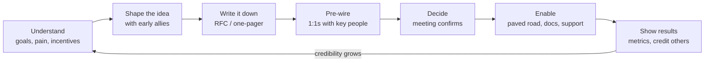

## TL;DR

- Staff+ engineers and architects deliver through **other people's teams**. Influence replaces authority as the primary tool, and it's built *before* you need it.
- Influence rests on **credibility** (track record, competence), **relationships** (trust, reciprocity) and **framing** (connecting your proposal to *their* goals).
- **Pre-wire decisions**: talk to key people one-on-one before the meeting. Meetings should ratify decisions, not create them.
- **Writing scales influence**: a clear RFC/design doc reaches more people, survives longer, and invites better critique than a meeting.
- Know when to **disagree and commit**, when to **escalate** (clearly, early, with options), and when to let go.

## Core Concepts

### Sources of influence

| Source | What it looks like | How to build it |
|---|---|---|
| Expertise | People seek your view because you're usually right | Depth in a few areas; admit what you don't know |
| Track record | You've delivered hard things before | Finish what you start; make results visible |
| Relationships | People trust your intent | Regular 1:1s across teams; help before asking |
| Reciprocity | People help you because you've helped them | Unblock others, review their RFCs, share credit |
| Framing | Your idea solves *their* problem | Learn others' goals, pressures and incentives |
| Process | You make decisions easier for everyone | Clear docs, decision records, good facilitation |
| Sponsorship | A leader visibly backs the work | Align with org priorities; keep sponsors informed |

### Understand before proposing

Map stakeholders by **influence and interest**, and for each one note:
- what they're measured on
- what they fear
- what they've tried before
- who they listen to

Most resistance is rational from the other person's point of view: a deadline, a past failure, a lack of context. Ask, "What would need to be true for you to support this?"

### Pre-wiring and the decision meeting

Socialise the idea one-on-one, starting with the most influential and most sceptical people. Incorporate their feedback (and credit it). By the meeting, nobody should be surprised. The meeting confirms the decision, owners and next steps.

### Writing to influence

A good RFC or design doc includes:
- context
- the problem and why now
- goals and non-goals
- options considered (including "do nothing") with trade-offs
- a recommendation
- risks and the rollout plan
- open questions

```markdown
# RFC: Standardise service-to-service auth on workload identity

**Status:** Draft · **Author:** … · **Reviewers:** Platform, Security, Payments, Identity
**Decision needed by:** 2026-12-15 · **Decider:** Architecture forum

## Problem
14 services use long-lived shared secrets; 3 incidents in 12 months involved leaked credentials.

## Goals / Non-goals
- Goal: no long-lived secrets for service-to-service calls by Q3.
- Non-goal: changing end-user authentication.

## Options
1. Do nothing — cost: continued incident risk, audit finding open.
2. Rotate secrets monthly — cost: toil, still leakable.
3. Workload identity federation (recommended) — cost: ~2 weeks per team; platform provides library.

## What this asks of each team
…
```

### Disagree and commit, and escalation

- **Disagree and commit**: argue your case fully, then support the decision as if it were yours. Record the dissent and the conditions that would trigger revisiting.
- **Escalate well**: early, jointly with the other party when possible ("we disagree on X; here are both options and trade-offs; we need a decision by Y"), and framed as a request for a decision rather than a complaint.

### Ways of working as a Staff+ engineer

Will Larson's archetypes (Tech Lead, Architect, Solver, Right Hand) and Tanya Reilly's "big-picture thinking, project execution, levelling up others" both put influence at the centre. Your output is measured by the organisation's outcomes, not your own commits.

## How It Works



Every successful cycle increases your credibility for the next one. Influence compounds.

## When to Use / Trade-offs

| Approach | Use when | Avoid when | Risk |
|---|---|---|---|
| 1:1 pre-wiring | Contentious or cross-team decisions | Trivial decisions | Perceived as back-channel politics if not transparent |
| Written RFC | Decisions with lasting impact or many stakeholders | Small reversible choices | Analysis paralysis; doc nobody reads |
| Paved road (make the right thing easy) | Driving adoption of standards | Teams with genuinely different needs | Platform becomes a bottleneck |
| Mandate via leadership | Security/compliance must-dos | Matters of taste or local trade-offs | Compliance without commitment, resentment |
| Prototype / spike | Scepticism about feasibility | When the question is about priorities, not feasibility | Prototype becomes production |
| Escalation | Deadlock with real cost of delay | Before trying direct resolution | Relationship damage if done badly |

## Common Pitfalls & Anti-patterns

- **Being right loudly** — winning the argument and losing the relationship; nobody adopts what they were defeated into.
- **Surprise in the meeting** — presenting a big proposal cold to a group; the default response is defensive.
- **Solution-first pitching** — leading with the technology instead of the other team's problem.
- **Hoarding credit** — reduces reciprocity; give credit publicly and generously.
- **Escalating as a first resort** — or escalating without telling the other party first.
- **Influence without follow-through** — getting agreement, then not supporting the teams doing the work.
- **Ignoring incentives** — asking a team to do work that hurts the metrics they're judged on, without addressing it.

## Real-world Scenario

**Context:** As a principal engineer, I wanted 22 product teams to adopt a shared observability standard (OpenTelemetry + SLOs). I had no reporting line to any of them; earlier mandates from the platform team had been ignored.

**Approach:**
1. 1:1s with each team lead, asking about their on-call pain. Three teams had recently had long outages where they couldn't trace requests across services.
2. Partnered with those three teams as **design partners**; built the shared library and dashboards with them, so it solved their real problems.
3. Wrote an RFC framed around *their* outcomes (faster incident resolution, fewer 3 a.m. pages), with their leads as co-authors.
4. Pre-wired the architecture forum and the VP of Engineering, who agreed to include SLO adoption in quarterly team objectives (incentives aligned, not mandated).
5. Published adoption and time-to-restore metrics monthly, crediting the teams.

**Outcome:** 18 of 22 teams adopted within two quarters. The remaining four had legitimate exceptions (batch/data workloads), which were documented as variants.

**What I'd do differently:** Engage the data-platform teams earlier. Their objections were valid and could have shaped a better standard from the start.

## Interview Questions

### What does "influence without authority" mean for a Staff or Principal engineer? {#definition}

**Level:** Foundation

**Model answer:**
It means achieving outcomes across teams you don't manage, such as technical direction, standards and cross-team projects, through credibility, relationships, clear communication and aligning with others' goals rather than through positional power. For Staff+ engineers this is the primary way of delivering impact: success is measured by organisational outcomes, which require other teams to choose to act.

**What the interviewer is looking for:**
Understanding that the role's leverage comes from multiplying others, and naming concrete mechanisms (RFCs, pre-wiring, relationships).

**Follow-ups:**
- What's the difference between influence and manipulation?
- How do you build influence in a new organisation?

**Red flags:**
- "I'd get my manager to tell them."
- Describing influence purely as persuasion skills, without trust or credibility.

### Tell me about a time you convinced another team to change their technical approach. {#convince-another-team}

**Level:** Senior

**Model answer:**
A strong STAR answer:
- **Situation**: the other team's approach and why it mattered (risk, cost, users).
- **Task**: your role, with no authority over them.
- **Action**: how you understood their constraints first, gathered evidence (data, prototype, incident history), framed the change in terms of their goals, involved them in shaping the solution, pre-wired key people, and made adoption easy (you did part of the work, wrote docs, paired).
- **Result**: a measurable outcome, the relationship afterwards, and what you learned, including what you'd do differently.

Example: persuading a team to move from polling to event-driven integration by showing their DB load during peak, prototyping with them, and co-writing the ADR.

**What the interviewer is looking for:**
Empathy for the other team's constraints, use of evidence, collaboration rather than coercion, measurable results, and self-reflection.

**Follow-ups:**
- What would you have done if they still said no?
- What did they change in *your* proposal?

**Red flags:**
- The story ends with escalation as the main lever.
- No acknowledgement of the other team's valid concerns.
- "We" throughout with no clarity on the candidate's actions.

### How do you decide when to escalate a disagreement, and how do you do it? {#when-to-escalate}

**Level:** Senior

**Model answer:**
Escalate when:
- direct resolution has been genuinely tried
- the disagreement blocks something with a real cost of delay
- the decision is above both parties' authority, e.g. a trade-off between two orgs' priorities

Do it well:
- tell the other party first, ideally escalate *jointly*
- write a short neutral summary: context, the options, each side's reasoning and trade-offs, a recommendation, and the deadline
- frame it as needing a decision, not a judgement on people
- accept the outcome (disagree and commit)

**What the interviewer is looking for:**
Escalation as a normal, respectful mechanism, not a weapon or a failure; transparency with the other party.

**Follow-ups:**
- What if the escalation goes against you?
- Give an example of an escalation that went badly. What did you learn?

**Red flags:**
- Never escalating ("I always resolve it myself"), or escalating everything.
- Going around someone without telling them.

### A senior director publicly dismisses your architecture proposal in a meeting. What do you do? {#senior-disagreement}

**Level:** Senior

**Model answer:**
In the meeting: stay calm, acknowledge the concern, ask a clarifying question to understand the objection ("Is the concern cost, timing or risk?"), and offer to follow up rather than argue in public.

Afterwards: a 1:1 to understand their real concerns and context (they may know about budget cuts or past failures). Then revise the proposal to address legitimate points, or find evidence for the ones you still disagree with. Find out who they trust and involve them. Next time, pre-wire them before the meeting. If you still disagree on a material point, agree a way to decide (a prototype, a time-boxed experiment, or a decision by the relevant leader).

**What the interviewer is looking for:**
Emotional regulation, curiosity, turning conflict into information, and process improvement (pre-wiring).

**Follow-ups:**
- What if their objection is based on incorrect information?
- How do you avoid it becoming personal?

**Red flags:**
- Arguing harder in the meeting.
- Giving up on the proposal entirely without understanding the objection.

### You need 20 autonomous teams to adopt a new platform standard and you can't mandate it. How do you drive adoption? {#org-wide-standard}

**Level:** Architect

**Model answer:**
1. **Validate the need**: talk to teams, gather data on the pain the standard solves, and be willing to change the standard.
2. **Design partners**: build it with 2–3 teams who feel the pain most; their success becomes the case study.
3. **Make the right thing easy**: a paved road (templates, libraries, docs, migration tooling) so adoption costs days, not months. Offer to pair or do the first migration.
4. **Frame it in their terms**: fewer incidents, faster onboarding, less toil, and link it to their objectives.
5. **Write it down**: an RFC with options and trade-offs; incorporate feedback visibly.
6. **Align incentives with leadership**: include it in quarterly objectives or engineering standards with a date, and have a documented exceptions process.
7. **Make progress visible**: an adoption dashboard, outcome metrics, and public credit for teams.
8. **Handle the long tail**: understand blockers; some exceptions are legitimate.

**What the interviewer is looking for:**
A multi-lever strategy (product thinking for internal platforms, social proof, incentives, enablement), willingness to adapt the standard, and measuring outcomes.

**Follow-ups:**
- What do you do about the last three teams who refuse?
- How do you avoid the platform team becoming a bottleneck?
- When would you go for a mandate instead?

**Red flags:**
- "Get the CTO to mandate it" as the plan.
- No enablement; expecting teams to absorb migration cost alone.

## Cheat Sheet

- **Influence foundations** — credibility, relationships, framing; build them before you need them.
- **Pre-wiring** — 1:1 conversations before the meeting so the meeting confirms, not debates.
- **Frame in their goals** — connect your proposal to what the other team is measured on.
- **Stakeholder map** — influence × interest; note each person's goals, fears and trusted advisers.
- **RFC** — context, problem, goals/non-goals, options with trade-offs, recommendation, rollout.
- **Design partners** — build with the teams who feel the pain most; they become your proof.
- **Paved road** — make the standard the easiest path; lower adoption cost beats mandates.
- **Disagree and commit** — argue fully, then support the decision; record the dissent.
- **Escalate well** — early, jointly, neutral summary, options, decision deadline.
- **Give credit away** — it builds reciprocity and future influence.

## Further Reading

- [StaffEng guides](https://staffeng.com/guides/) — Will Larson's guides on operating as a Staff+ engineer.
- *The Staff Engineer's Path*, Tanya Reilly (O'Reilly) — big-picture thinking, execution and levelling up others.
- *Influence Without Authority*, Allan R. Cohen & David L. Bradford — the reciprocity ("currencies") model.
- [Google re:Work: psychological safety](https://rework.withgoogle.com/guides/understanding-team-effectiveness/) — VERIFY: link path; research on what makes teams effective.
- [Amazon leadership principles](https://www.amazon.jobs/content/en/our-workplace/leadership-principles) — origin of "disagree and commit".
