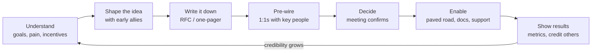

## TL;DR

- Staff+ engineers and architects deliver through **other people's teams**. Influence replaces authority as the primary tool, and it's built *before* you need it.
- Influence rests on **credibility** (track record, competence), **relationships** (trust, reciprocity) and **framing** (connecting your proposal to *their* goals).
- **Pre-wire decisions**: talk to key people one-on-one before the meeting. Meetings should ratify decisions, not create them.
- **Writing scales influence**: a clear RFC/design doc reaches more people, survives longer, and invites better critique than a meeting.
- Know when to **disagree and commit**, when to **escalate** (clearly, early, with options), and when to let go.

## Core Concepts

### Sources of influence

| Source | What it looks like | How to build it |
|---|---|---|
| Expertise | People seek your view because you're usually right | Depth in a few areas; admit what you don't know |
| Track record | You've delivered hard things before | Finish what you start; make results visible |
| Relationships | People trust your intent | Regular 1:1s across teams; help before asking |
| Reciprocity | People help you because you've helped them | Unblock others, review their RFCs, share credit |
| Framing | Your idea solves *their* problem | Learn others' goals, pressures and incentives |
| Process | You make decisions easier for everyone | Clear docs, decision records, good facilitation |
| Sponsorship | A leader visibly backs the work | Align with org priorities; keep sponsors informed |

### Understand before proposing

Map stakeholders by **influence and interest**, and for each one note:
- what they're measured on
- what they fear
- what they've tried before
- who they listen to

Most resistance is rational from the other person's point of view: a deadline, a past failure, a lack of context. Ask, "What would need to be true for you to support this?"

### Pre-wiring and the decision meeting

Socialise the idea one-on-one, starting with the most influential and most sceptical people. Incorporate their feedback (and credit it). By the meeting, nobody should be surprised. The meeting confirms the decision, owners and next steps.

### Writing to influence

A good RFC or design doc includes:
- context
- the problem and why now
- goals and non-goals
- options considered (including "do nothing") with trade-offs
- a recommendation
- risks and the rollout plan
- open questions

```markdown
# RFC: Standardise service-to-service auth on workload identity

**Status:** Draft · **Author:** … · **Reviewers:** Platform, Security, Payments, Identity
**Decision needed by:** 2026-12-15 · **Decider:** Architecture forum

## Problem
14 services use long-lived shared secrets; 3 incidents in 12 months involved leaked credentials.

## Goals / Non-goals
- Goal: no long-lived secrets for service-to-service calls by Q3.
- Non-goal: changing end-user authentication.

## Options
1. Do nothing — cost: continued incident risk, audit finding open.
2. Rotate secrets monthly — cost: toil, still leakable.
3. Workload identity federation (recommended) — cost: ~2 weeks per team; platform provides library.

## What this asks of each team
…
```

### Disagree and commit, and escalation

- **Disagree and commit**: argue your case fully, then support the decision as if it were yours. Record the dissent and the conditions that would trigger revisiting.
- **Escalate well**: early, jointly with the other party when possible ("we disagree on X; here are both options and trade-offs; we need a decision by Y"), and framed as a request for a decision rather than a complaint.

### Ways of working as a Staff+ engineer

Will Larson's archetypes (Tech Lead, Architect, Solver, Right Hand) and Tanya Reilly's "big-picture thinking, project execution, levelling up others" both put influence at the centre. Your output is measured by the organisation's outcomes, not your own commits.

## How It Works



Every successful cycle increases your credibility for the next one. Influence compounds.

## When to Use / Trade-offs

| Approach | Use when | Avoid when | Risk |
|---|---|---|---|
| 1:1 pre-wiring | Contentious or cross-team decisions | Trivial decisions | Perceived as back-channel politics if not transparent |
| Written RFC | Decisions with lasting impact or many stakeholders | Small reversible choices | Analysis paralysis; doc nobody reads |
| Paved road (make the right thing easy) | Driving adoption of standards | Teams with genuinely different needs | Platform becomes a bottleneck |
| Mandate via leadership | Security/compliance must-dos | Matters of taste or local trade-offs | Compliance without commitment, resentment |
| Prototype / spike | Scepticism about feasibility | When the question is about priorities, not feasibility | Prototype becomes production |
| Escalation | Deadlock with real cost of delay | Before trying direct resolution | Relationship damage if done badly |

## Common Pitfalls & Anti-patterns

- **Being right loudly** — winning the argument and losing the relationship; nobody adopts what they were defeated into.
- **Surprise in the meeting** — presenting a big proposal cold to a group; the default response is defensive.
- **Solution-first pitching** — leading with the technology instead of the other team's problem.
- **Hoarding credit** — reduces reciprocity; give credit publicly and generously.
- **Escalating as a first resort** — or escalating without telling the other party first.
- **Influence without follow-through** — getting agreement, then not supporting the teams doing the work.
- **Ignoring incentives** — asking a team to do work that hurts the metrics they're judged on, without addressing it.

## Real-world Scenario

**Context:** As a principal engineer, I wanted 22 product teams to adopt a shared observability standard (OpenTelemetry + SLOs). I had no reporting line to any of them; earlier mandates from the platform team had been ignored.

**Approach:**
1. 1:1s with each team lead, asking about their on-call pain. Three teams had recently had long outages where they couldn't trace requests across services.
2. Partnered with those three teams as **design partners**; built the shared library and dashboards with them, so it solved their real problems.
3. Wrote an RFC framed around *their* outcomes (faster incident resolution, fewer 3 a.m. pages), with their leads as co-authors.
4. Pre-wired the architecture forum and the VP of Engineering, who agreed to include SLO adoption in quarterly team objectives (incentives aligned, not mandated).
5. Published adoption and time-to-restore metrics monthly, crediting the teams.

**Outcome:** 18 of 22 teams adopted within two quarters. The remaining four had legitimate exceptions (batch/data workloads), which were documented as variants.

**What I'd do differently:** Engage the data-platform teams earlier. Their objections were valid and could have shaped a better standard from the start.

## Interview Questions

### What does "influence without authority" mean for a Staff or Principal engineer? {#definition}

**Level:** Foundation

**Model answer:**
It means achieving outcomes across teams you don't manage, such as technical direction, standards and cross-team projects, through credibility, relationships, clear communication and aligning with others' goals rather than through positional power. For Staff+ engineers this is the primary way of delivering impact: success is measured by organisational outcomes, which require other teams to choose to act.

**What the interviewer is looking for:**
Understanding that the role's leverage comes from multiplying others, and naming concrete mechanisms (RFCs, pre-wiring, relationships).

**Follow-ups:**
- What's the difference between influence and manipulation?
- How do you build influence in a new organisation?

**Red flags:**
- "I'd get my manager to tell them."
- Describing influence purely as persuasion skills, without trust or credibility.

### Tell me about a time you convinced another team to change their technical approach. {#convince-another-team}

**Level:** Senior

**Model answer:**
A strong STAR answer:
- **Situation**: the other team's approach and why it mattered (risk, cost, users).
- **Task**: your role, with no authority over them.
- **Action**: how you understood their constraints first, gathered evidence (data, prototype, incident history), framed the change in terms of their goals, involved them in shaping the solution, pre-wired key people, and made adoption easy (you did part of the work, wrote docs, paired).
- **Result**: a measurable outcome, the relationship afterwards, and what you learned, including what you'd do differently.

Example: persuading a team to move from polling to event-driven integration by showing their DB load during peak, prototyping with them, and co-writing the ADR.

**What the interviewer is looking for:**
Empathy for the other team's constraints, use of evidence, collaboration rather than coercion, measurable results, and self-reflection.

**Follow-ups:**
- What would you have done if they still said no?
- What did they change in *your* proposal?

**Red flags:**
- The story ends with escalation as the main lever.
- No acknowledgement of the other team's valid concerns.
- "We" throughout with no clarity on the candidate's actions.

### How do you decide when to escalate a disagreement, and how do you do it? {#when-to-escalate}

**Level:** Senior

**Model answer:**
Escalate when:
- direct resolution has been genuinely tried
- the disagreement blocks something with a real cost of delay
- the decision is above both parties' authority, e.g. a trade-off between two orgs' priorities

Do it well:
- tell the other party first, ideally escalate *jointly*
- write a short neutral summary: context, the options, each side's reasoning and trade-offs, a recommendation, and the deadline
- frame it as needing a decision, not a judgement on people
- accept the outcome (disagree and commit)

**What the interviewer is looking for:**
Escalation as a normal, respectful mechanism, not a weapon or a failure; transparency with the other party.

**Follow-ups:**
- What if the escalation goes against you?
- Give an example of an escalation that went badly. What did you learn?

**Red flags:**
- Never escalating ("I always resolve it myself"), or escalating everything.
- Going around someone without telling them.

### A senior director publicly dismisses your architecture proposal in a meeting. What do you do? {#senior-disagreement}

**Level:** Senior

**Model answer:**
In the meeting: stay calm, acknowledge the concern, ask a clarifying question to understand the objection ("Is the concern cost, timing or risk?"), and offer to follow up rather than argue in public.

Afterwards: a 1:1 to understand their real concerns and context (they may know about budget cuts or past failures). Then revise the proposal to address legitimate points, or find evidence for the ones you still disagree with. Find out who they trust and involve them. Next time, pre-wire them before the meeting. If you still disagree on a material point, agree a way to decide (a prototype, a time-boxed experiment, or a decision by the relevant leader).

**What the interviewer is looking for:**
Emotional regulation, curiosity, turning conflict into information, and process improvement (pre-wiring).

**Follow-ups:**
- What if their objection is based on incorrect information?
- How do you avoid it becoming personal?

**Red flags:**
- Arguing harder in the meeting.
- Giving up on the proposal entirely without understanding the objection.

### You need 20 autonomous teams to adopt a new platform standard and you can't mandate it. How do you drive adoption? {#org-wide-standard}

**Level:** Architect

**Model answer:**
1. **Validate the need**: talk to teams, gather data on the pain the standard solves, and be willing to change the standard.
2. **Design partners**: build it with 2–3 teams who feel the pain most; their success becomes the case study.
3. **Make the right thing easy**: a paved road (templates, libraries, docs, migration tooling) so adoption costs days, not months. Offer to pair or do the first migration.
4. **Frame it in their terms**: fewer incidents, faster onboarding, less toil, and link it to their objectives.
5. **Write it down**: an RFC with options and trade-offs; incorporate feedback visibly.
6. **Align incentives with leadership**: include it in quarterly objectives or engineering standards with a date, and have a documented exceptions process.
7. **Make progress visible**: an adoption dashboard, outcome metrics, and public credit for teams.
8. **Handle the long tail**: understand blockers; some exceptions are legitimate.

**What the interviewer is looking for:**
A multi-lever strategy (product thinking for internal platforms, social proof, incentives, enablement), willingness to adapt the standard, and measuring outcomes.

**Follow-ups:**
- What do you do about the last three teams who refuse?
- How do you avoid the platform team becoming a bottleneck?
- When would you go for a mandate instead?

**Red flags:**
- "Get the CTO to mandate it" as the plan.
- No enablement; expecting teams to absorb migration cost alone.

### You've just joined as a Staff engineer. How do you build credibility in your first 90 days? {#building-credibility}

**Level:** Foundation

**Model answer:**
Influence runs on trust, and trust is earned through **listening, competence and reliability**, in that order.

- **Days 1–30: listen and map.** One-to-ones with tech leads, engineering managers, product managers and a few people on the ground. Ask "What's hardest here? What have people tried? What should I not change?" Read the incident history, ADRs and roadmaps. Build a stakeholder map: who decides, who influences, who is affected.
- **Days 30–60: deliver something small and useful.** Fix a painful build, unblock a stuck design, write the missing runbook, pair on an incident. Visible help earns more credibility than early opinions.
- **Days 60–90: share what you've learned and propose.** Write up your observations, including what is going well, and suggest two or three priorities, testing them first with the people affected.

Throughout: do what you say you'll do, give credit generously, ask questions before giving answers, and avoid "at my last company we…" as an argument.

**What the interviewer is looking for:**
Listening before prescribing, quick tangible contributions, stakeholder mapping and reliability as the basis of trust.

**Follow-ups:**
- What would you do if you saw a serious architectural problem in week two?
- How do you build relationships with remote teams?

**Red flags:**
- Arriving with a rewrite plan.
- Relying on job title for authority.

### What is "pre-wiring" a decision, and why does it work? {#pre-wiring}

**Level:** Foundation

**Model answer:**
Pre-wiring means talking to the key stakeholders **individually before** the meeting where a decision is made. You share the proposal, hear their concerns and adjust it, so that nobody is surprised in the room.

Why it works:
- People resist surprises, especially in public. A concern raised in a group often hardens into a position because nobody wants to back down in front of their peers.
- In one-to-ones, people share real objections ("this doubles my team's on-call") that they might not voice in a meeting. That makes your proposal better.
- You learn who supports it, who opposes it and why, so the meeting confirms a decision rather than starting a debate.
- Stakeholders who shaped the proposal feel ownership of it.

Done well, it is not manipulation or back-room dealing. You are transparent about the proposal, you genuinely change it based on feedback, and the decision is still made openly.

**What the interviewer is looking for:**
The mechanics, the psychology behind it and the ethics of doing it transparently.

**Follow-ups:**
- What if a key stakeholder still opposes it after pre-wiring?
- How do you pre-wire with someone more senior than you?

**Red flags:**
- Presenting major proposals cold to a large group.
- Pre-wiring that tells different stakeholders different stories.

### What makes an RFC or design document persuasive? {#persuasive-rfc}

**Level:** Foundation

**Model answer:**
- **Start with the problem and why it matters now**, in the reader's terms: incidents, cost, delivery speed, customer impact, with data. If readers don't agree on the problem, they won't agree on the solution.
- **State goals and non-goals.** This avoids scope arguments.
- **Present real options**, including "do nothing" and the option you don't prefer, compared on explicit criteria. Honest comparison builds trust; a straw-man alternative destroys it.
- **Make a clear recommendation** and explain the trade-offs you accept.
- **Address risks, migration, cost and who is affected.** "What does this mean for my team?" is every reader's first question.
- **Put a summary at the top:** a decision-maker should get the point in 2 minutes.
- **Keep it short,** with detail in appendices. Use diagrams for the architecture.
- **Process:** circulate a draft to the key stakeholders first, set a comment deadline and a decision owner, and record the outcome as an ADR.

**What the interviewer is looking for:**
Problem-first framing, honest options, audience awareness and a clear path to a decision.

**Follow-ups:**
- How do you handle an RFC that gets 200 comments and no decision?
- When is an RFC overkill?

**Red flags:**
- Documents that start with the solution.
- No named decision-maker or deadline.

### A peer team keeps missing commitments that your project depends on. How do you handle it? {#unreliable-dependency}

**Level:** Senior

**Model answer:**
**Understand before escalating.** Meet their tech lead or engineering manager and ask what's going on: competing priorities, under-staffing, unclear requirements from us, technical blockers? Often our request is item 14 on their list and nobody told them it blocks a launch.

**Make the dependency explicit and shared:**
- Agree what is needed, by when and why (the business impact of the date), in writing.
- Break it into smaller deliverables with interim checkpoints.
- Check whether we've made it harder than it needs to be. Can we reduce what we ask for?

**Offer help:** lend an engineer, write the code ourselves under their review (an "inner source" contribution), or build a temporary workaround on our side.

**Reduce the dependency:** design so our project can ship without it (feature flag, interim adapter) or re-sequence the work.

**Escalate cleanly if it's still stuck:** take a joint note to both managers or the shared leader with the facts, the impact, the options and the decision needed. Frame it as a priority conflict for leadership to resolve, not a complaint about the other team.

**What the interviewer is looking for:**
Curiosity first, shared understanding, offering help, engineering around the dependency, and escalating in a way that preserves the relationship.

**Follow-ups:**
- How do you avoid this in future project planning?
- Their manager says it's simply not a priority. What next?

**Red flags:**
- Going straight to their boss.
- Complaining in public channels.

### How do you persuade product managers to invest in reliability or platform work? {#influence-product}

**Level:** Senior

**Model answer:**
Speak in their currency: **outcomes, risk and speed**, not technical elegance.

- **Quantify the cost of not doing it:** incidents per quarter and their customer and revenue impact, support tickets, conversion lost during slowness, hours of engineering time spent on toil or workarounds ("20% of the team's capacity goes on manual deploys").
- **Link it to their roadmap:** "The two features you want in Q3 both touch the billing module. Refactoring it first cuts their delivery time by about half and reduces regression risk."
- **Use error budgets:** if there are agreed SLOs, an exhausted budget is a shared, pre-agreed trigger to prioritise reliability. It is a policy, not an argument.
- **Make it incremental:** a steady capacity allocation (for example 20% for health work) or small slices delivered alongside features, rather than "stop everything for a quarter".
- **Report back:** show what the investment delivered (fewer incidents, faster lead time) so the next request is easier.
- **Build the relationship:** help PMs with their goals, include them in incident reviews so they see the cost first-hand.

**What the interviewer is looking for:**
Translating technical work into business value, using data and policy mechanisms, and partnership rather than confrontation.

**Follow-ups:**
- The PM agrees but leadership overrides each quarter. What then?
- How do you measure toil credibly?

**Red flags:**
- "Engineering should decide what engineering works on."
- Sneaking large refactors into feature estimates without telling anyone.

### What does "disagree and commit" mean in practice, and when should you not commit? {#disagree-and-commit}

**Level:** Senior

**Model answer:**
Once a decision has been made through a fair process, where your view was heard and considered, you **commit fully**: you execute it well, support it publicly and don't relitigate it in corridors or slow-walk it. Organisations can't move if every decision stays open.

Doing it well:
- **Disagree clearly beforehand:** state your concern, the evidence and the risk, ideally in writing so it is on record.
- **Agree signals for revisiting it:** "If p99 latency exceeds 500 ms after launch, we reopen the decision." This turns disagreement into a hypothesis to test.
- **After committing,** if your concern later proves right, raise it constructively with data. Don't say "I told you so".

When not to commit, and to escalate or refuse instead:
- **Ethical or legal issues:** misleading customers, violating privacy law, ignoring safety.
- **Serious, unacknowledged risk** of severe harm, such as data loss or a security breach, where decision-makers didn't understand the risk. Make sure they do, in writing, and escalate.
- **A process that wasn't fair:** the decision was made without the people who carry its consequences.

**What the interviewer is looking for:**
Genuine commitment after decisions, a mechanism to revisit them, and clear lines for when escalation or refusal is justified.

**Follow-ups:**
- Tell me about a decision you disagreed with and committed to.
- How do you tell a principled objection from ego?

**Red flags:**
- "Committing" while quietly working against the decision.
- Never disagreeing, or treating every disagreement as an ethical line.

### How do you shape technical strategy across an organisation when you have no line authority? {#shaping-strategy}

**Level:** Architect

**Model answer:**
Strategy without authority is built through **diagnosis, coalition and making the right thing easy**.

1. **Diagnose with evidence.** Gather data on the problems (incident themes, delivery metrics, cost, survey results) and talk to many teams. A shared, well-evidenced diagnosis is half the battle. Rumelt's "kernel" of good strategy is a diagnosis, a guiding policy and coherent actions.
2. **Write it down.** A short strategy document: where we are, where we need to be in 2–3 years, the few guiding principles ("buy before build for non-differentiating capabilities", "event-driven integration between domains"), and what we will *stop* doing.
3. **Build a coalition.** Co-write it with respected tech leads, pre-wire it with engineering directors, find an executive sponsor who will own the decisions it needs.
4. **Connect it to business goals.** Show how it enables the company strategy (entering new markets, cutting unit cost, regulatory deadlines).
5. **Make it concrete and easy:** paved roads, templates, reference implementations and ADRs that apply the principles, so teams adopt them because it's the easiest path.
6. **Use the existing forums:** architecture reviews and planning cycles, where strategy shows up as decisions, not slides.
7. **Measure and adjust:** track a few leading indicators and revisit the strategy every 6–12 months.

**What the interviewer is looking for:**
Evidence-based diagnosis, written strategy with trade-offs, sponsorship and coalition, and turning strategy into defaults teams want to use.

**Follow-ups:**
- How do you handle a VP whose priorities conflict with the strategy?
- How do you know whether the strategy is working?

**Red flags:**
- Strategy as a technology wishlist.
- Expecting teams to adopt it because the document says so.

### You must lead a migration across 10 teams, none of whom report to you. How do you run it? {#cross-org-migration}

**Level:** Architect

**Model answer:**
**Secure the mandate.** Get an executive sponsor to confirm that the migration is a priority with a deadline and a reason (end of support, security, cost), communicated by them, and that teams' roadmaps will include the capacity. Without that, every team rationally deprioritises it.

**Minimise the cost per team.** The most influential thing you can do is make migrating cheap:
- Tooling and codemods that automate most of the change.
- A migration guide with worked examples, office hours and a Slack channel.
- A central "migration squad" that does the first few migrations hands-on, or pairs with each team.

**Sequence it:**
1. Start with 1–2 friendly design-partner teams to harden the tooling and the guide.
2. Then the bulk of teams.
3. Then the hard cases, with custom plans.

**Make progress visible:** a dashboard of migrated services per team, shared in leadership updates. Social proof and gentle peer pressure work, but celebrate progress rather than shaming.

**Handle the long tail:** set dates for deprecation warnings, then a hard freeze. Offer to do the migration for teams that truly can't, and escalate genuine blockers through the sponsor.

**Close properly:** turn off the old system, write a retrospective and thank people publicly.

**What the interviewer is looking for:**
Sponsorship, reducing per-team cost, design partners, visible progress, a long-tail plan, and respect for teams' competing priorities.

**Follow-ups:**
- Two teams refuse, citing roadmap pressure. What do you do?
- How do you estimate the overall timeline with so many unknowns?

**Red flags:**
- Sending a wiki page and a deadline.
- No executive sponsor or capacity commitment.

### How do you get executives to act on a technical risk they don't understand? {#influencing-executives}

**Level:** Architect

**Model answer:**
Executives decide on **business risk, cost and opportunity**. Translate the risk into that language and make the decision easy.

- **Lead with impact and likelihood,** not mechanism. Not "our Postgres 11 cluster is out of support", but "we are running an unsupported database that holds all customer payments. If a critical vulnerability is published, we cannot patch it, which puts us out of PCI compliance and could stop card processing. Our auditors flag this in March."
- **Quantify where you can:** the cost of a likely incident (revenue per hour of downtime, regulatory fines, customer churn), against the cost of the fix.
- **Use comparisons and stories:** a recent incident at a competitor, or a near miss of our own.
- **Offer options with trade-offs:** fix now ($X, 2 months, delays feature Y); mitigate (cheaper, partial); accept the risk (and who signs it off). Give a clear recommendation.
- **Be brief:** one page, a 5-minute version, the decision needed and by when.
- **Find an ally:** the CISO, CFO or a product leader who already feels the pain.
- **If they decide to accept the risk,** record it in a risk register with an owner and a review date. That is a legitimate outcome, and it protects everyone.

**What the interviewer is looking for:**
Business framing, quantification, options with a recommendation, brevity and an explicit decision, including documented risk acceptance.

**Follow-ups:**
- They choose "accept the risk" and the incident happens. What now?
- How do you avoid crying wolf?

**Red flags:**
- Technical jargon to an executive audience.
- Presenting problems without options.

### Two respected principal engineers disagree on a key architectural direction, and teams are paralysed. How do you resolve it? {#resolve-architect-conflict}

**Level:** Architect

**Model answer:**
1. **Separate the people from the problem.** Meet each privately. Understand their reasoning, what they're optimising for and what worries them about the other option. Often they're optimising different goals, such as time to market versus long-term scalability, rather than one of them being wrong.
2. **Make the disagreement explicit and narrow.** Write down where they agree (usually most things), the specific points of difference and the **decision criteria** that matter to the business, with weights agreed by the stakeholders.
3. **Turn opinion into evidence:** a time-boxed spike or prototype of each option against the hardest requirement, benchmarks, or reference calls with companies that tried each approach.
4. **Look for a reversible path:** can we build behind an interface, defer the irreversible part and decide later with real data? Two-way-door decisions should be made quickly.
5. **Name the decider and the deadline.** If consensus doesn't come, a single decision-maker (often the senior engineering leader) decides by a set date. Both engineers present, the decision is recorded in an ADR with the dissenting view, and everyone commits.
6. **Unblock teams meanwhile:** identify the work that's valid under either option.
7. **Look after the relationship** afterwards. Make sure the "losing" engineer has visible ownership of something important, and that the ADR records conditions under which the decision would be revisited.

**What the interviewer is looking for:**
Understanding underlying goals, criteria-based decisions, evidence, reversibility, a clear decider and deadline, and attention to the relationship.

**Follow-ups:**
- One engineer keeps reopening the decision after it's made. What do you do?
- What if you think both options are wrong?

**Red flags:**
- Letting it drag on to avoid conflict.
- Deciding by seniority or volume.

## Cheat Sheet

- **Influence foundations** — credibility, relationships, framing; build them before you need them.
- **Pre-wiring** — 1:1 conversations before the meeting so the meeting confirms, not debates.
- **Frame in their goals** — connect your proposal to what the other team is measured on.
- **Stakeholder map** — influence × interest; note each person's goals, fears and trusted advisers.
- **RFC** — context, problem, goals/non-goals, options with trade-offs, recommendation, rollout.
- **Design partners** — build with the teams who feel the pain most; they become your proof.
- **Paved road** — make the standard the easiest path; lower adoption cost beats mandates.
- **Disagree and commit** — argue fully, then support the decision; record the dissent.
- **Escalate well** — early, jointly, neutral summary, options, decision deadline.
- **Give credit away** — it builds reciprocity and future influence.
- **Trust equation** — (credibility + reliability + intimacy) ÷ self-orientation (Maister); lower self-interest raises trust.
- **Executive framing** — impact, likelihood, cost, options and a recommendation on one page, with the decision needed by a date.
- **Revisit triggers** — agree in advance the evidence that would reopen a decision, so dissent becomes a testable hypothesis.

## Further Reading

- [StaffEng guides](https://staffeng.com/guides/) — Will Larson's guides on operating as a Staff+ engineer.
- *The Staff Engineer's Path*, Tanya Reilly (O'Reilly) — big-picture thinking, execution and levelling up others.
- *Influence Without Authority*, Allan R. Cohen & David L. Bradford — the reciprocity ("currencies") model.
- [Google re:Work: psychological safety](https://rework.withgoogle.com/intl/en/guides/understand-team-effectiveness) — research on what makes teams effective.
- [Amazon leadership principles](https://www.amazon.jobs/content/en/our-workplace/leadership-principles) — origin of "disagree and commit".
