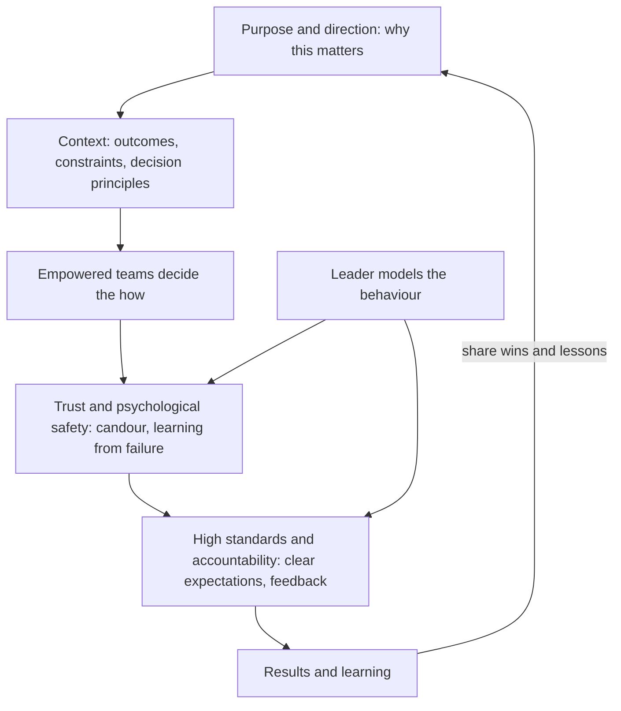
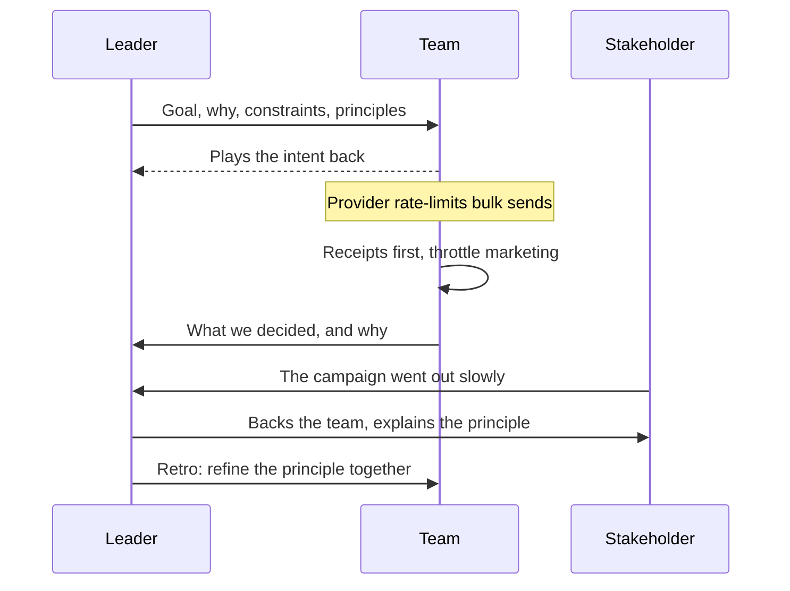

## TL;DR

- **Management** is about running the system well (plans, people processes, delivery); **leadership** is about direction and change — creating clarity, trust and motivation so people move towards a shared goal. Good engineering leaders do both, and Staff+ ICs lead without managing.
- Teams perform best with **psychological safety** plus **high standards**: people take risks, admit mistakes and challenge ideas, while being held to clear, ambitious expectations.
- Leaders **set context, not control**: explain the why, define outcomes and constraints, and let teams decide the how.
- Trust is built through **consistency, transparency and care** — doing what you say, sharing context and bad news, and caring about people's success.
- Adapt your style to the situation (crisis vs steady state, new team vs experienced team), and always model the behaviour you want.

## Core Concepts

### Leadership vs management

| Management | Leadership |
|---|---|
| Plans, budgets, processes | Direction, vision, purpose |
| Organising and staffing | Aligning people around the direction |
| Controlling and problem-solving | Motivating and inspiring |
| Produces predictability | Produces change |

(After John Kotter.) Both are needed: leadership without management is chaos; management without leadership is stagnation.

### Psychological safety and high standards

Amy Edmondson defines psychological safety as a shared belief that the team is safe for interpersonal risk-taking. Google's Project Aristotle found it the most important factor in team effectiveness. It is **not** about being nice or lowering standards:

| | Low standards | High standards |
|---|---|---|
| **High safety** | Comfort zone | Learning / high-performance zone |
| **Low safety** | Apathy | Anxiety |

Building it: frame work as learning problems, admit your own fallibility ("I might be missing something"), ask questions, respond appreciatively to bad news and dissent, run blameless postmortems, and address disrespect quickly.

### Leadership styles (situational)

- **Directive/coercive:** in a genuine crisis (major incident), clear commands help — harmful as a default.
- **Visionary/authoritative:** sets direction and why, leaves the how to the team — effective when change is needed.
- **Coaching:** develops people for the long term.
- **Affiliative:** builds harmony and emotional bonds — useful after setbacks.
- **Democratic/participative:** builds buy-in through input — slow in a crisis.
- **Pacesetting:** leading by example with high standards — burns teams out if sustained.

(Adapted from Daniel Goleman's research.) Effective leaders switch deliberately based on the situation and the people.

### Setting context, not control

Netflix popularised "context, not control"; the military calls a similar idea **mission command** / commander's intent: communicate the goal and the reasoning so people can make good decisions without asking. Practically:
- Clear **outcomes and constraints**, not task lists.
- **Decision principles** (e.g. "prefer reversible decisions; optimise for customer trust over short-term revenue").
- Explicit **decision rights** — who decides what.
- **Feedback loops** to see how it's going.

### Worked example: a task list versus commander's intent

An engineering manager hands a team the migration of customer notifications to a new email provider. Here are two ways to brief it:

**As a task list:** "Move all templates to the new provider by 30 June. Use the provider's SDK. Send everything through the new queue. Check with me before changing anything else."

**As intent:**
- **Goal:** all customer email goes through the new provider by 30 June, when the old contract ends.
- **Why:** the old provider's delivery failures cost us about 2% of password-reset emails, which is our top support complaint. The contract date is fixed.
- **Constraints:** no customer may miss a transactional email (password resets, receipts) during the move. Marketing email can pause for up to a day.
- **Decision principles:** protect transactional email over everything else; prefer reversible steps; tell support before customers notice anything.
- **Decision rights:** the team decides the how. Escalate only if the date or a constraint is at risk.

Three things then happen that the plan didn't anticipate:

| Situation | Team with a task list | Team with intent |
|---|---|---|
| The new provider rate-limits bulk sends, which would delay receipts during a sale | Waits two days for the manager, who's on leave | Sends transactional email first and throttles marketing, because "transactional over everything else" |
| The provider's SDK doesn't support the retry behaviour the team needs | Uses the SDK as instructed, and loses some emails on retries | Calls the provider's HTTP API directly, because the goal is delivery, not the SDK |
| Testing finds 40 unused templates | Migrates all of them, as listed | Retires them after a quick check with marketing, saving a week |

The intent version took longer to write and, at first, longer to discuss. Its value is that **the team could make good decisions in situations nobody foresaw**, without waiting for the leader. That's what "context, not control" means in practice.

### Trust

The trust equation (Maister): trust = (credibility + reliability + intimacy) / self-orientation. Leaders earn it by:
- Doing what they say (reliability) and knowing their stuff or admitting gaps (credibility).
- Sharing context, including uncomfortable truths (transparency).
- Caring about people's goals and wellbeing (intimacy) and putting the team ahead of personal credit (low self-orientation).

### Decision-making

- Distinguish **one-way door** (hard to reverse) from **two-way door** decisions; move fast on the latter.
- Decide with ~70% of the information you'd like (Bezos); waiting for certainty is itself a decision.
- Be clear about **how** a decision will be made (consult, consensus, delegate, decide) before discussing it.
- **Disagree and commit** once a decision is made; set revisit triggers.

## How It Works

### Delegating a decision with intent

## When to Use / Trade-offs

| Style | Use when | Avoid when | Trade-off |
|---|---|---|---|
| Directive | SEV1 incident, safety issue, immediate deadline with no slack | Normal operations with capable teams | Speed vs ownership and morale |
| Visionary | Team needs new direction or purpose | Direction is already clear and accepted | Alignment vs risk of being vague |
| Coaching | People are capable and want to grow | Crisis; person lacks basic skills for the task | Long-term growth vs short-term speed |
| Democratic | Decisions affecting the whole team; need buy-in and expertise | Time-critical decisions | Buy-in and quality vs speed |
| Pacesetting | Short bursts with highly skilled, motivated teams | Sustained periods | High output vs burnout |
| Affiliative | After failure, conflict or reorganisation | When performance problems need addressing | Cohesion vs avoidance of hard issues |

## Common Pitfalls & Anti-patterns

- **Hero leader** — the leader solves every hard problem, so the team never grows and the leader becomes the bottleneck.
- **Absent leader** — "empowerment" as an excuse for no direction or support.
- **Saying one thing, doing another** — "we value quality" but rewarding only speed.
- **Shooting the messenger** — bad news stops arriving.
- **Consensus on everything** — slow decisions and lowest-common-denominator outcomes.
- **Constant priority changes** — teams lose trust and momentum.
- **Taking credit, deflecting blame** — the fastest way to lose trust.
- **One style for every situation** — directive leadership during steady state, or committee decisions during an outage.

## Real-world Scenario

**Context:** A platform group of 25 engineers had become reactive and demoralised: frequent incidents, a backlog of requests from product teams, and a culture where engineers waited to be told what to do after a previous leader punished mistakes.

**Decision:** The new head of platform:
1. Spent the first month listening (1:1s, skip-levels, customer teams) and shared back a candid diagnosis, including their own uncertainties.
2. Defined a clear purpose ("make it easy for product teams to ship safely") and three outcomes for the year, with explicit things they would stop doing.
3. Introduced blameless postmortems, publicly thanked people who raised risks early, and admitted their own mistakes in team meetings.
4. Gave teams ownership of their roadmaps within the outcomes, with explicit decision rights.
5. Held a high bar: clear SLOs, regular operations reviews, and direct feedback when standards slipped.

**Outcome:** Within nine months incidents halved, platform adoption grew, engagement scores rose substantially, and two senior engineers who had planned to leave stayed and took on leadership roles.

**What I'd do differently:** Communicate the "stop doing" list to product teams earlier and more broadly — some stakeholders felt blindsided when requests were declined.

## Interview Questions

### What's the difference between leadership and management? {#leadership-vs-management}

**Level:** Foundation

**Model answer:**
- **Management** handles complexity: planning, budgeting, organising people and work, monitoring and solving problems — producing predictable results.
- **Leadership** handles change: setting direction, aligning people around it, motivating and inspiring them — producing movement towards a new state.

They overlap and both are needed. An engineering manager must manage (1:1s, reviews, delivery processes) and lead (direction, culture, change). A Staff or Principal engineer leads without managing — through technical direction, influence and example. A team with only management stagnates; with only leadership, it's chaotic.

**What the interviewer is looking for:**
A clear distinction, both being necessary, and leadership not requiring a management title.

**Follow-ups:**
- Give an example of leadership you showed without formal authority.
- Can someone be a great manager but a poor leader?

**Red flags:**
- "Leadership is being the boss."
- Dismissing management as administration.

### What is psychological safety, and how do you build it? {#psychological-safety}

**Level:** Foundation

**Model answer:**
Psychological safety (Amy Edmondson) is a team's shared belief that it's safe to take interpersonal risks — ask questions, admit mistakes, raise concerns, propose ideas — without being humiliated or punished. Google's Project Aristotle found it the most important factor in team effectiveness.

Building it:
- **Model fallibility:** admit mistakes and gaps ("I got this wrong", "I don't know").
- **Invite input explicitly:** "What am I missing?", ask quieter people directly, use written input before discussions.
- **Respond productively** to bad news, dissent and failure — thank people for raising issues; focus on learning.
- **Blameless postmortems** that look at systems, not culprits.
- **Address disrespect quickly** — interruptions, dismissiveness, put-downs.
- **Pair it with high standards:** safety is not lowering the bar; it's what lets people reach a high bar together.

**What the interviewer is looking for:**
Accurate definition, concrete leader behaviours, and the safety-plus-standards balance.

**Follow-ups:**
- How would you measure psychological safety?
- What do you do when a senior engineer's behaviour reduces safety for others?

**Red flags:**
- Equating psychological safety with avoiding conflict.
- No concrete practices.

### Which leadership styles do you use, and when? {#leadership-styles}

**Level:** Foundation

**Model answer:**
I adapt to the situation and the people:
- **Directive** during a major incident or safety issue — clear roles and instructions, because speed matters and there's no time for debate.
- **Visionary** when the team needs a new direction — explain where we're going and why, let the team work out how.
- **Coaching** for capable people who are stuck or growing — questions over answers.
- **Democratic** for decisions that affect the whole team and benefit from their expertise — e.g. working agreements, technical direction within the team.
- **Affiliative** after setbacks or conflict — rebuild cohesion.
- **Pacesetting** sparingly, for short bursts — sustained, it burns people out.

My default is visionary plus coaching: clear context and outcomes, then trust and support. The mistake is using one style everywhere.

**What the interviewer is looking for:**
Knowledge of styles, situational judgement and self-awareness about one's default.

**Follow-ups:**
- Tell me about a time your style didn't work and you adjusted.
- What style do you fall back on under stress?

**Red flags:**
- One style for everything.
- Directive leadership as the default.

### How do you build trust with a new team? {#building-trust}

**Level:** Foundation

**Model answer:**
- **Listen first:** 1:1s with everyone, asking about their work, frustrations, ideas and goals; learn the history before changing things.
- **Be reliable:** do what you say, follow up on actions, small promises kept matter.
- **Be transparent:** share context, including what you don't know and bad news; explain the reasoning behind decisions.
- **Show care:** learn what matters to each person, support their growth, protect them from unnecessary chaos.
- **Give credit, take responsibility:** credit the team publicly; own failures as the leader.
- **Demonstrate competence and humility:** contribute where you add value; admit gaps; ask for help.
- **Be consistent:** same standards for everyone; no favouritism.

Trust takes time and is lost quickly — one broken promise or public blame can undo months.

**What the interviewer is looking for:**
Listening, reliability, transparency, care, credit/blame behaviour and consistency.

**Follow-ups:**
- How do you rebuild trust after a mistake you made?
- How do you build trust with a team that distrusts management?

**Red flags:**
- Making big changes in the first weeks without listening.
- Trust based only on technical credibility.

### How do you make important decisions under uncertainty? {#decisions-under-uncertainty}

**Level:** Senior

**Model answer:**
- **Classify the decision:** reversible (two-way door) decisions should be made quickly, often by the team; irreversible (one-way door) decisions deserve more analysis and broader input.
- **Clarify the goal and criteria** before debating options.
- **Gather enough information, not all of it:** time-box research, use spikes or experiments to reduce the key uncertainty, consult experts and people affected.
- **Make the process explicit:** who decides, who's consulted, by when.
- **Consider options, including doing nothing,** and pre-mortems ("it's a year later and this failed — why?").
- **Decide, communicate the reasoning, and record it** (ADR), including assumptions and **revisit triggers**.
- **Monitor and adjust:** treat it as a hypothesis; change course when evidence shows you were wrong, without ego.

**What the interviewer is looking for:**
Reversibility, explicit process, time-boxed information gathering, pre-mortems, documentation and willingness to change course.

**Follow-ups:**
- Tell me about a decision you got wrong. What did you learn?
- How do you decide when you have conflicting expert advice?

**Red flags:**
- Analysis paralysis.
- Never revisiting decisions.

### How do you lead a team through significant change? {#leading-change}

**Level:** Senior

**Model answer:**
- **Explain the why** honestly: the problem or opportunity, the cost of not changing. People accept change they understand far more readily.
- **Involve people early** in shaping the how — they know the details, and participation builds ownership.
- **Be clear about what changes and what stays the same**, and about what isn't decided yet.
- **Acknowledge the human side:** change involves loss (familiar ways, status, relationships); listen to concerns and address them; don't dismiss resistance — it often carries useful information.
- **Create early wins** and make progress visible.
- **Communicate repeatedly, through multiple channels**; people need to hear things several times.
- **Support people individually** in 1:1s, especially those most affected.
- **Reinforce the change** through processes, recognition and your own behaviour, so it sticks.

Kotter's eight-step model and the ADKAR model (awareness, desire, knowledge, ability, reinforcement) offer useful structures.

**What the interviewer is looking for:**
The why, involvement, clarity, empathy for loss, early wins, repeated communication and reinforcement.

**Follow-ups:**
- A senior engineer is openly resisting the change. What do you do?
- How do you lead change you personally disagree with?

**Red flags:**
- Announcing change without explanation.
- Treating resistance as disloyalty.

### How do you communicate a vision so it actually guides the team? {#communicating-vision}

**Level:** Senior

**Model answer:**
- **Make it concrete:** describe what will be different for customers and the team ("product teams can launch a new service to production in a day without asking us"), not abstractions ("world-class platform").
- **Connect it to the business and to people's work:** why it matters, how each team's work contributes.
- **Pair it with strategy and priorities:** the few outcomes for this year, and what we're **not** doing.
- **Tell it as a story** with examples and data; repeat it often, in different forums (all-hands, planning, 1:1s, written docs).
- **Use it to make decisions visibly:** "we're choosing X because it moves us towards Y" — that's when people believe it.
- **Invite challenge and refine it** with the team; people support what they helped shape.
- **Track progress** towards it and share it.

**What the interviewer is looking for:**
Concreteness, linkage to strategy and daily decisions, repetition, co-creation and measurement.

**Follow-ups:**
- How do you know whether the team understands the vision?
- What do you do when business priorities change the vision?

**Red flags:**
- A one-off vision deck.
- Vague, unmeasurable statements.

### How do you lead during a major incident or crisis? {#crisis-leadership}

**Level:** Senior

**Model answer:**
- **Be calm and visible:** your demeanour sets the team's; panic spreads.
- **Structure quickly:** clear roles (incident commander, operations, communications), one channel, a cadence of updates. In a crisis, directive leadership is appropriate.
- **Protect the responders:** shield them from executive and stakeholder pressure; route questions through the comms lead.
- **Focus on mitigation first** (stop the bleeding), investigation later.
- **Make decisions with incomplete information** and explain them; adjust as you learn.
- **Communicate honestly** with customers and stakeholders: what we know, what we're doing, when the next update is.
- **Look after people:** rotate responders for long incidents, ensure breaks and food, watch fatigue.
- **Afterwards:** blameless postmortem, thank people specifically, follow through on actions, and switch back to a non-directive style.

**What the interviewer is looking for:**
Calm structure, appropriate directiveness, protecting responders, honest communication, care for people and blameless learning.

**Follow-ups:**
- An executive keeps interrupting the incident channel. What do you do?
- How do you decide when to escalate to a company-level crisis?

**Red flags:**
- Leader debugging and coordinating at the same time.
- Blame during or after the incident.

### How do you hold people accountable without creating a blame culture? {#accountability}

**Level:** Senior

**Model answer:**
Accountability and blamelessness aren't opposites:
- **Clear expectations and ownership upfront:** who owns which outcome, what "good" looks like, decision rights. You can't hold people accountable for unclear expectations.
- **Accountability is forward-looking:** owning outcomes, following through, raising risks early, and learning — not punishment.
- **Blameless analysis of failures:** look at systems, information and pressures that led to decisions; most failures have systemic causes.
- **But address behaviour:** repeated failure to meet clear expectations, ignoring agreed practices or reckless behaviour is addressed directly through feedback and performance processes. "Just culture" distinguishes honest mistakes (support), at-risk behaviour (coach) and reckless behaviour (sanction).
- **Model it:** leaders own their part publicly, especially in failures.
- **Make commitments visible:** regular reviews of goals and actions, so follow-through is a norm.

**What the interviewer is looking for:**
Clarity before accountability, forward-looking ownership, blameless systems analysis, a just-culture distinction and leader modelling.

**Follow-ups:**
- A postmortem shows an engineer ignored a known safety step. How do you handle it?
- How do you hold a peer team accountable?

**Red flags:**
- "Blameless means nobody is accountable."
- Naming and shaming.

### How do you manage up effectively? {#managing-up}

**Level:** Senior

**Model answer:**
- **Understand your manager's goals, pressures and preferences** — what they're measured on, how they like information (written vs verbal, detail vs summary), how often.
- **No surprises:** escalate risks and bad news early, with options and a recommendation.
- **Be concise and decision-oriented:** "here's the situation, the options, what I recommend, what I need from you".
- **Make them successful:** align your team's work with their priorities; give them the information they need for their own stakeholders.
- **Ask for what you need:** support, air cover, resources, feedback on your performance.
- **Disagree constructively** in private, with data, then commit.
- **Build trust through reliability:** deliver on commitments, follow up.

Managing up is not politics or flattery — it's an effective working relationship that benefits your team.

**What the interviewer is looking for:**
Understanding the manager's context, early escalation with options, concise communication, aligning priorities and constructive disagreement.

**Follow-ups:**
- Your manager makes a decision you think will harm the team. What do you do?
- How do you work with a manager who micromanages?

**Red flags:**
- Hiding problems until they're unavoidable.
- Treating managing up as self-promotion.

### How do you shape the engineering culture of an organisation? {#engineering-culture}

**Level:** Architect

**Model answer:**
Culture is what people actually do and what gets rewarded, not values on a wall.

- **Define the desired culture concretely** — behaviours, not adjectives: "we write a design doc for cross-team changes", "we run blameless postmortems for every SEV1/2", "we review PRs within one working day", "we put customer impact first in prioritisation".
- **Model it at the top:** leaders' behaviour is the strongest signal.
- **Embed it in systems:** hiring criteria and interview rubrics, onboarding, career framework and promotion criteria, recognition, rituals (demos, postmortems, architecture reviews), tooling and paved roads.
- **Tell stories:** share examples of the behaviour and its results.
- **Address violations, especially by high performers** — tolerating a "brilliant jerk" defines the real culture more than any statement.
- **Listen and measure:** engagement surveys, exit interviews, team health checks; adjust.
- **Evolve:** culture needs to change as the organisation grows; revisit periodically with input from people across levels.

**What the interviewer is looking for:**
Culture as behaviour and incentives, leadership modelling, embedding in systems, dealing with violations and measurement.

**Follow-ups:**
- How do you change a culture where shipping fast always beats quality?
- What's your view on "culture fit" in hiring?

**Red flags:**
- Culture as perks and slogans.
- Tolerating destructive high performers.

### You're asked to turn around a struggling team. What's your approach? {#team-turnaround}

**Level:** Architect

**Model answer:**
1. **Diagnose (first 30 days):** 1:1s with every team member, stakeholders and the team's customers; look at data — delivery metrics, incidents, quality, engagement, attrition, backlog. Find the root causes: unclear mission, too much work, technical debt, skills gaps, interpersonal conflict, poor processes, leadership vacuum, or external dependencies.
2. **Share the diagnosis openly** with the team and your manager, inviting correction.
3. **Stabilise:** stop the bleeding — reduce work in progress, protect the team from unplanned demands, fix the most painful operational issues, clarify priorities with stakeholders.
4. **Clarify direction:** team mission, ownership, a short list of outcomes, and what we will stop doing.
5. **Fix people issues:** address underperformance or toxic behaviour, fill critical skill gaps, give strong people more scope and recognition.
6. **Improve ways of working:** a few concrete changes (planning, code review norms, on-call improvements, retros with actions) rather than a big process overhaul.
7. **Rebuild confidence:** quick wins, visible progress, celebrating improvement, reconnecting the team with customers.
8. **Measure and communicate** progress to the team and stakeholders.

**What the interviewer is looking for:**
Structured diagnosis, transparency, stabilisation before transformation, clear direction, decisive people actions and visible progress.

**Follow-ups:**
- What if the root cause is outside the team (e.g. product management)?
- How long before you expect results?

**Red flags:**
- Arriving with a predetermined fix.
- Replacing people before understanding the system.

### Describe how you would handle an ethical dilemma as a leader. {#ethical-leadership}

**Level:** Architect

**Model answer:**
*Example:* leadership asks to launch a feature that collects more user data than necessary, with consent wording you believe is misleading, to hit a growth target.

Approach:
1. **Clarify the facts and concerns:** what exactly is being collected, how consent works, legal requirements (GDPR, consumer law), and the potential harm to users.
2. **Raise it early, through the right channels,** framed in terms leaders care about: legal and regulatory risk, reputational risk, customer trust — plus the ethical principle.
3. **Offer alternatives:** collect less data, clearer consent, phased rollout, privacy review — ways to reach the business goal without the harm.
4. **Involve the right functions:** privacy/legal, security, ethics or compliance boards where they exist.
5. **Document** the concern and the decision.
6. **Know your line:** if the decision crosses legal or clear ethical boundaries, escalate further (including whistleblowing channels) and be prepared not to participate. Disagree-and-commit doesn't apply to ethical violations.
7. **Protect your team:** make sure engineers know they can raise concerns too, without retaliation.

**What the interviewer is looking for:**
Moral courage combined with pragmatism: facts, business framing, alternatives, the right partners, documentation, and clear limits.

**Follow-ups:**
- How do you separate an ethical issue from a disagreement about strategy?
- What would make you resign?

**Red flags:**
- "I'd just do what I'm told."
- Moral grandstanding without engaging with the business problem.

### How does leadership need to change as an organisation grows from 20 to 200 engineers? {#scaling-organisation}

**Level:** Architect

**Model answer:**
At 20, leadership is personal: everyone knows everyone, decisions happen in conversations, context spreads informally. At 200, that breaks down:
- **From doing to enabling:** leaders move from making decisions to designing how decisions are made — decision rights, RFC/ADR processes, architecture forums.
- **Explicit structure:** teams aligned to domains, clear ownership, a management layer (managers of managers), staff+ IC roles for technical leadership.
- **Written context:** strategy docs, roadmaps, engineering principles and handbooks replace hallway conversations; communication becomes deliberate and repeated.
- **Scalable culture:** values embedded in hiring, onboarding, promotion and recognition, because the founders can't personally model it for everyone.
- **Developing leaders:** a pipeline of managers and staff engineers, training and coaching — the biggest constraint at scale is leadership capacity.
- **Metrics and feedback loops:** DORA, engagement surveys, operational reviews to see what you can no longer observe directly.
- **Platforms and standards:** shared infrastructure and paved roads to avoid each team reinventing.
- **Protecting what worked:** speed, ownership and closeness to customers — avoid bureaucracy creep by reviewing processes regularly.

**What the interviewer is looking for:**
Awareness of what breaks with scale, shifting from doing to designing systems, written context, leadership development and protecting agility.

**Follow-ups:**
- What processes would you introduce first, and which would you avoid?
- How do you keep startup speed at 200 people?

**Red flags:**
- Running a 200-person org like a 20-person one.
- Process for its own sake.

### How do you balance short-term delivery pressure against long-term team and system health? {#short-vs-long-term}

**Level:** Architect

**Model answer:**
- **Make the trade-off visible and explicit:** quantify the long-term costs (incident rates, lead time trends, attrition risk, on-call load, tech debt hotspots) and present them alongside delivery goals. Business leaders can make good trade-offs only if they see both sides.
- **Protect a baseline:** agreed capacity allocation for health work (e.g. 20%), SLO error budgets that trigger reliability work, sustainable on-call rules.
- **Accept deliberate debt consciously:** sometimes the deadline really matters (contract, regulatory date) — take the shortcut deliberately, record it with a repayment plan, and actually repay it.
- **Use crunch sparingly:** short, rare, with recovery time afterwards — never as the normal mode.
- **Build health into delivery:** improve the code you touch, automate as you go, so health work isn't a separate fight.
- **Track leading indicators:** engagement, attrition, DORA trends; act before collapse.
- **Model it personally:** don't reward heroics that come from poor planning.

**What the interviewer is looking for:**
Quantified trade-offs, protected capacity mechanisms, deliberate debt management, sustainable pace and leading indicators.

**Follow-ups:**
- The CEO insists on a date that requires sustained overtime. What do you do?
- How do you show the business the cost of neglecting health?

**Red flags:**
- Always prioritising short-term delivery.
- Treating health work as something engineers do in their spare time.

### You've been promoted to lead the team you were part of. What changes, and how do you handle it? {#promoted-from-peer}

**Level:** Foundation

**Model answer:**
Leading former peers is one of the hardest transitions, because **the relationships change before the people do**.

What changes:
- **Your job:** success is now the team's output, not yours. Your time goes on direction, unblocking, growing people and stakeholders. Keeping your old workload means doing two jobs badly.
- **Your relationships:** you'll give feedback to, and possibly evaluate, people who were your friends. Some information you'll now hold, such as salaries or reorganisation plans, can't be shared.
- **How your words land:** a casual opinion from the lead sounds like a decision.

How to handle it:
1. **Name it openly.** In 1:1s with each person: "This is a change for both of us. What would you want from me as a lead? What worries you?" Expect mixed feelings, especially from anyone who wanted the role. Talk to them first.
2. **Don't change everything at once.** Listen first, keep what works, and explain any changes you do make.
3. **Be consistent and fair.** No favouritism towards friends and no overcorrection against them. The team watches closely.
4. **Give up some technical ownership on purpose.** Hand your areas to others, and stop being the person who decides every technical debate. That creates room for others to lead.
5. **Get support:** your own manager, a mentor who has made the same transition, or a peer group of new leads.
6. **Address problems early.** The first time you have to give critical feedback to a former peer, do it promptly and privately. Avoiding it is how authority quietly drains away.

**What the interviewer is looking for:**
Understanding how the job and relationships change, open conversations, fairness, letting go of technical control, early handling of difficult feedback, and seeking support.

**Follow-ups:**
- A teammate who also applied for the role is disengaged. What do you do?
- How do you stay technical without competing with your team?

**Red flags:**
- Carrying on as an individual contributor with a title.
- Treating close friends differently in assignments or feedback.

### How do you keep a team motivated through a long, grinding project? {#sustaining-motivation}

**Level:** Senior

**Model answer:**
Long projects, such as a year-long migration or compliance programme, lose energy in the middle. The start is exciting, the end is in sight later, and the middle is just work. Motivation research gives useful levers.

- **Make progress visible.** Teresa Amabile's research found that making progress on meaningful work is one of the strongest everyday motivators, and that setbacks are the strongest demotivators. Break the project into milestones of weeks, not quarters. Track and celebrate them: "40 of 120 services migrated".
- **Reconnect to purpose.** Show the impact as it happens: the first incident that didn't happen, customer feedback, cost savings. "Why are we doing this?" fades unless someone keeps answering it.
- **Give autonomy and mastery** (Daniel Pink's framing): let people own parts end to end, choose how to solve problems, and learn something new. Rotate people between repetitive and interesting work.
- **Remove friction fast.** Nothing drains energy like a blocker that leaders ignore. Clear obstacles visibly, and say what you did.
- **Vary the rhythm:** a hack day to build tooling for the boring parts, a demo to another team, a short break between phases.
- **Watch individuals:** 1:1s to notice who is flagging. Some people need a change of task; some need recognition; some are near burnout.
- **Be honest about the grind.** "This phase is tedious and it matters" is more credible than forced enthusiasm.

**What the interviewer is looking for:**
Visible progress and small wins, purpose shown through real impact, autonomy and mastery, removing blockers, varying the rhythm, and attention to individuals.

**Follow-ups:**
- The deadline moves out by three months. How do you tell the team?
- How do you recognise people for unglamorous work?

**Red flags:**
- Motivation through pressure and deadlines alone.
- Pizza and slogans instead of removing blockers.

### You made a public decision as a leader that turned out to be wrong. How do you handle it? {#owning-a-wrong-decision}

**Level:** Senior

**Model answer:**
How a leader handles their own mistakes sets the standard for everyone else. Owning one well **builds** trust; defending it destroys it.

1. **Recognise it early.** Watch the signals you agreed when you made the decision, such as revisit triggers in the ADR. Sunk cost and ego are what keep people going the wrong way.
2. **Separate a bad decision from a bad outcome.** If the decision was reasonable with the information at the time, say so, but still change course. If you missed information you should have sought, own that specifically.
3. **Say it plainly, in the same forum where you made the decision:** "In March I decided we'd build our own feature-flag service. Six months in, it's cost twice what I estimated and isn't as reliable as the managed options. That was my call, and I'm reversing it."
4. **Come with the way forward:** the new plan, what it costs, and how you'll minimise the disruption for the people affected.
5. **Credit the people who raised concerns**, especially if you overruled them. It shows that dissent is valued.
6. **Share what you've learned** and change the process if needed, for example by adding a spike or a cost review for build-versus-buy decisions.
7. **Don't over-apologise or overcorrect.** One honest acknowledgement, then focus on moving forward. Becoming afraid to decide anything is a worse outcome.

**What the interviewer is looking for:**
Early recognition, separating decision quality from outcome, plain public ownership in the same forum, a way forward, crediting dissenters, and learning without paralysis.

**Follow-ups:**
- How do you tell your own manager?
- What if reversing it means writing off months of a team's work?

**Red flags:**
- Quietly letting the decision fade without acknowledging it.
- Blaming the team that implemented it.

### How do you build a leadership bench so the organisation doesn't depend on you? {#succession-planning}

**Level:** Architect

**Model answer:**
A leader whose team falls apart when they're away hasn't built an organisation. They've built a dependency. Succession planning is about **growing several people who could step up**, not naming one heir.

**Identify:**
- For each critical role, including your own and key technical roles, ask: if this person left tomorrow, who could step in now, who in a year, and who in two?
- Look beyond the obvious candidates. Informal leaders, such as the person others go to for help or the one who calms incidents, are often missed.

**Develop through real responsibility:**
- **Delegate parts of your own job,** permanently and visibly: running planning, owning a stakeholder relationship, leading the operations review, representing the team at the architecture forum.
- **Use absences deliberately:** when you're on holiday, someone acts in your role with real authority, and you don't take decisions back when you return.
- **Rotate stretch roles** such as incident commander, project lead or interim manager, with coaching and a debrief.
- **Sponsor them:** put their names forward, and make their work visible to your own leadership.

**Make it a system:**
- Discuss succession and development in talent reviews twice a year, with named people and plans.
- Track how many critical roles have at least one "ready now" successor.
- Reward leaders for the people they develop, including people who get promoted out of their team.

**The hard part is personal:** letting others do parts of your job less well at first, and getting comfortable with being less needed. A useful test is a two-week holiday with no contact: if things go well, the bench exists.

**What the interviewer is looking for:**
Thinking in terms of roles and readiness, developing people through real delegated responsibility, sponsorship, a recurring system with measures, and the leader's own willingness to let go.

**Follow-ups:**
- Your strongest potential successor wants to move to the IC track. What do you do?
- How do you avoid succession planning becoming favouritism?

**Red flags:**
- "Nobody else could do my job."
- A single named successor, with nobody else developed.

### The company is cutting costs and has frozen hiring. How do you lead your organisation through it? {#leading-through-cost-cutting}

**Level:** Architect

**Model answer:**
In a downturn, people's biggest fear is uncertainty, and the most valuable things a leader gives are **honesty, focus and care**.

**Communicate honestly and early:**
- Share what you know, what you don't know, and when you'll know more. Rumours fill every silence.
- Don't promise what you can't control ("there won't be layoffs"). Say what you will do: "I'll tell you as soon as I know anything that affects this team."

**Refocus the work:**
- With fewer people than planned, **stop things explicitly.** Agree with product and business leaders which commitments go, and say so publicly. Otherwise teams try to do the original plan with less, and burn out.
- Prioritise work that protects revenue, reduces cost or reduces serious risk. Show the organisation's work in those terms.
- **Look for real efficiencies:** cloud costs, duplicated tools, idle environments, abandoned services. Engineers often know where money is wasted.

**Look after people:**
- Increase 1:1 attention. Watch for people taking on too much, and for anxious people going quiet.
- Keep development going: stretch opportunities still exist, and growth matters more when promotions and pay rises are limited.
- Be careful about attrition. In a hiring freeze, every regretted departure is a permanent loss, so act early on retention risks.

**Protect the foundations:** don't cut on-call health, security or reliability so far that you create the next crisis. Make that risk explicit to leadership if pressed.

**Look after yourself,** and get support from peers. Leaders absorb a lot of anxiety in downturns, and a burnt-out leader can't steady anyone.

**What the interviewer is looking for:**
Honest communication without false promises, explicitly stopping work, aligning with business priorities, finding efficiencies, extra care for people and retention, protecting foundations, and the leader's own resilience.

**Follow-ups:**
- Leadership asks you to cut 20% of the budget. How do you decide what goes?
- An engineer asks you directly whether layoffs are coming, and you know they are. What do you say?

**Red flags:**
- Promising job security you can't guarantee.
- Doing the same plan with fewer people.

## Cheat Sheet

- **Management vs leadership** — complexity and predictability vs direction and change (Kotter).
- **Psychological safety** — safe to take interpersonal risks; pair it with high standards (Edmondson).
- **Safety × standards** — comfort zone, learning zone, apathy, anxiety.
- **Situational styles** — directive, visionary, coaching, democratic, affiliative, pacesetting (Goleman).
- **Context, not control** — share outcomes, constraints and reasoning; let teams choose the how.
- **Commander's intent** — the goal and reasoning, so people decide well without asking.
- **Trust equation** — (credibility + reliability + intimacy) ÷ self-orientation.
- **One-way vs two-way doors** — slow down for irreversible decisions; move fast on reversible ones.
- **Disagree and commit** — debate fully, then commit; ethics are the exception.
- **Just culture** — support honest mistakes, coach at-risk behaviour, address reckless behaviour.
- **Leading change** — explain why, involve people, acknowledge loss, early wins, reinforce.
- **Crisis leadership** — calm, structured, directive, protect responders, blameless afterwards.
- **Culture** — what gets rewarded and tolerated, embedded in hiring, promotion and rituals.
- **Scaling leadership** — from making decisions to designing decision systems and growing leaders.

### Revisit

- **Commander's intent in practice** — goal, why, constraints, decision principles and decision rights, so teams handle situations nobody foresaw.
- **Delegating with intent** — the team plays it back, decides and informs; the leader backs decisions that followed the principles.
- **Promoted from peer** — name the change in 1:1s, start with anyone who wanted the role, stay fair, and hand over technical ownership.
- **Sustaining motivation** — visible progress on meaningful work (Amabile), purpose shown through real impact, autonomy and mastery, blockers removed.
- **Owning a wrong decision** — say it plainly in the forum where you made it, bring the way forward, credit the dissenters and keep deciding.
- **Succession planning** — ready-now, one-year and two-year successors for critical roles, grown through permanently delegated responsibility.
- **Leading through cost-cutting** — honest updates without false promises, stop work explicitly, protect foundations and watch retention.

## Further Reading

- [Amy Edmondson: The Fearless Organization](https://amycedmondson.com/books/) — psychological safety research and practice.
- [Google re:Work: Understand team effectiveness](https://rework.withgoogle.com/intl/en/guides/understand-team-effectiveness) — Project Aristotle findings.
- [Kotter: Leading Change (8 steps)](https://www.kotterinc.com/methodology/8-steps/) — the change model used in many organisations.
- [Will Larson: An Elegant Puzzle](https://lethain.com/elegant-puzzle/) — systems thinking for engineering leadership.
- [Netflix culture memo](https://jobs.netflix.com/culture) — the origin of "context, not control".
