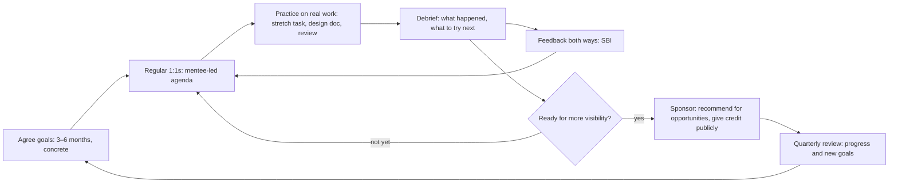

## TL;DR

- **Mentoring** shares experience and advice. **Coaching** asks questions so people find their own answers. **Sponsorship** uses your influence to put someone forward for opportunities. Senior engineers need all three, and sponsorship is the one most often missing.
- Effective mentoring is **mentee-led and goal-oriented**: clear goals, a regular cadence, and practical work (stretch tasks, code reviews, design reviews) rather than abstract advice.
- Give feedback that is **specific, timely and about behaviour and impact** (SBI: situation, behaviour, impact), and balance challenge with support.
- At Staff level, mentoring **scales through systems**: pairing, design reviews, written guidance, office hours and growing other mentors, not just one-to-ones.
- Sponsorship and fair access to stretch work are **equity issues**. Be deliberate about who gets the visible opportunities.

## Core Concepts

### Mentoring, coaching, sponsoring, managing

| Role | What it is | Typical phrase | When it helps |
|---|---|---|---|
| Mentor | Shares experience, advice, perspective | "When I faced this, I…" | Mentee lacks context or knowledge |
| Coach | Asks questions; helps the person think | "What options do you see? What's stopping you?" | Mentee has the knowledge but is stuck or needs to own the decision |
| Sponsor | Advocates in rooms the person isn't in; creates opportunities | "She should lead the migration RFC." | Career progression; visibility |
| Manager | Accountable for performance, goals, compensation | "Let's set your goals for the half." | Formal development and evaluation |

Good mentors move between modes deliberately. Default to coaching questions, give advice when it would save painful, low-value struggle, and sponsor when the person is ready for more visibility.

### Structure that works

- **Goals:** what does the mentee want in 3–6 months? Make it concrete. "Lead a cross-team design" is better than "grow as an engineer".
- **Cadence:** 30–45 minutes every 1–2 weeks. The mentee owns the agenda, and the mentor keeps lightweight shared notes.
- **Practice over talk:** pick real work (a design doc, an incident review, a difficult conversation) and debrief it.
- **Review progress** each quarter and refresh the goals, or end the relationship gracefully when it has served its purpose.

### Feedback techniques

- **SBI (Situation, Behaviour, Impact):** "In Tuesday's design review (situation), you dismissed the SRE's latency concern without asking about the data (behaviour). She stopped contributing, and we missed the cache stampede risk (impact)." Then ask: "What was going on for you?"
- **Specific and timely:** within days, about observable actions, not personality.
- **Praise specifically too:** "The way you split the RFC into decision and appendix made the review fast" teaches more than "great job".
- **Radical Candor** (Kim Scott): care personally *and* challenge directly. Avoid ruinous empathy (kind but useless) and obnoxious aggression.

### Mentoring through real work

- **Code review as teaching:** explain the *why*, link to principles, distinguish blocking issues from suggestions ("nit:"), ask questions ("What happens if this call times out?") and recognise good choices.
- **Pairing and mobbing:** model how you think, out loud, including when you're unsure.
- **Stretch assignments:** slightly beyond current ability, with a safety net. Agree checkpoints, be available, don't take over.
- **Design and incident reviews:** invite mentees to present and run them, and debrief afterwards.

## How It Works

A good one-to-one rhythm: start with what's on the mentee's mind, then review the action from last time, work through one topic in depth (often by coaching questions), agree one concrete action and finish with feedback on the session itself.

## When to Use / Trade-offs

| Approach | Use when | Avoid when | Trade-off |
|---|---|---|---|
| 1:1 mentoring | Individual goals, career questions, confidence | You need to reach many people | Deep impact, limited scale |
| Pairing / mobbing | Skill transfer on real code, onboarding | Simple tasks; mentor doesn't hold back | Fast learning; short-term velocity cost |
| Group mentoring / circles | Common challenges (new tech leads, new managers) | Sensitive personal topics | Scales; less personal |
| Office hours | Many people need occasional help | Deep long-term growth | Accessible; reactive |
| Written guides, talks | Recurring questions, standards | Nuanced individual situations | Scales infinitely; one-way |
| Sponsorship | Person is ready for bigger scope/visibility | Person isn't ready; sets them up to fail | Accelerates careers; uses your credibility |

## Common Pitfalls & Anti-patterns

- **The answer machine** — solving every problem for the mentee. It feels helpful and blocks growth. Ask first.
- **War stories without transfer** — "In my day…" monologues that don't connect to the mentee's situation.
- **No goals** — pleasant chats that drift for months with no progress.
- **Mentoring in your own image** — pushing the mentee towards *your* path, such as staff engineering, when they want management or a specialism.
- **Taking over stretch tasks** at the first wobble — it removes the learning and the confidence.
- **Only mentoring people like you** — informal mentoring flows to people who resemble existing seniors, which amplifies inequity.
- **Feedback sandwiches** — the criticism gets lost between the compliments. Be clear and kind instead.
- **Confidentiality breaches** — sharing a mentee's struggles with their manager without consent destroys trust.

## Real-world Scenario

**Context:** In a 60-engineer product group, promotions to senior were slow and uneven. Engineers said they didn't know what "senior" looked like in practice, and the same few people kept getting the high-visibility projects. Two strong mid-level engineers from under-represented groups were considering leaving.

**Decision:** A staff engineer worked with engineering managers to:
1. Publish concrete examples of senior-level behaviour (design docs, incident leadership, mentoring) alongside the career framework.
2. Start mentoring circles of 4–5 people with a senior or staff facilitator, meeting fortnightly around real work (one person's design doc or incident each session).
3. Make the allocation of "visible" work (RFC leads, incident commanders, demo presentations) explicit and tracked in planning, with a rotation.
4. Have each staff engineer actively sponsor two people per half: recommend them for opportunities and credit their work in leadership forums.

**Outcome:** Within a year, 7 engineers were promoted to senior (against 2 the previous year), and both at-risk engineers stayed; one led a major migration. Engagement survey scores on growth rose sharply.

**What I'd do differently:** Train the facilitators in coaching from the start. Early circles turned into seniors lecturing. Also, measure the opportunity distribution from day one. It was the most persuasive data for leadership.

## Interview Questions

### What is the difference between mentoring, coaching and sponsorship? {#mentoring-coaching-sponsorship}

**Level:** Foundation

**Model answer:**
- **Mentoring:** sharing your experience, knowledge and perspective to help someone grow. "Here's how I approached a similar migration."
- **Coaching:** asking questions that help the person reach their own insights and decisions. "What options do you see? What would you do if you weren't worried about X?" It builds ownership and works best when they have the knowledge but are stuck.
- **Sponsorship:** using your influence and credibility to create opportunities for someone: recommending them for projects, promotions or speaking slots, and championing their work in rooms they aren't in.

Good senior engineers switch between these deliberately. Sponsorship is often the missing piece. Advice alone doesn't change careers; opportunities and visibility do.

**What the interviewer is looking for:**
Clear distinctions, knowing when to use each and recognising the importance of sponsorship.

**Follow-ups:**
- Give an example of when you coached rather than advised.
- What are the risks of sponsoring someone?

**Red flags:**
- Equating mentoring with telling people what to do.
- Never having sponsored anyone.

### How do you start a new mentoring relationship? {#first-session}

**Level:** Foundation

**Model answer:**
In the first session:
- **Get to know each other:** background, current role, what they enjoy and find hard, and their longer-term aspirations. These might not match my path.
- **Clarify the goals:** what they want from the next 3–6 months, made concrete ("present a design to the architecture forum", "get comfortable leading incidents").
- **Agree how we'll work:** frequency (every 1–2 weeks), format, who owns the agenda (they do), how to reach me in between, and **confidentiality**. What's said stays between us unless we agree otherwise.
- **Set expectations:** I'll ask more questions than I answer, I'll give candid feedback, and they should push back when my advice doesn't fit.
- **Agree a first action:** something small and real to work on before the next session.

Then review the arrangement after a couple of months: is it useful, should we change anything?

**What the interviewer is looking for:**
Goal setting, mentee ownership, explicit confidentiality and expectations, and an early concrete action.

**Follow-ups:**
- What if the mentee doesn't know what their goals are?
- How do you end a mentoring relationship well?

**Red flags:**
- No goals or structure.
- The mentor setting the agenda for the mentee.

### How do you give feedback that actually helps someone improve? {#giving-feedback}

**Level:** Foundation

**Model answer:**
- **Be specific and behavioural:** use SBI (Situation, Behaviour, Impact). "In yesterday's stand-up (S), you committed the team to Friday without checking with QA (B), so QA had to work late and we skipped the regression run (I)."
- **Be timely:** within a day or two, while it's fresh. Give it privately when it's corrective.
- **Make it a conversation:** ask for their perspective ("What was going on?"). There may be context I'm missing.
- **Focus on the future:** "What could you try next time?" and agree one change.
- **Care and challenge together** (Radical Candor): make it clear I want them to succeed, and don't water down the message.
- **Give specific positive feedback** often, explaining *why* the behaviour worked, so they repeat it.
- **Ask for feedback on my mentoring** too. It models the behaviour.

**What the interviewer is looking for:**
A structured technique, timeliness, two-way conversation and a balance of challenge and care.

**Follow-ups:**
- How do you give feedback to someone defensive?
- How do you give feedback to someone more senior than you?

**Red flags:**
- Vague feedback ("be more proactive").
- The feedback sandwich as the default.

### How do you use code review as a mentoring tool? {#mentoring-in-code-review}

**Level:** Foundation

**Model answer:**
- **Explain the why:** not "use a Map here" but "a Map gives O(1) lookups. With 50k items in this loop, the array scan costs about 2 s."
- **Ask questions to provoke thinking:** "What happens if the payment call times out after the order is saved?"
- **Separate blocking from optional:** mark nits and preferences clearly so the important feedback stands out.
- **Recognise good choices,** specifically.
- **Link to principles or docs:** ADRs, style guides, a good article, so learning extends beyond this pull request.
- **Know when to switch medium:** if a thread passes 3–4 comments, have a call or pair. Long written debates are slow and can feel hostile.
- **Mind the tone:** "we" rather than "you", and assume good intent.
- **Invite juniors to review too,** including your code. Reviewing is a skill and builds confidence.

**What the interviewer is looking for:**
Reviews as teaching (why, questions, links), clarity about severity, tone awareness and knowing when to talk instead.

**Follow-ups:**
- How do you handle a pull request that needs a fundamental redesign?
- How do you stop reviews becoming a bottleneck while still mentoring?

**Red flags:**
- Rewriting the mentee's code yourself.
- Nitpicks with no explanation.

### Your mentee seems stuck and hasn't progressed in months. What do you do? {#mentee-not-progressing}

**Level:** Senior

**Model answer:**
1. **Reflect first:** are the goals still right, and still theirs? Have I been giving advice they don't act on, which suggests a mismatch?
2. **Have an honest conversation:** "We set the goal of leading a design in Q1, and it hasn't happened. What's getting in the way?" Listen for the real blockers:
   - Lack of opportunity (no suitable project).
   - Confidence or fear of failure.
   - Workload.
   - Unclear expectations.
   - Personal circumstances.
   - The goal isn't actually what they want.
3. **Respond to the cause:**
   - *Opportunity:* sponsor them, talking to their manager about the next project.
   - *Confidence:* smaller steps with support (co-present first, then lead).
   - *Workload:* help them negotiate priorities.
   - *Unclear expectations:* make "good" concrete with examples.
   - *The wrong goal:* reset it.
4. **Agree a concrete next step** with a date, and check in more frequently for a while.
5. **Be willing to change the arrangement:** another mentor with different experience may help more. That's not a failure.

**What the interviewer is looking for:**
Self-reflection, curiosity about root causes, tailored responses (including sponsorship) and openness to changing the arrangement.

**Follow-ups:**
- What if the blocker is their manager?
- When do you involve the manager, and how do you keep confidentiality?

**Red flags:**
- Blaming the mentee for lack of motivation.
- Continuing the same sessions unchanged.

### How do you mentor someone whose background or career path differs from yours? {#mentoring-across-difference}

**Level:** Senior

**Model answer:**
- **Lead with curiosity, not assumptions:** ask about their goals, values and constraints. They may want a management, specialist or product path, part-time work or a different pace.
- **Recognise that my path isn't the template:** what worked for me (luck, networks, being similar to the people who promoted me) may not be available to them. Under-represented engineers often face extra scrutiny, "prove it again" bias, or get less credit for the same work.
- **Coach more, prescribe less;** where my experience doesn't apply, connect them with others who share their path or background. Several mentors are better than one.
- **Use my position as a sponsor:** make their work visible, recommend them for opportunities and challenge biased assessments when I see them.
- **Ask for feedback** on whether my advice fits, and adjust.

**What the interviewer is looking for:**
Humility, avoiding mentoring in one's own image, awareness of systemic bias and active sponsorship.

**Follow-ups:**
- How would you mentor someone who wants to move into product management?
- What would you do if you saw your mentee being treated unfairly in performance calibration?

**Red flags:**
- "Just do what I did."
- Ignoring bias as a factor.

### As a Staff engineer, how do you scale your mentoring impact beyond one-to-ones? {#scaling-mentorship}

**Level:** Senior

**Model answer:**
- **Mentor through the work:** pair on hard problems, invite people to co-author design docs, run design reviews as teaching sessions, and debrief incidents with the people who led them.
- **Write things down:** guides on writing an RFC or running an incident, decision records with reasoning, worked examples of good designs. Writing answers the same question for many people.
- **Office hours:** a weekly open slot for design questions.
- **Group formats:** mentoring circles, reading groups, internal talks.
- **Grow mentors:** coach senior engineers to mentor others, and review their mentoring with them. This is the real multiplier.
- **Sponsor deliberately:** a small number of people each half for whom I actively create opportunities.
- **Shape the system:** career framework examples, interview and onboarding processes, fair allocation of stretch work.

**What the interviewer is looking for:**
Multiplying impact through work, writing, group formats, growing other mentors and changing systems.

**Follow-ups:**
- How do you decide whom to sponsor?
- How do you know whether these efforts work?

**Red flags:**
- Only one-to-ones with a handful of people.
- No investment in growing other mentors.

### How do you mentor junior engineers on a team under delivery pressure? {#mentoring-and-delivery}

**Level:** Senior

**Model answer:**
Treat mentoring as **part of delivery**, not competition with it. A team where only seniors can do critical work is slow and fragile.

- **Choose the work deliberately:** give juniors well-scoped tasks on the critical path with a clear definition of done. Keep the riskiest unknowns with seniors, but pair juniors on them some of the time.
- **Pair in short, focused bursts:** an hour of pairing at the start of a task (design walkthrough, first test) prevents days of wrong turns.
- **Make help cheap:** "ask after 30 minutes stuck" norms, a channel for questions and responsive reviews.
- **Use templates and examples** that reduce how much needs explaining: a reference service, checklists.
- **Be transparent about the trade-off:** a slightly slower sprint now builds capacity. Track it, and point out when juniors start delivering independently.
- **Protect the basics even in crunch:** reviews still teach, and quick debriefs still happen.

**What the interviewer is looking for:**
Integrating mentoring with delivery, smart work allocation, efficient help practices and an honest case for the investment.

**Follow-ups:**
- Your manager says there's no time for pairing this quarter. How do you respond?
- How do you prevent seniors becoming a bottleneck?

**Red flags:**
- Juniors only get bug fixes and chores.
- Mentoring paused "until things calm down", which they never do.

### How would you help a strong senior engineer grow into a Staff engineer? {#senior-to-staff-growth}

**Level:** Senior

**Model answer:**
The jump is mostly about **scope and leverage**, not more technical depth. Help them:

- **Understand the role:** Staff archetypes (tech lead, architect, solver, right hand, in Larson's framing) and what Staff looks like in *our* organisation, with concrete examples of past Staff-level work.
- **Find staff-scope problems:** cross-team, ambiguous, business-critical problems nobody owns, such as a reliability theme, a migration or a platform gap. I sponsor them to lead one.
- **Shift from doing to multiplying:** writing RFCs, building alignment, pre-wiring stakeholders, delegating implementation, growing others. Coach them through the discomfort of coding less.
- **Build visibility:** present at architecture forums, write strategy documents, and have their impact credited in leadership updates (sponsorship).
- **Develop influence skills:** handling disagreement, executive communication, saying no.
- **Assemble the evidence:** help them keep a record of impact (a "brag document") mapped to the Staff expectations for promotion discussions.

**What the interviewer is looking for:**
Understanding Staff as scope and leverage, concrete opportunities via sponsorship, influence skills and evidence building.

**Follow-ups:**
- They love coding and resist doing more alignment work. What do you say?
- How do you know they're ready?

**Red flags:**
- "Just keep being the best coder."
- No sponsorship component.

### How do you give someone a stretch assignment without setting them up to fail? {#stretch-assignments}

**Level:** Senior

**Model answer:**
- **Choose the right stretch:** a meaningful step beyond their current scope (leading a design across two teams, running a migration), but not several steps at once. Check that the risk to the business is acceptable.
- **Be explicit about it:** "This is a stretch. Here's why I think you're ready, what success looks like and how I'll support you."
- **Agree support and checkpoints:** early review of the plan, regular check-ins, and named people they can go to. Pre-wire stakeholders so they get a fair hearing.
- **Hold back:** let them make decisions, including some I'd make differently. Step in only for serious risks, and then explain why.
- **Debrief:** what went well, what they'd change, what they learned. Credit their success publicly. If it goes poorly, own my part (the scoping, the support) and help them extract the learning.

**What the interviewer is looking for:**
Calibrated difficulty, explicit framing, a safety net with checkpoints, restraint and a good debrief.

**Follow-ups:**
- Halfway through, it's clearly going off track. What do you do?
- How do you balance stretch assignments across the team fairly?

**Red flags:**
- Throwing someone in with no support ("sink or swim").
- Taking over at the first problem.

### Design a mentoring programme for an engineering organisation of 200 people. {#mentoring-programme}

**Level:** Architect

**Model answer:**
**Goals:** be explicit about what the programme is for, for example faster growth to senior, retention of mid-level engineers, onboarding, and fairer access to opportunities. Agree how success will be measured.

**Structure:**
- **Opt-in matching** on goals (technical depth, leadership, a management path) rather than seniority alone. Mentors come from outside the mentee's reporting line, so conversations stay candid.
- **Defined cycles** of about 6 months, with goal setting at the start and a review at the end. Relationships can renew or end cleanly.
- **Multiple formats:** one-to-one mentoring, mentoring circles for common transitions (new tech leads, new managers), and onboarding buddies for new joiners.
- **Mentor enablement:** short training in coaching, feedback and inclusive mentoring, a guide with session templates, and a mentor community to share practice.
- **Recognition:** mentoring counts in the career framework for senior and Staff levels and appears in performance discussions, so it isn't invisible extra work.

**Equity:** track participation and opportunity distribution (stretch assignments, promotions) by demographic where data and privacy allow. Actively invite people who don't self-nominate, and pair the programme with explicit sponsorship.

**Measurement:** participant feedback, goal attainment, promotion rates and time-to-promotion, retention of participants against non-participants, and engagement survey growth scores.

**What the interviewer is looking for:**
Clear goals, sensible matching and cycles, mentor training, recognition in career frameworks, equity design and outcome measurement.

**Follow-ups:**
- What if far more people want mentors than you have mentors?
- How do you keep the programme from fading after six months?

**Red flags:**
- Random pairing with no goals or training.
- Unrecognised volunteer work by the same few people.

### How do you ensure stretch opportunities and sponsorship are distributed fairly? {#sponsorship-equity}

**Level:** Architect

**Model answer:**
Informal opportunity allocation tends to favour people who resemble current leaders, are most visible or ask most loudly. Make it deliberate:
- **Make visible work explicit:** list high-visibility opportunities (RFC leads, incident commander roles, conference talks, customer meetings, migration leads) in planning, and decide allocation openly with criteria.
- **Rotate** roles such as incident commander or demo presenter.
- **Track the distribution:** who got which opportunities over the last year? Review it with engineering managers and look for patterns.
- **Separate glue work:** the documentation, onboarding, meeting notes and process work that keeps teams running. Make sure it is shared, and **recognised** in performance reviews rather than quietly defaulting to some people.
- **Sponsor intentionally:** each Staff+ engineer and manager commits to sponsoring specific people, including from under-represented groups. Raise names proactively in talent reviews.
- **Calibration hygiene:** use evidence-based promotion packets, and challenge vague language ("not strategic enough", "too aggressive") that often carries bias.

**What the interviewer is looking for:**
Awareness of how bias operates in informal allocation, concrete mechanisms (explicit allocation, tracking, rotation, glue-work recognition) and active sponsorship.

**Follow-ups:**
- A high performer says rotation slows them down. How do you respond?
- What is glue work, and why does it matter for careers?

**Red flags:**
- "We're a meritocracy; the best people get the best work."
- No data on who gets opportunities.

### How do you measure the impact of mentoring? {#measuring-mentoring}

**Level:** Architect

**Model answer:**
Mentoring's effects are real but slow and confounded, so combine several signals:
- **Goal attainment:** did mentees achieve the goals set at the start of the cycle? Use self-assessment plus mentor and manager input.
- **Career outcomes:** promotion rates and time in level for participants against similar non-participants, interpreted cautiously, because there is selection bias in who opts in.
- **Retention:** regretted attrition among participants, especially at known risk points (mid-level plateaus, new managers).
- **Engagement survey items:** "I have someone who supports my growth", "I see a path to progress here."
- **Capability indicators:** more people able to lead incidents, design reviews or migrations. This reduces single points of failure.
- **Qualitative stories:** specific examples of what changed for people, which are persuasive to leadership.

Avoid vanity metrics like the number of sessions held. Review the results each cycle and adjust the programme design.

**What the interviewer is looking for:**
Outcome-oriented, mixed-method measurement with awareness of confounders.

**Follow-ups:**
- How do you account for selection bias?
- Leadership wants an ROI number. What do you give them?

**Red flags:**
- Counting sessions as success.
- Claiming causality from simple correlations.

### How do you build a learning culture across an engineering organisation? {#learning-culture}

**Level:** Architect

**Model answer:**
- **Make learning part of the work:**
  - Blameless postmortems shared widely.
  - Design reviews and RFCs open to everyone.
  - Demos of work in progress.
  - "Today I learned" channels.
- **Protect time for it:** an explicit allocation (for example a learning day per month or a learning budget), visibly used by senior people, so others feel permitted.
- **Psychological safety:** leaders admit mistakes and gaps ("I don't know, let's find out"), and questions are welcomed, not punished. Without it, people hide problems and stop asking.
- **Communities of practice and guilds** around technologies and disciplines, with real mandates (owning standards, running internal training).
- **Reward teaching:** career frameworks recognise mentoring, writing and teaching. Internal talks count as impact.
- **Make knowledge findable:** a docs-as-code culture, searchable ADRs, and recorded talks.
- **Learn from outside:** conferences with sharing back, reading groups and external speakers.

**What the interviewer is looking for:**
Learning embedded in workflows, protected time, psychological safety, recognition and knowledge infrastructure.

**Follow-ups:**
- How do you know whether psychological safety is present?
- Learning time keeps getting cancelled for deadlines. What do you do?

**Red flags:**
- Learning is purely an individual responsibility after hours.
- Postmortems that assign blame.

### How do you help an engineer choose between the individual-contributor and management tracks? {#ic-vs-management}

**Level:** Architect

**Model answer:**
- **Clarify the reality of each path:** management is a different job, centred on people's growth, hiring, performance conversations and organisational design, with less hands-on technical work. Staff and Principal IC roles are about technical leadership at scale: architecture, strategy, cross-team influence and mentoring. Both are leadership roles, and neither is a promotion over the other in a healthy organisation (parallel levels and pay).
- **Explore motivations through coaching questions:** "What energises you on your best days? How do you feel about having difficult performance conversations? Do you want your impact to come through people or through technical direction?"
- **Try before committing:**
  - Leading a project, mentoring several people, interviewing.
  - Acting as tech lead, or a temporary manager role with a clear way back.
  - For the IC path: leading an RFC or migration across teams.
- **Normalise switching:** the "pendulum" between IC and management is common and valuable. The choice isn't permanent.
- **Warn against wrong reasons:** choosing management only for status, pay or because it's the only way up. If that's how the organisation works, it's a systemic problem to raise.

**What the interviewer is looking for:**
Accurate description of both paths, coaching for motivation, safe experiments, the pendulum and awareness of systemic incentives.

**Follow-ups:**
- What signs suggest someone would be a good manager?
- What if the organisation has no real Staff track?

**Red flags:**
- Treating management as the natural next step for every senior engineer.
- Steering people towards your own path.

## Cheat Sheet

- **Mentor vs coach vs sponsor** — share experience vs ask questions vs use your influence for their opportunities.
- **Mentee-led agenda** — the mentee owns goals and agenda; the mentor brings questions, experience and candour.
- **Concrete goals** — 3–6 month goals tied to real work, reviewed quarterly.
- **SBI feedback** — Situation, Behaviour, Impact, then ask for their view and agree one change.
- **Radical Candor** — care personally and challenge directly (Kim Scott).
- **Answer machine** — solving problems for mentees feels helpful but blocks growth; ask first.
- **Code review as teaching** — explain why, ask questions, mark nits, move long threads to a call.
- **Stretch assignment** — a calibrated step up with explicit framing, checkpoints and restraint.
- **Scale through systems** — pairing, writing, office hours, circles and growing other mentors.
- **Glue work** — essential, under-recognised team work; share it and credit it in reviews.
- **Opportunity equity** — make visible work explicit, rotate it and track who gets it.
- **Senior → Staff** — growth in scope and leverage, not just technical depth; sponsor a staff-scope problem.
- **IC/management pendulum** — moving between tracks is normal; neither is a promotion over the other.

## Further Reading

- [Radical Candor](https://www.radicalcandor.com/) — Kim Scott's framework for feedback that cares personally and challenges directly.
- [Staff Engineer archetypes (Will Larson)](https://staffeng.com/guides/staff-archetypes/) — useful when mentoring seniors towards Staff roles.
- [Being Glue (Tanya Reilly)](https://www.noidea.dog/glue) — the talk and essay on glue work and its career impact.
- [Center for Creative Leadership: SBI feedback model](https://www.ccl.org/articles/leading-effectively-articles/closing-the-gap-between-intent-vs-impact-sbii/) — the origin of the Situation-Behaviour-Impact model.
- [Google re:Work: Psychological safety](https://rework.withgoogle.com/intl/en/guides/understand-team-effectiveness) — Project Aristotle findings on team effectiveness.
