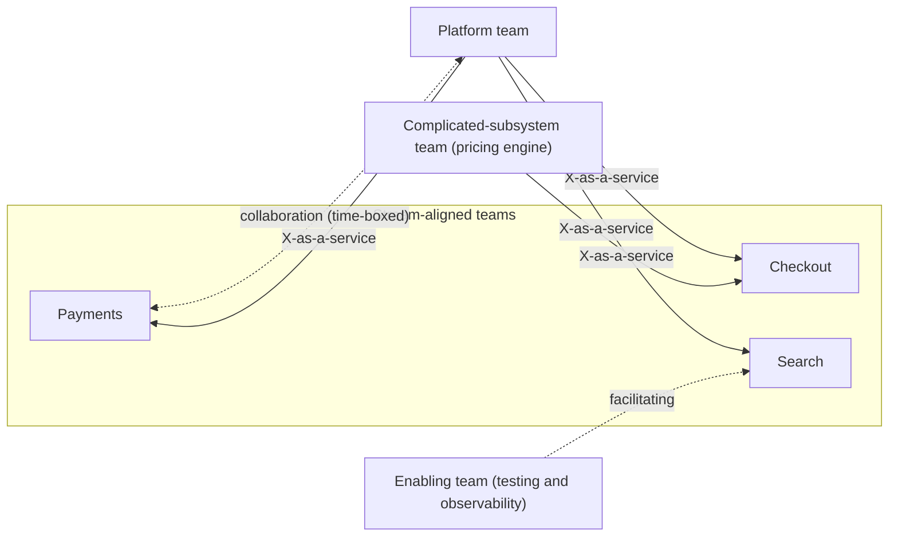
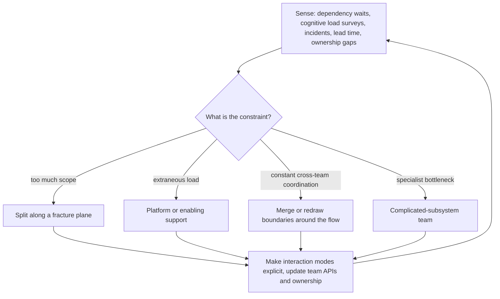

## TL;DR

- Organisation design is an **architecture decision**. Conway's law means systems mirror the communication structure of the teams that build them, so team boundaries and software boundaries must be designed together.
- *Team Topologies* gives a small vocabulary: four **team types** (stream-aligned, platform, enabling, complicated-subsystem) and three **interaction modes** (collaboration, X-as-a-service, facilitating). Most teams should be **stream-aligned**, owning a slice of value end to end.
- Design for **fast flow** and limited **cognitive load**. A team of about 5–9 people should own as much as it can understand and change safely, with few hand-offs and few dependencies on other teams.
- Split teams along **fracture planes** that match natural seams: business domain or bounded context, regulation, change cadence, risk, performance or user persona. Don't split along technology layers by default.
- Treat org design as **continuous evolution**, sensing dependency pain and cognitive overload, rather than a big reorganisation every 18 months. Spans of control, layers and ownership maps are the levers to watch.

## Core Concepts

### Conway's law and the inverse manoeuvre

Mel Conway (1968): "Any organisation that designs a system will produce a design whose structure is a copy of the organisation's communication structure." In practice:
- Three teams building a compiler tend to produce a three-pass compiler.
- A frontend team, a backend team and a DBA team produce a layered system with three hand-offs for every feature.
- Teams that have to coordinate on every change produce tightly coupled software.

The **inverse Conway manoeuvre** uses this deliberately. Design the team structure for the architecture you want, and the architecture tends to follow.

### The four team types

| Type | Purpose | Example | Share of teams |
|---|---|---|---|
| **Stream-aligned** | Delivers value along a flow of work (a product, journey, persona or domain), end to end | Checkout, Claims, Onboarding | The large majority |
| **Platform** | Provides internal services that reduce stream-aligned teams' cognitive load | Developer platform, data platform | A few |
| **Enabling** | Helps other teams acquire capabilities, temporarily | Test automation coaches, an observability enablement team | A few, often time-boxed engagements |
| **Complicated-subsystem** | Owns a part needing deep specialist knowledge | Pricing engine, video codec, risk models | Only where truly necessary |

### The three interaction modes

| Mode | What it looks like | Use when | Watch out for |
|---|---|---|---|
| **Collaboration** | Two teams work closely for a period, sharing goals | Discovering something new, defining a new API or platform capability | Expensive and blurs ownership. Time-box it |
| **X-as-a-service** | One team consumes another's capability with minimal interaction | The capability is well understood and stable | A poor service experience forces collaboration back |
| **Facilitating** | One team (usually enabling) helps another improve | Adopting new practices or tools | Becoming a permanent dependency |

Making the interaction mode **explicit** ("for this quarter, Payments and Platform collaborate on the new ledger API, then it becomes X-as-a-service") avoids the most common friction: teams expecting different things of each other.

### Team cognitive load

Borrowed from learning theory (John Sweller):
- **Intrinsic**: the inherent complexity of the domain and technology.
- **Extraneous**: incidental friction such as manual deployments, unclear environments or poor tooling. The platform's job is to remove it.
- **Germane**: the valuable learning about the domain that makes the team better at its job.

Signals of overload: slow onboarding, frequent context switching, many services per team with nobody understanding all of them, rising incidents, "we'd need to ask X" for every change, and burnout. Remedies: reduce scope (split the domain), remove extraneous load (platform, automation), or add a complicated-subsystem team for genuinely specialist parts.

### Team size and stability

- **5–9 people** is the usual range. Small enough for high trust and simple communication, large enough to cover on-call and absences. Amazon's "two-pizza team" captures the same idea.
- **Long-lived teams** that own systems over time beat project teams assembled and disbanded around initiatives: knowledge stays, ownership is clear and trust builds. Bring work to teams rather than people to work.
- **Dunbar-inspired groupings**: trust tends to break down beyond about 15 close collaborators, 50 in a group that knows each other well, and 150 in a recognisable community. Many organisations use those thresholds for team-of-teams and department sizes.

### Fracture planes

Natural seams for splitting a team or domain:

| Fracture plane | Example |
|---|---|
| **Business domain / bounded context** | Pricing vs fulfilment vs payments (the default choice, aligned with DDD) |
| **Regulatory compliance** | Isolate PCI-scoped card handling so fewer teams carry the compliance burden |
| **Change cadence** | A rapidly evolving customer app vs a stable billing core |
| **Risk** | High-risk money movement vs low-risk content features |
| **Performance isolation** | A latency-critical matching engine |
| **User persona** | Consumers vs merchants vs internal operations |
| **Location** | Time zones, when real-time collaboration is essential |
| **Technology** (use sparingly) | A genuinely different stack, such as embedded firmware vs cloud services |

Splitting by **technical layer** (frontend, backend, database) is usually a poor fracture plane, because every feature crosses all the layers and becomes a hand-off.

### Team API

Each team publishes how to work with it: what it owns, how to request things, what it offers as a service, its working agreements and its roadmap.

```yaml
# team-api.yaml — kept in the team's repository and surfaced in the developer portal
team: payments
type: stream-aligned
mission: Customers can pay quickly and safely in every market we serve.
owns:
  services: [payments-api, payouts-worker, card-vault-adapter]
  domains: [payment-authorisation, refunds, payouts]
offers:
  - name: Payments API
    mode: x-as-a-service
    docs: https://portal.internal/apis/payments
    slo: 99.95% successful authorisations, p99 < 400 ms
interactions:
  - team: platform-data
    mode: collaboration
    until: 2027-03-31
    purpose: Event schema for the new ledger
communication:
  channel: "#team-payments"
  requests: Jira project PAY (triage Mon/Thu)
  on_call: pagerduty://payments-primary
roadmap: https://portal.internal/roadmaps/payments
```

### Spans and layers

- **Span of control** (direct reports per manager): for engineering managers, roughly 5–8 people is common. Fewer means managers drift into doing the work or micromanaging. More leaves no time for coaching. Managers of managers can often take more.
- **Layers** between the CTO and an engineer add latency to every decision and message. Many organisations aim for no more than about 5–6 layers even at a few thousand people.
- Watch for **"manager of one or two"**, often created to give someone a promotion. It adds a layer without adding capacity. Use parallel senior technical career paths instead.

### Ownership

Every service, data store, pipeline and critical dependency needs **exactly one owning team**, recorded in a catalogue. Orphaned systems, with no owner or "everyone owns it", are where incidents, security gaps and stalled upgrades accumulate.

```ts
// Find ownership gaps and dependency hotspots from the service catalogue.
interface Component { name: string; owner?: string; dependsOn: string[] }

export function orgHealth(components: Component[]) {
  const ownerOf = new Map(components.map((c) => [c.name, c.owner]));
  const orphans = components.filter((c) => !c.owner).map((c) => c.name);

  // Cross-team dependencies per team: a rough proxy for coordination cost.
  const crossTeam = new Map<string, number>();
  for (const c of components) {
    if (!c.owner) continue;
    const external = c.dependsOn.filter((d) => ownerOf.get(d) && ownerOf.get(d) !== c.owner).length;
    crossTeam.set(c.owner, (crossTeam.get(c.owner) ?? 0) + external);
  }
  return { orphans, crossTeamDependencies: [...crossTeam].sort((a, b) => b[1] - a[1]) };
}
```

## How It Works

### Team types and interaction modes



### Evolving the organisation



## When to Use / Trade-offs

| Structure | Strengths | Weaknesses | Fits when |
|---|---|---|---|
| Stream-aligned product teams | Fast flow, clear ownership, customer focus | Duplicated effort, specialists spread thin | Most product organisations |
| Functional or component teams (frontend, backend, DBA) | Deep specialism, consistency within a layer | Hand-offs on every feature, slow flow, blame between layers | Very small orgs, or genuinely shared components |
| Matrix (product teams plus functional reporting lines, chapters) | Craft growth alongside delivery focus | Two bosses, slower decisions, confusion over priorities | Large orgs that invest in clear decision rights |
| Project teams | Flexible staffing | Lost knowledge, no long-term ownership, constant forming and storming | Short-lived, truly one-off efforts |
| Platform plus stream-aligned teams | Reduced cognitive load, consistency | A platform that becomes a bottleneck if run as ticket-ops | 20+ teams with shared infrastructure needs |
| Pods or squads assembled per quarter | Responds to changing priorities | Little ownership, ramp-up costs every quarter | Rarely; usually better to move work to teams |

## Common Pitfalls & Anti-patterns

- **Copying a model wholesale** — adopting Spotify's squads, tribes, chapters and guilds by name without its context. Spotify engineers themselves have described the published model as aspirational rather than how things fully worked.
- **Layered teams** — frontend, backend and QA teams make every feature a three-way hand-off.
- **Reorganising every year** — teams never reach high performance, and people learn to wait reorgs out.
- **Org chart first, architecture later** — boxes drawn by headcount and politics, which then fight the system's structure.
- **Teams owning too much** — 20 services for 6 people, so nothing is understood deeply and on-call is miserable.
- **Shared ownership** — "everyone owns the monolith" means nobody does.
- **Permanent collaboration** — two teams that must coordinate on everything are really one team, or have the boundary in the wrong place.
- **Managers of one** — layers added for career progression rather than need.
- **Ignoring the people** — designing a perfect structure on paper without considering skills, relationships, location and individual careers.

## Real-world Scenario

**Context:** A 140-engineer insurance software company was organised by layer: 4 frontend teams, 5 backend teams, a database team, a QA team and an ops team. A typical feature touched four teams, average lead time was 9 weeks, and every quarter's planning was a dependency negotiation. The architecture mirrored this: a shared database and a backend "core" everyone changed.

**Decision:**
1. Mapped the value streams (quote, bind, claims, billing, broker portal) and the bounded contexts in the codebase, along with their change frequency and coupling.
2. Designed 12 stream-aligned teams around those streams, each with frontend, backend and test skills, owning their slice of the UI, services and schema. Plus a platform team (CI/CD, environments, observability), an enabling team for test automation (time-boxed to 9 months) and a complicated-subsystem team for the rating engine.
3. Ran the transition in two waves of six teams, with clear new ownership maps. The database was split over the following year by context (inverse Conway), not on day one.
4. Published team APIs and explicit interaction modes, reviewed quarterly.
5. Kept functional "chapters" for craft (frontend, quality) as communities of practice, not reporting lines.

**Outcome:** After a year, average lead time fell to 3 weeks, cross-team dependencies in planning fell by about two thirds, and the engagement survey's "I understand what my team owns" score rose from 48% to 86%. Two senior DBAs moved to the platform team to build self-service database tooling.

**What I'd do differently:** Spend more time on individual conversations before announcing. A few specialists felt their expertise was being dissolved, and two left. Explicit career paths for specialists should have been part of the design from the start.

## Interview Questions

### What are the four Team Topologies team types? {#team-types}

**Level:** Foundation

**Model answer:**
- **Stream-aligned**: aligned to a flow of change (a product, user journey, persona or domain) and able to deliver it end to end with minimal hand-offs. Most teams should be this type.
- **Platform**: provides internal products (deployment, environments, data infrastructure) that stream-aligned teams consume as a service, reducing their cognitive load.
- **Enabling**: specialists who help other teams build capabilities (testing, observability, security practices), then step away. Their success is the other team no longer needing them.
- **Complicated-subsystem**: owns a component that needs rare specialist knowledge, such as a pricing engine or ML ranking model, so stream-aligned teams don't have to master it.

The point of the taxonomy is to make purpose and interactions explicit. A team that doesn't clearly fit one type is often a sign of an unclear mission.

**What the interviewer is looking for:**
The purpose of each type, the predominance of stream-aligned teams, and the temporary nature of enabling work.

**Follow-ups:**
- What's the difference between an enabling team and a platform team?
- Where does an SRE team fit?

**Red flags:**
- Treating "platform" as a label for any infrastructure team.
- Most teams being complicated-subsystem or component teams.

### What are the three interaction modes, and when do you use each? {#interaction-modes}

**Level:** Foundation

**Model answer:**
- **Collaboration**: two teams work closely together towards a shared goal. Use it for discovery and for defining new boundaries or capabilities. It's high-bandwidth and expensive, so time-box it.
- **X-as-a-service**: one team provides a capability that another consumes with minimal interaction, through a clear interface (an API, a platform feature, documentation). Use it when the capability is well understood. It scales well but needs a good service experience.
- **Facilitating**: one team, typically an enabling team, coaches another to improve. Use it to spread practices and skills.

The value is in making the mode **explicit and intended to change**: collaborate to build a new capability, then switch to X-as-a-service. Friction usually comes from mismatched expectations, such as one team acting as if it's collaborating while the other expects a self-service product.

**What the interviewer is looking for:**
When each fits, and the idea that modes are explicit and evolve.

**Follow-ups:**
- What does it tell you if two teams have been "collaborating" for two years?
- How do you move from collaboration to X-as-a-service?

**Red flags:**
- "All teams should collaborate all the time."
- No awareness of the cost of collaboration.

### What is team cognitive load, and how do you tell when a team has too much? {#cognitive-load}

**Level:** Foundation

**Model answer:**
Cognitive load is the total mental effort a team needs to understand, change and operate what it owns. Team Topologies borrows three kinds from learning theory:
- **Intrinsic**: the inherent complexity of the domain and technology.
- **Extraneous**: friction that adds nothing, such as manual deploys, unclear environments or flaky tests.
- **Germane**: the valuable learning that builds domain expertise.

You want to minimise extraneous load, keep intrinsic load within what one team can handle, and leave room for germane learning.

Signals of too much: many services and few people who understand each, slow onboarding, frequent context switching, every change needing someone specific, high on-call pain, rising incidents and burnout. A simple survey ("How well does the team understand what it owns?", "How much time goes on toil?") makes it visible.

Remedies: reduce scope (split the domain or hand components to better-fitting teams), remove extraneous load (platform, automation), or move specialist parts to a complicated-subsystem team.

**What the interviewer is looking for:**
The three types, concrete signals, and remedies matched to the type of load.

**Follow-ups:**
- How would you measure cognitive load without it becoming a vanity metric?
- How does a platform team reduce cognitive load?

**Red flags:**
- Equating cognitive load with workload or hours.
- "Hire more people" as the only remedy.

### How big should a team be, and why? {#team-size}

**Level:** Foundation

**Model answer:**
Typically **5–9 people**:
- **Communication paths** grow roughly with the square of team size (`n(n−1)/2`): 10 paths for 5 people, 45 for 10. Beyond about 9, coordination overhead and sub-groups appear.
- **Trust** is easier to build in small groups where everyone knows how everyone works.
- **Resilience**: below about 4–5, holidays, illness and on-call become hard, and knowledge concentrates in one or two people.

Equally important:
- **Long-lived and stable**: teams take months to become high-performing. Moving work to teams beats moving people to projects.
- **The right skills inside the team** to deliver end to end, rather than waiting on others.
- **Scope matched to size**: ownership the team can actually understand.

Brooks's law also applies: adding people to a late project initially slows it down, because of ramp-up and communication costs.

**What the interviewer is looking for:**
The reasoning (communication, trust, resilience) and the importance of stability, not just a number.

**Follow-ups:**
- A team has grown to 14. What do you do?
- How do you handle a team that's too small for on-call?

**Red flags:**
- "Bigger teams deliver more."
- Frequent reshuffling for "flexibility".

### What is a fracture plane, and how do you use fracture planes to split a team or domain? {#fracture-planes}

**Level:** Senior

**Model answer:**
A fracture plane is a natural seam in a system and its domain where a split creates two parts that can evolve mostly independently. Team Topologies lists several:
- **Business domain / bounded context**: the default and usually the best.
- **Regulatory compliance**: isolate the PCI-scoped or medical-data parts so fewer teams carry the compliance burden.
- **Change cadence**: separate fast-changing areas from stable ones.
- **Risk**: high-risk money movement versus low-risk content.
- **Performance isolation**: a latency-critical component with different engineering needs.
- **User persona**: consumers vs merchants vs internal operations.
- **Location or time zone**, when real-time collaboration is essential.
- **Technology**, rarely, when stacks are genuinely different.

How to use them: look at where changes cluster in the codebase (files that change together), where language and models differ (bounded contexts), and where hand-offs and waits happen today. Pick the plane that minimises cross-team changes for the work you expect, not the work you've done. Then check the resulting cognitive load per team.

**What the interviewer is looking for:**
Knowing the options, defaulting to domain, using evidence such as change coupling, and avoiding technical-layer splits.

**Follow-ups:**
- How would you use version-control history to find fracture planes?
- What if the domain boundaries aren't clear yet?

**Red flags:**
- Splitting into frontend and backend teams by default.
- Splitting purely by headcount.

### What is a team API? {#team-api}

**Level:** Senior

**Model answer:**
A team API is a team's published description of how other teams interact with it. It's a deliberate interface, like a software API, that reduces ad-hoc coordination. Typical contents:
- **Mission and team type.**
- **What it owns**: services, data, domains, and its on-call responsibilities.
- **What it offers as a service**: APIs, libraries, platform features, with documentation and SLOs.
- **How to engage**: request channels, triage cadence, office hours, and expected response times.
- **Current interactions**: which teams it collaborates with or facilitates, and until when.
- **Working agreements and roadmap.**

It lives somewhere discoverable (the repository, a developer portal) and is reviewed regularly. A good team API reduces interruptions, sets expectations for other teams, and makes ownership gaps or unhealthy dependencies visible.

**What the interviewer is looking for:**
The purpose (reducing coordination cost, clear expectations) and practical contents.

**Follow-ups:**
- How do you keep team APIs current?
- What would you do when two team APIs claim the same service?

**Red flags:**
- Treating it as just an org chart entry.
- No ownership or engagement information.

### How do you decide spans of control and the number of management layers? {#spans-and-layers}

**Level:** Senior

**Model answer:**
**Span of control** for first-line engineering managers is commonly around 5–8 direct reports. It depends on:
- How experienced the reports are (more senior people need less day-to-day support).
- Whether the manager also has technical or delivery responsibilities.
- How much hiring, onboarding or performance work is under way.
- Distribution across time zones.

Too narrow (2–3 reports) produces managers who micromanage or do individual-contributor work, plus extra layers. Too wide (12+) leaves no time for coaching, feedback or career development.

**Layers**: each one adds latency to decisions and information, and distorts communication. Keep the number of layers from the CTO to an engineer as low as practical, typically 4–6 even in large organisations. Managers of managers can often handle wider spans (6–10) because their reports are experienced managers.

Warning signs: managers with one or two reports created to provide promotions (fix with a strong individual-contributor track), and "player-coach" roles where neither the playing nor the coaching gets done.

**What the interviewer is looking for:**
Context-dependent reasoning, awareness of the cost of layers, and the link to career paths.

**Follow-ups:**
- When would you accept a manager with 12 reports?
- How do you introduce a new layer as the organisation grows?

**Red flags:**
- A fixed rule with no context.
- Adding layers as the default response to growth.

### Should engineering be organised by product, by function or by technology layer? {#product-vs-functional}

**Level:** Senior

**Model answer:**
Default to **product or stream-aligned** teams: cross-functional teams owning a slice of customer value end to end. They optimise for flow, ownership and customer focus. The weaknesses (duplicated effort, specialists spread thin, inconsistency) are addressed with platform teams for shared infrastructure, enabling teams for specialist practices, and communities of practice for craft.

**Functional or layer teams** (frontend, backend, QA, DBA) make sense only in limited cases: very small organisations, genuinely shared components that are better owned centrally, or specialisms too scarce to spread. They create hand-offs on every feature, and lead time and accountability suffer.

**Matrix** structures (reporting line by craft, day-to-day work in product teams) can support craft growth, but need very clear decision rights. Who sets priorities? Who does performance reviews? Otherwise people have two bosses and no clear direction.

The test: for the work you expect over the next year, how many teams does a typical change touch? Fewer is better.

**What the interviewer is looking for:**
A default with reasoning, ways to mitigate its weaknesses, and a concrete test.

**Follow-ups:**
- How do you keep frontend consistency across 15 product teams?
- Where should QA engineers sit?

**Red flags:**
- Layer teams as the default.
- Ignoring the need for craft communities in a product organisation.

### How do you handle shared services or components that many teams need to change? {#shared-components}

**Level:** Senior

**Model answer:**
A component everyone changes but nobody owns becomes a bottleneck and a source of incidents. Options:

1. **Give it one owner, and make it a service.** A platform or complicated-subsystem team owns it, with a clear API, roadmap and contribution model. Other teams consume it as X-as-a-service.
2. **Split it.** Often the "shared" component is several things. Break it along domain lines so each stream-aligned team owns its part (for example, splitting a shared "customer" module into identity, profile and preferences).
3. **Inner source.** One owning team accepts pull requests from others, with contribution guidelines, CODEOWNERS review, good tests and fast review times. Works well when changes are frequent but small.
4. **Push variation outward.** Design extension points (configuration, plugins, events) so teams can customise without changing the core.

Avoid: a "core team" that has to implement every other team's requests (a queue), or a free-for-all with no owner (decay).

**What the interviewer is looking for:**
Clear ownership plus a deliberate interaction model, and recognising when splitting is the right answer.

**Follow-ups:**
- How do you run inner source so it doesn't overload the owning team?
- What would make you move a shared library into a service?

**Red flags:**
- "Everyone owns it."
- A central team as a request queue.

### How do you detect that your org design is hurting flow? {#org-design-signals}

**Level:** Senior

**Model answer:**
Signals to look for:
- **Dependency waits**: work items blocked on other teams, and how long they wait. Track it in the work-tracking tool by tagging blocked reasons.
- **Changes spanning teams**: the share of features or pull requests needing changes in other teams' repositories. Version-control data shows this clearly.
- **Planning pain**: quarterly planning dominated by dependency negotiation.
- **Lead time** rising with no change in team capacity.
- **Ownership gaps**: orphaned services, or incidents where nobody knows who owns the failing component.
- **Cognitive load**: survey results, onboarding time, on-call load per team.
- **Communication patterns**: teams that are in constant meetings with one specific other team (likely a wrong boundary), or teams that never talk but should.
- **People signals**: engagement scores about clarity of ownership and purpose, and attrition.

Pair the data with qualitative conversations. Then use it to make targeted changes (move ownership of a service, split a team, make an interaction mode explicit) rather than a broad reorganisation.

**What the interviewer is looking for:**
Concrete, measurable signals, especially dependency waits and cross-team changes, and targeted responses.

**Follow-ups:**
- How would you collect dependency data without creating bureaucracy?
- Which signal would you trust most?

**Red flags:**
- Relying only on gut feel or complaints.
- Treating every signal as a reason for a reorg.

### How would you apply the inverse Conway manoeuvre to a monolith worked on by 8 teams? {#inverse-conway-monolith}

**Level:** Architect

**Model answer:**
1. **Find the target architecture's boundaries**: bounded contexts from domain modelling (event storming), plus change-coupling analysis from version control (which files change together), plus data ownership.
2. **Assign each context to one team**, matching cognitive load. Eight teams might own ten modules, with two teams owning two related modules each.
3. **Make ownership enforceable in the monolith first** (a modular monolith): module boundaries enforced with tooling (dependency rules, CODEOWNERS per module, separate schemas per module), and each team owns its module's tests and on-call.
4. **Change interactions**: cross-module changes go through module APIs, owned by the providing team. The teams' communication starts to match the intended architecture.
5. **Extract services only where independent deployment, scaling or risk isolation is worth it**, starting with the modules whose teams are most blocked by the shared release.
6. **Shared platform concerns** (build, deploy, environments) move to a platform team, reducing the coordination needed for releases.

The trap is drawing new team boundaries without changing the code's structure. The teams then still coordinate constantly, and the reorg is blamed. Move code ownership and enforcement along with people.

**What the interviewer is looking for:**
Evidence-based boundaries, ownership enforced in the code, a modular monolith before microservices, and incremental extraction.

**Follow-ups:**
- What tooling would you use to enforce module boundaries in a TypeScript or Java monolith?
- How would you handle the shared database?

**Red flags:**
- Splitting teams and services on day one.
- Reorganising people without changing code ownership.

### Design the engineering organisation for a 120-engineer product company that will grow to 300 in two years. {#design-org-growth}

**Level:** Architect

**Model answer:**
**Start from the strategy and architecture**: the product lines and customer journeys for the next two years, the domain map, platform needs and any regulatory constraints.

**Today, around 120 engineers:**
- About 12–14 stream-aligned teams of 6–8, grouped into 3–4 product areas (teams-of-teams of roughly 30–50) aligned to customer journeys or product lines, each with a product director and engineering director pairing.
- One platform team (CI/CD, environments, observability) and an embryonic data platform.
- One or two enabling teams, time-boxed (for example security engineering, or test automation).
- Complicated-subsystem teams only where justified.

**Growing to 300:**
- **Grow by cell division**: a team that reaches about 10 splits along a fracture plane, rather than creating new teams with no context. New areas are seeded with experienced people from existing teams.
- **Product areas** grow to 5–7, each capped at around 50–80 people, with their own small platform or enabling support where needed.
- **Platform group** grows to roughly 10–15% of engineering, with product management, split into developer experience, runtime and data.
- **Technical leadership**: Staff and Principal engineers per area, and an architecture forum for cross-area decisions.

**Enablers**: hiring and onboarding capacity (about 15 hires a month at peak, which is a serious load), management development (to fill 20+ new manager roles), a service catalogue with ownership, team APIs, and quarterly org health reviews using dependency and cognitive-load data.

**What the interviewer is looking for:**
Structure derived from strategy, growth by splitting existing teams, platform and leadership capacity scaling with the org, and attention to hiring and management development.

**Follow-ups:**
- What's the hardest part of growing this fast?
- How would you decide when a product area needs its own platform team?

**Red flags:**
- A static org chart drawn for 300 with no transition plan.
- Ignoring the management and hiring capacity needed.

### Two companies are merging with overlapping products and platforms. How would you design the combined engineering organisation? {#post-merger-org}

**Level:** Architect

**Model answer:**
**Principles first**: retain key people, keep customers safe, and avoid a long period of uncertainty. Make the decision process transparent even when outcomes aren't decided yet.

**Phases:**
1. **Stabilise (first 1–3 months)**: no structural changes to delivery teams. Name leaders early, so people know who decides. Map products, platforms, customers, contracts, people and skills on both sides. Identify flight risks and critical knowledge holders, and act on retention.
2. **Decide the product and technology strategy**: which products continue, merge or sunset, and which platform becomes the target for each capability (cloud, CI/CD, identity, data). Base it on customer value, scale and cost, not on which company "won". Some duplication may persist for a long time.
3. **Design the target org around that strategy**: stream-aligned teams for continuing products, migration teams with clear end dates for consolidations, one platform organisation, and blended teams where knowledge transfer is needed.
4. **Transition in waves**: start with low-risk areas, keep team stability where possible (move whole teams rather than scattering individuals), and align career frameworks, levels and compensation early, since mismatches cause attrition.

**Culture**: shared engineering principles, mixed communities of practice, and making sure leadership positions come from both organisations based on merit.

**What the interviewer is looking for:**
Strategy before structure, stabilisation and retention, honest handling of duplication, and attention to culture and career frameworks.

**Follow-ups:**
- How would you choose between two competing internal platforms?
- How do you handle two people who previously held the same role?

**Red flags:**
- Immediate wholesale restructuring.
- "The acquiring company's way wins" by default.

### Your company copied the Spotify model, and squads, tribes, chapters and guilds aren't working. What would you do? {#spotify-model-pitfalls}

**Level:** Architect

**Model answer:**
**Understand what "not working" means**: slow delivery, unclear ownership, chapter leads with no authority, too many meetings, inconsistent engineering practice? Gather data on dependency waits, cross-squad changes, ownership gaps and engagement.

**Common problems with copied Spotify structures:**
- Squads were labelled but kept the old component boundaries, so they're dependent on each other.
- Chapter leads manage people they never see work, so performance reviews and career growth are weak, and the matrix creates two bosses.
- Autonomy without alignment: every squad chooses its own tools and nobody owns shared concerns.
- The original model was a 2012 snapshot, which Spotify itself evolved and some of its engineers described as aspirational.

**What I'd do:**
- **Keep the parts that work** (small cross-functional squads, guilds as voluntary communities of practice) and drop the names if they carry baggage.
- **Fix boundaries**: re-align squads to value streams or bounded contexts, using Team Topologies team types and explicit interaction modes.
- **Clarify decision rights**: who sets priorities, who manages people (often moving line management into the product teams' area rather than chapters), and who owns technical standards.
- **Add the missing pieces**: a platform team, ownership catalogue, and lightweight architecture governance for alignment.
- **Evolve incrementally**, measuring dependency waits and lead time, rather than a new big-bang model.

**What the interviewer is looking for:**
Diagnosis before prescription, a critique of cargo-culting, and principles over labels.

**Follow-ups:**
- Should chapter leads do performance reviews?
- How do you balance squad autonomy with alignment?

**Red flags:**
- Replacing one copied model with another.
- Blaming the people for the model failing.

### How do you evolve team boundaries continuously instead of through big reorganisations? {#continuous-org-evolution}

**Level:** Architect

**Model answer:**
Big reorgs are expensive: months of disruption, lost productivity while teams re-form, and anxiety that drives attrition. Many organisations reorganise every 12–18 months without fixing the underlying problems. Instead:

1. **Sense continuously**: quarterly org health reviews using dependency waits, cross-team change data, ownership gaps, cognitive-load surveys, on-call load and engagement results.
2. **Make small, targeted moves**: transfer ownership of a service, split one team that has grown past 9, merge two that collaborate constantly, create or retire an enabling team. Each affects a few teams, not the whole organisation.
3. **Keep teams stable, move work and ownership.** When priorities shift, change what long-lived teams own before changing who is on them.
4. **Time-box temporary structures**: collaboration modes and enabling engagements have end dates.
5. **Involve the teams**: they often know where boundaries hurt. Self-selection exercises (letting engineers choose their team within constraints) have worked well for some organisations.
6. **Communicate the principles** (team types, cognitive load, ownership rules), so changes feel coherent rather than arbitrary.

Big restructures still happen, for example after a major strategy change, a merger or a layoff. Even then, transition in waves and keep as many teams intact as possible.

**What the interviewer is looking for:**
Sensing mechanisms, small reversible changes, stable teams with movable ownership, and people involvement.

**Follow-ups:**
- How would you run a team self-selection exercise?
- What would trigger a larger restructure?

**Red flags:**
- Annual reorgs as normal practice.
- Org changes decided entirely by leadership without data or team input.

## Cheat Sheet

### Principles

- **Conway's law** — systems mirror the communication structure of the organisation that builds them.
- **Inverse Conway manoeuvre** — design teams for the architecture you want, so the architecture follows.
- **Fast flow** — minimise hand-offs and cross-team dependencies for the work you expect.
- **Long-lived teams** — bring work to stable teams, rather than people to projects.

### Team Topologies

- **Stream-aligned team** — owns a flow of value end to end, and is the majority team type.
- **Platform team** — provides internal capabilities as a service to reduce others' cognitive load.
- **Enabling team** — coaches teams to gain capabilities, then steps away.
- **Complicated-subsystem team** — owns a component that needs rare specialist knowledge.
- **Interaction modes** — collaboration (time-boxed), X-as-a-service (stable), facilitating (coaching).
- **Cognitive load types** — intrinsic, extraneous (remove it) and germane (the valuable learning).
- **Team API** — the published description of what a team owns, offers and how to engage with it.

### Structure

- **Team size** — 5–9 people. Communication paths grow as n(n−1)/2.
- **Fracture planes** — domain, regulation, change cadence, risk, performance, persona, location. Rarely technology layer.
- **Span of control** — about 5–8 reports for first-line engineering managers, depending on context.
- **Ownership rule** — every service and data store has exactly one owning team.

## Further Reading

- [Team Topologies key concepts](https://teamtopologies.com/key-concepts) — team types, interaction modes and cognitive load from the source.
- [How Do Committees Invent?](https://www.melconway.com/Home/Committees_Paper.html) — Mel Conway's 1968 paper behind Conway's law.
- [Conway's Law](https://martinfowler.com/bliki/ConwaysLaw.html) — Martin Fowler on the law and the inverse Conway manoeuvre.
- [Spotify's Failed #SquadGoals](https://www.jeremiahlee.com/posts/failed-squad-goals/) — a former Spotify coach on why the copied model didn't work as described.
- [Team Cognitive Load](https://itrevolution.com/articles/cognitive-load/) — IT Revolution article on cognitive load as a design constraint.
