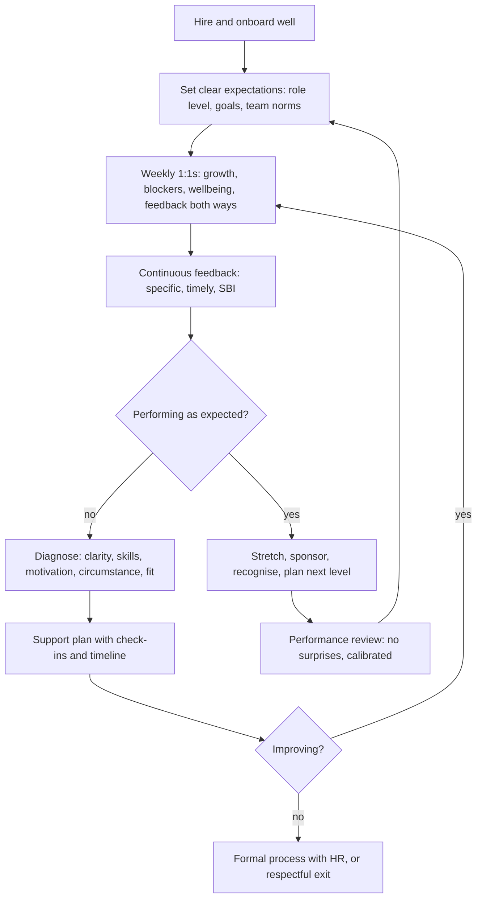
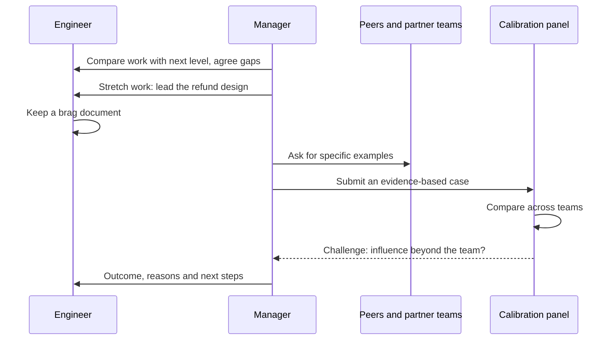

## TL;DR

- An engineering manager's output is **the output of their team** (Andy Grove). The job: hire and grow people, set clear expectations, remove obstacles, build a healthy team, and connect the team's work to business outcomes.
- **One-to-ones** are the core tool: regular, the report's agenda first, used for growth, feedback, wellbeing and trust — not status updates.
- Make expectations **explicit** (role levels, goals, what "good" looks like), give **frequent, specific feedback**, and avoid surprises in performance reviews.
- Address underperformance **early, kindly and directly**, with clear support and timelines; most issues are clarity, skills, motivation or circumstance — diagnose before acting.
- Protect the team's health: psychological safety, sustainable pace, fair distribution of work and opportunities, and attention to burnout.

## Core Concepts

### What managers are for

- **People:** hiring, onboarding, growth, performance, retention, wellbeing.
- **Delivery:** clarity of goals and priorities, healthy process, removing blockers, managing dependencies and risk.
- **Team:** culture, norms, psychological safety, collaboration with other teams.
- **Direction:** connecting work to business strategy; communicating up, down and across.

Manager leverage comes from multiplying others: a decision that unblocks five engineers, a hire that raises the bar, a process fix that saves everyone hours.

### One-to-ones

- **Cadence:** weekly or fortnightly, 30–45 minutes, rarely cancelled (reschedule instead).
- **Their meeting:** the report brings the agenda; a shared doc tracks topics and actions.
- **Mix of topics:** what's on their mind, blockers, feedback both ways, career goals, wellbeing, context on company changes. Status updates belong elsewhere.
- **Useful questions:** "What's taking more of your energy than it should?", "What would you change about how the team works?", "What's one thing I could do differently to help you?", "Where do you want to be in a year?"
- **Skip-levels** (meeting reports' reports) give a manager-of-managers direct signal.

### Expectations and goals

- **Career framework / levels:** concrete expectations per level (scope, impact, technical skills, collaboration, leadership) with examples. Discuss where someone is and what the next level looks like.
- **Goals:** a few meaningful goals per half/quarter, linked to team objectives (OKRs or similar) and growth areas, with visible progress.
- **Team charter / working agreements:** how we make decisions, review code, handle on-call, communicate.

### Feedback and recognition

- **Frequent, specific, timely**, using SBI (situation, behaviour, impact).
- **Positive feedback** reinforces what to repeat — specific and public where appropriate.
- **Constructive feedback** in private, focused on behaviour and impact, with a conversation about causes and next steps.
- **No surprises:** anything in a performance review should already have been discussed.

### Delegation

Delegate outcomes, not just tasks; match the level of support to the person's experience with the task (situational leadership): direct → coach → support → delegate. Be clear about the decision rights ("you decide and tell me", "recommend and I decide"), check-in points, and success criteria. Delegation is how people grow — and how managers avoid becoming bottlenecks.

### Performance management

- **Diagnose underperformance:** unclear expectations? skill gap? motivation/engagement? personal circumstances? wrong role? Each has a different response.
- **Support plan:** clear expectations, examples, resources, regular check-ins, and an honest timeline.
- **Formal process** (performance improvement plan) only after informal support, done with HR, documented, and genuinely aimed at success — or a respectful exit if the fit isn't there.
- **Calibration:** managers compare assessments across teams against the framework to improve fairness; watch for bias (recency, halo, similarity, "visibility" bias towards people who self-promote).

### Wellbeing and sustainability

Watch for burnout signs: cynicism, withdrawal, quality dropping, long hours, irritability. Causes are usually systemic. Christina Maslach's research names six areas: workload, lack of control, insufficient recognition or reward, breakdown of community, unfairness, and values conflict. Fix the system (scope, on-call load, priorities), not just "take a holiday".

### Worked example: an informal support plan

A mid-level backend engineer moved to the team three months ago. Their pull requests stay open a median of 6 days (the team's median is 1.5), they have missed two sprint commitments, and reviewers keep leaving the same comments about error handling and event idempotency.

**Diagnose first.** In a private conversation the manager shares the specific observations and asks open questions. It turns out the engineer came from a Java monolith, the team works in Go with an event-driven design, and they don't know who to ask, so they polish large pull requests alone before showing anyone. That is a **skill gap plus unclear expectations**, not low motivation, so the response is support, not a formal process.

**The plan**, agreed together and written up in their shared 1:1 document:

| Weeks | Expectation | Support | Evidence |
|---|---|---|---|
| 1–2 | Pull requests under about 300 lines; first one open within 2 days of starting a ticket | Pairing twice a week with a senior Go engineer; a short guide to the event model | Pull request size, time to first pull request |
| 3–4 | Own one small feature end to end, starting with a one-page design note | Design note reviewed by the tech lead before coding | Review rounds, design note quality |
| 5–6 | Deliver a medium ticket with no more than two review rounds | Pairing drops to once a week | Cycle time, review rounds |

**Check-ins** happen weekly in the 1:1, recording progress honestly, including what went well.

**At week 6:** median pull request time is 1.8 days, review rounds have fallen from about 5 to 2, and the repeated comments have stopped. The plan closes and normal 1:1s continue. Had there been no movement despite real support, the next step would have been a conversation with HR about a formal process, never a surprise.

## How It Works

### A promotion case, from gap to outcome

## When to Use / Trade-offs

| Approach | Use when | Avoid when | Trade-off |
|---|---|---|---|
| Directive style | Crisis, new person on unfamiliar task | Experienced people on familiar work | Speed vs ownership and growth |
| Coaching style | Capable people who are stuck | Urgent incidents | Growth and ownership vs time |
| Delegating fully | High skill and commitment on the task | New domains for the person | Leverage vs risk |
| Weekly 1:1 | Most reports, new reports, during change | — | Time investment vs trust and early signals |
| Fortnightly 1:1 | Senior, autonomous reports with plenty of other contact | Anyone struggling or new | Saves time vs fewer touchpoints |
| Formal PIP | Informal support hasn't worked, expectations clear and documented | As the first step or a paper trail to exit someone already decided | Clarity and fairness vs stress |

## Common Pitfalls & Anti-patterns

- **The super-IC manager** — still writing the critical code, becoming the bottleneck, neglecting people work.
- **Status-update 1:1s** — no space for growth, concerns or feedback.
- **Avoiding hard conversations** — underperformance tolerated for months; the team notices and morale drops.
- **Surprise reviews** — negative feedback first heard in the annual review.
- **Delegating tasks without context or authority** — then micromanaging the result.
- **Being everyone's friend** — reluctance to make decisions or give honest feedback.
- **Hero culture** — rewarding firefighting and long hours rather than prevention and sustainability.
- **Uneven opportunity** — the same people get the interesting work; others stagnate.
- **Shielding the team from all context** — people make worse decisions without knowing the business situation.

## Real-world Scenario

**Context:** A new engineering manager inherited a team of seven with low engagement scores, two people considering leaving, and one senior engineer whose output had dropped sharply for six months — the previous manager had avoided addressing it.

**Decision:** Started weekly 1:1s with everyone, focused first on listening. Learned that the team felt their roadmap changed weekly, on-call was punishing (one person carried most incidents), and nobody knew what the next level required. For the senior engineer, a direct, caring conversation revealed burnout from carrying most on-call plus a family situation. Actions: negotiated a stable quarterly priority list with product, rebalanced on-call with a runbook-and-alert cleanup, published level expectations with examples, set growth goals with each person, and agreed reduced scope and a temporary flexible schedule for the senior engineer with HR support.

**Outcome:** Within two quarters engagement scores rose significantly, neither at-risk engineer left, the senior engineer's performance recovered, and on-call pages per week dropped by 60%.

**What I'd do differently:** Raise the workload/on-call issue with my own manager sooner with data — I spent weeks trying to fix it locally before realising it needed cross-team prioritisation.

## Interview Questions

### How do you run effective one-to-ones? {#one-on-ones}

**Level:** Foundation

**Model answer:**
- **Regular and protected:** weekly or fortnightly, 30–45 minutes, rescheduled rather than cancelled.
- **The report owns the agenda** in a shared document; I add my topics after theirs.
- **Not status updates:** focus on what's on their mind, blockers I can remove, feedback in both directions, career growth, wellbeing and context about what's happening in the organisation.
- **Good questions:** "What's frustrating you right now?", "What should I know that I don't?", "What would you like to be doing more or less of?", "How can I better support you?"
- **Follow through:** track actions and do what I said I would — trust is built on reliability.
- **Adapt:** new joiners and people under pressure need more time; very senior people may want strategic discussions.
- Periodically step back: a quarterly career conversation separate from the weekly flow.

**What the interviewer is looking for:**
Purpose beyond status, report-owned agenda, consistent cadence, good questions and follow-through.

**Follow-ups:**
- What do you do when a report says "nothing to discuss" every week?
- How do you handle 1:1s with someone in a different time zone?

**Red flags:**
- Frequently cancelled 1:1s.
- Using them only for project status.

### How do you set clear expectations and goals for your team members? {#setting-goals}

**Level:** Foundation

**Model answer:**
- **Role expectations:** use the career framework to discuss what's expected at their level — scope, impact, technical depth, collaboration, leadership — with concrete examples from our team ("At senior level, you lead the design for a cross-team feature and get it reviewed and adopted").
- **Goals:** 2–4 meaningful goals per half, combining team outcomes (linked to OKRs) and personal growth, written so we both know what success looks like (measurable where possible, or with clear observable outcomes).
- **Team norms:** a team charter covering how we work — code review expectations, on-call, communication, decision-making.
- **Check regularly:** review progress in 1:1s, adjust when priorities change, and capture evidence along the way for reviews.
- **Ask for their input:** goals they help shape get more ownership.

**What the interviewer is looking for:**
Explicit level expectations with examples, a few meaningful goals, team norms and regular review.

**Follow-ups:**
- How do you set goals when the roadmap is uncertain?
- How do you handle someone who disagrees with the expectations for their level?

**Red flags:**
- Assuming expectations are obvious.
- Goals that are just a task list.

### How do you delegate effectively? {#delegation}

**Level:** Foundation

**Model answer:**
- **Choose what to delegate:** anything someone else can do or could learn to do — especially work that grows them. Keep only what truly needs me (some people matters, certain decisions).
- **Delegate outcomes with context:** why it matters, what success looks like, constraints, deadline, stakeholders.
- **Be explicit about decision rights:** "you decide", "you decide and inform me", or "recommend and we decide together".
- **Match support to experience** (situational leadership): more direction for someone new to the task, coaching for someone developing, hands-off for someone experienced.
- **Agree check-ins** proportional to risk, rather than ad-hoc hovering.
- **Let them do it their way** if it achieves the outcome; resist taking it back at the first wobble.
- **Credit them publicly** for the result.

**What the interviewer is looking for:**
Outcome-based delegation, decision rights, adapting support, agreed check-ins and avoiding micromanagement.

**Follow-ups:**
- What do you never delegate?
- A delegated task is going badly. What do you do?

**Red flags:**
- "It's faster if I do it myself."
- Delegating only boring tasks.

### How do you recognise good work? {#recognition}

**Level:** Foundation

**Model answer:**
- **Be specific:** name the behaviour and its impact ("Your incident write-up made the root cause clear to the whole org and led to the retry fix in two other services") rather than "great job".
- **Be timely:** close to the event.
- **Match the person's preference:** some like public recognition (team channel, all-hands), others prefer private.
- **Recognise the invisible work:** mentoring, documentation, on-call heroics prevented by good preparation, cross-team glue — not just shipping features.
- **Connect it to career growth:** record it as evidence for reviews and promotion cases; share it with my manager and in calibration.
- **Make it a team habit:** peer recognition, demo days, kudos channels.

**What the interviewer is looking for:**
Specific, timely, personalised recognition that includes glue work and feeds career outcomes.

**Follow-ups:**
- How do you avoid recognition always going to the most visible people?
- What's the role of money in recognition?

**Red flags:**
- Generic praise only.
- Recognising only individual heroics.

### How do you handle an underperforming engineer? {#underperformance}

**Level:** Senior

**Model answer:**
1. **Act early** — the longer it goes, the harder it is for everyone, including the team who notice.
2. **Diagnose before prescribing:** is it unclear expectations, a skill gap, low motivation or disengagement, personal circumstances (health, family), or a poor fit with the role? Ask open questions in a private conversation.
3. **Give clear, specific feedback** with examples and impact (SBI), and agree what "good" looks like over the next few weeks.
4. **Respond to the cause:** clarify expectations; pair them with someone or provide training; adjust scope; reconnect them with meaningful work; offer support and flexibility for personal issues (with HR); consider a role change if strengths lie elsewhere.
5. **Check in frequently** and document progress — positives too.
6. **If informal support doesn't work,** move to a formal improvement plan with HR: specific, achievable goals, a timeline, and real support — aimed at success. If it still doesn't work, help them exit with dignity.

Throughout: respect, privacy, fairness and consistency with how others are treated.

**What the interviewer is looking for:**
Early action, diagnosis of causes, specific feedback, tailored support, documentation and a fair formal process as a last resort.

**Follow-ups:**
- The underperformer is a long-tenured, well-liked engineer. Does that change anything?
- How do you keep the rest of the team motivated during this?

**Red flags:**
- Jumping straight to a PIP.
- Waiting for the annual review.

### How do you approach a difficult conversation with a team member? {#difficult-conversations}

**Level:** Senior

**Model answer:**
- **Prepare:** clarify the purpose and desired outcome, gather specific examples, consider their perspective and what might be going on for them, and anticipate emotional reactions.
- **Choose the setting:** private, uninterrupted, not right before something stressful; in person or video.
- **Be direct early:** state the issue clearly in the first minute — don't bury it in small talk or a "feedback sandwich".
- **Use facts and impact (SBI)**, not judgements about character.
- **Listen genuinely:** ask for their view, acknowledge emotions ("I can see this is frustrating"), and be willing to learn something that changes your understanding.
- **Agree next steps** together, with specifics and a follow-up date.
- **Follow up in writing** with a summary, and check in afterwards on how they're doing.

Frameworks like *Crucial Conversations* (make it safe, start with facts, state your path tentatively) and *Radical Candor* (care personally, challenge directly) help.

**What the interviewer is looking for:**
Preparation, directness with care, facts over judgement, listening, clear next steps and follow-up.

**Follow-ups:**
- The person becomes very emotional. What do you do?
- How do you handle a conversation where you might be partly at fault?

**Red flags:**
- Avoiding the conversation or delivering it by email.
- Diluting the message until it's unclear.

### How do you write fair performance reviews and take part in calibration? {#performance-reviews}

**Level:** Senior

**Model answer:**
**Writing reviews:**
- Base them on **evidence collected throughout the period** (1:1 notes, project outcomes, peer feedback, design docs, incident roles), not memory of the last month.
- Assess against the **level expectations**, covering impact, how the work was done (collaboration, quality), and growth — with specific examples.
- Include strengths and development areas, with concrete next steps; **no surprises**.
- Gather peer feedback from people who worked closely with them.

**Calibration:**
- Managers present ratings with evidence; the group compares across teams against the framework to make outcomes consistent.
- Actively watch for **bias**: recency, halo/horn, similarity, visibility bias (rewarding self-promotion over impact), double standards in language ("assertive" vs "aggressive"), and penalising part-time or remote workers.
- Advocate for your people with evidence, and be open to adjusting if others' evidence is persuasive.
- Afterwards, explain the outcome to each person honestly, including what would change it next time.

**What the interviewer is looking for:**
Evidence-based, framework-anchored reviews, bias awareness in calibration and transparent communication.

**Follow-ups:**
- One of your reports gets a lower rating in calibration than you proposed. How do you communicate it?
- How do you assess an engineer who spent the half on glue work?

**Red flags:**
- Ratings driven by visibility or likeability.
- First mention of problems in the written review.

### How do you recognise and respond to burnout on your team? {#burnout}

**Level:** Senior

**Model answer:**
**Signals:** cynicism or detachment, withdrawal from discussions, irritability, declining quality, missed commitments from someone usually reliable, consistently working late or on leave days, frequent sickness.

**Respond to the individual:**
- Raise it privately and with care: "I've noticed X; how are you doing?" Listen without judgement.
- Reduce load immediately where possible (reassign work, remove them from on-call temporarily), encourage real time off, point to support services (EAP, occupational health) with HR.

**Fix the system** — burnout is usually caused by work conditions, not individual weakness:
- **Workload and pace:** unrealistic deadlines, too much WIP; renegotiate scope and priorities.
- **On-call load:** noisy alerts, too few people in rotation; fix alerts, compensate time.
- **Lack of control or clarity:** constant priority changes; stabilise priorities with product.
- **Unfairness or lack of recognition.**
- **Breakdown of community:** isolation, unresolved conflict or no support from colleagues.
- **Values conflict:** asked to ship things they believe are wrong or unsafe.

**Model sustainable behaviour:** don't send midnight messages that imply expectations, take leave yourself, and celebrate prevention over heroics.

**What the interviewer is looking for:**
Recognising signs, caring individual response, and addressing systemic causes, plus modelling behaviour.

**Follow-ups:**
- The whole team is stretched before a critical launch. What do you do?
- How do you protect yourself from burnout as a manager?

**Red flags:**
- "Tell them to take a holiday" as the whole answer.
- Praising long hours.

### Two engineers on your team are in constant conflict. How do you handle it? {#team-conflict}

**Level:** Senior

**Model answer:**
1. **Understand each perspective separately:** 1:1 conversations to hear what's happening, what they need, and what they've tried — listen for whether it's about technical disagreement, working styles, roles/ownership, communication, or something more serious (disrespect, harassment — which goes to HR immediately).
2. **Look for structural causes:** unclear ownership or decision rights, competing incentives, overlapping responsibilities, resource contention. Often fixing the structure fixes the conflict.
3. **Bring them together** with a facilitated conversation: shared goals, specific behaviours and impacts, what each needs from the other, agreements on how to work together (e.g. how technical disagreements get decided — ADR, tie-breaker).
4. **Set clear expectations** of professional behaviour; disagreement about ideas is healthy, disrespect is not.
5. **Follow up** and observe; recognise improvement; escalate to formal processes if behaviour doesn't change.

**What the interviewer is looking for:**
Separate listening, structural diagnosis, facilitated resolution, clear behavioural expectations and follow-up; knowing when it's an HR issue.

**Follow-ups:**
- One of them is your strongest engineer. Does that change your approach?
- How do you prevent technical debates from becoming personal?

**Red flags:**
- Ignoring it and hoping it resolves.
- Taking sides without hearing both.

### Your best engineer tells you they're thinking of leaving. What do you do? {#retention}

**Level:** Senior

**Model answer:**
- **Thank them for telling you** and listen fully — what's driving it? Common reasons: lack of growth or interesting work, compensation, poor relationship with manager or team, burnout, unclear career path, company direction, or an opportunity too good to match.
- **Explore what would change their mind** honestly: a new challenge or scope, a path to the next level with concrete steps, a change of team or role, flexibility, compensation adjustment (work with HR/leadership quickly if it's below market).
- **Act on what's within your control fast**, and be honest about what isn't — don't make promises you can't keep.
- **Respect their decision** if they still leave: support a good transition, part on good terms (they may return or refer others), and learn from the exit.
- **Prevent the next one:** regular career conversations ("stay interviews"), fair compensation reviews, interesting work distributed fairly, and attention to early warning signs.

**What the interviewer is looking for:**
Listening for root causes, realistic actions, honesty, graceful exits and proactive retention practices.

**Follow-ups:**
- Would you make a counter-offer?
- How do you handle the knowledge gap if they leave?

**Red flags:**
- Guilt-tripping or promising things you can't deliver.
- Treating it as a betrayal.

### How would you build a new engineering team from scratch? {#building-a-team}

**Level:** Architect

**Model answer:**
- **Start with the mission and constraints:** what the team will own, expected outcomes, timeline, budget, and how it fits the organisation's architecture (team topology — stream-aligned, platform, enabling).
- **Design the team shape:** size (5–9), mix of seniority (a strong senior/staff anchor plus a range of levels to grow), skills (front end, back end, data, SRE, QA/automation), and diversity of background and perspective.
- **Hire deliberately:** clear role profiles, structured interviews with consistent rubrics, a fair and inclusive process; first hires set the culture — prioritise strong collaborators who raise the bar and can onboard others.
- **Onboarding:** a 30-60-90 plan, buddies, early small wins, documentation, and access ready on day one.
- **Establish ways of working early:** team charter, decision-making, code review norms, on-call, rituals (planning, retros), and the definition of done.
- **Define ownership and interfaces:** services and domains owned, stakeholders, SLOs, dependencies on other teams.
- **Build trust and psychological safety:** model vulnerability, run blameless retros, celebrate learning.
- **Measure health:** delivery metrics, engagement, onboarding time, retention.

**What the interviewer is looking for:**
Mission-first design, thoughtful composition, structured hiring, onboarding, early norms, clear ownership and attention to culture.

**Follow-ups:**
- Would you hire the most senior people first?
- How do you integrate people transferring from other teams?

**Red flags:**
- Hiring quickly without a clear mission or role profiles.
- Ignoring culture and norms until problems appear.

### What changes when you manage managers rather than engineers? {#managing-managers}

**Level:** Architect

**Model answer:**
- **Leverage through systems:** you influence outcomes through your managers, structures and processes rather than directly — clarity of goals, team design, decision rights, hiring standards, career frameworks.
- **Coaching managers:** help them grow management skills — 1:1s focused on their teams' health and their own development; review how they handle performance issues, hiring and difficult conversations; avoid doing their job for them.
- **Information flow:** skip-level 1:1s and team visits for direct signal, without undermining managers; engagement surveys and metrics as additional inputs.
- **Consistency and fairness:** calibration across teams, consistent application of policies, shared standards for hiring and promotion.
- **Context and alignment:** translate strategy into team goals, manage across peers, negotiate resources and priorities upwards.
- **Hiring and developing managers:** identifying ICs who might want management (with trial opportunities), training, and supporting new managers through the hard first months.
- **Your own presence:** less in the details, more in direction, culture and long-term organisational health.

**What the interviewer is looking for:**
Systemic leverage, coaching managers, skip-levels without bypassing, fairness across teams, and developing the management bench.

**Follow-ups:**
- One of your managers is struggling but their team likes them. What do you do?
- How do you spot problems in a team two levels down?

**Red flags:**
- Bypassing managers to direct their teams.
- Treating management of managers as more of the same.

### How would you plan and run a team reorganisation? {#reorganisation}

**Level:** Architect

**Model answer:**
**Is a reorg the right tool?** Reorganisations are disruptive; make sure the problem (ownership confusion, cross-team dependencies, cognitive overload, strategy shift) can't be solved more cheaply.

**Design:**
- Start from the strategy and architecture: align teams with value streams/bounded contexts (Team Topologies, inverse Conway manoeuvre), minimise handoffs, size teams to manageable cognitive load.
- Model options and evaluate against criteria (dependencies, ownership clarity, skills, leadership capacity, disruption).
- Involve senior ICs and managers in the design — they know where the friction is.

**Communication and change:**
- Plan the sequence: leadership alignment → managers → affected individuals (1:1 for significant changes) → everyone, close together to avoid leaks and rumours.
- Explain the **why**, what changes and doesn't, timelines, and how people's concerns will be handled; FAQs; open Q&A.
- Respect people: preferences where possible, honest conversations about role changes, HR/legal involvement where contracts are affected.

**Transition:** clear ownership handover for systems, on-call and in-flight work; new team rituals; extra 1:1 support; expect a productivity dip.

**Review:** measure whether the problem improved (dependencies, lead time, engagement) after 3–6 months and adjust.

**What the interviewer is looking for:**
Problem-first justification, strategy/architecture-driven design, inclusive process, careful communication, transition management and evaluation.

**Follow-ups:**
- How do you handle a manager whose team is dissolved?
- How often is too often to reorganise?

**Red flags:**
- Reorganising to fix individual performance problems.
- Announcing a reorg by email with no conversations.

### If you had to carry out layoffs, how would you do it as humanely as possible? {#layoffs}

**Level:** Architect

**Model answer:**
- **Understand and challenge the decision:** ensure it's necessary, the numbers are right, and alternatives (hiring freezes, reduced contractors, voluntary programmes) were considered — then commit to executing it well.
- **Fair selection:** criteria tied to business needs and roles, applied consistently and documented, reviewed for bias and legal compliance with HR/legal (consultation requirements differ by country).
- **Do it once, and quickly:** repeated rounds destroy trust.
- **Tell people directly and personally:** affected employees hear it in a private conversation (from their manager or a leader they know), not via email or a revoked laptop; be clear, compassionate, and don't argue the decision in the meeting.
- **Generous support:** severance, extended benefits, outplacement, references, help with visas where relevant, time to say goodbye, alumni networks.
- **Remaining team:** honest communication about why, what happens next, and what's changing in scope; acknowledge the loss; reduce work to match capacity rather than expecting the same output; watch for survivor guilt and anxiety.
- **Look after the managers** delivering the news; they need preparation and support too.

**What the interviewer is looking for:**
Ethical engagement, fair and legal process, direct and compassionate communication, generous support and care for remaining staff.

**Follow-ups:**
- What do you say when someone asks "why me?"
- How do you rebuild trust afterwards?

**Red flags:**
- Treating it as purely a numbers exercise.
- Expecting the remaining team to absorb all the work.

### How do you manage a distributed team across several time zones? {#distributed-teams}

**Level:** Architect

**Model answer:**
- **Async by default:** written communication for decisions (design docs, ADRs, decision logs), recorded demos and all-hands, clear documentation, and response-time expectations per channel. Meetings are for discussion that truly benefits from real time.
- **Overlap hours protected** for collaboration; rotate inconvenient meeting times so the same people don't always sacrifice evenings.
- **Clear ownership and handoffs:** avoid work that requires constant real-time coordination across zones; structure ownership so each location has meaningful, end-to-end work (not "the offshore team does tickets").
- **Equity of opportunity:** visible projects, promotions and leadership roles distributed fairly; watch for proximity bias towards people near HQ or the manager.
- **Connection and trust:** regular video 1:1s, informal social time, periodic in-person gatherings with a clear purpose.
- **Operations:** follow-the-sun on-call where it reduces night pages, with excellent handover practices.
- **Wellbeing:** respect working hours; avoid expecting instant responses outside them.

**What the interviewer is looking for:**
Async practices, fair meeting rotation, end-to-end ownership per location, equity, connection and operational design.

**Follow-ups:**
- How do you run a retro across 9 hours of time difference?
- How do you notice when someone remote is struggling?

**Red flags:**
- A "hub and satellites" model where remote people get second-class work.
- Meetings always scheduled for HQ convenience.

### How do you onboard a new engineer onto your team? {#onboarding-engineers}

**Level:** Foundation

**Model answer:**
Good onboarding gets someone **productive, connected and confident** quickly. A common measure is time to first production change, alongside how the person feels after 30 and 90 days.

**Before day one:**
- Accounts, hardware and access ready, so the first day isn't spent waiting for permissions.
- A **buddy** chosen: a peer, not the manager, who answers the "silly" questions.
- A first task chosen: small, real and shippable in the first week, such as a bug fix or a small improvement.

**First weeks:**
- **Context before code:** the team's mission, users, architecture overview, how work flows from idea to production, and who the key people are in other teams.
- **Ship something in week one,** pairing with the buddy, so they go through the whole path: branch, review, pipeline, deploy and monitoring.
- **Schedule introductions** with stakeholders and partner teams, rather than leaving them to chance.
- **Weekly 1:1s from day one,** with explicit permission to ask questions and say what's confusing.

**A 30-60-90 plan,** agreed together:
- **30 days:** knows the domain and tools, has shipped several changes, has joined on-call shadowing.
- **60 days:** owns a small feature end to end.
- **90 days:** works independently at their level, takes a full on-call shift, and contributes to planning.

**Improve the process:** the new joiner fixes anything wrong in the onboarding docs as they go, and at 30 days the manager asks what was confusing and what helped. Fresh eyes spot the gaps everyone else has stopped seeing.

**What the interviewer is looking for:**
Preparation before day one, a buddy, context alongside a real first change, early 1:1s, a shared 30-60-90 plan and feedback that improves onboarding for the next person.

**Follow-ups:**
- How does onboarding differ for a senior or staff engineer?
- How do you onboard someone fully remotely?

**Red flags:**
- "Read the wiki for two weeks."
- No first task, no buddy, and no check-ins until the probation review.

### How do you build a promotion case for someone on your team? {#promotion-cases}

**Level:** Senior

**Model answer:**
A promotion recognises that someone is **already working at the next level**, consistently. It isn't a reward for tenure or effort. The work starts months before the cycle.

**Months before:**
- Compare their recent work with the **next level's expectations** in the career framework, and agree the specific gaps together.
- **Create opportunities** that exercise those gaps, such as leading a design, owning a cross-team project or mentoring others, with enough support that the stretch is fair.
- Encourage them to keep a **brag document:** outcomes, decisions, influence and help given, with links.

**Writing the case:**
- Structure it **against the framework,** expectation by expectation: scope, impact, technical depth, collaboration and leadership.
- Use **specific evidence and impact:** "Led the refund redesign across three teams; incidents in that area fell from 4 a quarter to none" rather than "worked very hard".
- Include **peer and partner-team feedback** from people who saw the work directly.
- Be honest about remaining gaps, and how they're being closed. Panels trust balanced cases.

**In calibration:** advocate with evidence, answer challenges directly, and watch for bias against quieter people, part-time staff or those whose impact was glue work.

**Afterwards:** tell them in person first. If it didn't happen, explain why, agree what would change the outcome, and support them to the next cycle. A second "no" without clear reasons erodes trust fast.

**What the interviewer is looking for:**
Already performing at the next level, early gap analysis, deliberate opportunities, an evidence-based case structured on the framework, honest gaps, fair advocacy and careful communication.

**Follow-ups:**
- Your report expects a promotion you don't think they're ready for. What do you say?
- How do you promote someone whose biggest contribution was invisible glue work?

**Red flags:**
- "They've been here three years."
- Cases built on effort, hours or likeability.

### How do you manage someone who is more experienced than you? {#managing-more-experienced}

**Level:** Senior

**Model answer:**
This is common: a manager with six years' experience might manage a principal engineer with twenty. The manager's job isn't to be the best engineer. It's to make the team, and that person, effective.

**Respect their expertise openly:**
- Ask for their view on technical direction and defer to it where it's their area. Don't compete on technical depth.
- Be clear about **roles:** they lead on technical decisions within agreed boundaries; you own priorities, people matters and the team's health.

**Still manage them:**
- **Understand what they want:** influence, interesting problems, mentoring others, less process, or a path to a broader role. Experienced people leave when their manager stops investing in them.
- **Give feedback anyway,** about collaboration and impact as well as delivery. Senior people often get less feedback than anyone, and need it as much.
- **Represent their work** to leadership and in calibration, and find stretch opportunities beyond the team.

**Ask for help explicitly:** "You've seen more reorganisations than I have. What would you watch out for?" Most experienced people respect a manager who learns openly.

**If they challenge your decisions:** discuss it privately, explain your reasoning, listen properly, and change your mind when they're right. If you still disagree, decide, explain why and commit. Undermining in front of the team is a behaviour to address directly.

**What the interviewer is looking for:**
Security without needing to be the expert, clear division of roles, still giving feedback and growth, using their experience, and handling challenge maturely.

**Follow-ups:**
- They used to have your job. How does that change things?
- They're disengaged and coasting. What do you do?

**Red flags:**
- Avoiding them, or deferring on everything, including people decisions.
- Trying to win technical arguments to prove authority.

### How do you approach compensation conversations and pay equity for your team? {#pay-equity}

**Level:** Architect

**Model answer:**
Managers rarely set pay alone, but they strongly influence it, and they're the people reports ask. Unfair pay is one of the fastest ways to lose good people.

**Know the system:**
- **Pay bands per level,** based on market data. The **compa-ratio** (salary ÷ the band's midpoint) shows where each person sits.
- How increases are decided (merit budgets, promotion uplifts, market adjustments) and what you can influence.

**Review your team for equity every cycle:**
- Compare people at the **same level** doing comparable work. Gaps by gender, ethnicity, part-time status, or by people hired in a hot market versus long-tenured staff, are common and compound over time.
- Each gap needs a **legitimate, documented reason** (such as performance or a recent promotion), not "they negotiated harder". Escalate gaps you can't explain to HR and leadership, with data.
- The law increasingly expects this. The UK requires gender pay gap reporting from employers with 250 or more staff. The EU Pay Transparency Directive brings pay ranges in job ads, a right for employees to ask about pay levels, and a joint pay assessment where an unexplained gender gap of 5% or more appears in a category. Several US states require salary ranges in job ads.

**In conversations:**
- Be **transparent about the process:** how bands work, where they sit and what moves pay. Never share other people's salaries.
- When someone asks for a raise, listen to the reasoning, check the facts against the band and market data, and give an honest answer with a timeline, rather than a vague "I'll see".
- Don't promise what you can't deliver. Do follow through on what you said you'd raise.

**Counter-offers:** they fix the symptom, not the cause, and can be unfair to people who didn't threaten to leave. Fix underpayment proactively, so that a resignation isn't the only way to get a raise.

**What the interviewer is looking for:**
Understanding bands and compa-ratios, proactive equity reviews with documented reasons, awareness of transparency legislation, honest conversations and fixing pay before resignations force it.

**Follow-ups:**
- A new hire's offer is higher than an existing senior engineer's salary. What do you do?
- Should salaries be fully transparent inside a company?

**Red flags:**
- "Pay is HR's problem."
- Rewarding negotiation skill rather than level and performance.

### You manage eight teams through their managers. How do you know which teams are healthy? {#team-health-signals}

**Level:** Architect

**Model answer:**
No single number shows team health. Use **several signals, compared over time**, and combine data with conversations. Use them to start conversations, not to rank teams.

**Signals to watch:**

| Area | Signals |
|---|---|
| People | Engagement survey trends and comments, regretted attrition, absence, internal transfers away from the team |
| Delivery | DORA metrics, predictability of commitments, work item age |
| Sustainability | On-call pages per shift and out-of-hours pages, overtime patterns, leave taken |
| Ownership and load | Services per engineer, cognitive load survey, dependency waits on other teams |
| Growth | Promotions, people taking on new responsibilities, hiring and onboarding success |

**Ask the team itself:** a regular **team health check** (a format popularised by Spotify), in which each team rates areas such as fun, speed, mission clarity, technical quality and support, and discusses the trend. The conversation matters more than the score.

**Direct signal:**
- **Skip-level 1:1s** and small group conversations, without undermining the managers.
- Attend demos, retros and incident reviews occasionally.
- Ask each manager: "What's worrying you about your team?" and check whether their view matches the data.

**Read signals together:** strong delivery with falling engagement and rising out-of-hours pages is an early burnout warning. Low attrition with low engagement can mean people have quietly stopped trying.

**Avoid Goodhart's law:** if metrics become targets or rankings, teams game them. Share the trends with managers as a coaching tool, and act on systemic causes such as unclear priorities, under-staffed on-call or a team owning too much.

**What the interviewer is looking for:**
Multiple signals across people, delivery, sustainability and load; team self-assessment; direct signals through skip-levels; interpreting combinations; and avoiding metrics as rankings.

**Follow-ups:**
- One manager's team looks healthy on every metric, but you hear rumours of problems. What do you do?
- How do you avoid survey fatigue?

**Red flags:**
- Ranking teams on velocity or story points.
- Relying only on managers' reports, or only on dashboards.

## Cheat Sheet

- **Manager output** — the output of the team and of the teams they influence (Grove).
- **1:1s** — regular, report-owned agenda, growth and wellbeing over status.
- **Expectations** — level framework with concrete examples, a few meaningful goals, team charter.
- **SBI feedback** — situation, behaviour, impact; then listen and agree next steps.
- **No surprises** — nothing in a review that wasn't discussed before.
- **Delegation** — delegate outcomes with context and explicit decision rights; adapt support to experience.
- **Situational leadership** — direct, coach, support, delegate depending on the person's competence and commitment for the task.
- **Underperformance** — act early; diagnose clarity, skill, motivation, circumstance or fit; support then formalise.
- **Calibration bias** — recency, halo, similarity and visibility bias; language double standards.
- **Burnout** — mostly systemic (Maslach's six areas: workload, control, reward, community, fairness, values); fix the system, not just the person.
- **Retention** — stay interviews, growth, fair pay, fair opportunity; act on early signals.
- **Managing managers** — leverage through systems, coaching, skip-levels without bypassing.
- **Reorg** — strategy and architecture first, inclusive design, careful sequenced communication.
- **Distributed teams** — async by default, rotate meeting pain, fair opportunity, end-to-end ownership per location.

### Revisit

- **Informal support plan** — diagnose first, then agree weekly expectations, support and evidence for about six weeks, recorded together.
- **Onboarding** — access ready on day one, a buddy, a real change shipped in week one and a shared 30-60-90 plan.
- **Promotion case** — evidence of already working at the next level, structured against the framework, with peer examples and honest gaps.
- **Managing more experienced people** — don't compete on depth; split roles clearly and still give feedback and growth.
- **Compa-ratio** — salary divided by the midpoint of the pay band for the role's level.
- **Pay equity review** — compare people at the same level each cycle; every gap needs a documented, legitimate reason.
- **Team health signals** — combine people, delivery, sustainability and load signals with health checks and skip-levels; never rank teams on them.

## Further Reading

- [The Manager's Path (Camille Fournier)](https://www.oreilly.com/library/view/the-managers-path/9781491973882/) — the standard guide from tech lead to senior engineering leadership.
- [Google re:Work: The research behind great managers](https://rework.withgoogle.com/intl/en/guides/following-the-data-the-research-behind-great-managers) — research-based guidance including Project Oxygen findings.
- [Radical Candor](https://www.radicalcandor.com/) — feedback that combines care and directness.
- [Lara Hogan (Wherewithall): Resources for new managers](https://resources-for-new-managers.com/) — practical tools for 1:1s, feedback and team dynamics.
- [Team Topologies key concepts](https://teamtopologies.com/key-concepts) — designing teams around flow and cognitive load.
