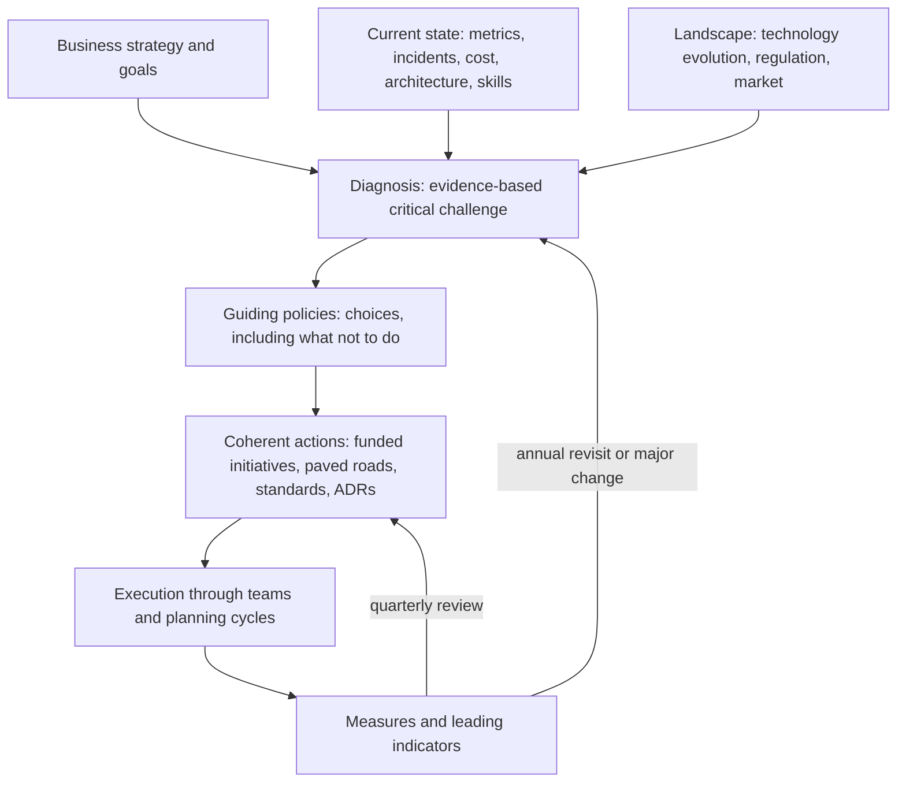

## TL;DR

- A technical strategy is **a diagnosis of the situation, a guiding policy for dealing with it, and coherent actions** (Rumelt's kernel). It is not a wishlist of technologies or a list of projects.
- Good strategy is **about choices and trade-offs**: what we will do, and explicitly what we won't. If nobody could disagree with it, it isn't a strategy.
- It must **serve the business strategy**, enabling growth, cutting unit cost, managing risk, and be expressed in those terms.
- Write it down, build it with others, and make it **actionable through defaults**: paved roads, standards, ADRs and investment allocation, not slide decks.
- Revisit it every 6–12 months against measurable indicators. Strategy is a hypothesis.

## Core Concepts

### Vision, strategy, roadmap, plan

| Artefact | Question | Horizon | Example |
|---|---|---|---|
| Vision | Where do we want to be? | 3–5 years | "Any team can safely ship to any market within a day." |
| Strategy | How will we get there, given our constraints? Which choices? | 1–3 years | "Standardise on one cloud and a golden-path platform; buy, don't build, generic capabilities." |
| Roadmap | In what order, roughly when? | Quarters | "Q1: platform MVP; Q2: migrate payments; Q3: second region." |
| Plan | Who does what, exactly? | Weeks | Sprint backlogs, milestones |

People often present a roadmap and call it a strategy. The test: does it explain **why these choices** over the alternatives, given an explicit diagnosis?

### Rumelt's kernel of good strategy

From *Good Strategy Bad Strategy* (Richard Rumelt, 2011):

1. **Diagnosis:** what's really going on? It simplifies the complexity into the critical challenge. "Our delivery is slow because 60% of changes require coordinated releases across 7 teams sharing one database", not "we need to modernise".
2. **Guiding policy:** the overall approach to the challenge, which rules some options in and others out. "Decouple data ownership by domain; integrate through events; no new cross-domain table access."
3. **Coherent actions:** concrete, mutually reinforcing steps. Allocate funding, build the outbox library, migrate the two highest-churn domains first, change review criteria.

**Bad strategy** signs: fluff ("leverage cutting-edge cloud-native synergies"), failing to face the real challenge, mistaking goals for strategy ("be 99.99% available"), and long lists of unrelated objectives.

### Inputs to a technical strategy

- **The business strategy:** markets, products, growth targets, margin pressure, regulation, M&A.
- **Current state:** architecture, delivery metrics (DORA), reliability (SLOs, incidents), cost trends, security posture, debt hotspots, skills and hiring market.
- **The external landscape:** technology maturity and evolution (what's becoming a commodity), vendor dynamics, regulation.
- **Constraints:** budget, team size, contracts, legacy systems with hard dependencies.

### Common strategy themes

- **Platform and paved roads:** reduce cognitive load and accelerate teams.
- **Architecture evolution:** modularisation, domain boundaries, data ownership.
- **Build versus buy:** focus engineering on differentiating capabilities.
- **Reliability and resilience:** SLOs, multi-region, disaster recovery targets.
- **Security and compliance by default.**
- **Cost efficiency:** FinOps and unit economics.
- **Technology standardisation:** a portfolio and radar, limiting sprawl.
- **Developer experience and productivity.**
- **Data and AI capabilities.**

### Writing it: a practical structure

Will Larson suggests writing several design documents, finding the common themes, and synthesising them into a strategy. A short strategy document typically includes:

```markdown
# Engineering Strategy 2026–2027

## Diagnosis (1 page)
Evidence: lead time p50 9 days; 38% of incidents from shared-DB changes; infra cost +42% YoY vs revenue +18%.
Critical challenge: coupling through shared data blocks independent delivery and inflates cost.

## Guiding policies
1. Domains own their data; cross-domain integration via events or published APIs only.
2. Buy generic capabilities (identity, notifications, billing engine) unless an ADR proves otherwise.
3. One golden path per workload type (web API, worker, SPA); deviations need an ADR.
4. Every service has SLOs and a cost owner.

## What we will NOT do
- No new programming languages in production in 2026.
- No multi-cloud for portability's sake.

## Coherent actions (next 4 quarters)
- Platform team builds outbox + event schema registry (Q1).
- Migrate Payments and Orders domains off shared DB (Q1–Q3).
- Replace in-house auth with managed IdP (Q2).
- Cost dashboards per service; unit-cost target per order (Q1).

## Measures
Lead time p50 < 2 days; cross-domain DB access count → 0; cost per order −25%.

## Review
Quarterly progress; full revisit Q4 2026.
```

### Wardley mapping (optional tool)

Simon Wardley's maps plot the components of a value chain (y-axis: visibility to the user) against **evolution** (x-axis: genesis, custom-built, product, commodity). They help:
- Avoid building commodity components (compute, auth, email) in-house.
- Spot components ready to move to products or services.
- Anticipate where competitors will commoditise.

## How It Works



The process, socially:
1. **Listen widely** (interviews, data) and draft the diagnosis. Test it with peers: "Does this ring true?"
2. **Co-write the guiding policies** with senior engineers and engineering leaders. Pre-wire with each director.
3. **Secure sponsorship and funding** from the CTO or VP Engineering, tied to planning and allocation.
4. **Publish** a short document, an executive one-pager and a talk, with FAQs.
5. **Embed** it in paved roads, review criteria, ADR templates and planning.
6. **Review** it with measures and adjust.

## When to Use / Trade-offs

| Approach | Use when | Avoid when | Trade-off |
|---|---|---|---|
| Written org-wide strategy doc | Org > ~50 engineers; recurring cross-team decisions; major shifts | Tiny team with one product; direction is obvious | Effort to write & align vs consistency and speed of later decisions |
| Strategy via accumulated ADRs/design docs | Bottom-up culture; strategy emerging from many decisions | Org needs a clear change of direction | Organic and grounded vs slow to change direction |
| Technology radar | Many teams choosing tools; need to curb sprawl without mandates | Very small orgs | Guidance with flexibility vs needs curation |
| Mandated standards | Security, compliance, critical consistency (auth, logging) | Areas where team autonomy produces better outcomes | Consistency vs autonomy and innovation |
| Big re-platform programme | Platform truly end-of-life; incremental path impossible | Most cases; incremental evolution usually possible | Clean slate vs years of dual running and delivery freeze |

## Common Pitfalls & Anti-patterns

- **A strategy that is a list of technologies** — "Kubernetes, Kafka, GraphQL, micro-frontends" with no diagnosis or business reasoning.
- **No trade-offs** — everything is a priority, nothing is ruled out.
- **Ivory tower strategy** — written by architects alone, ignored by teams who weren't involved.
- **Unfunded strategy** — no capacity allocated, so it competes with features every sprint and loses.
- **Strategy by slideware** — a big launch presentation, then nothing changes in the paved roads, reviews or planning.
- **Copying big tech** — adopting Netflix- or Google-scale patterns for a 30-engineer company.
- **Never revisiting** — a 3-year-old strategy that no longer matches the business.
- **Confusing goals with strategy** — "99.99% availability and 2× velocity" is an aspiration, not a plan.

## Real-world Scenario

**Context:** A 250-engineer retail company had grown by acquisition. It had 3 clouds, 7 languages, 4 identity systems and 120 services. Leadership asked for "a cloud strategy", expecting a choice of provider.

**Diagnosis (after 6 weeks of interviews and data):** Cloud choice wasn't the problem. The critical challenge was that **every team rebuilt common capabilities** (auth, deployment, observability) differently. This made security patching take 6 weeks across the estate, onboarding take 3 months, and cost visibility nil.

**Guiding policies:**
- Converge on one primary cloud, using the existing enterprise agreement and skills.
- Provide a golden path platform for the two dominant workload types.
- Buy identity (one managed identity provider).
- New services only in TypeScript or Java.
- Existing services migrate when they need significant change, not in a big-bang move.

**Actions:**
- Funded a platform team of 8.
- Migrated identity first, for security and audit.
- Set ADR requirements for deviations.
- Published quarterly scorecards: services on the golden path, patch time, cost per order.

**Outcome after 18 months:**
- 70% of services were on the golden path.
- Critical patch time fell from 6 weeks to 3 days.
- Onboarding to first deploy dropped to 1 week.
- Cloud spend was down 22% after consolidating contracts.

**What I'd do differently:** Involve product leaders earlier. They saw the platform work as competing with features until the patching and onboarding numbers turned into business stories. And publish a "won't do" list on day one. Teams kept reopening the multi-cloud question.

## Interview Questions

### What is a technical strategy, and how does it differ from a vision or a roadmap? {#strategy-vs-roadmap}

**Level:** Foundation

**Model answer:**
- A **vision** describes the desired future state: aspirational, long horizon, little detail.
- A **strategy** explains **how we'll get there given our situation**: a diagnosis of the key challenge, the guiding choices (including what we won't do) and coherent actions.
- A **roadmap** sequences the initiatives over time.
- A **plan** assigns the work.

Technical strategy is specifically about the technology and engineering choices that serve the business strategy: architecture direction, platforms, build versus buy, standards, reliability and security posture, and investment allocation. The key difference from a roadmap is the **"why these choices, and not others"** reasoning, grounded in evidence. A roadmap without a strategy is a list of projects. A strategy without a roadmap is not actionable.

**What the interviewer is looking for:**
Clear distinctions and the emphasis on diagnosis and choices.

**Follow-ups:**
- Can you have a good roadmap with a bad strategy?
- How long should a strategy document be?

**Red flags:**
- Equating strategy with a technology list or a Gantt chart.

### What are the components of a good strategy? {#strategy-kernel}

**Level:** Foundation

**Model answer:**
Using Rumelt's kernel:
1. **Diagnosis:** identifies the critical challenge, simplifying complex reality into what matters most, backed by evidence.
2. **Guiding policy:** an overall approach that addresses the diagnosis and **constrains choices**. It tells people what to prefer and what to avoid.
3. **Coherent actions:** specific, coordinated, resourced steps that implement the policy and reinforce each other.

Properties of a good technical strategy:
- **Choices with trade-offs:** a "not doing" list.
- **Linked to business goals.**
- **Measurable:** you can tell whether it's working.
- **Understandable:** short, plain language.
- **Owned and resourced:** a sponsor and allocated capacity.

Signs of bad strategy: fluff, goals presented as strategy, not facing the real problem, and lists of unrelated initiatives.

**What the interviewer is looking for:**
The kernel structure and the recognition that strategy is about choices.

**Follow-ups:**
- Give an example of a guiding policy you've written.
- What does "bad strategy" look like in engineering organisations?

**Red flags:**
- A strategy with no explicit trade-offs.
- Not grounding it in a diagnosis.

### What is a technology radar, and how would you use one? {#technology-radar}

**Level:** Foundation

**Model answer:**
A technology radar (popularised by Thoughtworks) categorises technologies, tools, platforms and techniques into rings:
- **Adopt:** proven, recommended default.
- **Trial:** use on real projects where the risk is manageable, with learning shared.
- **Assess:** explore with spikes or prototypes, not in production yet.
- **Hold:** don't start new work with it. Existing uses may continue or migrate.

An internal radar:
- **Guides teams' choices without mandating** them, and curbs sprawl (no fourth message broker).
- **Makes standards discoverable** and explains why ("Hold: self-managed Kafka. Use the managed service; see ADR-0031").
- **Creates a path for innovation:** teams propose items for Assess or Trial with evidence.

Keep it credible: a small group of practitioners curates it, updates it every 6–12 months, each entry has a rationale and an owner, and adoption is reflected in the paved roads.

**What the interviewer is looking for:**
The rings, the guidance-not-mandate role, rationale and curation process.

**Follow-ups:**
- What happens when a team wants to use something on Hold?
- How do you move an item from Trial to Adopt?

**Red flags:**
- A radar that's a static list nobody updates.
- Using it to block all experimentation.

### How do you decide whether to build or buy a capability? {#build-vs-buy}

**Level:** Foundation

**Model answer:**
Start with **strategic value:** is this capability a **differentiator** (core domain) or a **commodity** (generic)? Build what differentiates you. Buy (or use open source or managed services for) what doesn't.

Then compare the **total cost of ownership** over 3–5 years:
- *Build:* initial development, ongoing maintenance (often 15–25% of the build cost per year), operations and on-call, security and compliance, opportunity cost of engineers not working on the core.
- *Buy:* licences and usage fees (and how they scale), integration effort, customisation limits, vendor lock-in and exit costs, vendor risk (viability, security, data residency), and the internal owner still needed.

Other factors:
- **Fit:** does a product meet 80% of the need without bending your process too far?
- **Time to market.**
- **Skills available.**
- **Control requirements:** data sovereignty, extreme performance.
- **How fast the market for this capability is evolving.**

Record the decision in an ADR with revisit triggers ("If usage exceeds X, the cost curve favours building").

**What the interviewer is looking for:**
Differentiation as the first filter, honest total cost of ownership on both sides, lock-in and exit thinking, and documentation.

**Follow-ups:**
- When would you build something generic anyway?
- How do you plan for exiting a vendor?

**Red flags:**
- "Engineers can build it better."
- Ignoring the maintenance cost of building, or the lock-in of buying.

### Walk me through how you would write an engineering strategy for your organisation. {#writing-strategy}

**Level:** Senior

**Model answer:**
1. **Clarify scope and sponsor:** who asked, what decision or problem prompted it, and the time horizon.
2. **Gather evidence (3–6 weeks):**
   - Interviews with engineers, tech leads, engineering managers, product, security and finance.
   - Data: DORA metrics, incident themes, SLO performance, cost trends, survey results, architecture and debt hotspots.
   - The business strategy and constraints.
3. **Draft the diagnosis** and test it with a few trusted peers. If people don't recognise the problem, the rest will fail.
4. **Synthesise guiding policies.** Larson's approach: look across recent design documents and decisions for recurring themes, and make them explicit. Include what you won't do.
5. **Define coherent actions** with owners, funding and sequencing. Align them with the next planning cycle.
6. **Pre-wire** with directors and senior engineers, iterate, and get explicit sponsor endorsement.
7. **Publish** a short document (4–6 pages) plus a one-page summary, and present it at all-hands and in team meetings, with time for questions.
8. **Embed and measure:** update the paved roads, the ADR template ("How does this align with the strategy?"), review criteria and the scorecards. Review it quarterly.

**What the interviewer is looking for:**
An evidence-based, collaborative process with sponsorship, explicit choices, embedding in mechanisms and review.

**Follow-ups:**
- How do you handle a director who disagrees with the diagnosis?
- How do you avoid analysis paralysis?

**Red flags:**
- Writing it alone in a week, then announcing it.
- No link to funding or planning.

### How do you manage technical debt as part of strategy rather than ad hoc? {#tech-debt-strategy}

**Level:** Senior

**Model answer:**
Treat debt as a **portfolio with interest rates**:
- **Inventory and classify:** where does debt hurt? Combine code-health signals (hotspots: high churn plus complexity), incident causes, delivery friction (areas with slow lead time) and security exposure (end-of-life frameworks).
- **Estimate interest:** the ongoing cost (developer time lost, incident cost, risk) against the principal (the cost to fix). High-interest debt in frequently changed code comes first. Debt in stable, rarely touched code may never be worth repaying.
- **Funding mechanisms:**
  - A standing capacity allocation (for example 15–20%).
  - Larger strategic initiatives for structural debt, funded explicitly in planning.
  - The boy-scout rule for local improvements.
  - Error budgets triggering reliability work.
- **Deliberate debt:** take on debt consciously with ADRs (why, and when to repay).
- **Report in business terms:** "Payments module changes take 3× longer than average. Fixing it saves about 1.5 engineers' capacity per quarter and reduces the incident rate."

The strategy states which debt classes matter most (for example end-of-life runtimes and the shared database), so teams' local choices line up with them.

**What the interviewer is looking for:**
Interest-based prioritisation, evidence (hotspots), funding mechanisms and business framing.

**Follow-ups:**
- How do you measure the "interest" of debt?
- The business refuses to fund debt work. What do you do?

**Red flags:**
- "Rewrite it" as the main debt strategy.
- Treating all debt as equal.

### How do you balance technology standardisation against team autonomy? {#standardisation}

**Level:** Senior

**Model answer:**
Standardise where **consistency has organisation-wide value**, and leave autonomy where **local optimisation produces better outcomes**:

- **Standardise (mandate):**
  - Security and compliance: identity, secrets, encryption, audit logging.
  - Observability conventions: telemetry, trace propagation.
  - Deployment and runtime platform interfaces.
  - API and event conventions: versioning, error formats, schema registries.
  - Anything that crosses team boundaries.
- **Standardise by default (paved road):**
  - Languages, frameworks, datastores, CI templates.
  - Teams may deviate with an ADR that explains why and accepts the extra cost: operating it themselves, no platform support.
- **Leave to teams:** internal code structure, libraries inside a service, their own working practices.

Principles:
- **Make the standard path the easiest path.** Platform support, templates and documentation mean that teams choose it because it's better, not because they're forced to.
- **Limit the portfolio:** a few languages and datastores keeps hiring, mobility, security patching and on-call manageable.
- **Explain every rule:** keep a rationale per standard and a way to challenge it.

**What the interviewer is looking for:**
A layered model (mandated, default, free) with criteria for each, the paved-road philosophy and deviation by ADR.

**Follow-ups:**
- A team wants to use Rust for one service. How do you decide?
- How do you retire a standard?

**Red flags:**
- Total freedom, leading to sprawl.
- Mandating everything centrally.

### How do you align technical strategy with business strategy? {#business-alignment}

**Level:** Senior

**Model answer:**
- **Start from the business plan:** the growth targets, new markets and products, margin goals, regulatory deadlines and M&A plans. Ask the product and finance leaders what keeps them up at night.
- **Translate business goals into technical implications:**
  - "Enter Germany and France next year" → data residency, localisation, payment methods, latency.
  - "Improve gross margin by 5 points" → infrastructure unit cost, automation of manual operations.
  - "Enterprise customers" → SSO, audit logs, SLAs, tenant isolation.
- **Express the technical strategy in business outcomes:** time to market, cost per transaction, risk reduction, revenue enabled. Avoid pure technology language.
- **Tie it into planning:** strategic technical initiatives appear in the company roadmap with business sponsors, not as a separate shadow plan.
- **Feed back the other way:** technology opportunities inform business strategy (AI capabilities, platform reuse enabling new products).
- **Run a joint review cadence:** quarterly, with product and business leaders, on progress and whether assumptions have changed.

**What the interviewer is looking for:**
Deriving technical implications from business goals, framing in business terms, joint planning and two-way influence.

**Follow-ups:**
- The business strategy is unclear or changes every quarter. What do you do?
- Give an example of technology shaping business strategy.

**Red flags:**
- A technical strategy written without reading the business strategy.
- Justifying everything as "best practice".

### How do you measure whether a technical strategy is working? {#measuring-strategy}

**Level:** Senior

**Model answer:**
Define **outcome measures** tied to the diagnosis, **leading indicators** that move sooner, and **adoption** measures:

- **Outcomes** (lagging, the reason for the strategy): DORA lead time and change failure rate, SLO attainment, cost per transaction, security patch latency, onboarding time, revenue enabled (time to launch in a new market).
- **Leading indicators:**
  - Percentage of services on the golden path.
  - Cross-domain database access count trending to zero.
  - Number of services on end-of-life runtimes.
  - Share of engineering capacity on strategic initiatives against plan.
- **Health signals:** developer experience survey scores, platform NPS, the number of deviation ADRs (too many suggests the defaults don't fit).

Practices:
- Baseline before starting.
- Review quarterly with sponsors.
- Distinguish "not working" (the hypothesis is wrong) from "not executed" (no capacity allocated).
- Be willing to change the strategy based on the evidence.

**What the interviewer is looking for:**
Outcome, leading and adoption metrics linked to the diagnosis, with baselines and an honest review process.

**Follow-ups:**
- Adoption is high but outcomes haven't moved. What does that tell you?
- How often do you change course?

**Red flags:**
- Measuring only activity ("We wrote 30 ADRs").
- No baseline.

### What is a Wardley map, and when is it useful for technical strategy? {#wardley-mapping}

**Level:** Senior

**Model answer:**
A Wardley map (Simon Wardley) visualises a **value chain**. Starting from user needs at the top, it lists the components that fulfil them, ordered by visibility to the user. Each component is placed on an **evolution axis**:
- **Genesis:** novel, uncertain.
- **Custom-built:** emerging understanding, bespoke.
- **Product or rental:** increasingly standardised.
- **Commodity or utility:** well understood, cheap, standard.

Uses in technical strategy:
- **Build versus buy:** components in product or commodity should usually be bought or used as a service. Building them is waste. Genesis and custom components close to user value may be where you differentiate.
- **Anticipating change:** components move right over time. Plan for today's custom component to become a commodity (as happened with compute, then managed databases, then ML model hosting).
- **Team and method fit:** agile and exploratory methods for genesis, lean for products, outsourcing or six-sigma-style efficiency for commodities.
- **Communication:** a shared picture for debating strategy with business and technical leaders.

Limits: maps take practice, placement is subjective, and they work best as a discussion tool, not a precise model.

**What the interviewer is looking for:**
Understanding of the axes and evolution, practical applications (build versus buy, anticipating commoditisation) and realism about limitations.

**Follow-ups:**
- Map the components of an online checkout.
- What is inertia in Wardley's terms?

**Red flags:**
- Using it as decoration without drawing conclusions.
- Confusing the evolution axis with time.

### Your company plans to expand into three new countries in 18 months. Shape the technical strategy. {#expansion-strategy}

**Level:** Architect

**Model answer:**
**Diagnosis first:** what does expansion require, and what blocks it today?
- **Regulatory:** data residency (EU, for example), local tax and invoicing rules, consumer law, accessibility requirements.
- **Product:** languages and locales, currencies, local payment methods, address formats, local carriers.
- **Operational:** latency to new users, support hours, local integrations.
- **Today's blockers** (found via code and architecture review): hard-coded currency and VAT logic, a single-region database, UK-only address validation, and nobody owning internationalisation.

**Guiding policies:**
1. **Market as configuration, not code forks.** A market and tenant configuration model owns locale, currency, tax rules, payment methods and feature flags.
2. **Data residency by design:** a regional data plane per jurisdiction where required, with a global control plane holding only non-personal data.
3. **Buy market-specific generic capabilities:** tax engines, payment service providers with local methods, address validation, translation management.
4. **No market launches without the readiness checklist:** legal, accessibility, observability per market, support runbooks.

**Coherent actions:**
- Q1: internationalisation foundations (money and locale libraries, externalised strings), ADRs on the regional architecture, tax engine selection.
- Q2: second-region deployment with residency controls, payment provider integration.
- Q3: pilot market launch behind flags.
- Q4: remaining markets.

**Measures:** time to launch a market (target: the third market in under 6 weeks), market-specific code paths kept at or near zero, regional SLOs, compliance audit findings.

**Risks:** regulation changes (keep legal involved), translation quality, team capacity. Mitigate with a dedicated internationalisation and platform squad and a phased launch.

**What the interviewer is looking for:**
Translating the business goal into technical requirements, a diagnosis of blockers, configuration-driven design, residency architecture, build versus buy, phased actions and measures.

**Follow-ups:**
- How would you handle a country requiring all data to stay in-country, including logs?
- What's the minimum viable launch for the first market?

**Red flags:**
- Copying the codebase per country.
- Ignoring regulatory requirements until late.

### How do you decide between a major re-platform or rewrite and incremental evolution? {#replatform-decision}

**Level:** Architect

**Model answer:**
Default to **incremental evolution** (strangler fig, modularisation). Rewrites routinely take 2–3× longer than planned, freeze feature work, and lose implicit behaviour that the old system encoded over years.

Consider a re-platform only when the evidence shows:
- **Hard end-of-life:** unsupported runtime or hardware, with security and compliance exposure, and no upgrade path.
- **Fundamental mismatch:** the architecture cannot meet a new non-negotiable requirement (multi-tenancy, data residency, 10× scale) even with significant refactoring.
- **Cost of change** so high that incremental work is slower than replacement, *and* the domain is well understood.

Even then, **do it incrementally where possible:** route traffic capability by capability through a facade, run old and new side by side with output comparison, migrate data domain by domain, and retire pieces of the old system as you go.

Decision framework:
- Quantify the current pain: lead time, incidents, cost, risk.
- Estimate both paths honestly, including dual running, data migration and feature parity.
- Identify irreversible steps.
- Agree business tolerance for reduced feature delivery.
- Record it in an ADR with checkpoints and a stop or continue decision every quarter.

**What the interviewer is looking for:**
Bias towards incremental change with clear criteria for exceptions, honesty about rewrite risks and incremental execution even for re-platforming.

**Follow-ups:**
- How do you maintain feature parity during a migration?
- When would you stop a migration halfway?

**Red flags:**
- Proposing a rewrite because the code is "ugly".
- A big-bang cut-over plan.

### Your 400-engineer organisation runs 9 languages, 5 database technologies and 3 clouds after acquisitions. What's your strategy? {#tech-sprawl}

**Level:** Architect

**Model answer:**
**Diagnose the real cost of the sprawl:**
- Security patch latency across stacks.
- On-call and expertise gaps (a single expert per stack).
- Hiring and mobility friction.
- Duplicated platform work.
- Cloud contract inefficiency.

Not all diversity is harmful. Find out where it actually hurts.

**Guiding policies:**
- **A target portfolio:** for example 2–3 languages, 2 primary datastores (relational plus one document or key-value) and one primary cloud. Each is chosen on skills, ecosystem and business fit, and recorded in ADRs.
- **New work on the target portfolio;** deviations require an ADR and the team operates the deviation itself.
- **Migrate on change, not for its own sake:** services move when they need significant investment anyway, or when the risk is high (end-of-life, security). Stable, low-change services may stay as they are with a "hold" status and a named owner.
- **Contain what remains:** consistent interfaces such as observability, deployment, identity and security scanning across all stacks via the platform, so diversity is contained.
- **A second cloud only for a concrete reason** (an acquired product's customer contracts, a specific service), not for theoretical portability.

**Actions:** an inventory with risk scoring, a technology radar, platform support for target stacks, a migration funding mechanism, retirement milestones for the riskiest stacks and quarterly scorecards.

**People:** reskilling paths and an honest message for engineers attached to retiring technology. Involve acquired teams' leaders in setting the portfolio.

**What the interviewer is looking for:**
Diagnosis of real costs, a pragmatic target portfolio, migrate-on-change, consistent interfaces, people considerations and measurable progress.

**Follow-ups:**
- One acquired team's product is a cash cow on a stack you're retiring. What do you do?
- How do you avoid the "standard" choices becoming outdated?

**Red flags:**
- A mandate to rewrite everything into one language.
- Ignoring the people impact.

### How do you roll out a technical strategy across an organisation and keep it alive? {#strategy-rollout}

**Level:** Architect

**Model answer:**
**Launch:**
- Sponsor endorsement communicated by the CTO.
- A short document plus a one-pager, an all-hands presentation, and team-level sessions where engineering managers and tech leads discuss what it means for their area.
- An FAQ covering the "Does this mean we must…?" questions.

**Embed it in mechanisms** (strategy that isn't in the mechanisms doesn't exist):
- **Planning:** investment allocation reflects the strategy, and strategic initiatives get funded capacity.
- **Paved roads:** the platform delivers the defaults the strategy promises.
- **Decision processes:** the ADR template includes "alignment with strategy", and architecture reviews check it.
- **Standards and radar:** updated to match.
- **Hiring and onboarding:** role profiles and onboarding material reflect the strategy's direction.

**Keep it alive:**
- Quarterly progress reports against the measures, with stories as well as numbers.
- A strategy owner, often a principal engineer or an architecture group, answers questions and refines the guidance.
- An annual revisit, or earlier when the business changes. Publish a changelog of what changed and why.

**Listen:** track deviations and objections. Repeated deviations are data that the strategy or the paved road may be wrong.

**What the interviewer is looking for:**
Communication at several levels, embedding in planning, platforms and decisions, regular reporting, ownership and feedback loops.

**Follow-ups:**
- Six months in, teams are ignoring it. What do you do?
- How do you handle a reorganisation mid-strategy?

**Red flags:**
- Launch-and-forget.
- Relying on enforcement alone.

### How would you shape an AI adoption strategy for an engineering organisation? {#ai-adoption-strategy}

**Level:** Architect

**Model answer:**
**Diagnosis:** where would AI create the most value and where are the risks?
- **Value:** developer productivity (coding assistants, code review, test generation, documentation), product capabilities (search, support automation, personalisation) and operations (incident summarisation, log analysis).
- **Risks:** data leakage to vendors, IP and licensing, hallucinated code with security flaws, cost sprawl, uneven skills, and regulation (the EU AI Act for some product uses).

**Guiding policies:**
1. **Enable broadly, with guardrails:**
   - Approved tools with enterprise data agreements (no training on our data, residency where needed).
   - Clear rules on what data can be shared.
   - Human review and accountability for all AI-generated code. The usual CI quality and security gates apply unchanged.
2. **A central AI platform for product use cases:** a model gateway (routing, logging, cost tracking, PII redaction), evaluation tooling and approved patterns (RAG, tool use with authorisation in code), so teams don't each rebuild them.
3. **Use-case selection by value and risk:** start with internal, low-risk, high-frequency workflows. Customer-facing and high-stakes uses need evaluation sets, red-teaming and human-in-the-loop designs.
4. **Measure outcomes, not usage:** lead time, review time, defect rates, developer experience scores and product KPIs, not "percentage of code written by AI".

**Actions:**
- Pilot coding assistants with volunteer teams and baseline metrics.
- Write the acceptable-use policy with security and legal.
- Build the gateway MVP and ship one or two product use cases end to end with evaluations.
- Run training and communities of practice.
- Report quarterly on value, cost and incidents.

**What the interviewer is looking for:**
A balanced approach of enablement and guardrails, platform thinking, risk-tiered use cases and outcome-based measurement, avoiding both hype and blanket bans.

**Follow-ups:**
- An engineer pastes customer data into a public chatbot. What should your policy and tooling prevent?
- How do you evaluate whether coding assistants actually help?

**Red flags:**
- A blanket ban, or uncontrolled adoption.
- Measuring success by lines of AI-generated code.

## Cheat Sheet

### Foundations
- **Strategy kernel** — diagnosis, guiding policy, coherent actions (Rumelt).
- **Bad strategy** — fluff, goals mistaken for strategy, no real diagnosis, unrelated wishlists.
- **Vision vs strategy vs roadmap** — where we're going vs how and which choices vs in what order.
- **"Won't do" list** — explicit exclusions make a strategy real and stop decisions being reopened.
- **Technology radar** — Adopt, Trial, Assess, Hold; guidance with rationale, curated regularly.

### Practice
- **Build vs buy** — build differentiators, buy commodities; compare 3–5 year total cost of ownership including maintenance and exit.
- **Paved road** — make the strategic default the easiest path; deviate via ADR.
- **Standardisation layers** — mandate for security and cross-team interfaces, default for stacks, freedom inside services.
- **Debt as portfolio** — prioritise by interest (ongoing cost) in frequently changed code, not by ugliness.
- **Migrate on change** — move legacy stacks when they need investment anyway, not for its own sake.
- **Wardley map** — value chain plotted against evolution (genesis → commodity); don't build commodities.

### Execution
- **Embed in mechanisms** — planning allocation, paved roads, ADR templates, reviews, hiring.
- **Measure** — outcomes (lead time, cost per transaction), leading indicators (adoption), health (DevEx).
- **Rewrite bias** — default to incremental evolution; rewrites overrun and lose implicit behaviour.
- **Strategy cadence** — quarterly progress review, annual revisit or on major business change.

## Further Reading

- [Good Strategy Bad Strategy (Richard Rumelt)](https://www.goodstrategybadstrategy.com/) — VERIFY: site availability; the source of the diagnosis, guiding policy and coherent actions kernel.
- [Writing an engineering strategy (Will Larson)](https://lethain.com/eng-strategies/) — a practical guide to writing engineering strategy from design documents.
- [Staff Engineer: Leadership beyond the management track](https://staffeng.com/) — Larson's essays and stories on how Staff+ engineers shape direction.
- [Thoughtworks Technology Radar](https://www.thoughtworks.com/radar) — the original radar format, with guidance on building your own.
- [Wardley Maps (Simon Wardley)](https://learnwardleymapping.com/) — VERIFY: canonical source; free introduction to mapping value chains and evolution.
- [Team Topologies key concepts](https://teamtopologies.com/key-concepts) — organisational design choices that technical strategy must account for.
