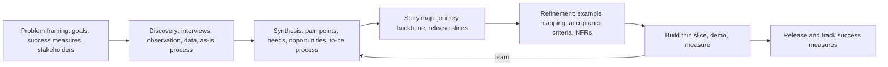

## TL;DR

- Start from **the problem and the outcome**, not the requested solution. "We need a dashboard" usually hides a decision someone can't make today.
- Use several **elicitation techniques**: interviews, observation, workshops, process mapping, data analysis, prototypes. People can't always describe what they do — watching them work reveals the real process and its workarounds.
- Write requirements as **testable examples**: user stories with acceptance criteria, Given/When/Then scenarios, example maps. Ambiguity is cheapest to resolve before code exists.
- Capture **non-functional requirements and constraints** explicitly (volumes, availability, security, compliance, integrations) — they drive the architecture.
- Requirements are discovered continuously: slice them with **story mapping** into thin, valuable releases, and validate with real users as early as possible.

## Core Concepts

### Problem first: needs vs solutions

Stakeholders usually arrive with a solution ("add an export to Excel button"). Dig for the underlying need:
- **Ask why, several times:** "What do you do with the export?" → "I reconcile it against the bank statement." → "How often, and what goes wrong?" → the real need is automated reconciliation with exception reporting.
- **Separate goal, need, requirement and solution:** goal (reduce month-end close from 8 to 3 days) → need (spot unmatched payments early) → requirement (show unmatched transactions daily with reason codes) → solution (a reconciliation service plus an exceptions screen).
- **Quantify the problem:** frequency, time spent, error rates, cost, customers affected. This also sets the success measures.

### Elicitation techniques

| Technique | Best for | Watch out for |
|---|---|---|
| Stakeholder interviews | Goals, pain points, context, politics | People describe the official process, not the real one |
| Observation / job shadowing | Real workflows, workarounds, tacit knowledge | Time-consuming; observer effect |
| Workshops (event storming, story mapping) | Shared understanding across roles, resolving conflicts | Dominant voices; needs a skilled facilitator |
| Process mapping (as-is / to-be, BPMN, swimlanes) | Handoffs, delays, rework loops, system touchpoints | Mapping the ideal instead of the actual |
| Document and data analysis | Volumes, edge cases, current rules, reports in use | Out-of-date documentation |
| Surveys | Breadth across many users | Shallow; leading questions |
| Prototypes and mock-ups | Validating UI and flows cheaply | Mistaken for finished product |
| Example mapping / specification by example | Precise rules and edge cases | Needs the "three amigos" (business, dev, test) |

### User stories and acceptance criteria

```text
As a finance clerk
I want unmatched bank transactions listed each morning with a suggested match
So that I can resolve exceptions daily instead of at month-end

Acceptance criteria
- Given a bank transaction with no ledger entry of the same amount within ±3 days
  When the nightly reconciliation runs
  Then it appears on the exceptions list with reason "No matching ledger entry"
- Given an exception with a ledger entry differing by less than £1.00
  Then a suggested match is shown with the difference highlighted
- Exceptions older than 5 working days are flagged red
```

Good stories follow **INVEST**: Independent, Negotiable, Valuable, Estimable, Small, Testable. A story is a placeholder for a conversation — the acceptance criteria record the outcome of that conversation.

### Example mapping

A 25-minute "three amigos" session per story using coloured cards: **story** (yellow), **rules** (blue), **examples** per rule (green), **questions** (red). Many red cards mean the story isn't ready; many blue cards mean it should be split. The examples become automated acceptance tests (BDD).

### Non-functional requirements and constraints

Business stakeholders rarely volunteer them, so ask explicitly:
- **Volumes and growth:** users, transactions per day and at peak, data size, retention.
- **Timing:** response times, batch windows, cut-off times, time zones.
- **Availability and recovery:** business hours vs 24/7, the cost of an hour of downtime, acceptable data loss.
- **Security and compliance:** data classification, regulations (GDPR, PCI DSS, sector rules), audit needs.
- **Integrations:** systems to read from and write to, formats, ownership, SLAs.
- **Usability and accessibility:** devices, accessibility standards, languages.
- **Constraints:** budget, deadlines, mandated technologies, contracts.

### Story mapping and slicing

Jeff Patton's **story map** lays out the user journey (backbone of activities) horizontally and stories vertically by priority. Draw horizontal release lines to find the **thinnest end-to-end slice** that delivers value (the walking skeleton / MVP), rather than building one component completely before the next.

## How It Works



Requirements work continues through delivery: each demo and release generates feedback that changes what comes next. Traceability (goal → requirement → story → test) can be kept lightweight in most contexts, and formal where regulation demands it.

## When to Use / Trade-offs

| Approach | Use when | Avoid when | Trade-off |
|---|---|---|---|
| Big up-front requirements specification | Fixed-scope contracts, regulated validation, vendor RFPs | Product development with uncertainty | Predictability on paper vs late discovery of wrong requirements |
| Continuous discovery + user stories | Most product work | Hard external commitments with no flexibility | Adaptability vs less up-front certainty |
| Prototypes before build | UI-heavy or novel workflows | Back-end rule changes with clear specs | Cheap validation vs risk of "the prototype is the product" |
| BDD / specification by example | Complex business rules, regulated calculations | Simple CRUD | Precise shared understanding and living docs vs facilitation time |
| Formal traceability matrix | Medical, aviation, finance regulation | Most commercial software | Audit evidence vs overhead |

## Common Pitfalls & Anti-patterns

- **Taking solutions as requirements** — building the requested report nobody reads.
- **Talking only to managers** — the people doing the work know the exceptions and workarounds.
- **Documenting the official process** instead of observing the real one.
- **Vague words** — "fast", "user-friendly", "real-time", "all data" — with no definition.
- **Gold-plating** — requirements nobody can link to a goal.
- **No acceptance criteria** — "done" is decided in an argument at the demo.
- **Ignoring non-functional requirements** until performance or compliance fails in testing.
- **Requirements thrown over the wall** — business analysts write documents, developers interpret them alone.
- **Big-bang scope** — everything is "must have" for go-live.

## Real-world Scenario

**Context:** A logistics company asked for a "new driver app" to replace paper delivery notes, with a 60-page requirements document listing 140 features compiled from managers' wishes.

**Decision:** The team spent two weeks shadowing drivers and depot staff. They discovered that the biggest cost wasn't paperwork: failed deliveries (customer not home) caused 12% of re-deliveries, and drivers phoned the depot for address issues, waiting on hold for an average of 6 minutes. A story map focused the first release on proof of delivery with photo, a "customer not in" flow with automatic rescheduling SMS, and in-app address notes. Of the original 140 features, 22 made the first two releases.

**Outcome:** Failed deliveries dropped from 12% to 7% within three months; depot calls fell by half. Several "must-have" features from the document were never requested again.

**What I'd do differently:** Bring the operations finance analyst in earlier. The cost-per-failed-delivery figure became the most persuasive argument for re-scoping, and it could have shaped the conversation from day one.

## Interview Questions

### How do you write a good user story with acceptance criteria? {#user-stories}

**Level:** Foundation

**Model answer:**
A user story describes a need from a user's perspective: "As a [role], I want [capability], so that [benefit]." The "so that" matters most: it explains the value and allows alternative solutions.

Acceptance criteria make it testable:
- Use specific, observable outcomes, often in Given/When/Then form.
- Cover the main rules and important edge cases (empty states, limits, errors, permissions).
- Include relevant non-functional expectations ("the list loads within 2 s for 5,000 exceptions").
- Avoid UI implementation detail unless it's a real constraint.

A good story is small enough to finish in a few days, delivers visible value and is agreed jointly by product, development and testing. It is a placeholder for a conversation, not a contract.

**What the interviewer is looking for:**
The value clause, testable acceptance criteria with edge cases, and story size.

**Follow-ups:**
- How do you write stories for technical work such as a database migration?
- What's the difference between acceptance criteria and the definition of done?

**Red flags:**
- Stories with no acceptance criteria.
- "As a developer, I want a database table…"

### What techniques do you use to elicit requirements? {#elicitation-techniques}

**Level:** Foundation

**Model answer:**
I combine several, because each reveals different things:
- **Interviews** with stakeholders at several levels for goals, pain points and context. Use open questions ("Walk me through the last time…").
- **Observation and shadowing** to see the real process, workarounds and tacit knowledge that people can't articulate.
- **Workshops:** event storming, process mapping and story mapping with mixed roles, to build shared understanding and surface conflicts.
- **Document and data analysis:** existing reports, logs, volumes and error rates, to quantify the problem and find edge cases.
- **Prototypes:** low-fidelity mock-ups or clickable prototypes, to test assumptions quickly with users.
- **Surveys** for breadth when there are many users.

The mix depends on the problem. For a workflow tool, observation is essential. For a reporting need, data analysis and decision interviews matter most.

**What the interviewer is looking for:**
Multiple techniques, what each is good for and the importance of observing real work.

**Follow-ups:**
- How do you run an interview so it doesn't just confirm your assumptions?
- When is a prototype the wrong tool?

**Red flags:**
- Relying only on a requirements document from management.
- No contact with actual end users.

### A stakeholder asks for a specific feature. How do you find the real need? {#problem-vs-solution}

**Level:** Foundation

**Model answer:**
Treat the request as a hypothesis about a solution, and explore the problem behind it:
- **Ask about the context:** "What are you trying to achieve? What happens today? Walk me through the last time you needed this."
- **Ask why repeatedly** (the five whys) until you reach the goal: "Export to Excel" → "to reconcile payments" → "because mismatches are found too late at month-end".
- **Quantify:** how often, how long it takes, the cost of errors, who else is affected.
- **Define success:** how will we know the problem is solved?
- **Explore alternatives together:** the original request may still be right, but often a simpler or more valuable option exists (automated matching instead of an export).

Respect the stakeholder's expertise. They know their domain. The aim is shared understanding, not proving them wrong.

**What the interviewer is looking for:**
Probing for underlying goals, quantification, success measures and collaborative exploration of options.

**Follow-ups:**
- What if the stakeholder insists on their solution?
- Give an example where the real need differed from the request.

**Red flags:**
- Building exactly what was asked without understanding it.
- Dismissing the stakeholder's proposal outright.

### What does INVEST mean for user stories? {#invest}

**Level:** Foundation

**Model answer:**
INVEST (Bill Wake) is a checklist for good stories:
- **Independent:** can be developed and released without depending on other stories, as far as possible.
- **Negotiable:** details are worked out in conversation, not fixed in a contract.
- **Valuable:** delivers value to a user or the business, not a technical layer.
- **Estimable:** understood well enough to size.
- **Small:** fits comfortably in an iteration, ideally a few days of work.
- **Testable:** clear acceptance criteria tell you when it's done.

Stories that fail INVEST usually need splitting: by workflow step, business rule, data variation, user role, happy versus unhappy path, or simple versus complex cases. Avoid splitting by technical layer (front end, back end, database), because those slices aren't valuable on their own.

**What the interviewer is looking for:**
Each letter explained and good splitting strategies (vertical, not horizontal).

**Follow-ups:**
- How would you split "As a customer I want to pay for my order"?
- Is "Independent" always achievable?

**Red flags:**
- Splitting by architectural layer.
- Stories that take a whole sprint or more.

### How do you use example mapping or Given/When/Then to clarify rules? {#example-mapping}

**Level:** Senior

**Model answer:**
**Example mapping** (Matt Wynne) is a short, time-boxed session (around 25 minutes) with the "three amigos": product or business, development and testing.
- Write the **story** on a yellow card.
- For each **business rule**, add a blue card. For each rule, add concrete **examples** on green cards ("Order of £49.99 → shipping £3.95"; "Order of £50.00 → free shipping").
- Record **questions** nobody can answer on red cards. They go to the right person before the work starts.

Signals: many red cards mean the story isn't ready. Many blue cards mean it's too big and should be split.

The examples become **Given/When/Then** scenarios, which can be automated as acceptance tests (BDD tools, or plain tests named after the examples), so the specification stays in sync with the code as living documentation.

```gherkin
Scenario: Free shipping applies at exactly the threshold
  Given a basket totalling £50.00 for delivery to the UK mainland
  When the customer views the checkout summary
  Then shipping is shown as "Free"
```

**What the interviewer is looking for:**
The mechanics, the boundary-case focus, what the card counts signal and linkage to automated tests.

**Follow-ups:**
- Should every story have Gherkin scenarios?
- How do you keep BDD tests maintainable?

**Red flags:**
- Writing Gherkin alone after development as documentation.
- Using BDD tooling for UI click-paths instead of business rules.

### Requirements are vague and stakeholders can't agree on details. How do you proceed? {#ambiguous-requirements}

**Level:** Senior

**Model answer:**
- **Align on the goal and success measures first.** Disagreement on details often hides disagreement on the objective.
- **Make the ambiguity concrete:** list the open questions explicitly, with their impact and who can decide. Use examples ("What should happen if a customer cancels after dispatch?") rather than abstract debate.
- **Prototype or spike:** show a low-fidelity version. Reactions to something tangible resolve ambiguity faster than documents.
- **Decide what to build now:** start with the parts that are clear and valuable, while the uncertain parts are explored. Design for change where uncertainty remains (configuration, feature flags).
- **Set decision owners and deadlines** for the open questions, and escalate if they block progress.
- **Record the decisions** in acceptance criteria or a decision log, so they don't get reopened.

**What the interviewer is looking for:**
Goal alignment, concrete examples, prototyping, progressing on the clear parts, and decision ownership.

**Follow-ups:**
- How do you avoid analysis paralysis?
- When is it right to stop and refuse to start building?

**Red flags:**
- Building on assumptions without validating them.
- Waiting for perfect requirements before doing anything.

### How do you use story mapping to scope an MVP? {#story-mapping}

**Level:** Senior

**Model answer:**
1. **Build the backbone:** the user's journey as a sequence of activities, left to right (for example *browse → choose → order → pay → track → return*), with the steps under each activity.
2. **Add stories** under each step, ordered vertically by importance or necessity.
3. **Draw release lines:** the first slice takes the minimum across **every** step of the journey, so a user can complete it end to end, even crudely (manual steps, one payment method). That's the walking skeleton or MVP.
4. **Use goals to decide each slice:** each release targets an outcome ("validate that customers will order online"), not a feature list.
5. **Walk the map** with stakeholders to check for gaps and agree priorities. The map makes trade-offs visible: moving a story above the line means moving another below.

This avoids the trap of building one component fully (a perfect catalogue with no checkout) and gets feedback from real usage sooner.

**What the interviewer is looking for:**
Backbone and slices, end-to-end thin first release, outcome-driven slicing and use as a negotiation tool.

**Follow-ups:**
- How do you decide what's "minimum" for a regulated product?
- How does a story map relate to the backlog?

**Red flags:**
- MVP defined as "phase 1 of the full scope".
- Building horizontally, component by component.

### How do you handle requirements traceability in a regulated environment? {#traceability}

**Level:** Senior

**Model answer:**
Regulators (medical devices, aviation, finance, pharmaceuticals) often require evidence that every requirement is implemented and tested, and that every change is controlled.

Approach:
- **A traceability chain:** regulation or business need → requirement (with a unique id) → design and risk items → stories and code changes → tests → test results → release.
- **Keep it in the tools people already use:** requirement ids linked from tickets, commits and pull requests, tests tagged with requirement ids, CI producing test evidence automatically. Avoid a separate spreadsheet maintained by hand.
- **Change control:** requirement changes are versioned, reviewed and approved, with an impact analysis of affected tests and components.
- **Risk-based depth:** safety- or money-critical requirements get more rigorous verification (independent review, additional testing) than low-risk ones.
- **Generate audit reports** (a traceability matrix) from the linked data at release time.

This keeps agility (small batches, continuous delivery) while meeting compliance, because the evidence is produced as part of the work.

**What the interviewer is looking for:**
The traceability chain, automation through tool linking, change control and risk-based rigour.

**Follow-ups:**
- How would you introduce this into a team that currently uses Word documents?
- What standards have you worked with (for example IEC 62304, DO-178C)?

**Red flags:**
- Manual matrices updated after the fact.
- "Agile can't work in regulated environments."

### How do you get non-functional requirements from business stakeholders who don't think in those terms? {#eliciting-nfrs}

**Level:** Senior

**Model answer:**
Ask in business language and scenarios, then translate:
- **Availability:** "What happens to the business if this is down for an hour on a Monday morning? Or at month-end? Who would notice first?" This tells you the business hours, peak periods and cost of downtime.
- **Data loss:** "If we lost the last 15 minutes of orders, what would that cost? What about a day?" That gives you the RPO.
- **Performance:** "How long do people wait today? At what point do customers give up?" Use data from analytics where possible.
- **Volumes:** "How many orders on your busiest day? What growth do you expect in 3 years?"
- **Security and compliance:** "What data is sensitive? Which regulations apply? Who must not see what?" Involve the compliance and security teams.
- **Usability and accessibility:** who the users are, devices, accessibility obligations, languages.
- **Operations:** "Who supports this out of hours? What reports does audit need?"

Then write measurable quality scenarios and play them back for confirmation: "So checkout must handle 300 orders per minute at peak with p95 under 2 s, and we can lose at most 5 minutes of data. Is that right?"

**What the interviewer is looking for:**
Business-language questioning, translation into measurable requirements and confirmation with stakeholders.

**Follow-ups:**
- The business says "it must never go down". How do you respond?
- How do you validate stated volumes?

**Red flags:**
- Not asking, then designing to assumptions.
- Asking "What's your required RPO?" to a business user.

### How do you gather requirements for a reporting or dashboard project? {#reporting-requirements}

**Level:** Senior

**Model answer:**
Start with **decisions, not data**:
- **Which decisions** will this report support, who makes them, how often, and what action follows? A metric that doesn't change any decision is noise.
- **Define each metric precisely:** formula, filters, time zone, currency, inclusion and exclusion rules ("active customer" = a purchase in the last 90 days?). Agree a single definition across departments, because different teams often calculate "revenue" differently.
- **Granularity and freshness:** daily or real-time? By region, product or customer? Real-time is often requested and rarely needed. Ask what would change if the data were an hour or a day old.
- **Data sources and quality:** where each field comes from, the owners, known quality issues, and history required.
- **Access and security:** who sees what (row-level security by region, PII masking).
- **Validate with a prototype** using real data early: reactions to a draft chart are much more precise than abstract requirements.
- **Check usage after launch:** retire unused reports.

**What the interviewer is looking for:**
A decision-centric approach, precise metric definitions, sensible freshness requirements, data quality and security, and early prototyping.

**Follow-ups:**
- Two departments define "active user" differently. What do you do?
- How do you push back on a request for real-time data?

**Red flags:**
- Building a dashboard with "all the data" and letting users find value.
- Undefined metrics.

### How would you run the discovery phase for a large business transformation programme? {#discovery-phase}

**Level:** Architect

**Model answer:**
**Goals of discovery:** a shared understanding of the problem, the target outcomes, the options and their costs and risks, and enough evidence to make an investment decision. It should not be a full specification.

**Activities (typically 6–12 weeks):**
1. **Align on objectives** with sponsors: business case drivers, measurable outcomes and constraints (budget, regulation, deadlines).
2. **Stakeholder mapping and interviews** across business units, operations, IT, finance, compliance and customers.
3. **As-is analysis:** process maps for the core value streams, a system landscape and data flows, pain points quantified (cycle times, error rates, cost), and current contracts and licences.
4. **User research:** observation and journey mapping for key personas.
5. **To-be vision and options:** target operating model and capability map, then architecture options (build, buy or extend) with rough costs, risks and timelines. Validate the riskiest assumptions with spikes or prototypes.
6. **Roadmap:** phased delivery of thin, valuable slices, dependencies, quick wins and success measures per phase.
7. **Governance and team:** decision rights, steering, and the delivery team shape.

**Outputs:** a short discovery report, the capability map, prioritised opportunities, an options analysis with a recommendation, a roadmap with measures, a risk register and ADRs for early decisions.

**What the interviewer is looking for:**
Outcome-focused discovery, quantified as-is analysis, options with evidence, a phased roadmap and governance, avoiding endless specification.

**Follow-ups:**
- How do you avoid discovery becoming a 9-month analysis exercise?
- How do you decide build versus buy during discovery?

**Red flags:**
- Producing a 300-page requirements document as the main output.
- Skipping the as-is analysis.

### How do you map and redesign a business process before automating it? {#process-mapping}

**Level:** Architect

**Model answer:**
"Automating a bad process gives you a fast bad process."

1. **Map the as-is process** with the people who do it, for example in a swimlane diagram by role or system (BPMN for formal needs). Capture handoffs, waiting time, rework loops, decision points, exceptions and the systems touched at each step. Observe real cases; don't rely only on procedure documents.
2. **Measure:** volumes, cycle time compared with touch time (often 90% waiting), error and rework rates, cost per case, the main exception types.
3. **Find the waste and root causes:** unnecessary approvals, duplicate data entry, information arriving late, batch handoffs, policy rules that no longer apply.
4. **Design the to-be process** with the stakeholders:
   - Remove steps first, then simplify, then automate.
   - Straight-through processing for the common case, with human handling for exceptions.
   - Clear ownership of each step.
   - Data captured once at the source.
5. **Validate** with real historical cases walked through the new process, and a pilot.
6. **Derive requirements:** system capabilities, integrations, business rules (candidates for a rules engine or a workflow orchestrator), and the metrics to monitor.

Change management matters as much as the technology: roles change, and people need to be involved, trained and supported.

**What the interviewer is looking for:**
As-is mapping with evidence, measurement, waste removal before automation, exception-focused design, validation and change management.

**Follow-ups:**
- When would you use BPMN and a workflow engine?
- How do you handle resistance from people whose roles change?

**Red flags:**
- Digitising the paper form as-is.
- Designing the to-be process without the people who do the work.

### Three business units run the same process differently and each wants the new system to match theirs. What do you do? {#harmonising-processes}

**Level:** Architect

**Model answer:**
1. **Map all three processes** and compare them side by side: where they're the same, where they differ and **why** each difference exists (regulation, product differences, customer segment, or just history).
2. **Classify the differences:**
   - *Legitimate and necessary* (legal requirements in one country, different products): support them through configuration or variants.
   - *Preference or legacy* ("we've always done it this way"): candidates for harmonisation.
   - *A competitive advantage* for one unit: consider adopting it across the board.
3. **Quantify the cost of variation:** more complexity to build, test and maintain each variant, training, reporting inconsistencies, and the inability to move staff between units.
4. **Propose a standard core process** with explicit, configurable variation points, and get executive sponsorship. Harmonisation is a business decision, not an IT one.
5. **Run joint workshops** with process owners from each unit to agree the standard. Use data (cycle times, error rates) to pick the best practice rather than seniority.
6. **Govern variations:** new requests for unit-specific behaviour go through a design authority that weighs value against complexity cost.

**What the interviewer is looking for:**
Understanding the reasons behind variation, classifying differences, quantifying their costs, a configurable standard core and business-led governance.

**Follow-ups:**
- One unit's leader refuses to change. How do you handle it?
- How do you design the system for configurable variation without making it unmaintainable?

**Red flags:**
- Building three separate versions.
- Imposing one unit's process without analysis.

### How do you write requirements for a vendor selection or RFP? {#rfp-requirements}

**Level:** Architect

**Model answer:**
- **Start from business outcomes and use cases,** not feature checklists: "A claims handler processes a standard motor claim end to end in under 10 minutes." Vendors can demonstrate scenarios; checklists invite "yes" to everything.
- **Prioritise ruthlessly:** must-have (knock-out) criteria, important and nice-to-have, with weights agreed by stakeholders before seeing any vendor responses.
- **Include non-functional and commercial requirements:**
  - Security and compliance (certifications, data residency, pen testing).
  - Integration (APIs, events, standards), scalability and SLAs.
  - Support, roadmap, pricing model and total cost over 5 years.
  - Exit provisions (data export, transition support).
- **Describe the context:** volumes, current landscape, integrations and constraints, so vendors can respond realistically.
- **Evaluate with evidence:** scripted demos using your scenarios and data, reference calls with similar customers, a proof of concept for the riskiest areas, and technical due diligence on the architecture and API quality.
- **Score transparently** with a cross-functional panel using the weighted criteria, and record the decision rationale.

**What the interviewer is looking for:**
Scenario-based requirements, weighted criteria set in advance, non-functional and exit criteria, evidence-based evaluation and transparent scoring.

**Follow-ups:**
- How do you stop the evaluation being biased towards an incumbent?
- What are common hidden costs in SaaS contracts?

**Red flags:**
- A 500-line feature checklist as the main instrument.
- Selecting on the demo experience alone.

### As an architect, how do you translate business capabilities and requirements into architecture? {#capabilities-to-architecture}

**Level:** Architect

**Model answer:**
1. **Capability map:** model what the business does (Order management, Pricing, Claims assessment, Customer onboarding), independent of organisation and systems. Rate each capability on strategic importance and current maturity.
2. **Link requirements to capabilities:** each initiative's requirements map to the capabilities they change. This reveals which capabilities are under pressure and where to invest.
3. **Classify the capabilities:** differentiating (core domain: build and invest), supporting, and commodity (buy or SaaS), in line with DDD subdomains.
4. **Derive the architecture:**
   - Capabilities become candidate bounded contexts and services.
   - The quality attributes (from NFRs) drive the patterns: availability, scale, consistency, security.
   - Integration needs drive APIs and events.
   - Data ownership follows the capabilities.
5. **Make the trade-offs explicit** in ADRs linked to the business requirements and quality scenarios they serve.
6. **Play it back to the business:** show how the architecture enables their outcomes, with a roadmap of capability uplift, so architecture and business plans stay connected.

**What the interviewer is looking for:**
Capability mapping, linking requirements to capabilities, classification for build versus buy, deriving boundaries and patterns, and traceable decisions.

**Follow-ups:**
- How does a capability map differ from an org chart or system list?
- How do you keep the capability map current?

**Red flags:**
- Jumping from requirements straight to technology choices.
- Architecture artefacts the business can't relate to.

## Cheat Sheet

- **Problem before solution** — treat requests as hypotheses; ask why until you reach the goal.
- **Goal → need → requirement → solution** — keep the layers separate.
- **Observe real work** — interviews give the official process; shadowing gives the real one.
- **User story** — As a role, I want capability, so that benefit; plus acceptance criteria.
- **INVEST** — Independent, Negotiable, Valuable, Estimable, Small, Testable.
- **Vertical slicing** — split by workflow, rule, data or path, never by technical layer.
- **Example mapping** — story, rules, examples and questions cards; many questions mean not ready.
- **Given/When/Then** — concrete examples that become automated acceptance tests.
- **Story map** — journey backbone with release slices; the first slice runs end to end.
- **NFRs in business language** — ask about downtime cost, data loss, peak volumes, then translate.
- **Reporting requirements** — start from decisions, define each metric precisely, question real-time needs.
- **Remove, simplify, then automate** — redesign the process before building software.
- **Capability map** — what the business does, independent of org chart and systems.
- **RFP requirements** — scenarios and weighted criteria agreed before vendor responses.

## Further Reading

- [IIBA: BABOK Guide](https://www.iiba.org/career-resources/a-business-analysis-professionals-foundation-for-success/babok/) — VERIFY: link path; the standard body of knowledge for business analysis.
- [Example Mapping (Matt Wynne, Cucumber blog)](https://cucumber.io/blog/bdd/example-mapping-introduction/) — the original introduction to example mapping.
- [Cucumber: Gherkin reference](https://cucumber.io/docs/gherkin/reference/) — syntax for Given/When/Then specifications.
- [Jeff Patton: User Story Mapping](https://jpattonassociates.com/story-mapping/) — VERIFY: link path; the author's resources on story mapping.
- [OMG BPMN specification](https://www.omg.org/spec/BPMN/) — the standard notation for business process modelling.
- [GOV.UK Service Manual: User research](https://www.gov.uk/service-manual/user-research) — practical, well-tested guidance on understanding user needs.
