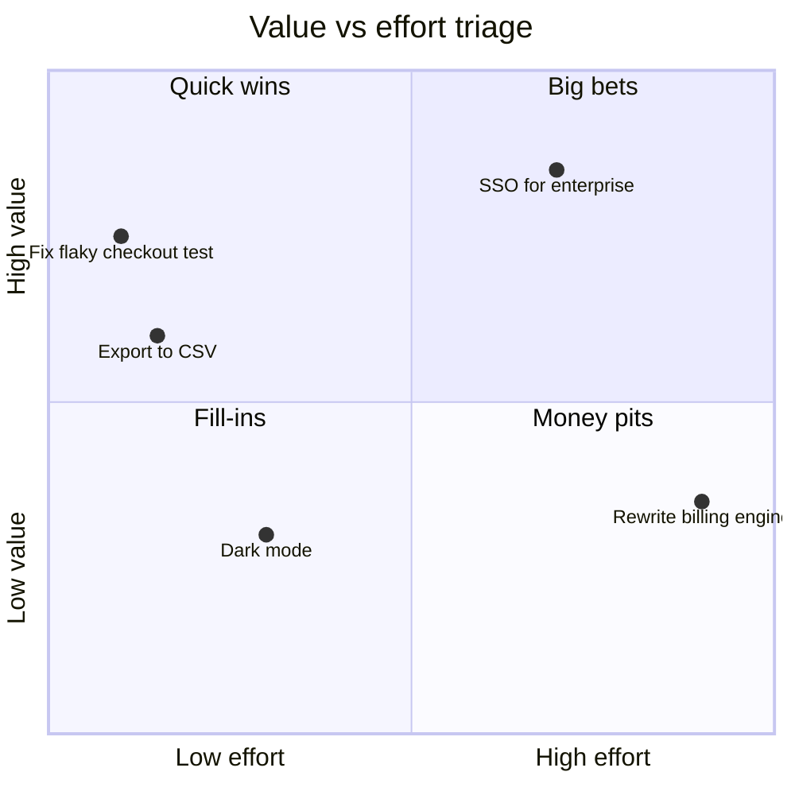

## TL;DR

- Prioritisation is deciding **what not to do**. Frameworks don't make the decision; they make the **assumptions visible** so people can argue about inputs instead of opinions.
- **Cost of Delay** is the most useful underlying idea: what does it cost per week to *not* have this? Dividing by duration (CD3 / WSJF) favours small, urgent, valuable work.
- **RICE** suits feature comparison with measurable reach; **MoSCoW** suits scoping a fixed release; **Kano** explains *why* features matter to users.
- Technical work (debt, reliability, platform) competes fairly only when expressed in the **same currency**: risk, cost, speed, revenue.
- The hardest prioritisation problems are **political, not mathematical**: competing executives, unclear strategy. Escalate to the strategy, not the spreadsheet.

## Core Concepts

### The common frameworks

| Framework | Formula / idea | Best for | Weakness |
|---|---|---|---|
| MoSCoW | Must / Should / Could / Won't (this time) | Scoping a release or MVP with a fixed date | Everything becomes a Must without a rule (e.g. Musts ≤ 60% of effort) |
| RICE | (Reach × Impact × Confidence) ÷ Effort | Comparing product features with data | False precision; reach is hard for B2B or platform work |
| ICE | Impact × Confidence × Ease | Quick experiment backlogs (growth) | Very subjective |
| Cost of Delay / CD3 | Cost of delay per week ÷ duration | Economic sequencing of any work | Requires estimating value over time |
| WSJF (SAFe) | (Business value + Time criticality + Risk reduction/Opportunity enablement) ÷ Job size | Large portfolios, SAFe trains | Relative scores can be gamed; job size ≠ duration |
| Kano | Basic / Performance / Delighter features | Understanding customer satisfaction drivers | Needs user research |
| Value vs effort 2×2 | Quick wins, big bets, fill-ins, money pits | Workshops, fast triage | Ignores urgency and dependencies |
| Opportunity scoring | Importance vs current satisfaction | Finding under-served needs | Research-heavy |

### Cost of Delay and why sequencing matters

If feature A costs £50k/week of delay and takes 2 weeks, and B costs £20k/week and takes 1 week:
- **A then B**: B waits 2 weeks → delay cost = A 2×50k + B 3×20k = £160k.
- **B then A**: A waits 1 week → delay cost = B 1×20k + A 3×50k = £170k.

CD3 = CoD ÷ duration: A = 25, B = 20, so A first. ✔ Dividing by duration is what makes small, valuable items rise.

**Urgency profiles** matter: some value decays fast (seasonal, competitive), some has a deadline (regulatory fines after a date), some is steady.

```ts
type Item = { name: string; reach: number; impact: 0.25 | 0.5 | 1 | 2 | 3; confidence: number; effortPersonMonths: number };

export const rice = (i: Item) => (i.reach * i.impact * i.confidence) / i.effortPersonMonths;

type WsjfItem = { name: string; businessValue: number; timeCriticality: number; riskReductionOrOpportunity: number; jobSize: number };

/** SAFe WSJF uses relative (modified Fibonacci) scores, normalised within one prioritisation session. */
export const wsjf = (i: WsjfItem) => (i.businessValue + i.timeCriticality + i.riskReductionOrOpportunity) / i.jobSize;

export const rank = <T>(items: T[], score: (t: T) => number) =>
  [...items].map((t) => ({ item: t, score: score(t) })).sort((a, b) => b.score - a.score);
```

### Prioritising technical work

Translate technical work into business terms:
- **Risk reduction**: probability × impact of an outage, breach or audit failure.
- **Cost**: cloud spend, support hours, toil hours per month.
- **Speed**: lead time, onboarding time, change failure rate improvements.
- **Opportunity enablement**: "this unblocks features X and Y".

Common allocation models: a **capacity split** (e.g. 70% product / 20% tech health / 10% exploration, adjusted quarterly), **error-budget policies** (reliability work takes priority when SLOs are breached), or **debt items in the same backlog** scored with the same framework.

### The decision process matters as much as the model

- Start from **strategy and outcomes** (OKRs). Items that don't map to an outcome need a strong reason.
- Make the **inputs explicit** and owned (who estimated reach? confidence based on what?).
- **Timebox** and decide; record decisions and the rationale.
- Communicate the **"no" and "not now"** list as clearly as the "yes" list.
- Revisit on a cadence; new information should change priorities.

## How It Works



A 2×2 is a conversation starter; follow it with Cost of Delay for anything contested.

## When to Use / Trade-offs

| Situation | Recommended approach | Why |
|---|---|---|
| Fixed date, fixed team, scope negotiable | MoSCoW with a Must ≤ 60% effort rule | Protects the date with contingency |
| Many features, decent analytics | RICE | Comparable, data-informed scoring |
| Portfolio across teams, economic framing | Cost of Delay / WSJF | Optimises sequence, values urgency |
| Early discovery, unclear needs | Kano, opportunity scoring, experiments | Learn what matters before scoring |
| Workshop triage with stakeholders | Value vs effort 2×2, then CoD on the contested items | Fast alignment |
| Tech debt vs features | Capacity allocation + business-currency framing | Ensures health work happens predictably |

## Common Pitfalls & Anti-patterns

- **HiPPO** — the Highest Paid Person's Opinion overrides the agreed process.
- **False precision** — RICE scores to two decimal places built on guesses; show confidence ranges.
- **Everything is P1** — no forced ranking; teams context-switch and finish nothing.
- **Ignoring dependencies and sequencing** — scoring items independently when one enables another.
- **Ignoring urgency** — pure value/effort scoring misses deadlines and decaying value.
- **Frameworks as weapons** — gaming scores to win arguments; inputs need challenge and ownership.
- **Never saying no explicitly** — the backlog grows forever, and stakeholders assume "later" means "yes".

## Real-world Scenario

**Context:** A B2B SaaS platform team had requests from Sales (enterprise SSO), Support (bulk admin tools), Security (secrets rotation) and Engineering (database upgrade before end of support). Each VP said theirs was #1; the team was splitting effort four ways and shipping nothing.

**Decision:** I facilitated a Cost of Delay session:
- **SSO**: three enterprise deals worth £1.2M ARR were blocked; their buyers' Q3 budget deadlines made it time-critical.
- **DB upgrade**: end of vendor support in 5 months, after which security patches stop. The risk was rising, and a compliance audit was due.
- **Secrets rotation**: important, but partially mitigated by existing controls.
- **Bulk tools**: saved ~30 support hours a week, steady value.

CD3 ordering: SSO (high CoD, 4 weeks) → DB upgrade (rising urgency, 3 weeks, started in parallel by a pair) → bulk tools → secrets rotation (with interim mitigation documented and accepted by the CISO).

**Outcome:** SSO shipped in 5 weeks and two of three deals closed. The DB upgrade landed a month before end of support. The VPs accepted the order because the inputs were theirs and visible.

**What I'd do differently:** Agree the prioritisation process with the VPs *before* the conflict, as part of quarterly planning.

## Interview Questions

### What is MoSCoW, and what goes wrong with it in practice? {#moscow}

**Level:** Foundation

**Model answer:**
MoSCoW sorts requirements into Must have, Should have, Could have and Won't have (this time) for a given release or timebox. It is useful for scoping a fixed-date delivery. In practice, stakeholders label almost everything Must, which removes the contingency it's meant to create. Mitigations: define Must strictly ("the release is pointless or illegal without it"), cap Musts at around 60% of capacity, keep Shoulds and Coulds as genuine contingency, and make "Won't" explicit and visible.

**What the interviewer is looking for:**
Knowing its purpose (scoping under a fixed date) and the practical governance that makes it work.

**Follow-ups:**
- How would you handle a stakeholder who insists everything is a Must?
- Why does MoSCoW not help with ordering *within* Musts?

**Red flags:**
- Treating MoSCoW as a full prioritisation method for a roadmap.
- No awareness of the "everything is a Must" problem.

### Walk me through RICE. When would you trust its output? {#rice}

**Level:** Senior

**Model answer:**
RICE = (Reach × Impact × Confidence) ÷ Effort:
- **Reach**: users or events affected per period.
- **Impact**: a scale such as 0.25–3.
- **Confidence**: a percentage reflecting evidence.
- **Effort**: person-months.

It gives a comparable score and, more importantly, forces explicit assumptions. I'd trust it for *relative* ordering among similar features when reach comes from real data and confidence reflects actual evidence (research, experiments). I'd distrust it when scores are close (noise exceeds signal), when inputs are guesses from one person, when items have very different urgency (RICE ignores time), or for platform/infrastructure work where reach is indirect.

**What the interviewer is looking for:**
Mechanics plus critical judgement about input quality and the framework's blind spots (urgency, dependencies).

**Follow-ups:**
- How do you estimate reach for an internal platform feature?
- How do you combine RICE with strategic bets that score poorly?

**Red flags:**
- Treating the RICE score as objective truth.
- Not knowing what Confidence is for.

### Explain Cost of Delay and WSJF. Why divide by duration? {#cost-of-delay}

**Level:** Senior

**Model answer:**
Cost of Delay is the economic value lost per unit of time an item is not delivered: lost revenue, ongoing costs, risk exposure, missed opportunity. Dividing by duration (CD3, or WSJF in SAFe, where CoD = business value + time criticality + risk reduction/opportunity enablement, divided by job size) gives the order that minimises total delay cost across the sequence. Short, high-CoD items go first because they stop accumulating delay cost sooner, while long items would block everything behind them. It makes urgency explicit, which value/effort scoring misses.

**What the interviewer is looking for:**
Understanding the economic logic (sequencing to minimise total delay cost), not just the formula, and urgency profiles.

**Follow-ups:**
- How would you estimate cost of delay for a security fix?
- What are the risks of WSJF using relative scores?

**Red flags:**
- "Do the most valuable thing first" without considering duration.
- Confusing job size with priority.

### How do you get technical debt prioritised against features? {#tech-debt-vs-features}

**Level:** Senior

**Model answer:**
Speak the same language as feature work. Quantify the debt's impact as:
- **cost**: hours lost per sprint, cloud spend
- **risk**: incident probability × impact, compliance deadlines
- **speed**: lead time, onboarding time, change failure rate in that area

Tie paying it down to outcomes ("cuts checkout lead time from 5 days to 1, enabling the Q3 pricing experiments"). Then use a mechanism that protects it:
- a capacity allocation (e.g. 20%)
- error-budget policies for reliability
- scoring debt in the same framework as features

Prioritise debt in code that changes often (a hotspot analysis of churn × complexity). Debt in stable code rarely matters.

**What the interviewer is looking for:**
Translation into business value, data (hotspots), and sustainable mechanisms rather than one-off pleading.

**Follow-ups:**
- What if product refuses any capacity for tech health?
- How do you prove the debt work paid off?

**Red flags:**
- "Engineers should just decide."
- Describing debt only in technical terms ("the code is ugly").

### Three VPs each insist their initiative is the company's top priority, and your team can do one this quarter. What do you do? {#competing-priorities}

**Level:** Architect

**Model answer:**
1. **Don't pick a winner yourself, and don't split the team three ways.**
2. **Clarify each request**: the outcome, who benefits, evidence, deadline or urgency, and what happens if it waits a quarter (cost of delay).
3. **Make it comparable**: a short written one-pager per initiative with explicit assumptions, reviewed by each VP for accuracy.
4. **Anchor to strategy**: map each to company OKRs; flag any that don't fit.
5. **Facilitate a decision** with the person who owns the trade-off (often the CPO/CTO or the leadership team), presenting the CD3 ordering and options (sequence, smaller slices, temporary mitigations, borrowing capacity).
6. **Record and communicate** the decision, rationale and revisit date; make the "not now" items and their mitigations explicit.

**What the interviewer is looking for:**
Escalating to the right level with data rather than taking sides, protecting team focus, and creating a repeatable process.

**Follow-ups:**
- What if the decision-maker refuses to decide?
- How do you maintain your relationship with the VPs who "lost"?
- How would you prevent this happening next quarter?

**Red flags:**
- Splitting the team across all three.
- Siding with the most senior or loudest VP.
- Deciding alone without involving the accountable leader.

## Cheat Sheet

- **MoSCoW** — Must / Should / Could / Won't (this time); scope a fixed-date release; cap Musts at ~60%.
- **RICE** — (Reach × Impact × Confidence) ÷ Effort; compares features; ignores urgency.
- **ICE** — Impact × Confidence × Ease; quick experiment triage.
- **Cost of Delay** — value lost per unit of time an item isn't delivered.
- **CD3** — Cost of Delay ÷ Duration; sequence by highest first.
- **WSJF** — (Business value + Time criticality + Risk reduction/Opportunity enablement) ÷ Job size.
- **Kano** — Basic needs, performance features, delighters; delighters decay into basics.
- **HiPPO** — Highest Paid Person's Opinion; counter with explicit inputs and process.
- **Tech debt currency** — express in cost, risk, speed and opportunity; prioritise hotspots.
- **Say no explicitly** — publish the "not now" list with reasons and a revisit date.

## Further Reading

- [Intercom: RICE prioritisation](https://www.intercom.com/blog/rice-simple-prioritization-for-product-managers/) — the original RICE write-up.
- [SAFe: Weighted Shortest Job First](https://framework.scaledagile.com/wsjf) — WSJF as defined in SAFe.
- [Black Swan Farming: Cost of Delay](https://blackswanfarming.com/cost-of-delay/) — Joshua Arnold's practical guide to CoD and CD3.
- [Agile Business Consortium: MoSCoW prioritisation](https://www.agilebusiness.org/dsdm-project-framework/moscow-prioririsation.html) — VERIFY: link path; the DSDM definition of MoSCoW.
- *The Principles of Product Development Flow*, Donald Reinertsen — the economic foundation of Cost of Delay.
