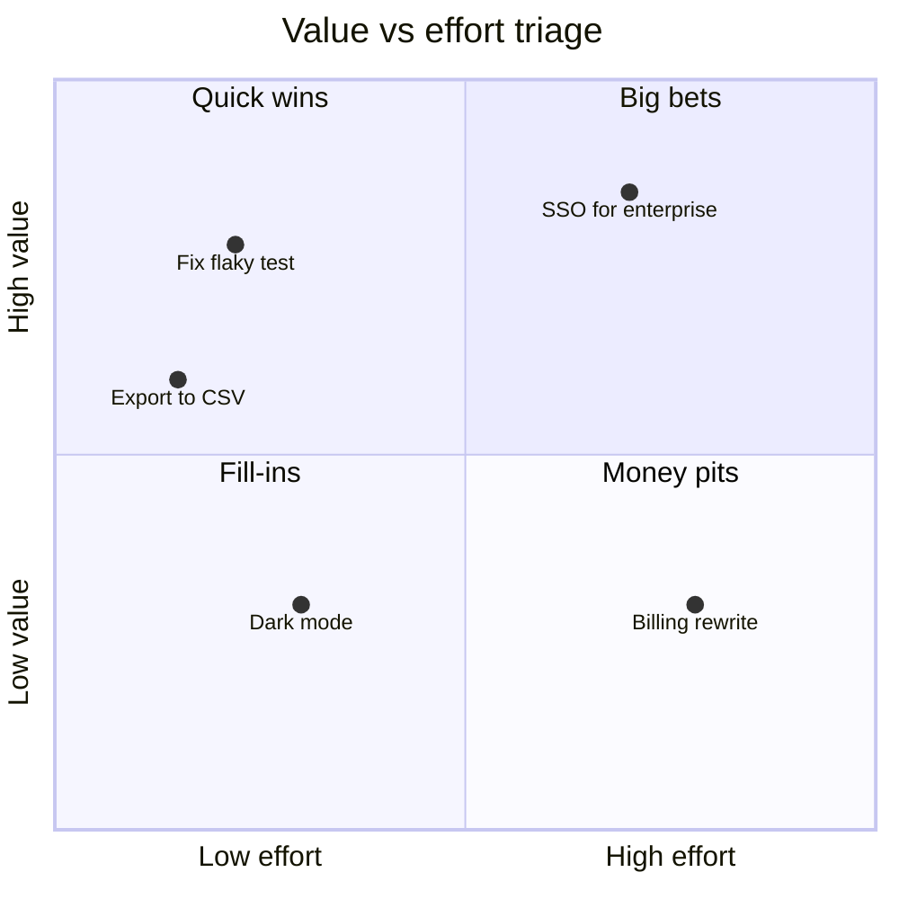
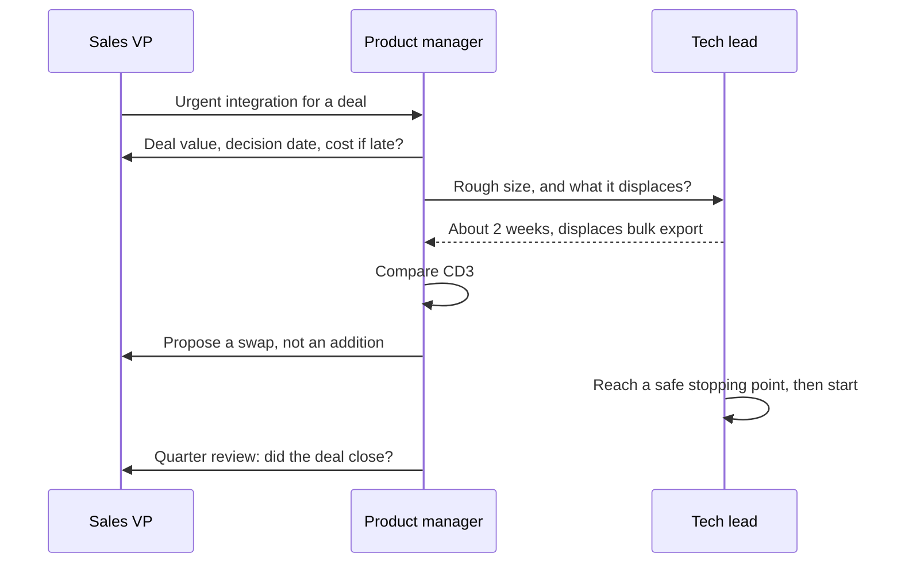

## TL;DR

- Prioritisation is deciding **what not to do**. Frameworks don't make the decision; they make the **assumptions visible** so people can argue about inputs instead of opinions.
- **Cost of Delay** is the most useful underlying idea: what does it cost per week to *not* have this? Dividing by duration (CD3 / WSJF) favours small, urgent, valuable work.
- **RICE** suits feature comparison with measurable reach; **MoSCoW** suits scoping a fixed release; **Kano** explains *why* features matter to users.
- Technical work (debt, reliability, platform) competes fairly only when expressed in the **same currency**: risk, cost, speed, revenue.
- The hardest prioritisation problems are **political, not mathematical**: competing executives, unclear strategy. Escalate to the strategy, not the spreadsheet.

## Core Concepts

### The common frameworks

| Framework | Formula / idea | Best for | Weakness |
|---|---|---|---|
| MoSCoW | Must / Should / Could / Won't (this time) | Scoping a release or MVP with a fixed date | Everything becomes a Must without a rule (e.g. Musts ≤ 60% of effort) |
| RICE | (Reach × Impact × Confidence) ÷ Effort | Comparing product features with data | False precision; reach is hard for B2B or platform work |
| ICE | Impact × Confidence × Ease | Quick experiment backlogs (growth) | Very subjective |
| Cost of Delay / CD3 | Cost of delay per week ÷ duration | Economic sequencing of any work | Requires estimating value over time |
| WSJF (SAFe) | (Business value + Time criticality + Risk reduction/Opportunity enablement) ÷ Job size | Large portfolios, SAFe trains | Relative scores can be gamed; job size ≠ duration |
| Kano | Basic / Performance / Delighter features | Understanding customer satisfaction drivers | Needs user research |
| Value vs effort 2×2 | Quick wins, big bets, fill-ins, money pits | Workshops, fast triage | Ignores urgency and dependencies |
| Opportunity scoring | Importance vs current satisfaction | Finding under-served needs | Research-heavy |

### Cost of Delay and why sequencing matters

If feature A costs £50k/week of delay and takes 2 weeks, and B costs £20k/week and takes 1 week:
- **A then B**: B waits 2 weeks → delay cost = A 2×50k + B 3×20k = £160k.
- **B then A**: A waits 1 week → delay cost = B 1×20k + A 3×50k = £170k.

CD3 = CoD ÷ duration: A = 25, B = 20, so A first. ✔ Dividing by duration is what makes small, valuable items rise.

**Urgency profiles** matter: some value decays fast (seasonal, competitive), some has a deadline (regulatory fines after a date), some is steady.

```ts
type Item = { name: string; reach: number; impact: 0.25 | 0.5 | 1 | 2 | 3; confidence: number; effortPersonMonths: number };

export const rice = (i: Item) => (i.reach * i.impact * i.confidence) / i.effortPersonMonths;

type WsjfItem = { name: string; businessValue: number; timeCriticality: number; riskReductionOrOpportunity: number; jobSize: number };

/** SAFe WSJF uses relative (modified Fibonacci) scores, normalised within one prioritisation session. */
export const wsjf = (i: WsjfItem) => (i.businessValue + i.timeCriticality + i.riskReductionOrOpportunity) / i.jobSize;

export const rank = <T>(items: T[], score: (t: T) => number) =>
  [...items].map((t) => ({ item: t, score: score(t) })).sort((a, b) => b.score - a.score);
```

### Prioritising technical work

Translate technical work into business terms:
- **Risk reduction**: probability × impact of an outage, breach or audit failure.
- **Cost**: cloud spend, support hours, toil hours per month.
- **Speed**: lead time, onboarding time, change failure rate improvements.
- **Opportunity enablement**: "this unblocks features X and Y".

Common allocation models: a **capacity split** (e.g. 70% product / 20% tech health / 10% exploration, adjusted quarterly), **error-budget policies** (reliability work takes priority when SLOs are breached), or **debt items in the same backlog** scored with the same framework.

### The decision process matters as much as the model

- Start from **strategy and outcomes** (OKRs). Items that don't map to an outcome need a strong reason.
- Make the **inputs explicit** and owned (who estimated reach? confidence based on what?).
- **Timebox** and decide; record decisions and the rationale.
- Communicate the **"no" and "not now"** list as clearly as the "yes" list.
- Revisit on a cadence; new information should change priorities.

### Worked example: RICE and Cost of Delay disagree

One team can work on one item at a time. Four candidates:

| Item | Reach / quarter | Impact | Confidence | Effort (person-months) | RICE |
|---|---|---|---|---|---|
| A: Bulk import | 2,000 | 1 | 80% | 2 | 800 |
| B: Enterprise SSO | 300 | 3 | 100% | 3 | 300 |
| C: Onboarding checklist | 4,000 | 0.5 | 50% | 1 | **1,000** |
| D: Audit log (regulatory deadline in week 10) | 150 | 2 | 100% | 2 | 150 |

RICE says **C, A, B, D**. Now add Cost of Delay per week and duration:

| Item | Cost of Delay per week | Duration | CD3 |
|---|---|---|---|
| A | £3,000 (support time, retention) | 4 weeks | 0.75 |
| B | £15,000 (three blocked enterprise deals) | 6 weeks | **2.5** |
| C | £2,000 (already risk-adjusted for low confidence) | 2 weeks | 1.0 |
| D | £0 until week 10, then £25,000 a week (fines and contract risk) | 4 weeks | Fixed date: must start by week 6 |

Total delay cost for each order (each item costs its weekly rate until it ships):

| Order | Calculation | Total |
|---|---|---|
| RICE order: C, A, B, D | C 2×2 + A 6×3 + B 12×15 + D 6 weeks late × 25 | **£352,000** |
| CD3 with the deadline: B, D, C, A | B 6×15 + D on time + C 12×2 + A 16×3 | **£162,000** |

**Why they differ:** RICE has no notion of **urgency**. It ranks B low because few users benefit, although each week of delay costs the most. It also has no way to represent D's deadline, so D ends up six weeks late.

**What the team does:** B first, D second so it lands by week 10, then C and A. RICE was still useful: its confidence score is why C's Cost of Delay was discounted.

## How It Works



A 2×2 is a conversation starter; follow it with Cost of Delay for anything contested.

### An urgent request arrives mid-quarter



## When to Use / Trade-offs

| Situation | Recommended approach | Why |
|---|---|---|
| Fixed date, fixed team, scope negotiable | MoSCoW with a Must ≤ 60% effort rule | Protects the date with contingency |
| Many features, decent analytics | RICE | Comparable, data-informed scoring |
| Portfolio across teams, economic framing | Cost of Delay / WSJF | Optimises sequence, values urgency |
| Early discovery, unclear needs | Kano, opportunity scoring, experiments | Learn what matters before scoring |
| Workshop triage with stakeholders | Value vs effort 2×2, then CoD on the contested items | Fast alignment |
| Tech debt vs features | Capacity allocation + business-currency framing | Ensures health work happens predictably |

## Common Pitfalls & Anti-patterns

- **HiPPO** — the Highest Paid Person's Opinion overrides the agreed process.
- **False precision** — RICE scores to two decimal places built on guesses; show confidence ranges.
- **Everything is P1** — no forced ranking; teams context-switch and finish nothing.
- **Ignoring dependencies and sequencing** — scoring items independently when one enables another.
- **Ignoring urgency** — pure value/effort scoring misses deadlines and decaying value.
- **Frameworks as weapons** — gaming scores to win arguments; inputs need challenge and ownership.
- **Never saying no explicitly** — the backlog grows forever, and stakeholders assume "later" means "yes".

## Real-world Scenario

**Context:** A B2B SaaS platform team had requests from Sales (enterprise SSO), Support (bulk admin tools), Security (secrets rotation) and Engineering (database upgrade before end of support). Each VP said theirs was #1; the team was splitting effort four ways and shipping nothing.

**Decision:** I facilitated a Cost of Delay session:
- **SSO**: three enterprise deals worth £1.2M ARR were blocked; their buyers' Q3 budget deadlines made it time-critical.
- **DB upgrade**: end of vendor support in 5 months, after which security patches stop. The risk was rising, and a compliance audit was due.
- **Secrets rotation**: important, but partially mitigated by existing controls.
- **Bulk tools**: saved ~30 support hours a week, steady value.

CD3 ordering: SSO (high CoD, 4 weeks) → DB upgrade (rising urgency, 3 weeks, started in parallel by a pair) → bulk tools → secrets rotation (with interim mitigation documented and accepted by the CISO).

**Outcome:** SSO shipped in 5 weeks and two of three deals closed. The DB upgrade landed a month before end of support. The VPs accepted the order because the inputs were theirs and visible.

**What I'd do differently:** Agree the prioritisation process with the VPs *before* the conflict, as part of quarterly planning.

## Interview Questions

### What is MoSCoW, and what goes wrong with it in practice? {#moscow}

**Level:** Foundation

**Model answer:**
MoSCoW sorts requirements into Must have, Should have, Could have and Won't have (this time) for a given release or timebox. It is useful for scoping a fixed-date delivery. In practice, stakeholders label almost everything Must, which removes the contingency it's meant to create. Mitigations: define Must strictly ("the release is pointless or illegal without it"), cap Musts at around 60% of capacity, keep Shoulds and Coulds as genuine contingency, and make "Won't" explicit and visible.

**What the interviewer is looking for:**
Knowing its purpose (scoping under a fixed date) and the practical governance that makes it work.

**Follow-ups:**
- How would you handle a stakeholder who insists everything is a Must?
- Why does MoSCoW not help with ordering *within* Musts?

**Red flags:**
- Treating MoSCoW as a full prioritisation method for a roadmap.
- No awareness of the "everything is a Must" problem.

### Walk me through RICE. When would you trust its output? {#rice}

**Level:** Senior

**Model answer:**
RICE = (Reach × Impact × Confidence) ÷ Effort:
- **Reach**: users or events affected per period.
- **Impact**: a scale such as 0.25–3.
- **Confidence**: a percentage reflecting evidence.
- **Effort**: person-months.

It gives a comparable score and, more importantly, forces explicit assumptions. I'd trust it for *relative* ordering among similar features when reach comes from real data and confidence reflects actual evidence (research, experiments). I'd distrust it when scores are close (noise exceeds signal), when inputs are guesses from one person, when items have very different urgency (RICE ignores time), or for platform/infrastructure work where reach is indirect.

**What the interviewer is looking for:**
Mechanics plus critical judgement about input quality and the framework's blind spots (urgency, dependencies).

**Follow-ups:**
- How do you estimate reach for an internal platform feature?
- How do you combine RICE with strategic bets that score poorly?

**Red flags:**
- Treating the RICE score as objective truth.
- Not knowing what Confidence is for.

### Explain Cost of Delay and WSJF. Why divide by duration? {#cost-of-delay}

**Level:** Senior

**Model answer:**
Cost of Delay is the economic value lost per unit of time an item is not delivered: lost revenue, ongoing costs, risk exposure, missed opportunity. Dividing by duration (CD3, or WSJF in SAFe, where CoD = business value + time criticality + risk reduction/opportunity enablement, divided by job size) gives the order that minimises total delay cost across the sequence. Short, high-CoD items go first because they stop accumulating delay cost sooner, while long items would block everything behind them. It makes urgency explicit, which value/effort scoring misses.

**What the interviewer is looking for:**
Understanding the economic logic (sequencing to minimise total delay cost), not just the formula, and urgency profiles.

**Follow-ups:**
- How would you estimate cost of delay for a security fix?
- What are the risks of WSJF using relative scores?

**Red flags:**
- "Do the most valuable thing first" without considering duration.
- Confusing job size with priority.

### How do you get technical debt prioritised against features? {#tech-debt-vs-features}

**Level:** Senior

**Model answer:**
Speak the same language as feature work. Quantify the debt's impact as:
- **cost**: hours lost per sprint, cloud spend
- **risk**: incident probability × impact, compliance deadlines
- **speed**: lead time, onboarding time, change failure rate in that area

Tie paying it down to outcomes ("cuts checkout lead time from 5 days to 1, enabling the Q3 pricing experiments"). Then use a mechanism that protects it:
- a capacity allocation (e.g. 20%)
- error-budget policies for reliability
- scoring debt in the same framework as features

Prioritise debt in code that changes often (a hotspot analysis of churn × complexity). Debt in stable code rarely matters.

**What the interviewer is looking for:**
Translation into business value, data (hotspots), and sustainable mechanisms rather than one-off pleading.

**Follow-ups:**
- What if product refuses any capacity for tech health?
- How do you prove the debt work paid off?

**Red flags:**
- "Engineers should just decide."
- Describing debt only in technical terms ("the code is ugly").

### Three VPs each insist their initiative is the company's top priority, and your team can do one this quarter. What do you do? {#competing-priorities}

**Level:** Architect

**Model answer:**
1. **Don't pick a winner yourself, and don't split the team three ways.**
2. **Clarify each request**: the outcome, who benefits, evidence, deadline or urgency, and what happens if it waits a quarter (cost of delay).
3. **Make it comparable**: a short written one-pager per initiative with explicit assumptions, reviewed by each VP for accuracy.
4. **Anchor to strategy**: map each to company OKRs; flag any that don't fit.
5. **Facilitate a decision** with the person who owns the trade-off (often the CPO/CTO or the leadership team), presenting the CD3 ordering and options (sequence, smaller slices, temporary mitigations, borrowing capacity).
6. **Record and communicate** the decision, rationale and revisit date; make the "not now" items and their mitigations explicit.

**What the interviewer is looking for:**
Escalating to the right level with data rather than taking sides, protecting team focus, and creating a repeatable process.

**Follow-ups:**
- What if the decision-maker refuses to decide?
- How do you maintain your relationship with the VPs who "lost"?
- How would you prevent this happening next quarter?

**Red flags:**
- Splitting the team across all three.
- Siding with the most senior or loudest VP.
- Deciding alone without involving the accountable leader.

### What is the Kano model, and how does it change what you build? {#kano}

**Level:** Foundation

**Model answer:**
Kano (Noriaki Kano, 1984) classifies features by how their presence or absence affects customer satisfaction:

- **Basic (must-be):** expected. Absence causes strong dissatisfaction, and presence gives no delight. Examples are a login that works, data not being lost, an invoice that's correct. You can't win on these, only lose.
- **Performance (one-dimensional):** more is better, roughly linearly. Faster search, lower price, more storage.
- **Delighters (attractive):** unexpected features that create outsized satisfaction, and whose absence nobody minds. They decay over time into performance features, then basic ones. Yesterday's delighter (mobile check deposit) is today's expectation.
- **Indifferent and reverse:** nobody cares, or some users actively dislike it.

How it's used: survey users with paired questions ("How would you feel if the product had X?" and "…did not have X?") to classify features. For prioritisation, it means getting basics to "good enough" first, investing in the performance features where you compete, and choosing a few delighters for differentiation, while accepting that today's delighters are tomorrow's table stakes.

**What the interviewer is looking for:**
The categories, the asymmetry of basic features and decay over time, plus a practical prioritisation implication.

**Follow-ups:**
- Is reliability a basic or a performance feature?
- How do you find delighters?

**Red flags:**
- Spending a quarter on delighters while basics are broken.
- Treating Kano as a scoring formula.

### How do you use an impact versus effort matrix, and what are its limits? {#impact-effort}

**Level:** Foundation

**Model answer:**
Plot candidates on a 2×2 grid: impact (value) against effort (cost).
- **High impact, low effort:** quick wins. Do them first.
- **High impact, high effort:** big bets. Plan them deliberately.
- **Low impact, low effort:** fill-ins.
- **Low impact, high effort:** money pits. Drop them.

It's useful for a fast, visual conversation with stakeholders, and for spotting obvious winners and losers in a long list.

Limits:
- **Estimates are guesses,** usually optimistic on impact and effort alike. It ignores confidence, which RICE adds.
- **It ignores time sensitivity:** a medium-impact item with a regulatory deadline beats a high-impact item that can wait. Cost of Delay handles that.
- **Dependencies and sequencing:** some low-impact work enables high-impact work later (platform foundations).
- **Gaming:** whoever argues loudest gets "high impact".
- **Consistency:** "impact" needs a defined measure (revenue, retention, cost saved), or every item is high impact to its sponsor.

Use it as a conversation starter, then apply a more rigorous method to the shortlist.

**What the interviewer is looking for:**
How to use it, plus a clear-eyed view of what it misses: confidence, urgency and dependencies.

**Follow-ups:**
- How would you make "impact" comparable across items?
- Where do tech debt items usually land on this grid, and is that fair?

**Red flags:**
- Treating the grid output as the final decision.
- No shared definition of impact.

### How do you say no to a stakeholder's request without damaging the relationship? {#saying-no}

**Level:** Foundation

**Model answer:**
"No" is really "not now, because…", grounded in shared priorities.

1. **Understand the request fully.** What problem are they trying to solve, by when and what happens if it isn't solved? Often there's a cheaper way to meet the underlying need: a workaround, an existing feature, or a smaller slice.
2. **Make the trade-off visible.** "We can do this, and it means delaying X, which we committed to the sales team for March. Which matters more?" Let the priority decision sit with whoever owns it, against agreed goals.
3. **Explain the reasoning** in terms of the shared objectives and the agreed prioritisation method, not personal preference.
4. **Offer alternatives:** a smaller version, a later date, a self-service option, a pointer to another team.
5. **Close the loop:** record it in the backlog with the reason and when it'll be revisited, and actually revisit it.

The relationship survives "no" when people feel heard, understand why and see consistency: the same rules for everyone, including senior people.

**What the interviewer is looking for:**
Curiosity about the underlying need, explicit trade-offs, transparent criteria, alternatives and follow-through.

**Follow-ups:**
- The stakeholder goes over your head to your manager. What do you do?
- How do you handle a request from the CEO?

**Red flags:**
- Saying yes to everything, then missing commitments.
- A flat "no" with no explanation or alternative.

### What is an outcome-based roadmap, and why do many teams prefer it to a feature roadmap? {#outcome-roadmaps}

**Level:** Senior

**Model answer:**
A **feature roadmap** lists outputs with dates: "Q2: bulk export, SSO, dark mode." An **outcome roadmap** lists the problems to solve and the measurable results sought: "Q2: reduce onboarding time-to-value from 14 to 5 days (activation rate from 40% to 55%)", with candidate solutions under each, held loosely.

Why prefer outcomes:
- **It focuses on value:** shipping a feature that moves nothing is visible as failure, not success.
- **It gives teams room** to discover the best solution and change course as they learn.
- **It resists stakeholder lists:** requests are evaluated against the outcome they would move.
- **It's honest about uncertainty:** commit to the problem, not to a specific solution 9 months out.

Common shape: **Now / Next / Later** columns, with detail and confidence decreasing to the right, and no fixed dates for Later.

Tools: Teresa Torres's **opportunity solution tree** connects a target outcome, through customer opportunities (needs and pain points) discovered in research, to candidate solutions and experiments to test them.

Caveats: some commitments really are date-bound (contracts, regulation, marketing launches) and should appear as such. Sales teams still need something concrete to talk about. Outcome roadmaps need good product analytics, or the outcomes can't be measured.

**What the interviewer is looking for:**
The distinction, the benefits, practical formats, and realism about the date-driven commitments that remain.

**Follow-ups:**
- Sales needs dates to close deals. How do you reconcile that?
- How do you choose the right outcome metric?

**Red flags:**
- Outcome language as a label on a feature list.
- Outcomes that can't be measured.

### How do you prioritise bugs against each other and against feature work? {#bug-prioritisation}

**Level:** Senior

**Model answer:**
Separate **severity** (technical impact: data loss, crash, cosmetic) from **priority** (how soon to fix, which also depends on frequency, number of users affected, revenue or compliance exposure and workarounds). A severe crash in a feature used by 3 internal users can be low priority. A cosmetic typo on the pricing page can be high.

A workable policy:
- **P0 (now):** security vulnerabilities, data loss or corruption, outages and payment failures. Interrupt work and handle it as an incident.
- **P1 (this sprint):** major functionality broken for many users with no workaround.
- **P2 (scheduled):** batch these into the normal backlog and fix steadily.
- **P3 (maybe never):** close them explicitly ("won't fix") rather than letting them rot. An honest backlog is more useful than a big one.

Against features:
- Reserve capacity for quality (for example 15–20%), or use an error budget or bug-count threshold that triggers a quality focus.
- **Fix bugs in code you're already changing.**
- Watch trends: a rising bug inflow is a signal about engineering practices, not just a backlog problem.

**What the interviewer is looking for:**
Severity versus priority, a clear tiered policy, explicitly closing low-value bugs and a capacity mechanism.

**Follow-ups:**
- Your backlog has 1,400 open bugs. What do you do?
- Who decides priority: QA, product or engineering?

**Red flags:**
- Treating every bug as more important than every feature, or the reverse.
- Never closing bugs.

### How do you prioritise when you don't know which ideas will work? {#prioritising-under-uncertainty}

**Level:** Senior

**Model answer:**
When value is uncertain, **prioritise learning**, and treat roadmap items as bets.

- **Make the riskiest assumptions explicit** for each idea: value (will customers want it?), usability, feasibility and viability (Marty Cagan's four risks). Rank them by impact if wrong multiplied by how uncertain we are.
- **Run the cheapest test that reduces the biggest risk:** customer interviews, fake-door tests, prototypes, concierge or Wizard-of-Oz versions, technical spikes. Days, not quarters.
- **Size bets by confidence:** small investments to learn, bigger ones once evidence accumulates (Shape Up calls this "appetite": fix the time and vary the scope).
- **Use a portfolio:** most capacity on high-confidence improvements, some on medium bets, a little on exploratory ones.
- **Agree kill criteria up front:** "If fewer than 5% of trial users activate the feature in 4 weeks, we stop." This avoids the sunk-cost trap.
- **Use RICE with honest confidence scores,** which pushes uncertain items down until they're de-risked.

**What the interviewer is looking for:**
Assumption mapping, cheap experiments, staged investment, portfolio thinking and pre-agreed stop criteria.

**Follow-ups:**
- Describe a fake-door test and its ethical limits.
- How do you stop a team falling in love with a failing bet?

**Red flags:**
- Committing a full quarter to an untested idea because a senior person likes it.
- "We'll know if it works when we launch."

### How would you allocate engineering capacity across 15 teams and competing investment themes? {#portfolio-allocation}

**Level:** Architect

**Model answer:**
Move the decision from individual items to **investment allocation**, then let teams prioritise within it.

1. **Define investment categories** that reflect strategy. For example: growth bets, core product improvements, platform and technical health, operational and compliance work (KTLO), and unplanned work.
2. **Measure the current split** from actual work data. Teams often find that "KTLO and unplanned" consumes 40%+ when leadership believes it's 15%. That alone reframes the conversation.
3. **Set target allocations with leadership,** tied to strategy. For example, 50% growth, 25% core, 15% platform, 10% KTLO, with explicit reasoning ("we're scaling: platform rises to 20% for two quarters").
4. **Fund durable teams,** not projects. Teams own outcomes in their area. Cross-team initiatives get explicit capacity reservations.
5. **Prioritise inside each category** with an appropriate method (Cost of Delay for time-critical bets, error budgets for reliability).
6. **Review quarterly:** compare planned and actual allocation, the outcomes delivered and lessons learned, then adjust.

Watch for dependency hotspots: if 8 teams' bets all need the identity team, its capacity is the real constraint. Plan around that bottleneck (Theory of Constraints) rather than optimising each team locally.

**What the interviewer is looking for:**
Allocation-level thinking, measuring the real baseline, linking to strategy, stable teams and handling cross-team bottlenecks.

**Follow-ups:**
- How do you stop KTLO quietly eating the growth budget?
- What do you do when one theme's sponsor wants more than their allocation?

**Red flags:**
- Ranking 300 items in one global list.
- Re-allocating people between projects every quarter.

### As an architect, how do you get platform and enabling work prioritised alongside product features? {#platform-vs-product}

**Level:** Architect

**Model answer:**
**Tie it to product outcomes.** Platform work wins when it is clearly the fastest path to things the business already wants: "Multi-region support is a prerequisite for the two enterprise deals in Q3", or "The new deployment pipeline cuts lead time from 9 days to 1, so the roadmap ships faster."

Mechanisms that help:
- **Quantified cost of delay** for platform work: incidents, toil hours, slower feature delivery, security exposure. Compare it with features on the same scale.
- **A capacity allocation** agreed at leadership level, so platform work doesn't have to win item-by-item fights every sprint.
- **Thin slices delivered with features:** build the platform capability while delivering the first feature that needs it, rather than a 6-month invisible project.
- **A platform product manager** or owner who manages internal customers, adoption and a roadmap with measurable outcomes.
- **Visible results:** report what the last platform investment enabled, which makes the next one easier to fund.
- **Error budgets and SLOs,** which turn reliability investment into a pre-agreed rule rather than a negotiation.

**What the interviewer is looking for:**
Business-linked framing, Cost of Delay applied to enabling work, structural mechanisms (allocation, platform product management) and incremental delivery.

**Follow-ups:**
- Give an example of a platform investment you justified and what happened.
- How do you prevent platform teams building things nobody uses?

**Red flags:**
- "The business doesn't understand technical debt."
- Big-bang platform projects with no customer until month 9.

### Your largest customer threatens to leave unless you build a custom feature. How do you decide? {#big-customer-request}

**Level:** Architect

**Model answer:**
**Understand the real need.** Talk to the customer (with account management). What problem are they solving, what is the deadline driving it and what would they accept? The request is often one implementation of a need others share, or one that can be met with configuration, an API or a workaround.

**Quantify both sides:**
- *Value:* their revenue and margin, renewal date, likelihood of actually churning, strategic value (logo, reference, market entry), and whether other customers or prospects need the same thing.
- *Cost:* build effort, opportunity cost (what we delay), **ongoing** maintenance, support and the complexity a one-off adds to the product for everyone.

**Options:**
1. Generalise it into a product feature that benefits many customers, possibly re-sequencing the roadmap. This is the best outcome when the need is shared.
2. Meet the need with extensibility (APIs, webhooks, configuration) so they or partners build the specific part.
3. Build it as a paid custom engagement with clear boundaries, if strategically justified, isolated from the core.
4. Decline, with alternatives and a timeline, accepting the churn risk if the economics don't work.

**Decide transparently** with product leadership and sales, document the reasoning, and watch the pattern. If several "must-have custom features" appear each quarter, it may signal a product-market gap or a sales process problem.

**What the interviewer is looking for:**
Probing the underlying need, full cost including maintenance, creative options (generalise, extend, isolate) and business-level decision making.

**Follow-ups:**
- Sales already promised the feature. What now?
- How would you keep custom features from fragmenting the codebase?

**Red flags:**
- Agreeing immediately because the customer is big.
- Refusing without understanding the account economics.

### Quarterly planning takes four weeks and nobody trusts the result. Redesign the process. {#planning-process}

**Level:** Architect

**Model answer:**
Diagnose first. Common causes are planning in too much detail, too many dependencies discovered too late, priorities that aren't decided before teams estimate, and plans that change anyway in week 3.

A leaner design:
1. **Strategy and allocation first (leadership, 1 week before):** company goals, investment allocation by theme, and a short list of the top cross-team bets. Decided and published *before* teams plan.
2. **Teams plan outcomes, not tasks (2–3 days):** each team proposes 2–4 outcomes with rough sizing (t-shirt sizes), confidence and dependencies. No story-level estimation for the whole quarter.
3. **One dependency session (a day):** teams with cross-team needs negotiate in the room, and leadership resolves conflicts immediately against the published priorities.
4. **Commit at the right level:** a few committed outcomes (high confidence), the rest as targets or stretch. Keep capacity buffers (around 20%) for unplanned work.
5. **Make change cheap:** monthly check-ins on progress and priority changes, so the plan adapts without a full re-plan.
6. **Measure the process itself:** time spent, predictability (outcomes achieved against committed), and how often priorities changed mid-quarter.

**What the interviewer is looking for:**
Deciding priorities before planning, outcome-level commitments, explicit dependency handling, buffers, lightweight replanning and measuring the process.

**Follow-ups:**
- How do you handle a team that consistently over-commits?
- How does this work with fixed-date external commitments?

**Red flags:**
- More detailed estimation to "improve accuracy".
- Planning bottom-up with no strategic guidance.

### How do you prioritise your own work as an engineer or tech lead? {#personal-prioritisation}

**Level:** Foundation

**Model answer:**
The same ideas that prioritise a backlog apply to your own day: **importance, urgency and the cost of switching**.

**Separate urgent from important** (the Eisenhower matrix):
- **Important and urgent:** production incidents, a blocker for the whole team. Do now.
- **Important, not urgent:** design work, mentoring, reducing toil, learning. Schedule it, or it never happens.
- **Urgent, not important:** many interruptions and pings. Delegate, batch or decline.
- **Neither:** drop.

**Protect focus:** deep work needs long uninterrupted blocks. Block 2–3 hours in your calendar, batch messages, and agree team norms such as a rotating "interrupt handler" who takes support questions for the week.

**Finish before starting:** limit your own work in progress. Two half-finished tasks deliver nothing; one finished task delivers value.

**For tech leads,** unblocking others often comes first. A review that unblocks three people beats an hour of your own coding. Keep a short list of the team's blockers and clear it daily.

**Make trade-offs visible:** when someone asks for something new, ask "What should I stop or delay to do this?" rather than silently absorbing it.

**What the interviewer is looking for:**
Urgent versus important, protected focus time, limiting work in progress, unblocking others first as a lead, and making trade-offs visible.

**Follow-ups:**
- Your manager and your tech lead give you conflicting priorities. What do you do?
- How do you handle constant Slack interruptions?

**Red flags:**
- Working on whatever arrived most recently.
- "I just work longer hours."

### How do you estimate Cost of Delay when the value is hard to put a number on? {#estimating-cost-of-delay}

**Level:** Senior

**Model answer:**
Cost of Delay doesn't need precision to be useful. Most of its value comes from **making assumptions explicit** and from recognising **urgency**. A rough range beats a confident guess hidden in someone's head.

**Start with the type of value:**
- **Increase revenue:** new deals, conversion, upsell.
- **Protect revenue:** churn prevented, renewals at risk.
- **Reduce cost:** support hours, cloud spend, manual work.
- **Avoid cost or risk:** fines, outages, security incidents, measured as probability × impact.

**Then the urgency profile** (how value changes with time; these match Kanban's classes of service):
- **Standard:** value is lost steadily for every week of delay.
- **Expedite:** value decays fast, such as a competitive window or a seasonal peak.
- **Fixed date:** little cost until a deadline, then a large one, such as a regulation or a contract.
- **Intangible:** little cost now, rising later, such as end-of-support software or ageing skills.

**When numbers are genuinely unavailable:**
- Use **ranges** ("£5,000–£20,000 a week") and check whether the decision changes across the range. Often it doesn't.
- Use **relative scoring** (as in WSJF) within one session, calibrated against one item everyone understands.
- Ask the people who own the value: sales for deals, finance for costs, security for risk.

**Calibrate:** after delivery, compare the estimated value with what happened, and use the lessons next time.

**What the interviewer is looking for:**
Value types, urgency profiles, ranges and sensitivity checks, relative scoring as a fallback, involving value owners, and calibration.

**Follow-ups:**
- How do you put a Cost of Delay on technical debt?
- What's the Cost of Delay of a security fix?

**Red flags:**
- Refusing to use Cost of Delay because "we can't know the numbers".
- Treating a guessed figure as fact.

### An urgent request arrives mid-quarter. How do you decide whether to change the plan? {#mid-quarter-changes}

**Level:** Senior

**Model answer:**
Plans should change when new information justifies it, but not every time someone says "urgent". The aim is a **quick, explicit trade-off**, not silent absorption.

**Ask for the inputs:**
- What happens if we do it next quarter instead? What's the Cost of Delay?
- Is there a real deadline, and who set it?
- Is there a smaller version that meets the urgent need?

**Make the trade-off explicit:**
- Size it roughly and name **what it would displace**. Compare CD3 (Cost of Delay ÷ duration) for the request and the displaced work.
- Include the **switching cost:** stopping in-flight work, context switching and re-planning.
- Propose a **swap, not an addition.** Adding work without removing any is how plans quietly fail.

**Decide at the right level:** the team's product manager can swap within the team's goals. If it affects company objectives or other teams, escalate with the numbers, so the person accountable for both outcomes chooses.

**Communicate:** tell the owners of the displaced work directly, with the reason and a new expected date. Record the decision.

**Watch the pattern:** if urgent requests arrive every week, the problem is upstream, in planning or strategy. Keep a buffer for unplanned work based on history, or shorten the planning cycle.

**What the interviewer is looking for:**
Asking for Cost of Delay inputs, smaller options, explicit displacement and switching cost, swaps rather than additions, the right decision-maker, and noticing patterns.

**Follow-ups:**
- The CEO asks for it directly. Does anything change?
- How much buffer for unplanned work do you keep, and how do you size it?

**Red flags:**
- Saying yes and hoping the team absorbs it.
- Refusing all change because "the plan is locked".

### How do you prioritise and sequence a roadmap with many dependencies between teams? {#dependency-sequencing}

**Level:** Architect

**Model answer:**
When work depends on other work, ranking items independently gives the wrong answer. An item with little value of its own can be the most urgent thing in the portfolio because it **unblocks** valuable work.

**Map the dependencies first:** for each initiative, which teams and which enabling work does it need? Visualise it as a dependency graph across the planning horizon.

**Sequence by the critical path:**
- Find the longest chain of dependent work. Delays anywhere on it delay the outcome.
- **Enablers inherit urgency:** an identity API needed by three high-value initiatives gets the combined Cost of Delay of what it unblocks.
- Start critical-path work first, and give the teams on it protected capacity.

**Find the constraint** (Theory of Constraints): if one team, such as platform or data, appears in most dependency chains, its capacity limits the whole portfolio. Options:
- Prioritise that team's work by portfolio value, not by who shouts loudest.
- Reduce demand on it: self-service, documentation, or letting other teams contribute through inner source.
- Add capacity there before adding it anywhere else.

**Reduce dependencies structurally:** recurring dependencies are a signal that team boundaries or architecture are wrong. Stable interfaces, X-as-a-service platforms and redrawing team boundaries cut them for good.

**Plan for slippage:** build in checkpoints where dependent teams confirm readiness, and have fallbacks such as a temporary workaround if an enabler slips.

**What the interviewer is looking for:**
Mapping dependencies, critical-path sequencing, enablers inheriting Cost of Delay, finding and managing the constraint, structural reduction of dependencies, and planning for slippage.

**Follow-ups:**
- The constrained team is overwhelmed and morale is falling. What do you do?
- How do you show executives that an "invisible" enabler is the top priority?

**Red flags:**
- Ranking every item on its own value, ignoring what it unblocks.
- Treating the bottleneck team as the problem rather than the system.

### How would you know whether your organisation's prioritisation is actually working? {#prioritisation-health}

**Level:** Architect

**Model answer:**
Good prioritisation shows up in **outcomes and flow**, not in how sophisticated the scoring model is. Look for evidence across four areas.

**Outcomes:**
- What share of roadmap items achieved their **intended outcome** (not just shipped)?
- Do the highest-ranked items turn out to be the most valuable in hindsight? Compare estimated and actual value.

**Flow and focus:**
- **Work in progress:** how many initiatives are active per team? More than one or two suggests nothing is really being prioritised.
- **Started vs finished:** are initiatives finished, or abandoned halfway?
- **Unplanned work** as a share of capacity, and whether mid-quarter changes are swaps or additions.

**Decision quality and speed:**
- **Decision latency:** how long do contested decisions take, and how often are they reopened?
- Are decisions recorded with their reasoning?
- Do teams know the top priorities? Ask them and compare the answers.

**Trust:**
- Stakeholder surveys: do they understand why their request is or isn't scheduled?
- Escalations that go around the process are a symptom of low trust in it.

**Act on what you find:** if outcomes rarely match intentions, invest in discovery before prioritising. If WIP is high, limit the number of active initiatives. If decisions keep reopening, clarify who decides.

**What the interviewer is looking for:**
Outcome-based evidence, flow and WIP signals, decision latency and reopening, shared understanding, stakeholder trust, and acting on the findings.

**Follow-ups:**
- Your leadership says prioritisation is fine because the roadmap is always full. How do you respond?
- How often should you review the prioritisation process itself?

**Red flags:**
- Judging prioritisation by the elegance of the scoring spreadsheet.
- Counting features shipped as the measure of success.

## Cheat Sheet

- **MoSCoW** — Must / Should / Could / Won't (this time); scope a fixed-date release; cap Musts at ~60%.
- **RICE** — (Reach × Impact × Confidence) ÷ Effort; compares features; ignores urgency.
- **ICE** — Impact × Confidence × Ease; quick experiment triage.
- **Cost of Delay** — value lost per unit of time an item isn't delivered.
- **CD3** — Cost of Delay ÷ Duration; sequence by highest first.
- **WSJF** — (Business value + Time criticality + Risk reduction/Opportunity enablement) ÷ Job size.
- **Kano** — Basic needs, performance features, delighters; delighters decay into basics.
- **HiPPO** — Highest Paid Person's Opinion; counter with explicit inputs and process.
- **Tech debt currency** — express in cost, risk, speed and opportunity; prioritise hotspots.
- **Say no explicitly** — publish the "not now" list with reasons and a revisit date.
- **Severity vs priority** — severity is technical impact; priority is how soon to fix, given reach, revenue and workarounds.
- **Outcome roadmap** — Now / Next / Later problems with target metrics; solutions held loosely.
- **Opportunity solution tree** — outcome → customer opportunities → solutions → experiments (Teresa Torres).

### Revisit

- **RICE vs Cost of Delay** — RICE ranks by value per effort but ignores urgency and deadlines; CD3 sequences by urgency.
- **Eisenhower matrix** — urgent and important: do; important only: schedule; urgent only: delegate or batch; neither: drop.
- **Urgency profiles** — standard, expedite, fixed date and intangible (Kanban classes of service); each shapes how value is lost over time.
- **Estimating Cost of Delay** — use value types, ranges and sensitivity checks; calibrate after delivery.
- **Mid-quarter requests** — ask for Cost of Delay, name what's displaced plus switching cost, and swap rather than add.
- **Enablers inherit urgency** — work that unblocks others carries the combined Cost of Delay of what it unblocks.
- **Prioritisation health** — outcomes achieved, WIP, started vs finished, decision latency and stakeholder trust.

## Further Reading

- [Intercom: RICE prioritisation](https://www.intercom.com/blog/rice-simple-prioritization-for-product-managers/) — the original RICE write-up.
- [SAFe: Weighted Shortest Job First](https://framework.scaledagile.com/wsjf) — WSJF as defined in SAFe.
- [Black Swan Farming: Cost of Delay](https://blackswanfarming.com/cost-of-delay/) — Joshua Arnold's practical guide to CoD and CD3.
- [Agile Business Consortium: MoSCoW prioritisation](https://www.agilebusiness.org/resource/what-is-moscow-prioritization/) — the DSDM definition of MoSCoW.
- *The Principles of Product Development Flow*, Donald Reinertsen — the economic foundation of Cost of Delay.
