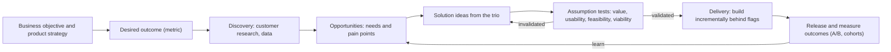

## TL;DR

- Product management is responsible for **what to build and why**: discovering valuable, usable, feasible and viable solutions and making sure they achieve business outcomes. Engineering owns **how** — but the best teams decide together.
- Separate **discovery** (figuring out what's worth building, cheaply) from **delivery** (building it well). Most product failures come from building the wrong thing, not building it badly.
- Address the **four risks** early: value, usability, feasibility, business viability (Marty Cagan). Engineers are essential for feasibility and often generate the best solutions.
- Measure **outcomes**, not output: a north-star metric, input metrics that drive it, and experiments (A/B tests) where you can.
- Senior engineers and architects add the most value by joining discovery, shaping options and trade-offs, and treating platforms and internal tools **as products** with customers and outcomes.

## Core Concepts

### Roles in the product trio

| Role | Owns | Contributes |
|---|---|---|
| Product manager | Value and viability: problem selection, outcomes, prioritisation, stakeholders | Customer insight, business context, market |
| Designer | Usability and experience | Research, prototypes, interaction design |
| Tech lead / engineers | Feasibility, quality, architecture | Technical options, cost/effort, enabling ideas only engineers see |

Strong product teams ("empowered teams") are given **problems to solve and outcomes to achieve**, not feature lists. The trio does discovery together.

### Discovery vs delivery

- **Discovery:** understand customers and problems; generate solution ideas; test the riskiest assumptions cheaply (interviews, prototypes, fake doors, concierge tests, data analysis, technical spikes). Output: validated learning and confidence.
- **Delivery:** build production-quality, scalable, secure solutions; release incrementally; measure outcomes.

Continuous discovery (Teresa Torres): weekly customer touchpoints by the team building the product, with the **opportunity solution tree** linking the desired outcome → customer opportunities (needs, pain points) → solutions → assumption tests.

### The four risks (Cagan)

1. **Value:** will customers buy or use it?
2. **Usability:** can users figure out how to use it?
3. **Feasibility:** can we build it with our time, skills, technology and data?
4. **Business viability:** does it work for the business — legal, financial, sales, support, brand?

Test the biggest risks first, before heavy engineering investment.

### MVP and iterative delivery

An **MVP** is the smallest thing that tests a hypothesis with real users — about learning, not a cut-down v1 of everything. Variants: prototypes (not production), "Wizard of Oz" (manual behind a real interface), concierge (manual service), single-feature products. Then iterate: release, measure, learn.

### Product metrics

- **North star metric:** a single metric capturing the value customers get, predictive of long-term success (e.g. weekly active teams collaborating on documents; nights booked).
- **Input metrics** teams can move (activation rate, time to first value, feature adoption).
- **AARRR "pirate metrics":** acquisition, activation, retention, referral, revenue.
- **Guardrail metrics** that must not degrade (latency, error rates, support tickets, churn).
- **Retention cohorts** — the ultimate test of value.

### Experimentation

A/B tests compare variants with randomised assignment: define a hypothesis and primary metric up front, compute sample size for the minimum detectable effect, run for full weekly cycles, avoid peeking (or use sequential methods), check guardrails, and watch for novelty effects and sample ratio mismatch. Engineering supplies the platform: feature flags, assignment, exposure logging and analysis pipelines.

### Jobs to be done

Customers "hire" products to make progress in a situation: "When I'm onboarding a new engineer, I want them productive in their first week, so the team doesn't slow down." JTBD framing focuses on the underlying progress, not demographics or feature requests, and helps find non-obvious competitors and solutions.

## How It Works

## When to Use / Trade-offs

| Approach | Use when | Avoid when | Trade-off |
|---|---|---|---|
| Heavy discovery before building | High uncertainty, expensive to build, new market | Well-understood problems, cheap reversible changes | Lower risk of waste vs slower start |
| Ship and learn (small bets) | Cheap to build and reverse, strong analytics | Irreversible or high-risk features (payments, compliance) | Speed vs risk of shipping the wrong thing |
| A/B testing | High traffic, measurable short-term metrics | Low traffic, long-term effects, B2B with few customers | Causal evidence vs time and statistical complexity |
| Feature-team model (deliver roadmap) | Very clear requirements, contractual work | Product work with uncertainty | Predictability vs empowerment and better solutions |
| Empowered product teams | Most product development | Teams without product skills or data | Better outcomes vs requires trust and capability |

## Common Pitfalls & Anti-patterns

- **Feature factory** — measuring success by features shipped, not outcomes achieved.
- **Roadmap as a promise list** — committing to solutions months ahead, ignoring learning.
- **Engineers as order-takers** — excluded from discovery, then asked for estimates on predetermined solutions.
- **Building the MVP as a mini-v1** — too big, testing nothing specific.
- **Vanity metrics** — sign-ups and page views without activation or retention.
- **HiPPO decisions** — the highest-paid person's opinion overrides evidence.
- **A/B test misuse** — peeking, underpowered tests, too many metrics, ignoring guardrails.
- **Never sunsetting** — features accumulate, increasing complexity and maintenance.
- **Ignoring non-functional "products"** — internal platforms without users' feedback or adoption metrics.

## Real-world Scenario

**Context:** A B2B SaaS team was asked by sales to build "advanced reporting" — a 12-week effort with 30 requested chart types — to stop churn among mid-size customers.

**Decision:** The product trio ran two weeks of discovery: interviewed 12 churned and at-risk customers and analysed usage data. They found customers didn't need more charts; they needed to answer one question for their monthly board meeting — "Are we getting ROI from this tool?" — and were exporting to spreadsheets to compute it. The team prototyped a single "ROI summary" page with an export to slides, tested it with five customers (strong positive response), and the tech lead found that the needed data already existed in an analytics pipeline — making the feature feasible in three weeks.

**Outcome:** The ROI summary shipped in four weeks; within two quarters, churn among mid-size customers dropped noticeably and the page became one of the most used features. The 30-chart project was never needed.

**What I'd do differently:** Involve sales in the customer interviews — they initially felt bypassed, and hearing customers directly would have aligned them faster.

## Interview Questions

### What does a product manager do, and how does the role relate to engineering? {#pm-role}

**Level:** Foundation

**Model answer:**
A product manager is accountable for **what** the team builds and **why**: understanding customers and the market, choosing which problems to solve, defining outcomes and success metrics, prioritising, and aligning stakeholders (sales, marketing, support, leadership). They own **value and business viability**.

Engineering owns **how** — architecture, quality, feasibility, delivery — and the tech lead is a partner in discovery, not just a recipient of requirements. With design, they form the product trio: PM brings customer and business context, design brings usability and experience, engineering brings feasibility and technical opportunities. Good teams make product decisions together and are accountable for outcomes, not output.

**What the interviewer is looking for:**
Clear ownership (value/viability), partnership with engineering and design, outcome focus.

**Follow-ups:**
- What's the difference between a PM and a project manager?
- How do you handle disagreement between PM and tech lead?

**Red flags:**
- "PMs write tickets; engineers build them."
- Engineers with no interest in the why.

### What's the difference between discovery and delivery? {#discovery-vs-delivery}

**Level:** Foundation

**Model answer:**
- **Discovery** answers "what should we build?" — understanding customer problems, generating ideas and testing assumptions quickly and cheaply (interviews, prototypes, data analysis, fake doors, spikes). Its output is validated learning, not production code. Many ideas should be killed here.
- **Delivery** answers "how do we build it well?" — production-quality software that is reliable, secure and scalable, released incrementally and measured.

They run in parallel and continuously: the same team discovers upcoming work while delivering validated work. Skipping discovery leads to building things nobody uses; skipping delivery quality leads to fragile products.

**What the interviewer is looking for:**
Clear distinction, parallel/continuous nature, and the cost of skipping discovery.

**Follow-ups:**
- How much time should a team spend on discovery?
- What's an example of a cheap discovery technique?

**Red flags:**
- Treating discovery as a separate phase done by someone else months in advance.

### What is an MVP, really? {#mvp}

**Level:** Foundation

**Model answer:**
An MVP (minimum viable product) is the **smallest experiment that tests a key hypothesis with real users** — learning is the goal. It's not "version 1 with fewer features" or a low-quality release.

Examples:
- A landing page with a "join waitlist" button to test demand (fake door).
- A concierge or "Wizard of Oz" service where humans do manually what software would later automate.
- A single core workflow, built properly, for one customer segment.

Good MVPs start from a clear hypothesis ("Small agencies will pay £30/month to automate client reports"), define what result validates or invalidates it, and are as small as possible while being credible to users. Quality matters where users experience it — a buggy MVP tests your bugs, not your idea.

**What the interviewer is looking for:**
Hypothesis-driven definition, examples, and avoiding the mini-v1 trap.

**Follow-ups:**
- When is an MVP inappropriate (e.g. regulated products)?
- What happens after the MVP succeeds?

**Red flags:**
- "MVP = phase 1 of the full scope."
- Using MVP as an excuse for poor engineering in production.

### What product metrics matter, and what is a north star metric? {#product-metrics}

**Level:** Foundation

**Model answer:**
- **North star metric:** one metric that best captures the value customers get and predicts long-term business success — e.g. "weekly active collaborating teams" for a collaboration tool, "nights booked" for a travel marketplace. It aligns teams on value rather than vanity numbers.
- **Input metrics:** drivers teams can influence — activation rate, time to first value, feature adoption, frequency of use.
- **Lifecycle (AARRR):** acquisition, activation, retention, referral, revenue — useful for finding where the funnel leaks.
- **Retention cohorts:** whether users keep getting value — the strongest signal of product-market fit.
- **Guardrails:** metrics that must not get worse (latency, errors, support tickets, unsubscribes).

Avoid vanity metrics (total sign-ups, page views) that rise without real value.

**What the interviewer is looking for:**
North star concept, input vs output metrics, retention emphasis and guardrails.

**Follow-ups:**
- What would the north star be for an internal developer platform?
- How do engineering metrics relate to product metrics?

**Red flags:**
- Only counting features shipped or users registered.

### What are the four product risks, and how do you address each? {#four-product-risks}

**Level:** Senior

**Model answer:**
Marty Cagan's four risks:
1. **Value risk** — will customers choose to use or buy it? Address with customer interviews, demand tests (fake doors, pre-sales), prototypes tested with real users, data analysis.
2. **Usability risk** — can users figure it out? Address with usability testing on prototypes, design iterations.
3. **Feasibility risk** — can we build it with our time, skills, technology and data? Address with technical spikes, architecture review, proof-of-concepts, checking data availability and performance.
4. **Business viability risk** — does it work for the business: legal, compliance, finance, sales channel, support, brand? Address by involving stakeholders early (legal, finance, sales) and modelling costs.

The trio tackles the biggest risk first, cheaply, before committing to delivery. Engineers are central to feasibility — and often spot enabling options (existing data, a platform capability) that change the solution.

**What the interviewer is looking for:**
All four risks with concrete mitigation techniques and engineering's role.

**Follow-ups:**
- Give an example where feasibility risk changed the solution.
- Which risk is most often ignored?

**Red flags:**
- Only addressing feasibility (engineering-centric view).

### How do you run a trustworthy A/B test? {#ab-testing}

**Level:** Senior

**Model answer:**
- **Hypothesis and primary metric** defined before starting, plus guardrail metrics (errors, latency, revenue, unsubscribes).
- **Power analysis:** determine sample size from baseline rate and minimum detectable effect; run for at least full weekly cycles to account for day-of-week patterns.
- **Randomisation** at the right unit (user, account) with consistent assignment; avoid contamination between groups (e.g. team members seeing different variants in B2B).
- **Don't peek** and stop early on apparent significance — or use sequential testing methods designed for it.
- **Check data quality:** sample ratio mismatch (unexpected split ratios indicate bugs), exposure logging correctness.
- **Interpret carefully:** statistical vs practical significance, novelty effects, segment effects (but beware fishing across many segments), and multiple-comparison corrections.
- **Engineering support:** feature flags with experimentation, reliable event pipelines, an analysis platform, documentation of results for organisational learning.
- **Know limits:** low traffic, long-term effects (retention), or network effects may need other methods (quasi-experiments, holdouts, qualitative research).

**What the interviewer is looking for:**
Pre-registration, power, randomisation, peeking, SRM checks, guardrails and limits of A/B tests.

**Follow-ups:**
- What's sample ratio mismatch and why does it matter?
- How would you test a pricing change in B2B with 200 customers?

**Red flags:**
- Stopping as soon as p < 0.05.
- Testing 20 metrics and reporting the one that moved.

### What is Jobs to be Done, and how does it change product decisions? {#jobs-to-be-done}

**Level:** Senior

**Model answer:**
Jobs to be Done (JTBD) frames demand around the **progress a customer wants to make in a particular situation**: "When [situation], I want to [motivation], so I can [expected outcome]." Customers "hire" a product (or a workaround) to get the job done and "fire" it when something better appears.

How it changes decisions:
- **Focus on the underlying need** rather than requested features — the "ROI for my board meeting" job might be better served by one summary page than 30 charts.
- **Reveals real competitors:** spreadsheets, email, an intern, doing nothing.
- **Segments by situation and motivation**, not demographics.
- **Guides messaging and onboarding** around the job.
- **Identifies switching forces:** push of the current situation, pull of the new solution, anxieties about switching, habits of the present — useful for adoption and migration design.

Research method: interviews about recent purchase or switching decisions ("walk me through when you decided to look for a tool").

**What the interviewer is looking for:**
Understanding of jobs and situations, practical implications, and research approach.

**Follow-ups:**
- How would you apply JTBD to an internal developer platform?
- How does JTBD relate to user stories?

**Red flags:**
- Treating JTBD as just another name for user stories.

### What role should engineers play in product discovery? {#engineers-in-discovery}

**Level:** Senior

**Model answer:**
- **Join customer conversations** regularly — hearing problems first-hand improves solutions and motivation.
- **Assess feasibility early:** spikes, data availability checks, performance and security implications, cost estimates — before the team commits.
- **Generate solutions:** engineers often know what's newly possible (existing data, a platform capability, new technology like LLMs) and can propose simpler options.
- **Build prototypes** to test value and usability quickly (throwaway, clearly separated from production).
- **Instrument for learning:** analytics, feature flags, experiment infrastructure.
- **Shape scope:** identify the thinnest slice that tests the hypothesis and the technical risks to retire first.

Time investment is modest — the tech lead most deeply, other engineers in rotation — and pays off by avoiding building the wrong things.

**What the interviewer is looking for:**
Active engineering participation: customer exposure, feasibility, ideation, prototypes, instrumentation and scoping.

**Follow-ups:**
- How do you balance discovery time with delivery commitments?
- What's the risk of prototypes becoming production code?

**Red flags:**
- "Engineers should focus on coding; product figures out what to build."

### How should a PM, designer and tech lead collaborate effectively? {#product-trio}

**Level:** Senior

**Model answer:**
- **Shared outcomes:** the trio is jointly accountable for the team's outcome metrics, not separate deliverables.
- **Do discovery together:** joint customer interviews, synthesis sessions, opportunity mapping and solution ideation — so trade-offs between value, usability and feasibility are discussed early.
- **Clear decision rights with mutual influence:** PM decides on problem priority and scope (value/viability), design on experience, tech lead on technical approach — but each challenges the others constructively.
- **Regular cadence:** weekly trio sync on discovery and upcoming work; shared artefacts (opportunity tree, roadmap, design docs, ADRs).
- **Transparent trade-offs:** e.g. tech lead explains the cost of a design choice; PM explains the business impact of delay; together they pick the option.
- **Shared customer exposure:** all three hear customers directly.
- **Healthy conflict:** disagreements resolved with evidence and experiments, escalated rarely.

**What the interviewer is looking for:**
Joint accountability, collaborative discovery, clear but permeable decision rights, cadence and evidence-based conflict resolution.

**Follow-ups:**
- What do you do when the PM wants a feature you think is technically harmful?
- How does the trio work with a missing designer?

**Red flags:**
- Hand-offs from PM to design to engineering.

### How do you decide when to sunset a feature? {#sunsetting-features}

**Level:** Senior

**Model answer:**
- **Evidence of low value:** usage data (few users, declining), low retention impact, little revenue attributable, poor fit with strategy.
- **Cost of keeping it:** maintenance effort, incidents, complexity slowing other work, infrastructure and support cost, security exposure (old dependencies).
- **Who depends on it:** identify users and customers (especially high-value or contractual), integrations and internal dependencies.

Process:
1. Make the case with data (cost vs value), and agree with product, sales, support and legal.
2. Offer alternatives or migration paths for affected users.
3. Communicate early and clearly with a timeline (announcement, deprecation warnings in-product, end date), and handle contractual obligations.
4. Measure impact (support tickets, churn) and remove the code fully — not just the UI — to realise the simplification benefits.

**What the interviewer is looking for:**
Data-driven cost/value analysis, stakeholder impact, migration paths, communication and full removal.

**Follow-ups:**
- A large customer depends on the feature. What do you do?
- How do you make deleting features culturally acceptable?

**Red flags:**
- Never removing anything.
- Removing features without telling users.

### How do you define a product strategy and connect it to the roadmap? {#product-strategy}

**Level:** Architect

**Model answer:**
- **Vision:** the long-term future you're creating for customers (3–5+ years).
- **Strategy:** the choices about **where to play and how to win** — target customers and segments, the key problems you'll solve, differentiation, business model, and what you won't do. Grounded in insights: customer research, market and competitor analysis, technology trends, and your own data and capabilities.
- **Objectives:** the outcomes for the next period (often OKRs) derived from the strategy — e.g. "increase activation of mid-size teams from 30% to 45%".
- **Roadmap:** the sequence of problems/opportunities to tackle (Now / Next / Later), held loosely at the solution level and updated as you learn.

Connecting to engineering: technical strategy should enable the product strategy (e.g. multi-tenancy and SSO for an enterprise move; internationalisation for new markets). Review quarterly with product, engineering and business leaders; communicate the "why" so teams can make aligned decisions.

**What the interviewer is looking for:**
Clear layers from vision to roadmap, insight-driven choices, outcomes, and linkage to technical strategy.

**Follow-ups:**
- How would you evaluate whether a product strategy is good?
- How does a platform team's strategy differ?

**Red flags:**
- Strategy as a list of features.
- No explicit choices or trade-offs.

### What does it mean to run a platform "as a product"? {#platform-as-product}

**Level:** Architect

**Model answer:**
Treating an internal platform (developer platform, data platform, design system, shared APIs) as a product means:
- **Customers:** internal teams are users with needs; talk to them regularly, map their journeys (e.g. "from idea to production"), and measure their experience.
- **Product management:** a platform PM or tech lead owning vision, roadmap and prioritisation based on user value — not just requests or the platform team's interests.
- **Outcomes and metrics:** adoption (voluntary where possible), time to first deploy, lead time for teams, reliability of the platform (SLOs), developer satisfaction (surveys/NPS), reduction in duplicated effort.
- **Good UX:** self-service, documentation, golden paths, clear APIs, sensible defaults, migration support — "make the right thing the easy thing".
- **Lifecycle management:** versioning, deprecation policies, support model, communication of changes.
- **Optional vs mandatory:** prefer earning adoption through value; mandate only for security/compliance essentials.

This avoids platforms built in isolation that teams work around.

**What the interviewer is looking for:**
Customer focus, product ownership, outcome metrics, UX, lifecycle and earned adoption.

**Follow-ups:**
- How do you prioritise between 15 teams' requests?
- Adoption is low. What do you investigate?

**Red flags:**
- Platform roadmap driven solely by the platform team's technical interests.
- Forcing adoption without understanding user needs.

### How do you decide whether to build, buy or partner for a product capability? {#product-build-vs-buy}

**Level:** Architect

**Model answer:**
- **Strategic differentiation:** if the capability is core to how you win (key to customer value and hard to replicate), build. If it's table stakes or generic (payments processing, identity, email, analytics infrastructure), buy or use a platform.
- **Time to market:** buying or partnering is usually faster; building may be justified when no option meets needs.
- **Total cost over 3–5 years:** licences/usage pricing at your scale vs engineering, maintenance, operations and opportunity cost.
- **Fit and control:** how much customisation you need, roadmap control, data ownership, compliance, integration complexity.
- **Partnership options:** embedded or white-label solutions, revenue-sharing partnerships — useful for adjacent capabilities that customers expect but you don't want to own.
- **Risk:** vendor viability and lock-in (exit strategy, data portability), security posture.
- **Reversibility:** start by buying/partnering to learn, and build later if the capability proves strategic.

Document the decision (ADR) with revisit triggers (scale thresholds, strategy changes).

**What the interviewer is looking for:**
Differentiation-first reasoning, TCO, fit/control, partnership as an option, risk and reversibility.

**Follow-ups:**
- When might you replace a bought component with your own?
- How do you evaluate a vendor's long-term viability?

**Red flags:**
- Building everything in-house by default.
- Buying without exit planning.

### How does a product-led growth strategy affect architecture and engineering? {#product-led-growth}

**Level:** Architect

**Model answer:**
Product-led growth (PLG) relies on the product itself to acquire, activate and expand customers (self-serve sign-up, free tiers or trials, in-product upgrades), rather than primarily on sales. Engineering implications:
- **Frictionless onboarding:** fast sign-up, SSO/social login, instant provisioning (multi-tenant architecture where a new tenant costs near zero), templates and sample data for quick time-to-value.
- **Instrumentation:** detailed product analytics and event tracking (activation milestones, feature usage), experimentation platform, data pipelines feeding growth and sales teams (product-qualified leads).
- **Entitlements and billing:** flexible plans, usage-based pricing, metering, trials, upgrades/downgrades in product — a robust entitlement service separated from features (feature flags by plan).
- **Scalability and cost efficiency:** many free users → efficient multi-tenancy, quotas and abuse prevention, careful unit cost management.
- **Self-serve everything:** in-product guidance, documentation, admin features, data export.
- **Security and trust at scale:** abuse, fraud and spam controls for open sign-up.

**What the interviewer is looking for:**
Concrete architectural consequences: tenancy, instrumentation, entitlements/billing, cost efficiency, abuse prevention.

**Follow-ups:**
- How would you design an entitlements service?
- How do you prevent free-tier abuse?

**Red flags:**
- Treating PLG as a marketing-only concern.

### How do you align the technical roadmap with the product roadmap? {#tech-product-roadmap}

**Level:** Architect

**Model answer:**
- **One roadmap, not two:** technical initiatives appear alongside product initiatives, framed by the outcomes they enable or protect (e.g. "multi-region support → enables enterprise deals in EU", "payments refactor → halves time to add new payment methods").
- **Joint planning:** product and engineering leaders plan together each quarter; architects review upcoming product bets early to identify enabling work and risks.
- **Capacity allocation:** an agreed share for platform/technical health (e.g. 15–25%), adjusted with evidence (incident trends, delivery speed).
- **Make the cost of not doing it visible:** quantify how technical constraints slow product delivery or create risk.
- **Sequence for leverage:** do enabling technical work just before the product work that needs it (just-in-time architecture), and deliver it incrementally alongside features where possible.
- **Shared metrics:** product outcomes plus engineering health metrics (DORA, SLOs) reviewed together.

**What the interviewer is looking for:**
Integrated roadmap, outcome framing for technical work, joint planning, capacity allocation and just-in-time sequencing.

**Follow-ups:**
- The product team keeps deprioritising a critical upgrade. What do you do?
- How do you present technical work to non-technical leaders?

**Red flags:**
- A separate "tech roadmap" competing for time with no business framing.

## Cheat Sheet

- **PM owns what and why** — value and viability; engineering owns how; the trio decides together.
- **Discovery vs delivery** — learn what's worth building cheaply, then build it well.
- **Four risks** — value, usability, feasibility, business viability (Cagan).
- **MVP** — the smallest experiment that tests a key hypothesis with real users.
- **Continuous discovery** — weekly customer touchpoints; opportunity solution tree.
- **North star metric** — one metric capturing customer value and long-term success.
- **Input vs output metrics** — drivers teams can move vs results they can't directly control.
- **AARRR** — acquisition, activation, retention, referral, revenue.
- **Guardrail metrics** — must not degrade while optimising the primary metric.
- **A/B testing hygiene** — pre-registered metric, power analysis, no peeking, SRM checks.
- **Jobs to be Done** — progress customers want in a situation; reveals real competitors.
- **Feature factory** — measuring output instead of outcomes.
- **Platform as a product** — internal customers, PM ownership, adoption and experience metrics.
- **PLG architecture** — instant tenant provisioning, entitlements, metering, analytics, abuse controls.

## Further Reading

- [Silicon Valley Product Group (Marty Cagan)](https://www.svpg.com/articles/) — essays on empowered teams, discovery and the four risks.
- [Product Talk (Teresa Torres)](https://www.producttalk.org/) — continuous discovery and the opportunity solution tree.
- [Shape Up (Basecamp)](https://basecamp.com/shapeup) — shaping, appetites and betting on work.
- [Trustworthy Online Controlled Experiments (Kohavi, Tang, Xu)](https://experimentguide.com/) — the reference on running A/B tests correctly.
- [Christensen Institute: Jobs to Be Done](https://www.christenseninstitute.org/theory/jobs-to-be-done/) — VERIFY: link path; the theory from its originators.
