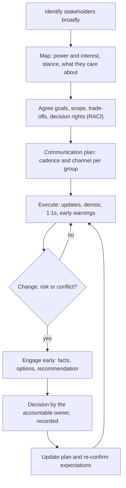

## TL;DR

- Stakeholders are **anyone affected by, or able to affect, your work**. Map them by influence and interest, and engage each group differently.
- **Most stakeholder problems are expectation problems.** Agree goals, scope, trade-offs and how you'll communicate *at the start*, and re-confirm them when things change.
- **No surprises:** deliver bad news early, in person, with options and a recommendation.
- Speak each stakeholder's language: outcomes, risk, cost and time for executives; impact and timelines for business partners; detail for engineers.
- Clear **decision rights** (who decides, who is consulted) prevent most conflicts. RACI or a DACI-style model helps.

## Core Concepts

### Identifying and mapping stakeholders

Brainstorm broadly. Teams usually miss people, not the obvious sponsor:
- **Sponsor and decision-makers:** who funds it and who signs off?
- **Users and customers** and their proxies (support, sales, customer success).
- **Delivery partners:** other engineering teams, platform, security, data, legal, compliance, finance, procurement, vendors.
- **The affected:** operations, on-call teams, teams whose systems you depend on or change.
- **Influencers:** respected senior engineers, people whose opinion others follow.

**Power/interest grid (Mendelow):**

| | Low interest | High interest |
|---|---|---|
| **High power** | Keep satisfied (concise updates, consult on key decisions) | Manage closely (regular 1:1s, involve in decisions) |
| **Low power** | Monitor (broadcast updates) | Keep informed (demos, newsletters, feedback channels) |

Also note each stakeholder's **current stance** (champion, supporter, neutral, sceptic, blocker) and **what they care about**: their goals, fears and success metrics. Then plan the move: "Head of Support, neutral to supporter: show the reduced ticket volume from the pilot."

### Decision rights: RACI and DACI

**RACI** assigns, per decision or deliverable:
- **R**esponsible: does the work.
- **A**ccountable: the single owner who signs off.
- **C**onsulted: two-way input before the decision.
- **I**nformed: told after.

**DACI** (Driver, Approver, Contributors, Informed) is a variant for decisions. Rules: one Accountable or Approver per decision, Consulted kept small, and decision rights agreed before the contentious moment, not during it.

### Expectations and communication plan

At kick-off, agree:
- **Goals and success measures:** what outcome, measured how.
- **Scope and non-goals,** plus the **trade-off preference**: if we must flex, do we flex scope, date or quality? (Quality shouldn't really flex.)
- **Constraints and assumptions,** with dependencies listed.
- **Communication cadence:** weekly written update, monthly steering meeting, the channel for urgent issues, and how decisions get escalated.

### Status updates that work

A good update can be read in two minutes:

```markdown
**Checkout redesign — week 14 — Status: AMBER (was GREEN)**
**Summary:** Payment-provider certification slipped 2 weeks (their test env outage). Launch at risk for 3 March.
**Decisions needed:** By Fri: accept 17 March launch (recommended) OR launch 3 March without Apple Pay.
**Progress:** Address validation done; load test passed at 3× peak.
**Risks:** Provider capacity for re-certification (owner: Priya, mitigation: escalated to account manager).
**Next:** Complete certification run; start staged rollout plan.
```

Honest RAG status (red, amber, green), with trends and decisions needed at the top, beats long activity lists. "Watermelon reporting" (green outside, red inside) destroys trust.

## How It Works



## When to Use / Trade-offs

| Technique | Use when | Avoid when | Trade-off |
|---|---|---|---|
| Power/interest grid | Any project with more than a handful of stakeholders | Tiny, single-team work | Quick insight; can oversimplify individuals |
| RACI / DACI | Cross-team decisions; recurring confusion about who decides | Small teams with obvious ownership | Clarity vs bureaucracy if over-applied |
| Steering committee | Large programmes with significant funding or risk | Small projects; it becomes theatre | Senior alignment vs meeting overhead |
| Written weekly update | Many stakeholders, async orgs | Stakeholders who need dialogue on decisions | Scales well; one-way |
| 1:1 pre-wiring | Contentious decisions, influential sceptics | Routine updates | Builds trust; time-consuming |
| Demos | Showing progress, getting early feedback | Nothing real to show yet | Concrete and engaging; can set false expectations if mocked-up |

## Common Pitfalls & Anti-patterns

- **Watermelon status** — green on the dashboard, red in reality, until it's too late.
- **Surprising stakeholders** — the first they hear of a delay is in a public meeting or on launch day.
- **Talking tech to executives** — "the Kafka consumer rebalance issue" instead of "orders may be delayed by up to 2 hours on peak days."
- **Forgetting quiet stakeholders** — security, legal, support or the on-call team discovered at the end, with veto power.
- **Saying yes to everyone** — scope creep, then broken commitments.
- **Unclear decision rights** — two VPs both believe they approve the scope.
- **Communicating only through tickets** — no relationships, so no goodwill when things go wrong.
- **Hiding behind process** — "it's not in the backlog" without understanding the need.

## Real-world Scenario

**Context:** A platform team was replacing the company's identity system, affecting 40 internal applications and every customer login. Six months in, the programme was "green" in reports, but three application teams hadn't started integration, security was unhappy about a token design detail, and customer support didn't know login screens would change.

**Decision:** The new technical lead:
1. Ran a stakeholder mapping session and found 14 groups. Five, including support, the mobile release managers and the fraud team, had never been engaged.
2. Agreed a RACI: the CISO accountable for the security design, the platform lead for the delivery plan, application teams responsible for their integrations.
3. Reset the status to amber with a clear recovery plan and the decisions needed.
4. Set up a fortnightly written update, a monthly steering group with business owners, office hours for app teams and a support briefing pack with screenshots and FAQs.

**Outcome:** The launch moved by 5 weeks, but with no surprises. All 40 applications migrated, support handled the change with ticket volume only 8% above normal, and security signed off without late changes.

**What I'd do differently:** Map stakeholders on day one, not in month six. The fraud team's requirements alone would have changed the session design early, at a fraction of the cost.

## Interview Questions

### How do you identify and map stakeholders for a new project? {#stakeholder-mapping}

**Level:** Foundation

**Model answer:**
Start broad. Brainstorm everyone who is affected by, or can affect, the project: sponsors and decision-makers, users and customers, delivery partners (other teams, platform, security, legal, finance, vendors), operations and support, and influential individuals. Ask existing stakeholders "Who else should I talk to?"

Then map them:
- **Power/interest grid:** manage high-power, high-interest people closely. Keep high-power, low-interest people satisfied. Keep low-power, high-interest people informed. Monitor the rest.
- **Stance:** champion, supporter, neutral, sceptic or blocker, and *why*.
- **What they care about:** their goals, metrics and fears.

Use the map to plan engagement for each group (cadence, format, who owns the relationship) and revisit it as the project evolves. People's power, interest and stance change.

**What the interviewer is looking for:**
Breadth of identification, a mapping technique, attention to motivations and stance, and using the map to drive engagement.

**Follow-ups:**
- Which stakeholders are most often forgotten?
- How do you engage a high-power stakeholder who doesn't care about your project?

**Red flags:**
- Considering only the sponsor and the immediate team.
- A map made once and never used.

### What is RACI, and when is it useful? {#raci}

**Level:** Foundation

**Model answer:**
RACI is a responsibility matrix that sets, for each key decision or deliverable, who is:
- **Responsible:** does the work. There can be several.
- **Accountable:** owns the outcome and makes the final call. Exactly **one** per item.
- **Consulted:** gives input before the decision (two-way communication).
- **Informed:** kept up to date after decisions (one-way).

It's useful when work crosses teams or departments and there's confusion or conflict about who decides: security sign-off, scope changes, go-live approval, budget. DACI (Driver, Approver, Contributors, Informed) is a similar decision-focused variant.

Keep it lightweight: cover the decisions that matter, agree it at kick-off and keep "Consulted" small, or decisions slow down.

**What the interviewer is looking for:**
Correct definitions, the single-Accountable rule and pragmatic use.

**Follow-ups:**
- What goes wrong when two people are Accountable?
- How is DACI different?

**Red flags:**
- Several Accountable people for one decision.
- A RACI for every trivial task.

### What does a good status update look like? {#status-updates}

**Level:** Foundation

**Model answer:**
- **Headline first:** overall status (red, amber or green), with the trend ("amber, was green") and a one-line summary.
- **Decisions or help needed,** with deadlines and a recommendation. This is the most important section for senior readers.
- **Progress against milestones,** not a list of activity.
- **Risks and issues,** each with an owner and a mitigation.
- **Next steps.**
- **Brief:** readable in two minutes, with links to the detail.

Principles:
- **Honest status:** amber when the risk is real, not when it's certain. Explain what would turn it green.
- **Consistent format and cadence,** so people know where to look.
- **Tailored:** a short version for executives, more detail for delivery partners.
- **No surprises:** anything serious is discussed in person *before* it appears in a written update.

**What the interviewer is looking for:**
Decision-oriented structure, honest RAG status with trends, brevity and audience awareness.

**Follow-ups:**
- When do you turn a project red?
- How do you report on a project with lots of uncertainty?

**Red flags:**
- Pages of activity with no decisions or risks.
- Status that stays green until the deadline is missed.

### How do you set expectations at the start of a project? {#setting-expectations}

**Level:** Foundation

**Model answer:**
In a kick-off and a short written charter, agree:
- **The problem and goals,** with success measures ("reduce checkout abandonment from 22% to 18%").
- **Scope and explicit non-goals.**
- **Constraints, assumptions and dependencies:** what we rely on from others, and the dates that depend on it.
- **The trade-off preference:** if something has to give, is it scope or date? Agree upfront that quality and security don't flex.
- **The estimate as a range with confidence** ("6–9 weeks; we'll narrow it after the first 2 weeks of discovery"), not a single date.
- **Decision rights and escalation path** (RACI).
- **The communication plan:** who gets what, how often and where.

Then re-confirm expectations whenever something material changes, rather than assuming the original agreement still holds.

**What the interviewer is looking for:**
Goals and measures, non-goals, range estimates, an explicit trade-off preference, decision rights and a communication plan.

**Follow-ups:**
- The sponsor insists on a fixed date and fixed scope. What do you do?
- How do you handle a stakeholder who skipped the kick-off?

**Red flags:**
- Committing to a single date before discovery.
- No written record of what was agreed.

### You discover your project will be six weeks late. How do you tell stakeholders? {#delivering-bad-news}

**Level:** Senior

**Model answer:**
1. **Tell them early.** As soon as the slip is likely, not certain. Bad news ages badly.
2. **Get the facts straight:** what happened, the new estimate with confidence, and the impact on dependants (marketing launch, customer commitments).
3. **Prepare options with trade-offs:**
   - Ship a reduced scope on the original date.
   - Move the date.
   - Add capacity, with its real effect (often small, per Brooks's law).
   - Phase the launch.

   Include a recommendation.
4. **Tell the key people individually first,** in person or on a call: the sponsor and those most affected. Then put it in writing for everyone else. Nobody should learn it from a dashboard.
5. **Own it** without blame or excessive apology, explain what we've learned and what we're changing so it doesn't recur (estimation, dependency management).
6. **Agree a decision and update the plan.** Communicate the new commitments and then hit them.

**What the interviewer is looking for:**
Timeliness, prepared options with a recommendation, private-before-public communication, ownership and a corrective plan.

**Follow-ups:**
- The sponsor reacts angrily. How do you handle the conversation?
- How do you avoid being late again?

**Red flags:**
- Waiting until the deadline.
- Blaming another team in front of stakeholders.

### Two stakeholders give you conflicting requirements. What do you do? {#conflicting-stakeholders}

**Level:** Senior

**Model answer:**
1. **Understand each need deeply.** Talk to each separately: what problem are they solving, why does it matter and what does success look like? Conflicts at the level of *solutions* often disappear at the level of *needs*. For example, Sales wants custom fields per customer and Compliance wants a strict schema. The underlying needs may both be met by a validated extension mechanism.
2. **Look for options that satisfy both,** or sequence them (one now, the other next).
3. **If there is a genuine trade-off, make it explicit:** describe it neutrally, with the impact of each option on the business goals, ideally in one document both agree is fair.
4. **Escalate to the right decision-maker:** the person accountable for both areas, or the product owner. Use a joint conversation, not separate lobbying.
5. **Record the decision and the reasoning,** and communicate it to both. Make sure the "losing" side understands why and what they can expect later.

**What the interviewer is looking for:**
Separating needs from solutions, creative options, neutral framing of trade-offs and clean escalation to the right decider.

**Follow-ups:**
- What if both stakeholders are equally senior and have no common manager below the CEO?
- How do you stay neutral when you have an opinion?

**Red flags:**
- Implementing both and creating an incoherent product.
- Choosing whoever is most senior or loudest without analysis.

### A stakeholder keeps changing the scope mid-project. How do you handle it? {#scope-changes}

**Level:** Senior

**Model answer:**
Change isn't bad in itself. Learning should change plans. **Unmanaged** change is the problem.

- **Understand why the changes happen:** new information, unclear original goals, pressure from their own stakeholders, or discovering what they want by seeing it? The fix depends on the cause.
- **Make the cost of change visible:** for each change, show its impact on the date, other scope and risk. "Adding multi-currency now moves launch by 3 weeks, or we drop bulk export. Which do you prefer?"
- **Have a lightweight change process:** changes go through the product owner, are assessed and are accepted with an explicit trade-off. Not every request becomes a commitment.
- **Shorten feedback loops:** frequent demos and prototypes surface changes earlier, when they're cheaper.
- **Revisit the goals:** if the changes keep coming, the original goals may have been wrong. Reset them openly rather than absorbing endless churn.

**What the interviewer is looking for:**
Curiosity about the cause, visible trade-offs, a light change mechanism and early feedback loops.

**Follow-ups:**
- The stakeholder is a senior executive who says "just make it happen". What now?
- How do you handle changes requested directly to engineers?

**Red flags:**
- Silently absorbing every change, then missing the deadline.
- Refusing all change on principle.

### How do you communicate a technical risk to non-technical stakeholders? {#technical-risk-communication}

**Level:** Senior

**Model answer:**
- **Translate it into business impact and likelihood:** not "the database is single-AZ", but "if one data centre fails, which happens a few times a year across the industry, customers can't place orders for 1–3 hours. At peak, that's about £80k in lost sales per hour."
- **Use concrete comparisons and recent events:** a competitor's outage, our own near miss.
- **Quantify what you can,** and be honest about uncertainty with ranges.
- **Offer options with cost, effort and residual risk:** fix fully, mitigate partially, or accept the risk.
- **Make a recommendation, and ask for a decision.** If they accept the risk, record who accepted it and when it will be reviewed.
- **Keep it short:** one page or five minutes, with technical detail available for those who want it.

**What the interviewer is looking for:**
Business framing, quantification, options and a decision, including documented risk acceptance.

**Follow-ups:**
- How do you avoid crying wolf?
- What do you do if they accept a risk you think is unacceptable?

**Red flags:**
- Jargon-heavy explanations.
- Raising risks without options.

### A senior stakeholder keeps going directly to engineers with requests, bypassing the process. What do you do? {#bypassing-process}

**Level:** Senior

**Model answer:**
1. **Understand why.** Is the official process too slow? Are their requests consistently deprioritised? Is it urgency, or habit? The bypass is often a symptom of a real problem.
2. **Talk to them directly and privately:** acknowledge their need, and explain the impact of the bypass. Engineers get interrupted, other commitments slip, and work is done without prioritisation, testing or visibility.
3. **Offer a better path:** a fast lane for genuinely urgent requests, a named contact (the product owner or me), regular slots to review their requests, and transparency on where their items sit.
4. **Support the engineers:** they should feel able to say "please raise this with our product owner" without fear. Back them up.
5. **If it continues, escalate respectfully,** to align with the stakeholder's manager or the product leadership on how requests are handled.

**What the interviewer is looking for:**
Diagnosing the root cause, a direct but respectful conversation, an improved process and protecting the team.

**Follow-ups:**
- The stakeholder is the CEO. Does your approach change?
- How do you handle it when the bypassed request was actually important?

**Red flags:**
- Blaming the engineers.
- Ignoring it and letting the team be pulled in many directions.

### How do you build trust with a sceptical stakeholder? {#skeptical-stakeholder}

**Level:** Senior

**Model answer:**
- **Understand the scepticism:** past experience (previous projects that failed them), different goals, fear of losing control, or a lack of information. Ask directly: "What would you need to see to be confident in this?"
- **Involve them early:** consult them on things that affect them, and incorporate their input visibly ("We changed the rollout plan based on your concern about month-end").
- **Deliver small, visible wins quickly:** reliability builds trust faster than presentations.
- **Be transparent:** share risks and bad news early. Sceptics trust people who don't hide problems.
- **Keep promises meticulously,** including small ones like sending the notes or answering the question by Friday.
- **Find common ground:** the shared goals you both care about.

Over time, a sceptic who has been listened to often becomes a strong advocate. Their concerns usually improve the plan.

**What the interviewer is looking for:**
Empathy and curiosity, involvement, early wins, transparency and reliability.

**Follow-ups:**
- What if their scepticism is based on a misunderstanding of the technology?
- How do you handle a sceptic who is actively undermining the project?

**Red flags:**
- Avoiding sceptics.
- Trying to win them over with more slides.

### How would you manage stakeholders for a migration affecting 30 teams and several business units? {#large-programme-stakeholders}

**Level:** Architect

**Model answer:**
**Structure:**
- **An executive sponsor** with authority across the affected units, who owns the "why now" and resolves priority conflicts.
- **A steering group** with business-unit representatives, meeting monthly, deciding on scope, sequencing and risk acceptance.
- **A working group** of team-level tech leads and champions, meeting weekly or fortnightly.
- **A RACI** for key decisions and for each team's migration.

**Mapping and segmentation:** classify the teams and business units by impact, readiness and stance. Plan engagement for each segment: early adopters as design partners, the majority with self-service support, laggards and blockers with individual plans and executive help.

**Communication:**
- A single source of truth (a programme page with the plan, FAQs, timelines and a migration tracker).
- A fortnightly written update.
- Dedicated channels and office hours.
- Business-friendly summaries for non-technical units: impact on their customers, timelines, what they need to do.

**Expectation management:** clear deadlines and why they exist, a published support model, transparent progress per team (a dashboard), and early warning when teams fall behind.

**Feedback:** surveys or retrospectives after each wave, and a visible "you said, we did" response.

**What the interviewer is looking for:**
Governance layers with clear roles, segmentation, a single source of truth, transparency and feedback loops.

**Follow-ups:**
- A business unit refuses to allocate time. What do you do?
- How do you keep the steering group from becoming a status theatre?

**Red flags:**
- One mass email and a deadline.
- No executive sponsor.

### How do you design an effective steering committee? {#steering-committee}

**Level:** Architect

**Model answer:**
- **A clear purpose and decision rights:** a steering committee exists to **make decisions** (scope trade-offs, funding, risk acceptance, resolving cross-unit conflicts) and remove blockers. It isn't for status updates, which go out in writing beforehand.
- **The right membership:** a small group (5–8) of people with real authority over the affected budgets and teams, plus the programme lead and chief architect. Delegates without decision power make it useless.
- **A cadence matched to the decision flow:** monthly, with ad hoc sessions for urgent decisions.
- **Prepared sessions:** a pre-read sent 48 hours ahead (status, key risks, the decisions needed with options and recommendations). The meeting time is spent on the decisions, and the decisions are recorded with owners and dates.
- **Honest information:** a culture where amber and red are welcome. Reward early bad news. A committee that punishes bad news gets watermelon reporting.
- **Review itself:** is it making decisions and unblocking work? If not, change it or disband it.

**What the interviewer is looking for:**
Decision focus, authority of members, pre-reads, recorded decisions and psychological safety for bad news.

**Follow-ups:**
- Members keep sending delegates. What do you do?
- How do you handle a decision the committee keeps deferring?

**Red flags:**
- A two-hour status slide-show.
- No recorded decisions.

### How do you manage stakeholders during a major production incident? {#incident-stakeholders}

**Level:** Architect

**Model answer:**
- **Separate the communication role from the technical response:** a communications lead (not the engineers debugging) handles stakeholders, while the incident commander coordinates. This protects the responders from interruptions.
- **Communicate early and on a cadence:** the first update within 15–30 minutes of declaring a SEV1, even if it only says "we're investigating", then at fixed intervals (for example every 30 minutes) even with no news, so stakeholders don't chase engineers.
- **Use templates:** what's affected (customer impact in business terms), what we know, what we're doing, the next update time. Avoid speculating on causes or promising ETAs you can't keep.
- **Segment the audiences:**
  - Executives: impact, business exposure, decisions needed.
  - Customer-facing teams (support, sales): what to tell customers, approved wording.
  - Customers: the status page and direct notifications for key accounts.
  - Regulators: when required, within the legal deadlines, via legal and compliance.
- **Close well:** a resolution notice, then a postmortem summary for stakeholders in business language, with the actions being taken. Brief key customers personally where appropriate.

**What the interviewer is looking for:**
Role separation, cadence and templates, audience segmentation, regulatory awareness and follow-through.

**Follow-ups:**
- An executive joins the incident bridge and starts directing engineers. What do you do?
- How do you communicate when you don't yet know the impact?

**Red flags:**
- Engineers fielding executive questions while debugging.
- Silence until it's fixed.

### How do you manage vendor and third-party stakeholders on a critical project? {#vendor-stakeholders}

**Level:** Architect

**Model answer:**
- **Know their incentives:** account managers optimise for renewals and upsells, their engineers for their own roadmap. Align your asks with their interests where possible (case studies, early-adopter feedback).
- **Make the contract match the reality:** SLAs, support tiers, escalation paths, data-processing terms and exit provisions agreed before you depend on them. Involve procurement and legal early.
- **Build relationships at several levels:** technical contacts for daily work, the account manager for commercial issues, and an executive sponsor on their side for escalation. Know the escalation path *before* an incident.
- **Make joint plans with shared milestones** and regular check-ins, and track the vendor's dependencies as risks with mitigations in your own plan.
- **Reduce dependency risk:** abstraction layers, fallback options, exit plans, and evaluating vendor health (financial, security posture).
- **Treat them as partners, but verify:** test their claims (load tests, failover tests) instead of trusting slides.

**What the interviewer is looking for:**
Understanding vendor incentives, contractual foundations, multi-level relationships, joint planning and risk mitigation with verification.

**Follow-ups:**
- The vendor misses a critical delivery date. What do you do?
- How do you handle a vendor whose product roadmap diverges from your needs?

**Red flags:**
- Relying on goodwill without contractual SLAs.
- Discovering the escalation path during an outage.

### Product, sales and engineering disagree strongly on a roadmap trade-off. How do you align them? {#cross-functional-alignment}

**Level:** Architect

**Model answer:**
1. **Bring everyone back to the shared goals:** company objectives, customer outcomes, revenue and retention targets. Agreement at that level makes the trade-off discussion concrete.
2. **Make each position explicit and steel-manned:**
   - *Sales:* "These 3 enterprise deals, worth £2.4M, need SSO and audit logs by Q2."
   - *Product:* "The activation redesign affects 100% of new users; we lose 30% at onboarding."
   - *Engineering:* "The payments platform upgrade is needed before PCI renewal in Q3; skipping it is a compliance risk."
3. **Quantify cost of delay and risk** for each option on a common scale (revenue at risk, users affected, compliance exposure) with confidence levels.
4. **Explore options:**
   - Sequence the work.
   - Reduce the scope of each (a minimal SSO for the top deal).
   - Add temporary capacity.
   - Buy instead of build (SSO through a managed identity provider).
5. **Decide with the right owner:** usually the product leader, or an executive above all three for the biggest trade-offs, in one joint session with the analysis prepared beforehand.
6. **Communicate the decision and its reasoning to all sides,** including what each group will get and when, and set review points.

**What the interviewer is looking for:**
Anchoring on shared goals, fair representation of each view, common-scale quantification, creative options and a clear decider.

**Follow-ups:**
- Sales escalates to the CEO after the decision. What now?
- How do you prevent this conflict recurring each quarter?

**Red flags:**
- Siding with whichever function you belong to.
- Splitting capacity evenly to avoid conflict.

## Cheat Sheet

- **Stakeholder** — anyone affected by, or able to affect, your work; identify them broadly and early.
- **Power/interest grid** — manage closely, keep satisfied, keep informed, monitor.
- **Stance mapping** — champion, supporter, neutral, sceptic or blocker; plan how to move each.
- **RACI** — Responsible, Accountable (exactly one), Consulted, Informed.
- **DACI** — Driver, Approver, Contributors, Informed; a decision-focused variant.
- **Kick-off agreement** — goals, measures, non-goals, trade-off preference, decision rights, comms plan.
- **No surprises** — deliver bad news early, privately first, with options and a recommendation.
- **Status update** — RAG status with trend, decisions needed, risks with owners; readable in 2 minutes.
- **Watermelon reporting** — green outside, red inside; destroys trust.
- **Needs vs solutions** — conflicting requests often share compatible underlying needs.
- **Visible cost of change** — every scope change shown with its impact on date, scope or risk.
- **Technical risk for executives** — impact, likelihood, cost and options, with an explicit decision or risk acceptance.
- **Steering committee** — exists to decide and unblock; pre-reads, recorded decisions, welcomes bad news.
- **Incident comms** — separate comms lead, fixed cadence, templates, segmented audiences.

## Further Reading

- [Atlassian Team Playbook: DACI decision-making framework](https://www.atlassian.com/team-playbook/plays/daci) — a practical template for decision roles.
- [Atlassian Team Playbook: Stakeholder communications](https://www.atlassian.com/team-playbook/plays/stakeholder-communications-plan) — planning communication by stakeholder group.
- [Project Management Institute: PMBOK Guide](https://www.pmi.org/standards/pmbok) — the standard reference for stakeholder engagement in projects.
- [Google SRE Book: Managing Incidents](https://sre.google/sre-book/managing-incidents/) — roles and communication during incidents.
- [GOV.UK Service Manual: Agile delivery governance](https://www.gov.uk/service-manual/agile-delivery/governance-principles-for-agile-service-delivery) — principles for proportionate, decision-focused governance.
