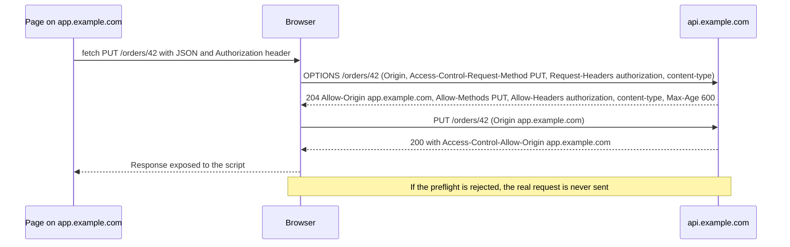
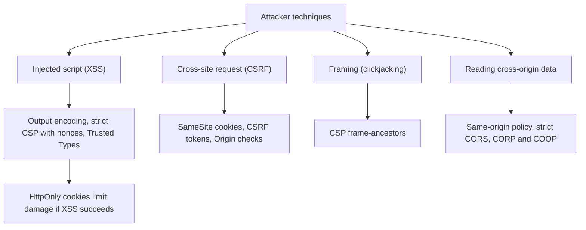

## TL;DR

- The **same-origin policy (SOP)** is the browser's foundation: scripts from one origin (scheme + host + port) can't read another origin's data. Almost every web security mechanism either relaxes it safely (**CORS**, `postMessage`) or reinforces it (**CSP**, cookie attributes, cross-origin isolation headers).
- **CORS is not a security control for your server.** It tells browsers when they may let a page *read* a cross-origin response. It doesn't stop requests being sent, and it doesn't protect against non-browser clients. Misconfigured CORS (reflecting any origin with credentials) hands attackers your users' data.
- **Content Security Policy** is the strongest defence-in-depth against XSS. Use a **strict, nonce- or hash-based policy** with `strict-dynamic`, not long allow-lists of hosts. Add **Trusted Types** to remove DOM XSS sinks.
- **Cookies** carry most session security: use `Secure`, `HttpOnly`, `SameSite=Lax` (or `Strict`) and the `__Host-` prefix. `SameSite` is a strong CSRF mitigation, but not complete on its own.
- Ship a **baseline of security headers** on every response: HSTS, CSP, `frame-ancestors` against clickjacking, `X-Content-Type-Options: nosniff`, `Referrer-Policy`, and `Cross-Origin-Opener-Policy` where possible.

## Core Concepts

### Origins and sites

- **Origin** = scheme + host + port. `https://app.example.com` and `https://api.example.com` are **different origins**. `http://` and `https://` versions are different origins too.
- **Site** = scheme + registrable domain (eTLD+1). `app.example.com` and `api.example.com` are the **same site**. `SameSite` cookies and some isolation features work at the site level, not the origin level.

The **same-origin policy** lets a page *send* many kinds of cross-origin requests (forms, images, scripts) but stops it *reading* the responses, unless the other origin opts in.

### CORS

CORS lets a server tell the browser which other origins may read its responses.

- **Simple requests** (GET, HEAD or POST with standard content types such as `application/x-www-form-urlencoded` and no custom headers) are sent directly. The browser checks `Access-Control-Allow-Origin` on the response before exposing it to the script.
- **Preflighted requests** (other methods, JSON content type, custom headers such as `Authorization`) first send an `OPTIONS` request. The server must approve the method, headers and origin before the real request goes out.
- **Credentials** (cookies, HTTP auth) need `credentials: 'include'` on the client, plus `Access-Control-Allow-Credentials: true` and an **exact** origin (not `*`) on the server.

```ts
// Express: an explicit allow-list, never a reflected Origin header.
import cors from 'cors';

const allowed = new Set(['https://app.example.com', 'https://admin.example.com']);

app.use('/api', cors({
  origin: (origin, cb) => cb(null, !origin || allowed.has(origin) ? origin ?? false : false),
  credentials: true,                       // only because the app uses cookie sessions
  methods: ['GET', 'POST', 'PUT', 'DELETE'],
  allowedHeaders: ['Content-Type', 'Authorization', 'X-CSRF-Token'],
  maxAge: 600,                             // cache preflight results for 10 minutes
}));
```

Remember: CORS only governs what the browser exposes to scripts. Authentication, authorisation and CSRF protection must still be enforced on the server.

### Content Security Policy

CSP tells the browser which scripts, styles, frames and connections a page may use. The most effective modern form is a **strict CSP** based on nonces or hashes rather than host allow-lists, which are easy to bypass through JSONP endpoints or script gadgets on allowed hosts.

```http
Content-Security-Policy:
  script-src 'nonce-r4nd0mPerResponse' 'strict-dynamic' https: 'unsafe-inline';
  object-src 'none';
  base-uri 'none';
  frame-ancestors 'self';
  require-trusted-types-for 'script';
  report-to csp-endpoint
```

- A **fresh random nonce per response** is added to each legitimate `<script nonce="…">` tag. Injected scripts don't know it, so they don't run.
- **`strict-dynamic`** lets trusted, nonced scripts load further scripts (bundler chunks, tag managers), while ignoring host allow-lists. `https:` and `'unsafe-inline'` are fallbacks for old browsers that ignore nonces; modern browsers ignore them when a nonce is present.
- **`object-src 'none'`** and **`base-uri 'none'`** close classic bypasses.
- **`frame-ancestors`** controls who may frame the page, replacing `X-Frame-Options`.
- **Roll out** with `Content-Security-Policy-Report-Only` first, collect reports, fix violations, then enforce.

**Trusted Types** (`require-trusted-types-for 'script'`) makes dangerous DOM sinks (`innerHTML`, `eval`-like APIs, `script.src`) reject plain strings. Code must pass values through a reviewed policy (for example DOMPurify), which turns DOM XSS prevention from code review into enforcement. It's supported in Chromium browsers, and has arrived more recently in others.

### Cookies

| Attribute | Effect | Recommendation |
|---|---|---|
| `Secure` | Only sent over HTTPS | Always |
| `HttpOnly` | Not readable from JavaScript | Always for session cookies |
| `SameSite=Lax` | Not sent on cross-site subrequests, sent on top-level navigations with safe methods | The default for sessions (and browsers' default when unset, in Chromium) |
| `SameSite=Strict` | Never sent cross-site, even on navigation | High-value apps where users rarely arrive from links |
| `SameSite=None; Secure` | Sent cross-site | Only for genuine third-party or embedded use |
| `__Host-` prefix | Requires `Secure`, `Path=/` and no `Domain`, so the cookie is locked to one host | Session cookies, to prevent subdomain overwriting |
| `Domain=` | Shares the cookie with subdomains | Avoid unless needed. A compromised subdomain can read or overwrite it |
| `Partitioned` (CHIPS) | Third-party cookie keyed to the top-level site | Embedded widgets that need state per embedding site |

Browser policies on third-party cookies differ: Safari and Firefox block them by default, while Chrome dropped its plan to phase them out in 2024–2025. Design embedded and cross-site flows so they don't depend on third-party cookies.

```ts
// Setting a hardened session cookie (Express).
res.cookie('__Host-session', sessionId, {
  httpOnly: true,
  secure: true,
  sameSite: 'lax',
  path: '/',
  maxAge: 8 * 60 * 60 * 1000,    // 8 hours; pair with server-side expiry and rotation on login
});
```

### Framing and clickjacking

An attacker frames your page invisibly and tricks users into clicking. Defend with `Content-Security-Policy: frame-ancestors 'self'` (or an explicit list of trusted embedders), plus `X-Frame-Options: DENY` for very old browsers. For pages that must be embeddable, allow specific origins and require a user gesture for sensitive actions.

### Cross-origin communication with postMessage

`window.postMessage` is the safe way for frames and windows on different origins to communicate, but only if both sides check:

```ts
// Receiver: always verify the sender's origin and validate the message shape.
window.addEventListener('message', (event) => {
  if (event.origin !== 'https://checkout.example.com') return;   // never trust '*'
  const msg = PaymentResult.safeParse(event.data);                 // e.g. a zod schema
  if (!msg.success) return;
  handlePaymentResult(msg.data);
});

// Sender: specify the target origin, never '*', when sending anything sensitive.
iframe.contentWindow?.postMessage({ type: 'init', orderId }, 'https://checkout.example.com');
```

### Cross-origin isolation headers

- **COOP** (`Cross-Origin-Opener-Policy: same-origin`) severs the link between your window and cross-origin windows it opens or is opened by, defending against cross-window attacks such as XS-Leaks and tabnabbing.
- **CORP** (`Cross-Origin-Resource-Policy: same-origin` or `same-site`) stops other sites embedding your resources (images, scripts) in their pages, mitigating Spectre-style data leaks.
- **COEP** (`Cross-Origin-Embedder-Policy: require-corp` or `credentialless`) requires embedded resources to opt in. Together with COOP it enables **cross-origin isolation**, which unlocks `SharedArrayBuffer` and high-resolution timers.

### Transport and other headers

- **HSTS** (`Strict-Transport-Security: max-age=63072000; includeSubDomains; preload`): browsers use HTTPS only, defeating SSL stripping. Preloading bakes it into browsers; make sure every subdomain supports HTTPS before adding `includeSubDomains` and `preload`.
- **`X-Content-Type-Options: nosniff`**: stops MIME sniffing that could turn uploads into scripts.
- **`Referrer-Policy: strict-origin-when-cross-origin`**: avoids leaking paths and query strings (which may contain tokens) to other sites.
- **`Permissions-Policy`**: disables powerful features (camera, geolocation, payment) for your page and its frames unless needed.
- **Subresource Integrity (SRI)**: `<script src="…" integrity="sha384-…" crossorigin>` makes the browser refuse third-party files that were modified. Works only for static, versioned files.

## How It Works

### A preflighted CORS request



### How the defences layer



## When to Use / Trade-offs

| Mechanism | Use when | Avoid or watch out | Cost |
|---|---|---|---|
| Same-origin deployment (UI and API on one origin, via a reverse proxy) | You control both, and want to avoid CORS entirely | Separate public APIs | Routing configuration |
| CORS with an explicit allow-list | SPAs calling APIs on another origin | Reflecting `Origin`, or `*` with credentials | Preflight latency (cache with `Max-Age`) |
| Strict CSP with nonces | Server-rendered or SSR apps that can inject a per-response nonce | Fully static hosting with no server, where hashes are needed instead | Template changes, third-party script review |
| Hash-based CSP | Static sites with known inline scripts | Frequently changing inline scripts | Build-time hash generation |
| Trusted Types | Large frontends with many DOM manipulation paths | Codebases that rely heavily on string HTML without refactoring | Refactoring dangerous sinks |
| `SameSite=Strict` | Banking-style apps | Apps where users arrive via links and expect to be logged in | Users appear logged out on first navigation |
| HSTS preload | Domains fully on HTTPS, long term | Any subdomain still needing HTTP | Hard to undo (removal takes months) |
| COOP/COEP isolation | Apps needing `SharedArrayBuffer`, or high-security apps | Pages relying on cross-origin popups (OAuth, payments) without testing | Breaks some third-party embeds |

## Common Pitfalls & Anti-patterns

- **Reflecting the Origin header** with `Access-Control-Allow-Credentials: true` — any site can read authenticated responses.
- **Allowing `null` origin** — sandboxed iframes and some redirects send `Origin: null`, which attackers can produce.
- **Regex allow-lists that match too much** — `example.com.attacker.net` or `attacker-example.com` passing a sloppy pattern.
- **Treating CORS as authorisation** — curl and server-to-server calls ignore CORS entirely.
- **CSP with `'unsafe-inline'` and no nonce** — provides almost no XSS protection.
- **Host allow-list CSP** (`script-src https://cdn.example.com …`) — bypassable via JSONP or script gadgets on allowed hosts.
- **Tokens in `localStorage`** — any XSS can read them. Prefer `HttpOnly` cookies (with CSRF protection) or a backend-for-frontend.
- **`Domain=.example.com` session cookies** — any subdomain, including a forgotten marketing site, can read or overwrite them.
- **`postMessage` with `'*'`** — sending secrets to any origin, or accepting messages without checking `event.origin`.
- **Setting `includeSubDomains; preload`** before every subdomain supports HTTPS — breaks internal or legacy hosts.

## Real-world Scenario

**Context:** A fintech's customer dashboard (a React SPA on `app.`) called its API on `api.` with cookie-based sessions. A penetration test found the API reflected any `Origin` header with `Access-Control-Allow-Credentials: true`, a leftover from a debugging session two years earlier. Any website a logged-in user visited could have read their account data. The app also had no CSP, and session cookies were scoped to `.example.com`, shared with a third-party-hosted marketing site.

**Decision:**
1. **Immediate fix**: an explicit CORS allow-list of two origins, with tests asserting that unknown origins get no `Access-Control-Allow-Origin` header. Rotated all sessions.
2. **Architectural simplification**: served the API under `app.example.com/api` through the CDN (same origin), removing the need for credentialed CORS in the main app entirely.
3. **Cookies**: moved to `__Host-session` (host-only, `Secure`, `HttpOnly`, `SameSite=Lax`), so the marketing subdomain could no longer read or overwrite sessions.
4. **CSP**: rolled out a nonce-based strict CSP in report-only mode for 4 weeks (the reports found 3 inline scripts and a tag manager needing nonces), then enforced it. Added Trusted Types for the two components using `dangerouslySetInnerHTML`, via DOMPurify.
5. **Baseline headers** at the CDN: HSTS, `frame-ancestors 'self'`, `nosniff`, `Referrer-Policy`, COOP.
6. **Guardrails**: an automated header check in CI and a weekly external scan.

**Outcome:** The retest found no issues in these areas. CSP violation reports dropped to near zero after enforcement, and a later dependency compromise in a small analytics script was blocked because its injected loader lacked a nonce.

**What I'd do differently:** Add header and CORS assertions to CI from the start. A two-line test would have caught the debugging leftover before it shipped.

## Interview Questions

### What is the same-origin policy, and what does it actually restrict? {#same-origin-policy}

**Level:** Foundation

**Model answer:**
The same-origin policy is the browser rule that a document or script from one **origin** (scheme + host + port) can't **read** data from another origin unless that origin allows it.

What it restricts:
- Reading cross-origin responses from `fetch`/XHR (unless CORS allows it).
- Accessing the DOM of a cross-origin iframe or window.
- Reading cross-origin storage (cookies are scoped differently, by domain and path).

What it does **not** restrict:
- **Sending** many cross-origin requests: forms can POST anywhere, images and scripts can load from anywhere. That's why CSRF exists.
- **Embedding** cross-origin resources: scripts, images, styles and iframes, although the page can't read their contents (scripts run with the page's privileges, which is why including third-party scripts is a trust decision).

Mechanisms that relax it safely: CORS, `postMessage`, and `document.domain` (deprecated). Mechanisms that strengthen it: CORP, COOP, COEP and CSP.

**What the interviewer is looking for:**
The definition of origin, the read-versus-send distinction, and how it connects to CORS and CSRF.

**Follow-ups:**
- Are `app.example.com` and `api.example.com` the same origin? The same site?
- Why can a page include a script from another origin but not read a JSON response?

**Red flags:**
- "The same-origin policy blocks all cross-origin requests."
- Confusing origin with site.

### How does CORS work, and what is a preflight request? {#cors-preflight}

**Level:** Foundation

**Model answer:**
CORS is a protocol where a server tells the browser which other origins may read its responses.

- The browser adds an `Origin` header to cross-origin requests.
- For **simple requests** (GET, HEAD, or POST with form or plain-text content types and no custom headers), the browser sends the request. Then, if the response's `Access-Control-Allow-Origin` matches the page's origin (or is `*` for non-credentialed requests), it exposes the response to the script.
- For other requests (PUT, DELETE, JSON bodies, an `Authorization` header), the browser first sends a **preflight** `OPTIONS` request with `Access-Control-Request-Method` and `Access-Control-Request-Headers`. The server must reply with matching `Allow-Methods`, `Allow-Headers` and `Allow-Origin`. Only then is the real request sent. `Access-Control-Max-Age` lets the browser cache the preflight result.
- **With credentials** (cookies), the server must return `Access-Control-Allow-Credentials: true` and an exact origin, not `*`.

CORS protects users' data in the browser. It doesn't protect the server: non-browser clients ignore it.

**What the interviewer is looking for:**
Simple versus preflighted requests, credential rules, and the point that CORS isn't server-side access control.

**Follow-ups:**
- Why is a JSON POST preflighted but a form POST isn't?
- How do you reduce the latency cost of preflights?

**Red flags:**
- "CORS protects my API from unauthorised access."
- Using `*` with credentials.

### Which cookie attributes should a session cookie have, and why? {#cookie-attributes}

**Level:** Foundation

**Model answer:**
- **`Secure`**: only sent over HTTPS, so it can't leak over plain HTTP.
- **`HttpOnly`**: JavaScript can't read it, so an XSS attack can't steal the session directly (it can still make requests as the user, which is why XSS prevention matters too).
- **`SameSite=Lax`** (or `Strict`): not sent on cross-site subrequests (form POSTs, fetches from other sites), which blocks most CSRF. `Lax` still sends it on top-level navigation with safe methods, so links into the app keep users logged in.
- **`__Host-` prefix**: requires `Secure`, `Path=/` and no `Domain`, so the cookie is bound to exactly one host and can't be set or overwritten by subdomains.
- **No `Domain` attribute** unless subdomains genuinely need it.
- **A sensible lifetime**, with server-side expiry, rotation on login and privilege change, and invalidation on logout.

**What the interviewer is looking for:**
Each attribute with its threat, including the `__Host-` prefix and the limits of `HttpOnly`.

**Follow-ups:**
- What does `SameSite=Lax` not protect against?
- When would you need `SameSite=None`?

**Red flags:**
- Storing session tokens in `localStorage` "because cookies are old".
- Not knowing what `HttpOnly` does.

### What is clickjacking, and how do you prevent it? {#clickjacking}

**Level:** Foundation

**Model answer:**
Clickjacking (UI redressing) loads your page in an invisible or disguised iframe on the attacker's site and tricks the user into clicking buttons on it, such as "Confirm transfer", "Delete account" or a permission prompt, while they believe they're clicking something on the attacker's page. The user's cookies are sent, so the action is authenticated.

Prevention:
- **`Content-Security-Policy: frame-ancestors 'self'`** (or `'none'`, or an explicit list of trusted embedders). This is the modern, standard control.
- **`X-Frame-Options: DENY`** or `SAMEORIGIN` as a fallback for very old browsers.
- For pages that must be embeddable (widgets), allow only specific origins, and require confirmation or re-authentication for sensitive actions.
- `SameSite` cookies help too: a cross-site iframe doesn't receive `Lax` or `Strict` cookies, so the framed page appears logged out.

JavaScript "frame-busting" code is unreliable and can be bypassed, so use headers.

**What the interviewer is looking for:**
The attack mechanics and `frame-ancestors` as the primary control.

**Follow-ups:**
- How do you allow a partner to embed one page but not the rest of the app?
- Why is JavaScript frame-busting unreliable?

**Red flags:**
- Not knowing about `frame-ancestors`.
- Relying only on JavaScript frame-busting.

### How would you design a strict Content Security Policy for a React app, and roll it out safely? {#strict-csp}

**Level:** Senior

**Model answer:**
**Policy:** nonce-based with `strict-dynamic`, rather than host allow-lists:

```http
script-src 'nonce-{random}' 'strict-dynamic' https: 'unsafe-inline';
object-src 'none'; base-uri 'none'; frame-ancestors 'self';
require-trusted-types-for 'script'; report-to csp
```

**Making it work:**
- The server (or the SSR framework or edge function) generates a cryptographically random nonce **per response** and adds it to every legitimate `<script>` tag. Next.js and similar frameworks support this. For fully static hosting, use **hashes** of inline scripts, or move inline code to external files loaded by a nonced or hashed bootstrap script.
- `strict-dynamic` lets the nonced bundle load its own chunks without listing hosts.
- Inline event handlers (`onclick="…"`) and `javascript:` URLs must be removed. React apps rarely use them, but third-party snippets often do.
- Third-party scripts (analytics, tag managers) are loaded through nonced loaders, and reviewed.

**Rollout:**
1. Deploy as `Content-Security-Policy-Report-Only` with a reporting endpoint.
2. Collect and triage violations for a few weeks (browser extensions create noise, so filter it).
3. Fix legitimate violations, then enforce. Keep reporting on, and alert on spikes.
4. Add Trusted Types in report-only mode next, refactor sinks (`dangerouslySetInnerHTML` through DOMPurify via a Trusted Types policy), then enforce.
5. Add CI tests checking the header is present and contains no `'unsafe-eval'` or missing nonce.

**What the interviewer is looking for:**
Nonce-based strict CSP, why host allow-lists are weak, and a report-only rollout with Trusted Types as a next step.

**Follow-ups:**
- How do you handle a tag manager that injects arbitrary scripts?
- Why must the nonce be different on every response?

**Red flags:**
- A policy containing `'unsafe-inline'` without a nonce, or `'unsafe-eval'`.
- Enforcing on day one without report-only.

### What CORS misconfigurations do attackers look for? {#cors-misconfigurations}

**Level:** Senior

**Model answer:**
- **Reflecting the `Origin` header** into `Access-Control-Allow-Origin` together with `Access-Control-Allow-Credentials: true`. Any website can make credentialed requests and read the responses, including personal data and CSRF tokens.
- **Trusting `null`**: `Origin: null` comes from sandboxed iframes, `file:` pages and some redirects, all of which an attacker can produce.
- **Loose matching**: `endsWith('example.com')` matches `attackerexample.com`. Unanchored regexes match `example.com.attacker.net`. `startsWith('https://example.com')` matches `https://example.com.evil.io`.
- **Trusting all subdomains**: one XSS on any subdomain (or a subdomain takeover through a dangling DNS record) becomes access to the API.
- **Allowing `http://` origins** for a credentialed HTTPS API: a network attacker can inject script into the HTTP page.
- **Overly broad `Access-Control-Expose-Headers` or methods** beyond what's needed.
- **Missing `Vary: Origin`** when the response varies by origin, so caches serve one origin's CORS headers to another.

Prevention: an exact allow-list from configuration, tests for unknown and malicious origins, `Vary: Origin`, and avoiding credentialed cross-origin calls altogether where a same-origin setup is possible.

**What the interviewer is looking for:**
Concrete misconfigurations, why each is exploitable, and the `Vary: Origin` caching detail.

**Follow-ups:**
- How would you test an API for these issues?
- How can a dangling DNS record lead to a CORS bypass?

**Red flags:**
- "Using `*` is fine as long as we use cookies."
- No awareness of the `null` origin.

### Does SameSite make CSRF tokens unnecessary? {#samesite-vs-csrf-tokens}

**Level:** Senior

**Model answer:**
`SameSite=Lax` or `Strict` blocks the classic CSRF attack, where another site submits a form or makes a request using the user's cookies. It's a strong, cheap defence and should always be on. But it's not complete on its own:

- **Same-site attacks**: `SameSite` works at the *site* level, so a request from a compromised or attacker-controlled **subdomain** (`evil.example.com` via takeover, or user-generated content on a subdomain) counts as same-site.
- **`Lax` allows top-level GET navigations**, so state-changing GET endpoints remain vulnerable. Never change state on GET.
- **Browser differences and older browsers**: not every client enforces it the same way, and Chrome's "Lax by default" has a short exception for newly set cookies on top-level POSTs.
- **Cookies with `SameSite=None`** (needed for embedded or cross-site flows) get no protection.

**Defence in depth:**
- `SameSite=Lax` or `Strict` on session cookies.
- For state-changing requests, check the `Origin` (or `Sec-Fetch-Site`) header against an allow-list. This is cheap and effective.
- CSRF tokens (synchroniser or double-submit with signing) for traditional form-based apps, or require a custom header for JSON APIs (which forces a CORS preflight).

**What the interviewer is looking for:**
The site-versus-origin gap, the GET caveat, and layered defences including `Origin` and Fetch Metadata checks.

**Follow-ups:**
- What are Fetch Metadata request headers, and how would you use them?
- How does subdomain takeover enable same-site attacks?

**Red flags:**
- "SameSite solved CSRF, so tokens are obsolete everywhere."
- State-changing GET endpoints.

### Where should a single-page app keep authentication state? {#spa-auth-state}

**Level:** Senior

**Model answer:**
The options, in order of preference for most apps:

1. **`HttpOnly` session cookie on the same origin (or a backend-for-frontend)**: the SPA never sees tokens. A BFF performs the OAuth flow server-side, keeps the tokens, and gives the browser a hardened `__Host-` session cookie. XSS can still act as the user while the page is open, but can't steal long-lived credentials. Add CSRF defences (SameSite plus Origin checks).
2. **Access tokens in memory only** (JavaScript variables), with refresh handled by a cookie-based endpoint or rotating refresh tokens. Better than storage, but XSS can still read the token while it's in memory.
3. **`localStorage` or `sessionStorage`**: simplest, but any XSS (including a compromised dependency) can read and exfiltrate the tokens for use elsewhere. Avoid for anything sensitive.

The underlying point: in the browser, XSS is game over for that session regardless. The question is how much damage it can do *beyond* the page: exfiltrating long-lived tokens is much worse than performing actions while the user's tab is open. That's why the BFF pattern is the recommended approach for sensitive SPAs (and the IETF OAuth browser-based apps guidance describes it).

**What the interviewer is looking for:**
The XSS threat model, the BFF pattern, and honest trade-offs.

**Follow-ups:**
- How does a BFF change your CORS and CSRF design?
- What does DPoP add for tokens used in the browser?

**Red flags:**
- `localStorage` for refresh tokens.
- Claiming `HttpOnly` cookies make XSS harmless.

### How do you safely communicate between a page and a cross-origin iframe? {#postmessage-security}

**Level:** Senior

**Model answer:**
Use `window.postMessage`, with strict checks on both sides:

**Sender:**
- Always pass an explicit **target origin** (`'https://checkout.example.com'`), never `'*'`, when the message contains anything sensitive. Otherwise, if the frame has navigated to an attacker's page, the data goes to them.

**Receiver:**
- Check **`event.origin`** against an exact allow-list before doing anything.
- Optionally check **`event.source`** is the expected window.
- **Validate the message shape** with a schema. Treat the data as untrusted input, never pass it to `innerHTML`, `eval`, or navigation without validation.
- Design a **narrow protocol**: a handful of typed messages, not "execute this command".

**Additional hardening:**
- `sandbox` attributes on iframes you embed, granting only the capabilities needed.
- `frame-ancestors` on the framed page, so only expected parents can embed it.
- For payment or identity widgets, consider a popup or full redirect if the iframe's isolation needs are high.

**What the interviewer is looking for:**
Target-origin and `event.origin` checks, schema validation and a narrow protocol.

**Follow-ups:**
- What can go wrong if the receiver uses `event.origin.includes('example.com')`?
- When would you use `MessageChannel` instead?

**Red flags:**
- `postMessage(data, '*')` with sensitive data.
- No origin check on received messages.

### What security headers should every web response carry? {#security-headers-baseline}

**Level:** Senior

**Model answer:**
A practical baseline, ideally set centrally at the CDN, ingress or framework level:

- **`Strict-Transport-Security: max-age=63072000; includeSubDomains`** (add `preload` once every subdomain is HTTPS).
- **`Content-Security-Policy`**: a strict nonce- or hash-based script policy, `object-src 'none'`, `base-uri 'none'`, `frame-ancestors 'self'`.
- **`X-Content-Type-Options: nosniff`**: stops MIME sniffing.
- **`Referrer-Policy: strict-origin-when-cross-origin`** (or stricter): avoids leaking URLs to other sites.
- **`Cross-Origin-Opener-Policy: same-origin`** (or `same-origin-allow-popups` if you use OAuth or payment popups).
- **`Cross-Origin-Resource-Policy: same-site`** for resources that shouldn't be embedded elsewhere.
- **`Permissions-Policy`** disabling features you don't use (camera, microphone, geolocation, payment).
- **`Cache-Control: no-store`** on responses containing personal or sensitive data.

Remove headers that leak information (`X-Powered-By`, detailed `Server` versions). `X-XSS-Protection` is obsolete. Modern browsers removed the XSS auditor, so set it to `0` or omit it.

Verify with automated tests in CI and periodic external scans.

**What the interviewer is looking for:**
A sensible list with reasons, central enforcement, and knowing which legacy headers are obsolete.

**Follow-ups:**
- Why might `includeSubDomains` break something?
- How would you enforce these headers across 50 services?

**Red flags:**
- Recommending `X-XSS-Protection: 1; mode=block`.
- Headers set inconsistently per service by hand.

### Your app loads 15 third-party scripts (analytics, chat, A/B testing). How do you manage the security risk? {#third-party-script-risk}

**Level:** Architect

**Model answer:**
Every third-party script runs with **full privileges** in your origin: it can read the DOM (including personal data and form inputs), make authenticated requests and exfiltrate data. Supply-chain attacks on such scripts, such as Magecart-style card skimming, are common.

**Governance:**
1. **Inventory and ownership**: list every script, its purpose, owner, vendor and the pages it runs on. Remove what isn't used. 15 often becomes 8.
2. **Risk assessment per vendor**: security posture, data access, contract and data processing terms (GDPR). Approve new scripts through a lightweight review.
3. **Keep scripts off sensitive pages**: no marketing or analytics scripts on checkout, payment, login or account-settings pages. PCI DSS v4 now explicitly requires inventory, authorisation and integrity checks for scripts on payment pages.

**Technical controls:**
- **Strict CSP** with nonces, so only scripts you deliberately load can run. Use `connect-src` to restrict where data can be sent, which limits exfiltration.
- **Self-host or pin versions** with **SRI** where vendors allow it. For dynamic vendor scripts that can't use SRI, monitor for changes.
- **Sandbox where possible**: run widgets in sandboxed cross-origin iframes, or server-side tagging that sends events from your backend instead of the browser.
- **Tag manager governance**: restrict who can publish, require review, and don't let it bypass your CSP.
- **Monitoring**: CSP violation reports, and client-side script change detection on critical pages.

**What the interviewer is looking for:**
Understanding of the privilege of third-party scripts, inventory and governance, CSP and SRI limits, isolation, and PCI awareness.

**Follow-ups:**
- How do you handle a vendor that updates its script daily, making SRI impossible?
- What would server-side tagging change?

**Red flags:**
- "They're reputable vendors, so it's fine."
- Analytics scripts on payment pages.

### Design the browser security architecture for a banking web app with an SPA, an API and embedded partner widgets. {#banking-browser-architecture}

**Level:** Architect

**Model answer:**
**Topology:** serve the SPA and API from the **same origin** (`app.bank.com`, with `/api` routed by the CDN to the backend), avoiding credentialed CORS. Partner widgets run on their own origins inside sandboxed iframes.

**Authentication:** a **backend-for-frontend** handles OIDC with the identity provider. The browser gets a `__Host-session` cookie (`Secure`, `HttpOnly`, `SameSite=Strict` or `Lax` depending on deep-link needs). Tokens never reach JavaScript. Short idle timeouts, re-authentication (step-up) for payments.

**CSRF:** SameSite cookies, plus `Origin` or Fetch Metadata (`Sec-Fetch-Site`) checks on every state-changing request, plus a required custom header on API calls.

**XSS:** React's escaping, a **strict nonce-based CSP** with `strict-dynamic`, **Trusted Types** enforced, sanitisation (DOMPurify) for any rich content, and dependency scanning.

**Framing and windows:** `frame-ancestors 'none'` on banking pages. COOP `same-origin` (with careful handling of the identity provider's flows). Partner iframes get `sandbox="allow-scripts allow-forms"` and a narrow `postMessage` protocol with strict origin checks.

**Third parties:** none on authenticated pages, except vetted, sandboxed partner widgets. Analytics through server-side events.

**Transport:** HSTS with preload, TLS 1.2+ only, CAA records, certificate monitoring.

**Detection:** CSP and Trusted Types violation reporting, alerts on unusual session behaviour, and client-side integrity monitoring on payment pages.

**Verification:** security header tests in CI, regular penetration tests, and threat modelling for new features.

**What the interviewer is looking for:**
Layered, coherent choices (same-origin plus a BFF, strict CSP with Trusted Types, isolated widgets) and attention to detection and verification.

**Follow-ups:**
- How does the identity provider's redirect or popup flow interact with COOP?
- How would you let a partner widget initiate a payment securely?

**Red flags:**
- Tokens in `localStorage`.
- Unsandboxed third-party scripts on authenticated pages.

### How would you roll out and govern browser security headers across 50 services and several frontends? {#security-headers-governance}

**Level:** Architect

**Model answer:**
1. **Define a baseline policy** with security and frontend leads: the required headers and values, the allowed variations (for example frame embedding for widget pages), and a CSP template per app type.
2. **Enforce centrally where possible**: set common headers at the CDN or edge, ingress controller or API gateway, so individual services can't forget them. App-specific headers (CSP nonces) come from shared framework middleware or SSR templates.
3. **Make it the default**: golden-path templates and shared libraries include the headers and CSP nonce handling.
4. **Roll out CSP carefully**: report-only per application, with a central reporting endpoint and dashboards, then enforce app by app as violations are fixed.
5. **Test continuously**: CI checks per service (a test asserting headers on representative routes), plus scheduled external scanning of all public hostnames (including forgotten ones found through DNS and Certificate Transparency logs).
6. **Handle exceptions explicitly**: documented, time-limited, with an owner.
7. **Measure**: share of hostnames compliant with the baseline, CSP enforcement coverage, violation trends.
8. **Keep it current**: review the baseline yearly as browsers change (for example new isolation headers, changing third-party cookie behaviour).

**What the interviewer is looking for:**
Central enforcement plus defaults, careful CSP rollout, continuous testing and exception handling.

**Follow-ups:**
- Who owns CSP violation triage?
- How do you find hostnames nobody remembers?

**Red flags:**
- A wiki page of recommended headers and nothing else.
- Enforcing a strict CSP everywhere at once.

### How would you migrate a large SPA from tokens in localStorage to a backend-for-frontend with HttpOnly cookies? {#bff-migration}

**Level:** Architect

**Model answer:**
**Why**: any XSS, including through a compromised dependency, can read tokens in `localStorage` and use them elsewhere for their full lifetime. A BFF keeps tokens server-side and gives the browser only a hardened session cookie.

**Design the target:**
- A BFF on the **same origin** as the SPA (for example `app.example.com/bff/*`, routed by the CDN), so cookies are first-party and CORS disappears.
- The BFF runs the OIDC authorisation code flow (with PKCE) as a confidential client, stores tokens in a server-side session store (encrypted), and sets a `__Host-` session cookie (`Secure`, `HttpOnly`, `SameSite=Lax`).
- API calls go through the BFF, which attaches the access token, or the BFF issues short-lived tokens only for specific same-origin APIs.
- CSRF protection: SameSite plus `Origin` or Fetch Metadata checks, and a custom header on API calls.

**Migrate incrementally:**
1. Build the BFF and route a pilot (internal users) through it behind a feature flag, while the old token flow still works.
2. Replace the SPA's API client in one place, so calls go through the BFF without the app handling tokens. Remove token reads from components.
3. Roll out by percentage and monitor login success, session errors and latency.
4. Remove the old code paths and **clear `localStorage` tokens** on first load of the new version, and revoke refresh tokens issued to the old flow.
5. Add a strict CSP to reduce the remaining XSS risk.

**Watch out for**: session store capacity and availability (it's now critical), WebSocket authentication via cookies, mobile apps that still need tokens (they keep their own flow), and logout and session-timeout behaviour across tabs.

**What the interviewer is looking for:**
A clear security rationale, a same-origin BFF design with CSRF handling, and an incremental, observable migration that cleans up old tokens.

**Follow-ups:**
- How does the BFF scale, and what happens if its session store is down?
- How would you handle the SPA calling third-party APIs directly today?

**Red flags:**
- A big-bang switch with no fallback.
- Leaving old tokens in storage after migration.

### How do you keep a micro-frontend platform secure in the browser when many teams ship code into one page? {#micro-frontend-browser-security}

**Level:** Architect

**Model answer:**
Every micro-frontend loaded into the shell runs with the **same origin privileges** as the whole app. One team's XSS or compromised dependency can read every other team's data and act as the user. Security has to be a platform concern.

**Platform controls:**
- **One strict CSP for the shell**, with nonces and `strict-dynamic`. Micro-frontends are loaded only by the shell's nonced loader, from approved, versioned locations (an internal CDN with immutable paths), ideally with SRI hashes from a manifest.
- **Trusted Types** enforced for everyone, with a small set of shared, reviewed policies (for example sanitised HTML via DOMPurify).
- **Shared authentication**: tokens never reach micro-frontends. The shell or a BFF handles sessions, and micro-frontends call APIs through a shared client that relies on cookies.
- **Dependency hygiene**: shared, centrally scanned dependencies, lockfiles, SCA in every team's pipeline, and a supply-chain policy for publishing to the internal CDN.
- **Contracts between micro-frontends** through typed events or a narrow API, not global variables or direct DOM access to each other.
- **Isolation for less-trusted code**: third-party or partner widgets go in **sandboxed cross-origin iframes**, communicating via validated `postMessage`, rather than being loaded into the shell.

**Governance:**
- A security checklist in the micro-frontend template, automated checks for CSP and Trusted Types violations in CI (browser tests), and violation reporting in production with per-team attribution.
- Threat model the platform itself: the manifest service and CDN are high-value targets, because whoever controls them controls the page.

**What the interviewer is looking for:**
Recognising the shared-origin risk, platform-level CSP and Trusted Types, protecting the loading path, and isolating less-trusted code in iframes.

**Follow-ups:**
- Would you ever use iframes for internal micro-frontends?
- How do you attribute a CSP violation to the team that caused it?

**Red flags:**
- Each micro-frontend setting its own security headers.
- Loading micro-frontends from mutable URLs without integrity checks.

## Cheat Sheet

### Origins and CORS

- **Origin** — scheme + host + port. `app.` and `api.` subdomains are different origins but the same site.
- **Same-origin policy** — blocks reading cross-origin responses, not sending requests.
- **CORS preflight** — an OPTIONS request for non-simple methods, JSON bodies or custom headers.
- **Credentialed CORS** — needs an exact origin plus Allow-Credentials true, never `*`.
- **CORS is not authorisation** — non-browser clients ignore it, so enforce access on the server.
- **Vary: Origin** — required when CORS headers differ by origin, so caches don't mix them up.

### XSS and framing defences

- **Strict CSP** — a per-response nonce plus strict-dynamic, with object-src and base-uri set to none.
- **Trusted Types** — makes DOM XSS sinks reject plain strings unless they pass through a reviewed policy.
- **frame-ancestors** — the CSP directive that prevents clickjacking. It replaces X-Frame-Options.
- **postMessage rule** — send with an explicit target origin, and check event.origin on receipt.

### Cookies and transport

- **Session cookie attributes** — Secure, HttpOnly, SameSite=Lax or Strict, with the __Host- prefix.
- **SameSite limits** — site-level, so subdomains are same-site, and Lax allows top-level GET navigation.
- **HSTS** — forces HTTPS in the browser. Preload only when every subdomain supports HTTPS.
- **COOP / COEP / CORP** — cross-origin isolation headers that defend against cross-window and Spectre-style leaks.
- **SRI** — an integrity hash on third-party script tags, for static, versioned files only.

## Further Reading

- [MDN: Same-origin policy](https://developer.mozilla.org/en-US/docs/Web/Security/Same-origin_policy) — what is and isn't restricted.
- [MDN: Cross-Origin Resource Sharing (CORS)](https://developer.mozilla.org/en-US/docs/Web/HTTP/Guides/CORS) — simple and preflighted requests, credentials and headers.
- [web.dev: Mitigate XSS with a strict CSP](https://web.dev/articles/strict-csp) — nonce- and hash-based CSP with strict-dynamic.
- [MDN: Trusted Types API](https://developer.mozilla.org/en-US/docs/Web/API/Trusted_Types_API) — enforcing safe DOM sinks.
- [MDN: Using HTTP cookies](https://developer.mozilla.org/en-US/docs/Web/HTTP/Guides/Cookies) — attributes, prefixes and SameSite.
- [OWASP HTTP Security Response Headers Cheat Sheet](https://cheatsheetseries.owasp.org/cheatsheets/HTTP_Headers_Cheat_Sheet.html) — recommended headers and values.
- [OAuth 2.0 for Browser-Based Applications](https://datatracker.ietf.org/doc/draft-ietf-oauth-browser-based-apps/) — IETF guidance including the backend-for-frontend pattern.
