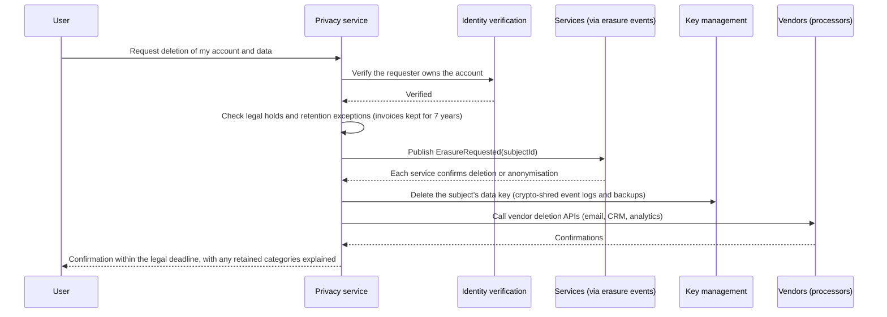
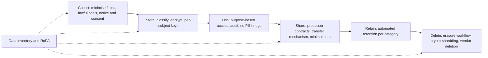

## TL;DR

- Privacy law (GDPR in the EU, UK GDPR, CCPA/CPRA in California, and similar laws elsewhere) turns into **engineering requirements**: know what personal data you hold and why, collect only what you need, keep it only as long as necessary, protect it, and **honour people's rights** (access, correction, deletion, portability, objection) reliably and on time.
- **Pseudonymised data is still personal data.** Only truly anonymised data (where re-identification isn't reasonably possible) falls outside GDPR, and true anonymisation is harder than it looks.
- The hardest technical problems are **finding all the copies** (logs, analytics, search indexes, caches, backups, third parties) and **deleting from immutable systems** (event logs, backups). A **data inventory** plus **crypto-shredding** solves most of it.
- Build privacy into the **platform**: PII classification in schemas, log scrubbing by default, masked test data, automated subject-request and retention workflows, and privacy review (DPIAs) for risky new processing.
- Treat privacy as **risk to people**, not just compliance. GDPR fines can reach 4% of global annual turnover, but the bigger cost is usually lost trust.

## Core Concepts

### Personal data and special categories

- **Personal data**: any information relating to an identified or identifiable person. That includes names and emails, but also IP addresses, device ids, cookie ids, location data, and combinations of attributes that single someone out.
- **Special category data** (GDPR Article 9): health, biometric, genetic, racial or ethnic origin, political opinions, religion, trade union membership, sex life or orientation. Processing is prohibited unless a specific condition applies, and it needs stronger protection.
- **Pseudonymisation**: replacing identifiers with tokens, with the mapping kept separately. It reduces risk and is encouraged, but the data **remains personal data**.
- **Anonymisation**: irreversibly removing the ability to identify anyone, even by combining with other data. Anonymised data is outside GDPR, but many "anonymised" datasets have been re-identified (for example through rare combinations of postcode, birth date and gender).

### GDPR principles (Article 5)

| Principle | Engineering translation |
|---|---|
| Lawfulness, fairness, transparency | Every processing purpose has a lawful basis, and users are told about it in the privacy notice |
| Purpose limitation | Data collected for billing isn't silently reused for marketing or model training |
| Data minimisation | Collect and store only the fields you need. Don't log full request bodies |
| Accuracy | Users can correct data, and corrections propagate to copies |
| Storage limitation | Retention periods per data category, enforced automatically |
| Integrity and confidentiality | Encryption, access control, least privilege, audit logs |
| Accountability | You can *demonstrate* compliance: records of processing, DPIAs, policies, evidence |

### Lawful bases (Article 6)

Consent, contract, legal obligation, vital interests, public task and legitimate interests. Common engineering-relevant points:
- **Contract** covers processing needed to deliver the service the user signed up for.
- **Consent** must be freely given, specific, informed, unambiguous and as easy to withdraw as to give. It's the wrong basis for processing the service can't work without, and the right one for optional uses such as marketing emails or non-essential cookies (which also fall under the ePrivacy rules).
- **Legitimate interests** need a balancing test (your interest versus the person's rights) and an opt-out.

### Data subject rights

| Right | What engineering must support |
|---|---|
| Access (Article 15) | Find and export all of a person's data, usually within one month (extendable by two more for complex cases) |
| Rectification | Correct data everywhere it's copied |
| Erasure (Article 17) | Delete across all systems and processors, with documented exceptions (legal retention, for example invoices) |
| Restriction | Mark data so it's stored but not processed |
| Portability | Export data the user provided in a machine-readable format |
| Objection | Stop processing based on legitimate interests or for direct marketing |
| Automated decisions (Article 22) | Human review for decisions with legal or similarly significant effects |

### The data inventory

You can't protect, export or delete what you can't find. Maintain a **data map**:
- Which systems store which categories of personal data, for which purpose, under which lawful basis, for how long, and who owns them. That's also the backbone of the **Records of Processing Activities** (Article 30).
- **Classify fields in schemas**, so tooling knows what's personal:

```ts
// Field-level classification drives log scrubbing, masking, exports and deletion.
type Classification = 'public' | 'internal' | 'personal' | 'sensitive';

interface FieldMeta { classification: Classification; retentionDays?: number; erasable: boolean }

export const customerSchema = {
  id:          { classification: 'internal', erasable: false },               // pseudonymous key
  email:       { classification: 'personal', erasable: true },
  fullName:    { classification: 'personal', erasable: true },
  dateOfBirth: { classification: 'personal', erasable: true },
  healthNotes: { classification: 'sensitive', erasable: true },
  createdAt:   { classification: 'internal', erasable: false },
} satisfies Record<string, FieldMeta>;

// A log serializer that redacts anything personal or sensitive by default.
export function redact<T extends Record<string, unknown>>(obj: T, schema: Record<string, FieldMeta>): T {
  return Object.fromEntries(
    Object.entries(obj).map(([k, v]) => [k, ['personal', 'sensitive'].includes(schema[k]?.classification ?? 'personal') ? '[REDACTED]' : v]),
  ) as T;
}
```

Automated discovery tools (cloud DLP services such as Amazon Macie, Microsoft Purview or Google Sensitive Data Protection) scan stores for unexpected personal data, which is useful for catching what the inventory misses.

### Protecting personal data

- **Encryption** at rest and in transit by default, plus **field-level** or application-level encryption for sensitive fields, so database administrators and backups don't see plaintext.
- **Tokenisation**: replace identifiers (card numbers, national ids) with tokens, with a vault holding the mapping, limiting how many systems touch the real values.
- **Least-privilege access**, purpose-based access for analytics, and **audit logs** of who accessed personal data.
- **Keep personal data out of logs, traces, error reports and URLs** (query strings end up in logs and referrer headers).
- **Masked or synthetic test data**: production personal data shouldn't be copied to development or test environments.

### Crypto-shredding

Encrypt each person's (or tenant's) personal data with their own key, stored in a key management service. To erase, **delete the key**. Every copy encrypted with it, including in immutable event logs and backups, becomes unreadable. It's the standard answer to "how do you delete from Kafka, event stores or backups?". It needs careful key management (rotation, availability, never caching keys indefinitely).

### International transfers

Personal data leaving the EU/EEA needs a transfer mechanism: an **adequacy decision** (for example the UK, Japan, or the US for companies certified under the EU-US Data Privacy Framework adopted in July 2023), **standard contractual clauses** plus a transfer impact assessment, or binding corporate rules. Architecturally, this affects where you host, which vendors (processors and sub-processors) you use, and where support staff can access data from.

### Other regimes

- **UK GDPR** with the Data Protection Act 2018, amended by the Data (Use and Access) Act 2025.
- **CCPA/CPRA** (California): rights to know, delete, correct and opt out of "sale" or "sharing" for advertising, plus honouring Global Privacy Control signals.
- Many others (Brazil's LGPD, India's DPDP Act 2023, and a growing set of US state laws). Design for the strictest common denominator where practical, with configuration for regional differences.

### Worked example: why removing names isn't anonymisation

A hospital team wants to share a research extract. Names and patient numbers are removed, leaving postcode, birth date, gender and condition:

| Postcode | Birth date | Gender | Condition |
|---|---|---|---|
| SW1A 1AA | 1987-03-14 | F | Asthma |
| SW1A 2BB | 1986-07-02 | F | Diabetes |
| SW1A 0PW | 1989-01-30 | F | Asthma |
| SW1A 1AA | 1988-11-23 | M | Migraine |
| SW1A 2AB | 1985-05-09 | M | Migraine |
| SW1A 0AA | 1987-09-17 | M | Migraine |

**Every row is unique** on postcode, birth date and gender. These are **quasi-identifiers**: not names, but enough to single someone out when combined with another source, such as an electoral roll or social media. Latanya Sweeney showed in 2000 that about 87% of the US population could likely be identified by ZIP code, gender and date of birth alone.

**Step 1, generalise to reach k-anonymity:** report the postcode sector (SW1A) and a 5-year birth band (1985–1989). Now each combination of quasi-identifiers covers at least 3 people, so the extract is **3-anonymous** (k = 3).

| Postcode | Birth band | Gender | Conditions in the group |
|---|---|---|---|
| SW1A | 1985–1989 | F | Asthma, Diabetes, Asthma |
| SW1A | 1985–1989 | M | Migraine, Migraine, Migraine |

**Step 2, check diversity:** the male group is k-anonymous but every member has migraine. Anyone who knows a man born in the late 1980s in SW1A is in the data learns his condition. This is a **homogeneity attack**, and k-anonymity alone doesn't stop it. **l-diversity** requires at least l different sensitive values in each group.

**Step 3, generalise further:** dropping gender merges the groups into one group of 6 with 3 different conditions (k = 6, l = 3).

**The lesson:** each step lost detail researchers may need, and a real dataset with more columns is far harder to protect. Unless anonymisation is designed and tested by specialists, treat the extract as **pseudonymised personal data**, still under GDPR, and protect it with access controls and agreements. Alternatively, publish only aggregates with techniques such as differential privacy.

## How It Works

### An erasure request across systems



### Privacy controls along the data lifecycle



## When to Use / Trade-offs

| Technique | Use when | Limits | Cost |
|---|---|---|---|
| Hard deletion | Mutable stores (relational rows, documents, files) | Copies elsewhere, backups | Referential integrity work |
| Anonymisation in place (keep the record, strip identity) | You need aggregate history (order counts, revenue) | Re-identification risk if done badly | Careful field-by-field design |
| Crypto-shredding | Event logs, append-only stores, backups | Key management becomes critical | KMS cost and complexity |
| Pseudonymisation / tokenisation | Analytics and lower-trust systems that don't need identity | Still personal data under GDPR | A token vault |
| Synthetic test data | Development and test environments | Realism for edge cases | Generators to maintain |
| Masked copies of production | Performance testing with realistic distributions | Masking must be thorough, including free text | Masking pipeline |
| Differential privacy | Publishing aggregate statistics or training on sensitive data | Accuracy loss, expertise needed | Specialist libraries and review |

## Common Pitfalls & Anti-patterns

- **"We'll add GDPR later"** — retrofitting erasure into 40 services and an event log is far harder than designing for it.
- **Personal data in logs** — request bodies, emails in URLs and error messages with user input, kept for years in a log platform nobody includes in erasure.
- **Production data in test environments** — the most common uncontrolled copies, often with weaker security.
- **Consent for everything** — asking for consent where contract is the real basis, then being unable to operate when it's withdrawn.
- **Pseudonymisation treated as anonymisation** — hashing an email gives a stable identifier, still personal data and often reversible by guessing.
- **Forgotten copies** — search indexes, caches, data warehouses, ML feature stores, spreadsheets, third-party tools.
- **Backups ignored** — no documented approach for erasure from backups.
- **Unlimited retention** — data kept "in case it's useful", violating storage limitation and growing breach impact.
- **Vendors without contracts** — sending personal data to a SaaS tool without a data processing agreement or a transfer mechanism.

## Real-world Scenario

**Context:** A consumer fintech app with 2 million EU users received about 1,500 data subject requests a month, handled manually by a support team querying 12 systems. Response times averaged 26 days (close to the one-month limit), deletion requests missed the event store, the data warehouse and two marketing tools, and a regulator inquiry followed a user complaint.

**Decision:**
1. **Data inventory**: mapped 31 systems and 14 vendors holding personal data, with owners, purposes, lawful bases and retention. Added field classifications to service schemas.
2. **Privacy service**: a central workflow for access, deletion and correction requests, with identity verification, legal hold checks, a deadline tracker and an audit trail.
3. **Integration contract**: every service owning personal data implements `export(subjectId)` and `erase(subjectId)` handlers, triggered by events, and confirms completion. Vendors integrated through their APIs.
4. **Crypto-shredding** for the event store and backups: per-user data keys in KMS, envelope encryption for personal fields in events.
5. **Logs**: a shared logging library that redacts classified fields by default, and log retention reduced to 30 days.
6. **Test data**: synthetic data generators replaced production snapshots in non-production environments.

**Outcome:** Median response time fell to 3 days, deletion covered all mapped systems with evidence, and the regulator closed the inquiry without a fine after reviewing the new process. Two previously unknown copies (a support analytics export and an old marketing bucket) were found and deleted during the inventory.

**What I'd do differently:** Start the inventory with automated discovery scans. The two forgotten copies would have been found in days rather than at the end of a three-month manual exercise.

## Interview Questions

### What counts as personal data, and what's the difference between pseudonymisation and anonymisation? {#personal-data}

**Level:** Foundation

**Model answer:**
**Personal data** is any information relating to an identified or identifiable living person. Beyond obvious identifiers (name, email, phone), it includes online identifiers (IP addresses, cookie ids, device ids), location data, and any combination of attributes that can single someone out. **Special category** data (health, biometrics, ethnicity, religion, sexual orientation and so on) needs extra protection and a specific legal condition.

- **Pseudonymisation** replaces direct identifiers with tokens or keys, keeping the mapping separately. It lowers risk and is good practice, but the data is **still personal data**: re-identification is possible with the mapping, or often by linking to other data.
- **Anonymisation** makes re-identification not reasonably possible, by anyone, using any means reasonably likely to be used. Properly anonymised data is outside GDPR. It's hard: removing names isn't enough when rare combinations of attributes (postcode, birth date, gender) identify people. Techniques include aggregation, generalisation, k-anonymity and differential privacy.

**What the interviewer is looking for:**
A broad definition of personal data, and a clear, correct distinction with examples of re-identification risk.

**Follow-ups:**
- Is a hashed email address personal data?
- How would you check whether a dataset is truly anonymised?

**Red flags:**
- "We hash the email, so it's anonymous."
- Treating IP addresses as non-personal by default.

### What are GDPR's core principles, and how do they translate into engineering work? {#gdpr-principles}

**Level:** Foundation

**Model answer:**
1. **Lawfulness, fairness and transparency**: every use of personal data has a lawful basis and is explained in the privacy notice. Engineering: record purposes and bases in the data inventory, and don't add new processing silently.
2. **Purpose limitation**: data collected for one purpose isn't reused for incompatible purposes. Engineering: purpose-based access controls, and a review when someone wants to reuse data (for example for model training).
3. **Data minimisation**: only what's needed. Engineering: question every new field, avoid logging bodies, drop data you don't use.
4. **Accuracy**: users can correct data, and corrections propagate.
5. **Storage limitation**: retention periods enforced by automated jobs.
6. **Integrity and confidentiality**: encryption, access control, monitoring and secure development.
7. **Accountability**: be able to demonstrate compliance through records of processing, DPIAs, audit logs and evidence of deletions.

**What the interviewer is looking for:**
All the principles, and concrete engineering practices for each.

**Follow-ups:**
- Which principle is hardest to implement in a microservices architecture?
- What evidence would demonstrate accountability?

**Red flags:**
- Treating GDPR as a legal team issue only.
- Equating compliance with having a cookie banner.

### What are the lawful bases for processing, and when is consent the wrong choice? {#lawful-basis}

**Level:** Foundation

**Model answer:**
GDPR Article 6 lists six: **consent**, **contract** (necessary to deliver a service the person asked for), **legal obligation** (for example tax records), **vital interests**, **public task**, and **legitimate interests** (subject to a balancing test and the right to object).

Consent is the **wrong** choice when:
- The processing is **necessary for the service**. You can't run a payments app without processing payment data, so that's contract. If you ask for consent and the user withdraws it, you'd have to stop.
- There's an **imbalance of power**, such as employers and employees, where consent can't be freely given.
- **Another basis clearly applies**, such as a legal obligation.

Consent is appropriate for **optional** processing: marketing emails, non-essential cookies and tracking (also required by ePrivacy rules), and optional uses such as using content for model training in many cases. It must be freely given, specific, informed, unambiguous, recorded with what was agreed and when, and as easy to withdraw as to give.

**What the interviewer is looking for:**
All six bases, the "necessary for the service" reasoning, and consent's requirements.

**Follow-ups:**
- How would you implement consent records?
- What changes when a user withdraws consent?

**Red flags:**
- "We get consent for everything to be safe."
- Pre-ticked boxes.

### What does data minimisation mean for engineers in practice? {#data-minimisation}

**Level:** Foundation

**Model answer:**
Collect, store, process and share **only the personal data needed** for a defined purpose. In practice:
- **Forms and APIs**: question every field. Do you need date of birth, or only "over 18"? A full address, or just a country?
- **Derived values**: store the result instead of the raw data where possible (an age bracket instead of birth date, a verification result instead of an ID scan).
- **Logs and telemetry**: no request bodies, no personal data in URLs, redaction by default. Use ids rather than emails in logs.
- **Analytics**: aggregate or pseudonymise, and don't send everything to third-party tools.
- **Sharing**: send vendors only the fields they need.
- **Retention**: delete data when the purpose ends.
- **Access**: limit who and what can read personal data.

The benefits go beyond compliance: less to secure, smaller breach impact, cheaper storage and simpler subject requests.

**What the interviewer is looking for:**
Concrete practices across collection, storage, logs, analytics and sharing.

**Follow-ups:**
- How would you challenge a product request to "collect everything, we might need it"?
- How do you minimise data in error reports?

**Red flags:**
- "Storage is cheap, so keep everything."
- Logging full requests in production.

### How do you implement the right to erasure across a microservices architecture? {#right-to-erasure}

**Level:** Senior

**Model answer:**
1. **Know where the data is**: a data inventory mapping each service, store and vendor holding personal data, kept current through service templates and reviews.
2. **A central privacy workflow** receives the request, verifies the requester's identity, checks **exceptions** (legal retention such as invoices, legal holds, open fraud investigations) and tracks the legal deadline.
3. **Fan out** via an `ErasureRequested(subjectId)` event (or calls) to every service that owns personal data. Each implements an idempotent erasure handler: delete the data, or **anonymise** records that must stay for aggregate or legal reasons (keep the order total and date, remove the name and address).
4. **Confirm**: each service reports completion. The workflow retries failures and escalates to owners when stuck.
5. **Derived copies**: search indexes, caches, data warehouse and ML feature stores are updated via the same events or their own pipelines.
6. **Immutable stores and backups**: crypto-shredding (per-subject keys), or documented backup expiry where restored data is re-filtered against an erasure list.
7. **Vendors**: deletion via processor APIs, recorded.
8. **Evidence**: an audit trail of what was deleted, where and when, without retaining the personal data itself.

**What the interviewer is looking for:**
Inventory, central orchestration, idempotent handlers, exceptions, derived copies, backups and evidence.

**Follow-ups:**
- How do you test that erasure works end to end?
- What do you do if a service is down during the erasure?

**Red flags:**
- Deleting from the main user table only.
- No handling of legal retention exceptions.

### How would you automate data subject access requests at scale? {#dsar-automation}

**Level:** Senior

**Model answer:**
- **Intake and verification**: a self-service portal or form tied to the authenticated account, with stronger verification for requests from outside the account (to avoid handing data to impostors, which is itself a breach).
- **Orchestration**: a privacy service creates a request with a deadline (one month by default), and publishes an export request to all systems in the data inventory.
- **Service contract**: each service owning personal data implements `export(subjectId)` returning structured data (JSON) about the subject, with field descriptions. Vendors' data is fetched through their APIs.
- **Assembly**: combine results into a readable package (a summary plus machine-readable files), together with the required information: purposes, recipients, retention periods, sources and rights.
- **Review step** for edge cases: data about other people mixed in (support transcripts mentioning third parties), or legally privileged material.
- **Secure delivery**: an authenticated download with expiry, never by email attachment.
- **Tracking and metrics**: time to complete, failures by system, and volume trends. Alerts as deadlines approach.

Self-service "download my data" features for common data reduce formal request volume.

**What the interviewer is looking for:**
Verification, a service-level export contract, deadline tracking, third-party data review and secure delivery.

**Follow-ups:**
- How do you handle data about the requester that also identifies others?
- How would you include data held only in logs?

**Red flags:**
- Sending exports by email.
- Manual queries in production databases for each request.

### How do you keep personal data out of logs, traces and error reports? {#pii-in-logs}

**Level:** Senior

**Model answer:**
- **Structured logging with redaction by default**: a shared logging library that knows field classifications (or common patterns) and redacts personal fields before writing. Log ids instead of emails or names.
- **Never log request or response bodies** in production by default. Allow it only temporarily for debugging, with redaction, in restricted environments.
- **URLs**: keep personal data out of paths and query strings (use POST bodies or opaque ids), because URLs end up in access logs, proxies, analytics and referrer headers.
- **Error reporting tools** (Sentry and others): configure data scrubbing, and avoid capturing local variables or form inputs.
- **Traces**: attribute naming conventions that avoid personal data, and processors in the OpenTelemetry Collector that drop or hash sensitive attributes centrally.
- **Detection**: scanning log streams for patterns (emails, card numbers, national ids) and alerting the owning team.
- **Retention and access**: short log retention (for example 30 days), with access controls and audit, and logs included in the data map.

**What the interviewer is looking for:**
Prevention at the source (libraries, URL design), central scrubbing as a backstop, detection, and retention.

**Follow-ups:**
- How would you handle a discovery that a service has logged emails for two years?
- Can you hash emails for correlation in logs?

**Red flags:**
- "Our log platform is internal, so it's fine."
- Logging full HTTP requests.

### How should teams get realistic test data without copying production personal data? {#test-data}

**Level:** Senior

**Model answer:**
Options, in order of preference:
1. **Synthetic data**: generators that produce realistic data from schemas and distributions (libraries such as Faker, plus domain-specific rules). Safe to use anywhere. The challenge is realism for edge cases, which is improved by modelling real distributions (in aggregate) and known tricky cases.
2. **Masked production subsets**: extract a consistent subset, then irreversibly replace personal fields (names, emails, addresses, free text), keeping referential integrity and formats. Run the masking in the production security boundary, so unmasked data never leaves it. Watch out for free-text fields (notes, messages), which often contain personal data and are hard to mask.
3. **Production data in tightly controlled environments**: only where genuinely necessary (for example a production-like performance or incident-reproduction environment), with the same controls as production, documented justification and short retention.

Supporting practices: a policy forbidding unmasked production data in development and test, automated detection in non-production stores, and test fixtures that are designed rather than copied.

**What the interviewer is looking for:**
Synthetic first, careful masking with integrity, awareness of free text, and controls for exceptions.

**Follow-ups:**
- How do you mask data while keeping it useful for performance testing?
- What about production bugs that only reproduce with real data?

**Red flags:**
- Nightly production database restores into staging.
- Masking only names and emails while leaving free-text notes.

### When is a Data Protection Impact Assessment needed, and what is the engineer's role? {#dpia}

**Level:** Senior

**Model answer:**
GDPR Article 35 requires a **DPIA** before processing that's **likely to result in a high risk** to people's rights and freedoms. Typical triggers: large-scale processing of special category data, systematic monitoring (tracking behaviour, location), profiling or automated decisions with significant effects, new technologies such as AI, combining datasets, and processing vulnerable people's data. Regulators publish lists of processing that always needs one.

A DPIA describes the processing and its purpose, assesses necessity and proportionality, identifies risks to individuals, and records the measures that address them. If high risk remains, the regulator must be consulted.

**The engineer's role:**
- Explain the **data flows** accurately: what's collected, where it goes, who can access it, how long it's kept. Diagrams help.
- Propose **technical mitigations**: minimisation, pseudonymisation, encryption, access controls, retention, opt-outs and human review.
- Flag new processing early (the DPIA belongs in design, not just before launch), and update it when the design changes.
- Implement and test the controls committed to.

It's similar to threat modelling, but the risk is to the *people* whose data is processed, not to the company.

**What the interviewer is looking for:**
Triggers, contents, and engineering contributions early in design.

**Follow-ups:**
- How would you integrate DPIAs with your existing design review or threat modelling process?
- What would trigger a DPIA for a new AI feature?

**Red flags:**
- "Legal does the DPIA after we build it."
- Not knowing what one is.

### How do you implement data retention policies reliably? {#retention}

**Level:** Senior

**Model answer:**
1. **Define retention per data category and purpose** with legal and the business: for example, inactive accounts deleted after 3 years, support tickets after 2 years, invoices kept 7–10 years (legal obligation), logs 30 days.
2. **Record it in the data inventory and in schemas** (retention metadata per table or field), so it's discoverable and testable.
3. **Automate enforcement**:
   - Database TTLs where available (DynamoDB TTL, Cosmos DB TTL, MongoDB TTL indexes).
   - Scheduled deletion or anonymisation jobs for relational data, batched and idempotent.
   - Object storage lifecycle rules for files and exports.
   - Log and telemetry retention settings in the platforms.
   - Partitioning by time (drop old partitions) for large tables.
4. **Handle exceptions**: legal holds pause deletion for specific subjects or matters.
5. **Propagate to copies**: derived stores (warehouse, search, caches) follow the same rules.
6. **Monitor and evidence**: metrics on records past retention, job failures alerting owners, and periodic reports.

**What the interviewer is looking for:**
Retention as data with automated enforcement per store type, legal holds, copies and monitoring.

**Follow-ups:**
- How do you apply retention to data that must be kept partially (for example the invoice but not the delivery notes)?
- What happens to retention when a user's account is reactivated?

**Red flags:**
- Retention defined in a policy document only.
- Manual yearly clean-ups.

### How do you erase personal data from event logs, Kafka topics and backups? {#erasure-immutable-stores}

**Level:** Architect

**Model answer:**
Immutable stores are designed not to forget, so use one or more of these approaches:

1. **Keep personal data out of immutable logs**: events carry identifiers and non-personal facts, with personal details looked up from a mutable store. This is the simplest option when designing new systems ("claim check" for personal data).
2. **Crypto-shredding**: encrypt personal fields in events (envelope encryption) with a **per-subject data key** held in a key management service. Erasure deletes the key, making all copies (topic, replicas, consumers' stored copies of the ciphertext, backups) unreadable. Consumers decrypt when processing. Requirements: a highly available key service, caching keys only briefly, and handling events whose key was deleted (render as "erased").
3. **Kafka compacted topics**: for keyed state topics, a tombstone (null value) for the key eventually removes earlier values after compaction. That helps for state topics, but not for long-retention event topics or downstream copies.
4. **Rewriting** event stores or topics (copying without the subject's events) is possible but expensive and risky. Use it rarely.
5. **Backups**: crypto-shredding covers them. Otherwise document a backup retention period (for example 35 days), and maintain an erasure list applied whenever a backup is restored.

Document the approach in the privacy notice and records of processing, so the regulator and users understand how erasure works in practice.

**What the interviewer is looking for:**
Avoiding personal data in immutable logs, crypto-shredding with its operational requirements, compaction's limits, and a backup strategy.

**Follow-ups:**
- What happens to projections built from events when a key is shredded?
- How do you make the key service resilient enough?

**Red flags:**
- "Events are immutable, so erasure doesn't apply."
- Unencrypted personal data in infinite-retention topics with no plan.

### Design a privacy engineering programme for an organisation with 300 services and 80 vendors. {#privacy-engineering-programme}

**Level:** Architect

**Model answer:**
**Foundations:**
1. **Data inventory**: automated discovery (cloud DLP scans of databases and storage), schema classification metadata in service repositories, and a vendor register with data processing agreements and transfer mechanisms. Owners for every system.
2. **Policy into platform**:
   - Logging libraries that redact classified fields by default, with centralised scrubbing in the telemetry pipeline.
   - Service templates with `export` and `erase` handlers and classification metadata.
   - Encryption by default, per-subject keys for event-sourced systems.
   - Retention metadata and standard TTL or deletion jobs.
   - Synthetic test data tooling, and a ban on unmasked production data outside production.
3. **Central privacy service**: request intake and verification, orchestration of exports and erasures, deadlines, audit trails, and consent records.

**Process:**
- **Privacy review in design**: a lightweight checklist for every new feature handling personal data (purpose, lawful basis, minimisation, retention, sharing), escalating to a full DPIA when triggers apply. Combine with threat modelling.
- **Vendor onboarding** via procurement, with privacy and security review before any data is shared.
- **Privacy champions** in each team, trained and supported by the privacy team.

**Measurement**: inventory coverage, request completion times, services with handlers implemented, data found outside known locations, vendor agreements in place, and incidents.

**Rollout**: start with the highest-risk systems (special category data, large-scale processing), with clear owners and an incremental migration of services onto the platform tooling.

**What the interviewer is looking for:**
Inventory, platform-level defaults, a central workflow, design-time review, vendor governance, champions and metrics.

**Follow-ups:**
- How do you keep the inventory accurate as teams ship new services?
- How would you prioritise the first six months?

**Red flags:**
- A spreadsheet inventory maintained by the legal team alone.
- Relying on every team to implement privacy independently.

### How do international data transfer rules affect your architecture? {#international-transfers}

**Level:** Architect

**Model answer:**
Under GDPR, personal data transferred outside the EU/EEA needs a mechanism:
- **Adequacy decisions** for countries with equivalent protection (for example the UK, Japan, Switzerland, and the US for organisations certified under the EU-US Data Privacy Framework, adopted in July 2023, after its predecessor Privacy Shield was invalidated in 2020 by the Schrems II judgment).
- **Standard contractual clauses** with a **transfer impact assessment**, and supplementary measures (such as encryption where the importer can't access the keys) where the destination's laws create risk.
- **Binding corporate rules** for intra-group transfers.

**Architectural implications:**
- **Hosting region**: hosting EU users' data in EU regions avoids many transfers, but **access is also a transfer**: support or engineering staff outside the EU viewing data, and US-based vendors' sub-processors, count.
- **Vendors**: choose processors with EU data residency options, and check where their sub-processors are. Telemetry, error reporting, email and AI services are common blind spots.
- **Encryption with customer- or EU-held keys** as a supplementary measure.
- **Separation**: keep EU personal data in EU stamps, with only non-personal or aggregated data flowing globally.
- **Resilience to legal change**: the DPF faces legal challenges like its predecessors. Designs that can fall back to SCCs, or regionalise further, reduce risk.

Similar rules exist elsewhere (UK transfers, and localisation requirements in some countries), so make data location configurable per region.

**What the interviewer is looking for:**
The mechanisms, the point that remote access counts as a transfer, vendor and telemetry blind spots, and designing for legal change.

**Follow-ups:**
- How would you let a US-based support team help EU customers?
- What supplementary measures would you propose for a US cloud provider?

**Red flags:**
- "Our database is in Frankfurt, so we're compliant."
- Ignoring vendors and sub-processors.

### How can you do analytics or train models on personal data while protecting privacy? {#privacy-preserving-analytics}

**Level:** Architect

**Model answer:**
**Governance first**: confirm a lawful basis and compatible purpose for analytics or training (or get consent), record it, run a DPIA where triggered, and give users notice and an opt-out where required.

**Technical approaches, from simple to advanced:**
- **Minimise and aggregate**: use only the fields needed, aggregate early, and drop direct identifiers.
- **Pseudonymise** identifiers in the analytics environment with keys held separately, and restrict re-identification to a controlled service.
- **Access controls**: purpose-based access, clean rooms for sensitive joins, and query auditing.
- **Generalisation and k-anonymity**: coarsen quasi-identifiers (age bands, partial postcodes) so each record is indistinguishable from at least k others. Note its weaknesses against attackers with background knowledge.
- **Differential privacy**: add calibrated noise so the output barely depends on any one person's data. Used by the US Census Bureau (2020) and in large tech companies' telemetry. Good for published statistics and some model training (DP-SGD), at a cost in accuracy and with expertise needed to set the privacy budget.
- **Synthetic data** generated from real data, with care, since generators can memorise records.
- **Federated learning** and on-device processing, where raw data never leaves users' devices.

**For model training specifically**: keep training data lineage, honour erasure (retraining schedules or documented limits), and test models for memorisation of personal data.

**What the interviewer is looking for:**
Governance plus a ladder of techniques with honest limitations.

**Follow-ups:**
- What is a privacy budget in differential privacy?
- How would you handle an erasure request for data already used to train a model?

**Red flags:**
- "We remove names, so it's anonymous."
- Using personal data for training without considering purpose limitation.

### A product team wants to use customer support conversations to train an AI assistant. How do you evaluate and enable it? {#ai-training-data-privacy}

**Level:** Architect

**Model answer:**
**Assess:**
- **Purpose and lawful basis**: support conversations were collected to resolve tickets. Training an assistant is a new purpose. Is it compatible, under legitimate interests with a balancing test, or does it need consent or contract changes? Check customer contracts (B2B customers often prohibit training on their data) and the privacy notice.
- **Data content**: conversations contain names, contact details, account data, sometimes special category data (health, financial hardship) and data about third parties.
- **Risk**: the model memorising and regurgitating personal data, staff and model providers seeing data, and cross-customer leakage.
- **DPIA**: almost certainly required (new technology, large scale, possibly sensitive data).

**Enable it safely:**
1. **Minimise**: use only what's needed. Often retrieval over curated knowledge-base articles achieves the goal without training on raw conversations.
2. **De-identify**: automated PII detection and redaction (names, emails, account numbers, addresses) with sampling-based quality checks. Remove conversations flagged as sensitive.
3. **Respect opt-outs and contracts**: exclude customers or tenants who haven't agreed, and honour erasure (track data lineage, so deleted conversations are removed at the next training run).
4. **Vendor terms**: if using an external model provider, ensure no training on your data by them, data residency, and retention limits.
5. **Testing**: red-team the model for memorisation and leakage of personal data, and for answers that reveal other customers' information.
6. **Transparency**: update the privacy notice, and inform B2B customers.

**What the interviewer is looking for:**
Purpose limitation and contracts first, a DPIA, de-identification with verification, opt-outs and erasure, vendor terms and leakage testing.

**Follow-ups:**
- Would RAG over conversations be lower risk than fine-tuning? Why?
- How would you measure the quality of PII redaction?

**Red flags:**
- "It's our data, so we can use it however we like."
- No consideration of B2B contracts.

### What does privacy by design and by default mean in practice? {#privacy-by-design}

**Level:** Foundation

**Model answer:**
GDPR Article 25 requires **data protection by design and by default**. It's a legal duty, not just good practice.

**By design** means building privacy into systems from the start, considering the risks to people at each stage:
- **Minimise:** collect only the fields the purpose needs, and question every "nice to have".
- **Separate and protect:** encrypt sensitive fields, pseudonymise where identity isn't needed, and restrict access by purpose.
- **Plan the lifecycle:** decide retention periods and deletion mechanisms when the data store is designed, not after a request arrives.
- **Keep personal data out of logs, analytics and test environments** through shared libraries and defaults.
- **Review risky processing** early with a DPIA.

**By default** means the most privacy-friendly settings apply unless the person chooses otherwise:
- Profiles private rather than public, optional tracking off, and marketing opt-in rather than pre-ticked.
- Only the minimum data shared with other users or partners by default.

**For engineers, it shows up in everyday work:** a privacy section in design document templates, field classifications in schemas, a review checklist, and platform features (log redaction, data retention jobs, deletion handlers) that make the right thing the easy thing.

**What the interviewer is looking for:**
Article 25 as a legal duty, concrete design measures (minimisation, protection, lifecycle, logs, DPIAs), privacy-friendly defaults, and how it appears in engineering processes.

**Follow-ups:**
- Give an example of a default you'd change in a product you know.
- How do you make privacy by design work in a team that ships weekly?

**Red flags:**
- "We'll ask legal before launch."
- Treating it as only a policy document.

### A database containing customer personal data was exposed publicly. What has to happen in the next 72 hours? {#breach-notification}

**Level:** Senior

**Model answer:**
Run it as a security incident **and** a personal data breach, with legal and privacy specialists involved from the start. Under GDPR Article 33, the controller must notify the supervisory authority **without undue delay and, where feasible, within 72 hours of becoming aware** of the breach, unless it's unlikely to result in a risk to people.

**Hours 0–4: contain and preserve**
- Close the exposure: remove public access, rotate any exposed credentials and keys.
- **Preserve evidence:** access logs, configuration history and snapshots, before anything is overwritten.
- Open an incident with an incident commander, and bring in the data protection officer and legal.

**Hours 4–48: assess**
- **What data and whose:** categories of data, number of people and records, any special category or financial data.
- **Was it accessed?** Check access logs for downloads, and search for the data being offered or published.
- **How long** was it exposed, and how did it happen?
- **Risk to people:** identity theft, fraud, discrimination, distress. Encryption with keys that weren't exposed greatly reduces the risk.

**By 72 hours: notify**
- **The regulator:** the nature of the breach, categories and approximate numbers, likely consequences, measures taken, and a contact point. If facts are still missing, notify on time and provide the rest in phases.
- **Affected people** (Article 34), without undue delay, if the risk to them is **high**: what happened, the likely consequences, and what they can do, such as resetting passwords or watching for phishing.
- **Others as required:** processors must tell their controllers without undue delay; contracts, sector regulators, card schemes or other countries' laws may add obligations.

**Afterwards:** record the breach in the internal breach register (required even when it isn't reported), run a blameless review, and fix the systemic cause, such as automated checks for publicly exposed storage.

**What the interviewer is looking for:**
Containment and evidence, involving legal and the DPO early, a structured risk assessment, the 72-hour regulator notification with phased detail, notifying people when the risk is high, other obligations, and a breach register.

**Follow-ups:**
- Logs show no downloads during the exposure. Do you still notify?
- The exposed data was encrypted, but the key was in the same bucket. What changes?

**Red flags:**
- Waiting until the investigation is complete before notifying.
- Fixing it quietly because "nobody noticed".

### How do you implement cookie consent correctly? {#cookie-consent}

**Level:** Senior

**Model answer:**
In the EU and UK, the rules for storing or reading information on a device come from the **ePrivacy rules** (the ePrivacy Directive, and PECR in the UK), with GDPR defining what valid consent means.

**The core rules:**
- **Strictly necessary** storage, such as session cookies, security tokens and a shopping basket, needs no consent.
- **Everything else,** such as analytics, advertising and most third-party tags, needs **consent before** it's set or read.
- Consent must be **freely given, specific, informed and unambiguous:** no pre-ticked boxes (the Court of Justice confirmed this in *Planet49*, 2019), and no access walls for non-essential tracking in most cases.
- **Rejecting must be as easy as accepting:** a "Reject all" button at the same level as "Accept all". Regulators such as France's CNIL have fined large companies for making refusal harder.
- People can **withdraw** consent as easily as they gave it, at any time.

**Engineering it properly:**
- **Block non-essential tags until consent:** load them through a tag manager or consent-aware loader that checks the user's choice first. A banner alone doesn't stop scripts running.
- **Store the consent record:** the choice, the version of the banner and policy, and the time, as evidence.
- **Pass consent to vendors,** for example through Google's Consent Mode or the IAB Transparency and Consent Framework, and check what they do with it.
- **Audit regularly:** scan pages to confirm no unexpected cookies or network calls happen before consent.

**Regional differences:** in California, people can opt out of the "sale" or "sharing" of personal data, and businesses must honour **Global Privacy Control** signals. In the UK, the Data (Use and Access) Act 2025 adds consent exemptions for some low-risk purposes, such as certain analytics, provided users get clear information and a simple way to object. Check exactly when and how each exemption applies before relying on it.

**What the interviewer is looking for:**
ePrivacy as the source of the rules, necessary versus non-essential storage, valid consent with an easy reject and withdrawal, technical blocking before consent, consent records, passing signals to vendors, audits, and regional differences such as GPC.

**Follow-ups:**
- Marketing says the reject button cuts analytics data by 40%. What do you do?
- Is server-side tracking a way around consent?

**Red flags:**
- A banner that doesn't actually block anything.
- "Accept" as a big button and "Manage options" hidden behind several clicks.

### Design a consent and preference management system for a company with web and mobile apps and email marketing. {#consent-management-design}

**Level:** Architect

**Model answer:**
Consent is scattered by default: a cookie banner on the web, OS prompts on mobile, a marketing tool's subscription list and a CRM checkbox. Users then see inconsistent behaviour and the company can't prove what anyone agreed to. The design goal is **one source of truth, enforced at the point of use, with evidence**.

**Data model:**
- A **consent record** per person (or per device for anonymous visitors): purpose (such as marketing email, personalisation, analytics, advertising), status (granted or withdrawn), the **notice version** shown, the channel and method, and timestamps.
- **Append-only history,** so you can show what was true at any past date.
- Link anonymous device consent to the account when the user signs in, applying the more restrictive choice where they conflict.

**Architecture:**
- A **consent service** with an API to record and query choices, owned by a platform team.
- **Capture points** everywhere people make choices: web banner, mobile settings, account preferences, email unsubscribe links, support tools. All call the same service.
- **Propagation:** publish `ConsentChanged` events so downstream systems (email platform, CDP, ad integrations, data warehouse) update quickly, with a target time such as minutes, and reconcile nightly.
- **Enforcement at the point of use:** the email sender checks consent at send time, not only when the list was built; analytics pipelines filter by purpose; ad audiences are rebuilt from current consent.

**Other requirements:**
- Honour **Global Privacy Control** and the OS-level controls on mobile, such as Apple's App Tracking Transparency.
- **Legal bases differ by purpose:** some processing relies on contract or legitimate interests with an opt-out, not consent, so model "objection" as well as consent.
- **Availability:** if the consent service is down, **fail closed** for non-essential purposes.
- **Audit and reporting:** evidence for regulators, and dashboards for consent rates by purpose.

**What the interviewer is looking for:**
A purpose-based consent record with notice versions and history, one service with every capture point using it, event propagation plus reconciliation, enforcement at use time, GPC and mobile OS controls, consent versus other lawful bases, and failing closed.

**Follow-ups:**
- How do you handle a user who unsubscribes by replying to an email?
- What happens to data collected before consent was withdrawn?

**Red flags:**
- Each tool keeping its own unconnected opt-out list.
- Checking consent only when data is collected, not when it's used.

### Your product is starting to attract users under 18. What changes for privacy and safety? {#children-data}

**Level:** Architect

**Model answer:**
Children get stronger protection in most privacy laws, and regulators expect services **likely to be used by children** to account for that, even if they're not aimed at them.

**Know the main rules:**
- **GDPR Article 8:** for online services offered directly to children that rely on consent, parental consent is needed below 16, or a lower age set by each country, down to 13. The UK uses 13.
- **The UK Age Appropriate Design Code** (the Children's Code) applies to online services likely to be accessed by under-18s, with 15 standards including the child's best interests, high-privacy defaults, geolocation off by default, no nudging towards weaker privacy settings, and DPIAs.
- **In the US, COPPA** requires verifiable parental consent before collecting personal information from children under 13, and the FTC updated its rule in 2025.
- **Online safety laws,** such as the UK Online Safety Act, add duties around harmful content and age assurance.

**What changes in the product and platform:**
- **Assess whether children use it:** analytics, research and app store categories. "Our terms say 18+" isn't enough if children clearly use it.
- **Age assurance** proportionate to the risk: self-declaration for low risk, stronger estimation or verification where risks are high. Collect as little as possible for it.
- **High-privacy defaults for young users:** private profiles, no precise location, limits on who can contact them, no targeted advertising or profiling by default.
- **Data minimisation and shorter retention** for children's data, and no use for training models without careful assessment.
- **Design reviews for harmful patterns:** autoplay, streaks, and dark patterns that push data sharing.
- **Parental tools and clear explanations** written for children's understanding.

**Governance:** a children's DPIA, a named owner, and regular reviews as features change.

**What the interviewer is looking for:**
Knowing the "likely to be accessed" test, GDPR Article 8 ages, the Children's Code standards, COPPA, proportionate age assurance, high-privacy defaults, minimisation, harmful design patterns and governance.

**Follow-ups:**
- How do you do age assurance without collecting more sensitive data?
- A feature relies on precise location. How do you handle younger users?

**Red flags:**
- "Our terms of service say users must be 18."
- Collecting identity documents from everyone by default.

## Cheat Sheet

### Concepts

- **Personal data** — anything relating to an identifiable person, including IPs, cookie ids and location.
- **Pseudonymised vs anonymised** — pseudonymised is still personal data. Anonymised is irreversible and outside GDPR.
- **GDPR principles** — lawfulness, purpose limitation, minimisation, accuracy, storage limitation, security, accountability.
- **Lawful bases** — consent, contract, legal obligation, vital interests, public task, legitimate interests.
- **Consent rule** — freely given, specific, informed, unambiguous, and as easy to withdraw as to give.
- **Special category data** — health, biometrics, ethnicity, religion and similar. Needs extra conditions and protection.

### Rights and deadlines

- **Subject access deadline** — one month, extendable by two more for complex requests.
- **Breach notification** — to the supervisory authority within 72 hours of becoming aware.
- **Right to erasure** — delete across all systems and processors, except legal retention.
- **DPIA** — required before high-risk processing such as large-scale sensitive data or profiling.

### Engineering

- **Data inventory** — where personal data lives, why, its lawful basis, retention and owner.
- **Crypto-shredding** — per-subject keys, deleted to erase data in immutable stores and backups.
- **Logs** — redact by default, no personal data in URLs, short retention.
- **Test data** — synthetic first, masked subsets second, never raw production copies.
- **International transfers** — adequacy (including the EU-US DPF), SCCs with impact assessments, or BCRs. Remote access counts.

### Revisit

- **Quasi-identifiers** — attributes such as postcode, birth date and gender that identify people in combination, even without names.
- **k-anonymity and l-diversity** — each group shares quasi-identifiers with at least k − 1 others, and holds at least l different sensitive values.
- **Privacy by design and default** — GDPR Article 25: build in minimisation, protection and lifecycle, and default to the most private settings.
- **72-hour breach notice** — notify the regulator without undue delay and within 72 hours where feasible; tell people too if the risk is high.
- **Cookie consent** — non-essential storage needs prior consent; reject as easy as accept; actually block tags until consent.
- **Consent management** — one purpose-based record with history, propagated by events and enforced at the point of use.
- **Children's data** — "likely to be accessed" triggers duties: high-privacy defaults, proportionate age assurance, no profiling by default.

## Further Reading

- [GDPR full text (EUR-Lex)](https://eur-lex.europa.eu/eli/reg/2016/679/oj) — the official regulation text.
- [ICO: UK GDPR guidance and resources](https://ico.org.uk/for-organisations/uk-gdpr-guidance-and-resources/) — practical, readable guidance on every principle and right.
- [EDPB guidelines](https://www.edpb.europa.eu/our-work-tools/general-guidance/guidelines-recommendations-best-practices_en) — the European Data Protection Board's official interpretations.
- [NIST Privacy Framework](https://www.nist.gov/privacy-framework) — a risk-based framework for privacy engineering.
- [OWASP Top 10 Privacy Risks](https://owasp.org/www-project-top-10-privacy-risks/) — common privacy risks in web applications.
- [California Privacy Protection Agency](https://cppa.ca.gov/) — CCPA/CPRA regulations and guidance.
