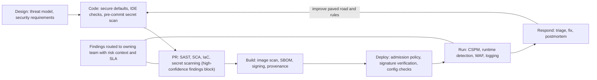

## TL;DR

- DevSecOps makes **security a shared responsibility built into the delivery flow** — automated, continuous and owned by the teams who build and run software — instead of a gate at the end.
- **Shift left** (threat modelling, secure defaults, SAST/SCA/secret/IaC scanning in PRs) *and* **shift right** (runtime protection, cloud posture management, detection and response, bug bounties).
- Tools are easy to add and hard to make useful: **tune for signal**, route findings to owners with context, prioritise by real risk, and automate fixes (dependency updates, base-image rebuilds).
- Prefer **guardrails** (secure paved roads, policy as code, safe defaults) over **gates** that block delivery; block only on high-confidence, high-risk findings.
- Scale through people: **security champions** in teams, clear SLAs, and metrics like time to remediate and coverage — not finding counts.

## Core Concepts

### Security across the lifecycle

| Phase | Practices | Tools/examples |
|---|---|---|
| Plan/design | Threat modelling, security requirements (ASVS), privacy review | STRIDE, OWASP Threat Dragon |
| Code | Secure libraries and frameworks, IDE plugins, pre-commit secret scanning | Linters, secret scanners |
| Build (CI) | SAST, SCA (dependencies), IaC scanning, container image scanning, SBOM | Semgrep/CodeQL, Dependabot/Renovate + SCA, Checkov/Trivy, Syft |
| Test | DAST, API security testing, fuzzing | OWASP ZAP, API fuzzers |
| Release | Artefact signing, provenance, policy checks, approvals | Sigstore/cosign, SLSA provenance, OPA |
| Deploy | Admission control, secure configuration | Kyverno/Gatekeeper, cloud policies |
| Operate | CSPM/CNAPP, runtime detection, WAF, logging, incident response | Defender for Cloud, Falco, SIEM |
| Learn | Postmortems, pen tests, bug bounty, metrics | — |

### Security testing types

- **SAST (static analysis):** scans source code for vulnerable patterns (injection, unsafe deserialisation). Fast, early, but false positives and no runtime context.
- **SCA (software composition analysis):** identifies third-party dependencies and known vulnerabilities/licences. Most application code is dependencies; reachability analysis reduces noise.
- **Secret scanning:** detects credentials in code, history and CI logs; push protection blocks commits with secrets.
- **IaC scanning:** misconfigurations in Terraform/Bicep/Kubernetes manifests before deployment.
- **Container scanning:** OS packages and libraries in images; base image hygiene.
- **DAST (dynamic analysis):** tests the running application from outside (like an attacker) — finds runtime issues (headers, auth flaws, injection) but later and slower.
- **IAST/RASP:** instrumentation inside the running app for testing (IAST) or blocking attacks at runtime (RASP).
- **Fuzzing:** feeds malformed inputs to find crashes and parsing bugs.

### Guardrails vs gates

- **Gates** block a pipeline or deploy (e.g. a critical, exploitable vulnerability; a secret detected; a public storage bucket in prod). Use for high-confidence, high-impact issues only.
- **Guardrails** steer towards safe outcomes without blocking: secure templates and modules, auto-remediation, warnings with context, default-deny policies that make insecure options hard to choose.
- Too many gates → teams bypass or ignore security. Too few → risk accumulates.

### Supply chain and artefacts

- **SBOM** (SPDX or CycloneDX) for every artefact; stored and queryable to answer "where do we use library X?" within minutes.
- **Provenance and signing** (SLSA, Sigstore) to verify that artefacts were built by trusted pipelines from reviewed source.
- **Dependency hygiene:** lockfiles, automated updates, curated registries, policies on new packages.

### Cloud and Kubernetes security

- **CSPM/CNAPP:** continuous assessment of cloud configuration against benchmarks (CIS), with prioritised findings and attack-path analysis.
- **Kubernetes:** Pod Security Standards (restricted profile), non-root containers, read-only root filesystems, network policies (default deny), RBAC least privilege, admission control, secrets via external stores, image signature verification, regular cluster upgrades.
- **Runtime detection:** syscall/behaviour monitoring (Falco, cloud defenders) for unexpected shells, crypto-miners, privilege escalation.

### People and process

- **Security champions** in each team: trained, connected to the security team, facilitating threat modelling and triage.
- **SLAs** for remediation by risk tier; ownership routed to service owners.
- **Blameless security incident reviews** that improve the paved road.

## How It Works

## When to Use / Trade-offs

| Control | Use when | Avoid when | Trade-off |
|---|---|---|---|
| Blocking gate | High-confidence, high-impact (secrets, critical exploitable vulns, public data exposure) | Noisy rules, low severity | Prevents risk vs friction and bypass incentives |
| Warning / PR comment | Medium findings, educational rules | — | Low friction vs may be ignored |
| Auto-remediation | Dependency bumps, base-image updates, policy-driven config fixes | Changes needing judgement | Speed vs need for good test coverage |
| DAST in pipeline | Internet-facing apps with stable test environments | Early-stage apps without deploy environments | Runtime coverage vs slower, flakier |
| Bug bounty | Mature programme with triage capacity | Basic hygiene not yet in place | Real-world testing vs cost and noise |
| CNAPP platform | Large multi-cloud estates | Small single-account setups (native tools suffice) | Unified view vs licence cost |

## Common Pitfalls & Anti-patterns

- **Tool sprawl without triage** — five scanners, 20,000 findings, nobody fixing anything.
- **Blocking on everything** — teams disable checks or route around them.
- **Security as a separate team's job** — "throw it to security" at the end.
- **CVSS-only prioritisation** — critical scores on unreachable code while exploited, internet-facing issues wait.
- **No ownership routing** — findings in a central dashboard nobody looks at.
- **Ignoring base images and transitive dependencies.**
- **Secrets removed from code but not rotated.**
- **Shift-left only** — no runtime visibility, so attacks and misconfigurations in production go unseen.
- **Measuring finding counts** — incentivises suppressing scanners rather than reducing risk.

## Real-world Scenario

**Context:** A company added SAST, SCA and container scanning to all pipelines, set to block on "high" findings. Within a month, deploys were blocked daily, teams added suppressions wholesale, and the security team's backlog of unreviewed findings exceeded 30,000.

**Decision:** Reset the programme: blocking only on secrets, critical vulnerabilities that are reachable or in the CISA KEV catalogue, and IaC rules for public exposure; everything else as PR comments with fix guidance. Introduced reachability analysis in SCA, automated dependency updates with auto-merge for passing tests, a hardened base-image pipeline rebuilding images weekly, findings routed to owning teams via the service catalogue with SLAs by risk tier, and a security champions programme with monthly sessions.

**Outcome:** Within two quarters, actionable findings dropped by ~85% (noise removed), median time to remediate critical issues fell from 60+ days to under 7, deploy blocks became rare and meaningful, and teams began proposing new rules themselves.

**What I'd do differently:** Pilot tools with two teams and tune rules before rolling out organisation-wide — the initial blast of noise cost months of trust.

## Interview Questions

### What is DevSecOps? {#what-is-devsecops}

**Level:** Foundation

**Model answer:**
DevSecOps integrates security into DevOps practices so that security is **continuous, automated and shared** across the software lifecycle — planning, coding, building, deploying and operating — rather than a separate phase or a final approval by a security team.

Key elements:
- **Shared responsibility:** development teams own the security of what they build, supported by security experts who provide tools, standards and guidance.
- **Automation:** security checks in pipelines (SAST, SCA, secret and IaC scanning), policy as code, automated remediation.
- **Secure by default:** paved roads, hardened templates and libraries.
- **Continuous feedback:** fast, actionable findings in developers' workflows; runtime monitoring and incident learning feeding back into practices.
- **Culture:** collaboration, blameless learning, security champions.

**What the interviewer is looking for:**
Shared responsibility, automation, secure defaults, feedback loops and culture.

**Follow-ups:**
- How does the security team's role change?
- What's the difference between DevSecOps and just buying scanners?

**Red flags:**
- "DevSecOps = adding a scanner to the pipeline."

### Explain SAST, DAST, SCA and IAST. {#security-testing-types}

**Level:** Foundation

**Model answer:**
- **SAST (static application security testing):** analyses source code without running it, finding risky patterns (SQL built with strings, unsafe deserialisation). Early and fast in PRs; can produce false positives and lacks runtime context.
- **SCA (software composition analysis):** inventories third-party dependencies and flags known vulnerabilities (CVEs) and licence issues. Critical because most code is open-source dependencies; reachability analysis reduces noise.
- **DAST (dynamic testing):** probes the running application from the outside like an attacker (crawling, injecting payloads). Finds runtime and configuration issues; slower and later in the lifecycle; limited code-level detail.
- **IAST (interactive testing):** instruments the running app during functional tests to observe data flows and detect vulnerabilities with code-level context and fewer false positives; requires agent support for your stack.

Complementary, not alternatives; plus secret scanning, IaC scanning and container scanning.

**What the interviewer is looking for:**
Accurate definitions, timing in the lifecycle, strengths and limits, and complementarity.

**Follow-ups:**
- Which would find a missing authorisation check?
- How do you reduce SAST false positives?

**Red flags:**
- Believing one tool type covers everything.

### What do "shift left" and "shift right" mean in security? {#shift-left-right}

**Level:** Foundation

**Model answer:**
- **Shift left:** move security earlier in the lifecycle — threat modelling in design, secure coding guidance, IDE plugins, pre-commit and PR checks — where fixes are cheapest and fastest.
- **Shift right:** strengthen security in production — runtime protection (WAF, RASP), cloud posture management, runtime threat detection, logging and alerting, incident response, chaos/security game days, bug bounties — because some issues only appear at runtime and attackers target live systems.

You need both: shift-left prevents many issues; shift-right detects what slips through, catches misconfigurations and drift, and provides learning that improves the left side.

**What the interviewer is looking for:**
Both directions with examples and the feedback loop.

**Follow-ups:**
- What can't shift-left catch?
- How does runtime data improve earlier controls?

**Red flags:**
- Treating shift-left as sufficient on its own.

### How should secret scanning work in a mature setup? {#secret-scanning}

**Level:** Foundation

**Model answer:**
- **Prevention:** pre-commit hooks and server-side **push protection** that block commits containing secrets before they enter history.
- **Detection:** scanning of repositories (including history), pull requests, CI logs, container images, wikis and ticketing systems; provider partner programmes that notify when tokens appear publicly.
- **Response runbook:** treat any exposed secret as compromised — **revoke/rotate first**, then investigate usage (audit logs), then clean up history if needed. Removing it from Git alone isn't enough.
- **Reduce secrets in the first place:** workload identities, OIDC federation, short-lived credentials, vault-based dynamic secrets.
- **Ownership and alerting:** findings routed to owners with urgent SLAs; metrics on time to rotate.

**What the interviewer is looking for:**
Prevention plus detection across locations, rotate-first response, reducing secrets and ownership.

**Follow-ups:**
- A key was in a public repo for 3 days. What steps do you take?
- How do you handle false positives in secret scanning?

**Red flags:**
- "We deleted the commit, so we're fine."

### How do you integrate security tools without overwhelming teams? {#tooling-without-friction}

**Level:** Senior

**Model answer:**
- **Start small and tune:** pilot with a few teams, enable high-signal rules first, measure false-positive rates, adjust.
- **Fast and in-workflow:** results as PR comments with clear explanations and fix suggestions, not in a separate portal.
- **Block only on high-confidence, high-impact issues;** warn on the rest.
- **Prioritise by real risk:** exploitability (KEV, EPSS), reachability, exposure, data sensitivity — not raw CVSS.
- **Deduplicate and route:** aggregate findings (ASPM tools or a central pipeline), map to owners via the service catalogue, set SLAs per tier.
- **Automate fixes:** dependency updates with tests, base-image rebuilds, autofix suggestions.
- **Baseline legacy findings:** don't block new work on old debt; track it separately with a burn-down plan, and fail only on **new** issues.
- **Feedback loop:** let developers mark false positives easily; review and improve rules.

**What the interviewer is looking for:**
Tuning, workflow integration, selective blocking, risk-based prioritisation, routing, automation, baselining and feedback.

**Follow-ups:**
- How do you handle a team that ignores findings?
- What's ASPM?

**Red flags:**
- Turning on every rule and blocking on "medium".

### How do you secure container images? {#container-security}

**Level:** Senior

**Model answer:**
- **Minimal base images:** distroless or slim images, fewer packages = fewer vulnerabilities; pinned by digest.
- **Hardened, centrally maintained base images** rebuilt regularly with patches; application images rebuilt automatically when bases update.
- **Scan images** in CI and in the registry continuously (new CVEs appear after build).
- **Non-root user**, read-only root filesystem, no unnecessary capabilities; no secrets in images or build layers (use build secrets features).
- **Multi-stage builds** so build tools don't ship in runtime images.
- **SBOM and signing** for each image; verify signatures and provenance at deploy (admission control).
- **Registry controls:** private registries, immutable tags, retention policies.
- **Runtime:** limit privileges, network policies, runtime detection for anomalous behaviour.

**What the interviewer is looking for:**
Minimal/hardened bases, rebuild cadence, continuous scanning, least privilege, no secrets, multi-stage, signing and verification.

**Follow-ups:**
- A critical CVE appears in your base image. How fast can you roll it out everywhere?
- Distroless vs Alpine — trade-offs?

**Red flags:**
- Images built once and never rebuilt.
- Running containers as root by default.

### What are the essential Kubernetes security controls? {#kubernetes-security}

**Level:** Senior

**Model answer:**
- **Cluster access:** SSO for humans with RBAC least privilege; no shared admin kubeconfigs; audit logging enabled; private API server endpoint where possible.
- **Workload security:** Pod Security Standards (restricted) via Pod Security Admission or policy engines (Kyverno/Gatekeeper): non-root, no privileged containers, no host namespaces/paths, drop capabilities, read-only filesystems, seccomp profiles.
- **Network:** default-deny network policies, explicit allows; ingress with TLS and WAF; mTLS between services (mesh) where needed.
- **Secrets:** external secret stores (vault/cloud) via CSI or operators; encryption at rest for etcd; avoid plain env vars where possible.
- **Supply chain:** only signed images from approved registries (admission verification).
- **Workload identity:** pods get cloud identities via workload identity, not node-level credentials.
- **Upgrades and patching:** keep clusters and nodes on supported versions; managed node images.
- **Detection:** runtime security (Falco or cloud defenders), audit log monitoring.

**What the interviewer is looking for:**
Access control, pod hardening, network policies, secrets, supply chain admission, workload identity, upgrades and detection.

**Follow-ups:**
- How do you roll out a default-deny network policy without breaking things?
- What does a privileged container allow an attacker to do?

**Red flags:**
- Everyone with cluster-admin.
- No network policies.

### What is an SBOM, and how do you use it? {#sbom}

**Level:** Senior

**Model answer:**
A Software Bill of Materials is a machine-readable inventory of the components in a piece of software — libraries, versions, licences, and often dependency relationships — in standard formats such as **SPDX** or **CycloneDX**.

Uses:
- **Incident response:** when a new vulnerability (e.g. Log4Shell) is announced, query SBOMs to find every affected artefact and deployment in minutes.
- **Vulnerability management:** continuous matching of components against vulnerability databases, including after release.
- **Licence compliance:** detect incompatible licences.
- **Customer and regulatory requirements:** many customers and regulations increasingly ask for SBOMs (for example US federal software attestation following Executive Order 14028, and the EU Cyber Resilience Act, which requires manufacturers to produce an SBOM; its vulnerability reporting duties apply from 11 September 2026 and its main obligations from 11 December 2027).
- **Supply chain trust:** combined with signatures and provenance.

Practice: generate SBOMs automatically at build (Syft, build tools), attach them to artefacts (attestations), store them centrally with deployment metadata, and use VEX statements to communicate whether known vulnerabilities actually affect a product.

**What the interviewer is looking for:**
Definition, formats, concrete uses especially incident response, automation and VEX.

**Follow-ups:**
- What's VEX?
- How do you keep SBOMs linked to what's actually running?

**Red flags:**
- SBOMs generated once by hand for compliance.

### What is cloud security posture management, and how do you act on it? {#cspm}

**Level:** Senior

**Model answer:**
CSPM continuously assesses cloud resources against security best practices and benchmarks (CIS, provider benchmarks, compliance frameworks) — finding misconfigurations like public storage, open management ports, unencrypted databases, over-privileged identities, disabled logging. CNAPP platforms combine CSPM with workload protection, identity analysis (CIEM) and attack-path analysis.

Acting on it:
- **Prioritise by exposure and impact:** internet-facing + sensitive data + exploitable paths first (attack-path analysis helps).
- **Route to owners** via tags/account structure with SLAs.
- **Prevent recurrence:** convert frequent findings into policy-as-code guardrails (deny or auto-remediate) and fixes in IaC modules — fix the template, not just the instance.
- **Exceptions** time-bound with justification.
- **Track trends:** secure score, mean time to remediate, new vs fixed findings.

**What the interviewer is looking for:**
Purpose, risk-based prioritisation, ownership, prevention through guardrails and IaC, and trend tracking.

**Follow-ups:**
- What's an attack path?
- How do you stop the same misconfiguration recurring?

**Red flags:**
- A dashboard with thousands of findings nobody owns.

### Describe an effective vulnerability remediation workflow. {#remediation-workflow}

**Level:** Senior

**Model answer:**
1. **Detect:** scanners (SCA, container, CSPM, DAST, pen tests, bug bounty) feed a central place (ASPM/vulnerability management), deduplicated.
2. **Enrich and prioritise:** asset criticality, exposure, data sensitivity, exploitability (KEV, EPSS), reachability, compensating controls → risk tier.
3. **Assign:** automatically to the owning team via the service catalogue, with clear SLAs per tier (e.g. actively exploited + internet-facing: 48–72 hours; high: 30 days; medium: 90 days).
4. **Fix efficiently:** automated dependency/base-image updates, central fixes in shared libraries or images, templates; guidance on how to fix.
5. **Verify** with re-scans; close automatically.
6. **Exceptions:** documented risk acceptance with expiry and approver.
7. **Report:** SLA compliance, age of open critical findings, mean time to remediate, trends by team — used to target support, not shame.

**What the interviewer is looking for:**
End-to-end flow with enrichment, ownership, SLAs, automation, verification, exceptions and reporting.

**Follow-ups:**
- How do you handle a vulnerability with no available fix?
- What SLA would you set for a critical but unreachable vulnerability?

**Red flags:**
- Manual spreadsheets.
- Same SLA for every finding regardless of context.

### How would you build a DevSecOps programme in an organisation with no security automation? {#devsecops-programme}

**Level:** Architect

**Model answer:**
**Phase 1 (foundations, ~3 months):**
- Inventory: services, owners, repos, cloud accounts (service catalogue).
- Quick, high-value controls: secret scanning with push protection, SCA with automated dependency updates, MFA/SSO everywhere, branch protection, basic CSPM.
- Pick 2–3 pilot teams; tune tools for signal.

**Phase 2 (paved road, 3–9 months):**
- Secure pipeline templates (SAST, SCA, IaC and container scanning, SBOM, signing) and hardened base images and IaC modules.
- OIDC for pipelines; secrets management with a vault.
- Risk-based vulnerability workflow with SLAs and owner routing.
- Security champions programme; lightweight threat modelling for high-risk changes.

**Phase 3 (scale and mature, 9–18 months):**
- Policy as code at deploy (admission, cloud policies); signature verification.
- Runtime detection and response integrated with the SOC.
- DAST/pen testing for critical apps; bug bounty when ready.
- Metrics dashboard and quarterly reviews with engineering leadership.

Throughout: executive sponsorship, developer experience focus, and treating security tooling as a product.

**What the interviewer is looking for:**
Phased, prioritised roadmap, quick wins, paved roads, people programme, runtime maturity and sponsorship.

**Follow-ups:**
- What would you measure after 6 months?
- How do you get engineering leadership to prioritise this?

**Red flags:**
- Buying a big platform first and rolling it out everywhere at once.

### How do you run a security champions programme? {#security-champions}

**Level:** Architect

**Model answer:**
- **Purpose:** scale security expertise by having a trained engineer in each team who brings a security mindset, facilitates threat modelling, triages findings and connects the team with the security group.
- **Selection:** volunteers with interest, supported by their managers; ~1 per team; time allocation agreed (e.g. 10%).
- **Enablement:** onboarding training (OWASP Top 10, threat modelling, tool triage), monthly community sessions, CTFs/hands-on labs, early access to new tools and rules, direct line to AppSec engineers.
- **Responsibilities:** facilitate threat models, review security-sensitive PRs, help prioritise findings, share learnings, give feedback on tooling and paved roads.
- **Recognition:** count it in career frameworks and performance reviews; visibility with leadership; certifications or conference budget.
- **Measure:** coverage (teams with champions), threat models done for high-risk changes, remediation times in champion teams, champion retention and satisfaction.
- **Avoid:** making champions the team's "security dumping ground" — security remains everyone's responsibility.

**What the interviewer is looking for:**
Clear purpose, selection with time allocation, enablement, responsibilities, recognition and measurement.

**Follow-ups:**
- What if a team has no volunteer?
- How do you keep champions engaged over time?

**Red flags:**
- Champions without time or recognition.

### How do you decide where to put security guardrails versus blocking gates? {#guardrails-vs-gates}

**Level:** Architect

**Model answer:**
Decide per control using **confidence**, **impact** and **cost of friction**:
- **Gate (block)** when the finding is high-confidence and high-impact, and the fix is clear: committed secrets, critical exploitable vulnerabilities in internet-facing services, public exposure of sensitive data stores, unsigned images in production, disabled encryption for regulated data.
- **Guardrail** when you can make the safe path the default: secure templates and modules, auto-remediation policies (enable logging, enforce TLS), defaults that require explicit opt-out, contextual warnings in PRs.
- **Monitor and educate** for low-confidence or low-impact findings.

Design principles:
- Every gate needs **clear messages, documentation and an exception path** (time-bound, approved).
- Measure gate impact: block frequency, false positives, time to resolve; retire or tune noisy gates.
- Introduce new gates in **audit/warn mode first**, then enforce after teams have a chance to fix.
- Ensure gates exist at multiple layers (CI and runtime policy) for critical risks, so bypassing CI doesn't bypass security.

**What the interviewer is looking for:**
A principled decision model, defaults over blocks, rollout strategy, exceptions and layered enforcement.

**Follow-ups:**
- A gate blocks an urgent production fix. What happens?
- How do you prevent teams bypassing gates?

**Red flags:**
- Everything blocks, or nothing does.

### How do you measure the effectiveness of a DevSecOps programme? {#security-metrics}

**Level:** Architect

**Model answer:**
Prefer outcome and flow metrics over raw finding counts:
- **Exposure:** number and age of open critical/high findings that are exploitable/reachable and internet-facing; exposure window for newly announced critical CVEs (time to know + time to fix).
- **Remediation:** mean/median time to remediate by risk tier; SLA compliance.
- **Coverage:** % of services with standard pipeline controls, SBOMs, signed artefacts, threat models for high-risk changes, owners assigned.
- **Prevention:** recurrence rate of the same issue class; findings caught pre-merge vs in production.
- **Incidents:** security incidents by cause, detection time, containment time.
- **Developer experience:** false-positive rate, time added to pipelines, developer satisfaction with security tooling.
- **Posture trends:** CSPM secure score over time.

Report trends to leadership in business terms (risk reduced, time to patch), and use team-level data to target support.

**What the interviewer is looking for:**
Risk-focused, outcome-oriented metrics balanced with coverage and developer experience.

**Follow-ups:**
- Why are raw finding counts a poor metric?
- What would you show the board?

**Red flags:**
- "Number of vulnerabilities found" as the headline KPI.

### What does runtime security detection and response look like for cloud-native systems? {#runtime-security}

**Level:** Architect

**Model answer:**
- **Telemetry:** cloud audit logs (control plane), Kubernetes audit logs, workload runtime events (process, file, network — e.g. Falco/eBPF-based sensors, cloud workload protection), application security logs (auth failures, privilege changes), WAF logs, identity provider logs.
- **Detection:** rules and anomaly detection for suspicious behaviour — unexpected shells in containers, crypto-mining, privilege escalation, access from unusual locations, mass data access, new admin role assignments, disabled logging.
- **Central analysis:** SIEM/XDR correlating signals with asset and identity context; attack-path context from CSPM.
- **Response:** playbooks (SOAR) for common scenarios — isolate a pod/node, revoke credentials, block IPs, snapshot for forensics; clear on-call ownership between security operations and service teams.
- **Prepare:** incident response plans, regular exercises (tabletops, purple teaming), logging retention meeting investigation needs.
- **Feedback:** each incident improves detections and preventive guardrails.

**What the interviewer is looking for:**
Telemetry breadth, behavioural detections, correlation, automated response playbooks, preparation and learning loops.

**Follow-ups:**
- How do you avoid alert fatigue in security operations?
- Who responds at 3 a.m. — security or the service team?

**Red flags:**
- No runtime visibility in containers.
- Logs collected but never analysed.

## Cheat Sheet

### Concepts
- **DevSecOps** — security built into the delivery flow; shared, automated, continuous.
- **Shift left and right** — prevent early (design, PR checks) and detect late (runtime, posture).
- **SAST / SCA / DAST / IAST** — code patterns / dependencies / running app from outside / instrumented app.
- **Guardrails vs gates** — safe defaults that steer vs blocks for high-confidence, high-impact issues.
- **Baseline legacy findings** — fail on new issues; burn down old ones separately.

### Supply chain and runtime
- **SBOM** — SPDX/CycloneDX inventory; answers "where is library X?" in minutes.
- **Signing and provenance** — Sigstore/SLSA; verify at deploy with admission control.
- **Hardened base images** — minimal, centrally maintained, rebuilt regularly.
- **Kubernetes basics** — restricted pod security, default-deny network policies, RBAC, workload identity.
- **CSPM/CNAPP** — continuous cloud misconfiguration and attack-path analysis.
- **Runtime detection** — behavioural signals (shells, miners, privilege escalation) with response playbooks.

### Programme
- **Risk-based prioritisation** — KEV, EPSS, reachability, exposure, data sensitivity.
- **Owner routing with SLAs** — findings go to the owning team via the service catalogue.
- **Security champions** — trained engineers per team with time, community and recognition.
- **Metrics** — time to remediate, exposure windows, coverage, false-positive rate — not finding counts.

## Further Reading

- [OWASP DevSecOps Guideline](https://owasp.org/www-project-devsecops-guideline/) — practices across the pipeline.
- [OWASP SAMM](https://owaspsamm.org/) — a maturity model for software security programmes.
- [NIST Secure Software Development Framework (SP 800-218)](https://csrc.nist.gov/pubs/sp/800/218/final) — high-level secure development practices.
- [SLSA](https://slsa.dev/) — supply-chain levels and provenance.
- [CycloneDX](https://cyclonedx.org/) and [SPDX](https://spdx.dev/) — SBOM standards.
- [Kubernetes Pod Security Standards](https://kubernetes.io/docs/concepts/security/pod-security-standards/) — baseline and restricted profiles.
- [CISA Known Exploited Vulnerabilities Catalog](https://www.cisa.gov/known-exploited-vulnerabilities-catalog) — prioritising vulnerabilities exploited in the wild.
