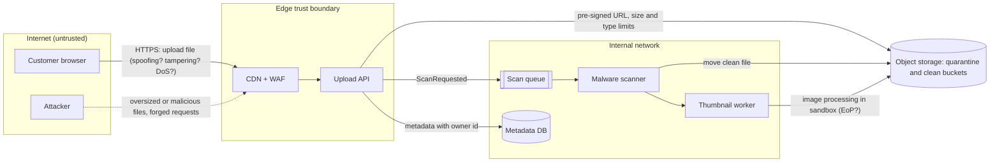
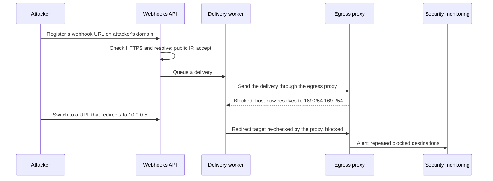

## TL;DR

- The **OWASP Top 10** is an awareness list of the most critical web application risk categories; **broken access control** tops it. Use it for education, and OWASP **ASVS** for testable requirements.
- Most vulnerabilities fall into recurring classes with known defences: parameterised queries (injection), output encoding + CSP (XSS), object-level authorisation checks (IDOR), allow-listed outbound requests (SSRF), safe defaults and patching (misconfiguration, vulnerable components).
- **Threat modelling** is structured thinking about what can go wrong, done early in design: *What are we working on? What can go wrong? What are we going to do about it? Did we do a good job?* (Shostack's four questions).
- **STRIDE** per element/data flow on a diagram with **trust boundaries** is a practical way to find threats; prioritise by risk and record mitigations as backlog items and tests.
- Security is a design property: least privilege, defence in depth, secure defaults, fail closed — plus automation (SAST, dependency scanning, secret scanning) and fast patching.

## Core Concepts

### OWASP Top 10 (2025 edition)

| # | Category | Typical example | Core defence |
|---|---|---|---|
| A01 | Broken Access Control (now includes SSRF) | `/api/invoices/123` returns another customer's invoice (IDOR); a fetch-URL feature reaches the cloud metadata endpoint | Server-side, deny-by-default, object-level checks; egress allow-lists |
| A02 | Security Misconfiguration | Debug endpoints in prod, default creds, public bucket | Hardened defaults, IaC + policy checks |
| A03 | Software Supply Chain Failures | Log4Shell in a transitive dependency; a compromised package or build step | SCA, SBOMs, pinned and verified dependencies, protected pipelines |
| A04 | Cryptographic Failures | Passwords hashed with SHA-1; PII sent over HTTP | TLS everywhere, Argon2id/bcrypt, managed keys |
| A05 | Injection (incl. XSS) | `"SELECT ... WHERE id = " + id` | Parameterised queries, encoding, validation |
| A06 | Insecure Design | No rate limit on OTP verification | Threat modelling, secure design patterns |
| A07 | Authentication Failures | Credential stuffing, weak session handling | MFA, rate limits, secure sessions |
| A08 | Software or Data Integrity Failures | Unsigned updates, insecure deserialisation | Signing, integrity checks, safe deserialisation |
| A09 | Security Logging & Alerting Failures | Breach undetected for months | Audit logs, alerting, incident response |
| A10 | Mishandling of Exceptional Conditions | An error path fails open and skips an authorisation check | Fail closed, centralised error handling, tests for error paths |

Compared with the 2021 edition, SSRF was folded into Broken Access Control, Vulnerable & Outdated Components widened into Software Supply Chain Failures, and Mishandling of Exceptional Conditions is new. Related lists: **OWASP API Security Top 10** (2023) and **OWASP Top 10 for LLM Applications**.

### Key vulnerability classes and defences

**Injection** — untrusted data interpreted as code/commands:

```ts
// Vulnerable
await db.query(`SELECT * FROM users WHERE email = '${email}'`);
// Safe: parameterised
await db.query('SELECT * FROM users WHERE email = $1', [email]);
```

Also applies to OS commands (avoid shells; pass argument arrays), LDAP, NoSQL operators (`{"$gt": ""}` in MongoDB queries), template engines.

**Cross-site scripting (XSS)** — attacker script runs in victims' browsers:
- Context-aware **output encoding** (frameworks like React escape by default; `dangerouslySetInnerHTML`/`v-html` bypass it).
- Sanitise rich HTML with a maintained sanitiser (DOMPurify, sanitize-html).
- **Content Security Policy** (nonce-based `script-src`, no `unsafe-inline`) as defence in depth; `HttpOnly` cookies limit token theft.

**CSRF** — a malicious site makes the victim's browser send authenticated requests: `SameSite` cookies (Lax/Strict), anti-CSRF tokens for state-changing requests, check `Origin`.

**SSRF** — server fetches attacker-controlled URLs, reaching internal services or cloud metadata (`169.254.169.254`): allow-list destinations, resolve and validate IPs (block private/link-local ranges, re-check after redirects/DNS rebinding), separate egress network, IMDSv2 on AWS.

**Broken object-level authorisation** — check ownership/tenancy on every object access; derive tenant/user from the authenticated context, never from the request body.

### Threat modelling

**Shostack's four questions:**
1. **What are we working on?** — a data-flow diagram: external entities, processes, data stores, data flows, and **trust boundaries** (internet ↔ edge, service ↔ database, tenant ↔ tenant, your account ↔ vendor).
2. **What can go wrong?** — STRIDE per element and per boundary-crossing flow; attack trees for high-value goals; abuse cases.
3. **What are we going to do about it?** — mitigate, eliminate (remove the feature/data), transfer (insurance, vendor), or accept (documented).
4. **Did we do a good job?** — review coverage, verify mitigations with tests, revisit when the design changes.

**STRIDE:**

| Threat | Property violated | Example | Typical mitigation |
|---|---|---|---|
| Spoofing | Authentication | Forged JWT, stolen session | Strong auth, token validation, mTLS |
| Tampering | Integrity | Modifying price in a request; altering messages on a queue | Server-side validation, signing, authorisation |
| Repudiation | Non-repudiation | "I never approved that refund" | Tamper-evident audit logs |
| Information disclosure | Confidentiality | Verbose errors, IDOR, unencrypted backups | Least privilege, encryption, error hygiene |
| Denial of service | Availability | Expensive GraphQL queries, unbounded uploads | Rate limits, quotas, timeouts, size limits |
| Elevation of privilege | Authorisation | User calls admin endpoint; container escape | Deny-by-default authz, least privilege, sandboxing |

Other methods: **LINDDUN** (privacy threats), **PASTA** (risk-centric, attacker-focused), **attack trees**, and lightweight "threat modelling as code" in design reviews.

### Security design principles

Least privilege · defence in depth · secure by default · fail closed · minimise attack surface · separation of duties · don't trust input (validate at boundaries) · keep security simple and centralised (auth libraries, policy engines) · assume breach (detect and contain).

### Worked example: STRIDE on a password reset flow

The flow: a user enters their email, the service emails a reset link with a token, and the user follows it to set a new password. It crosses two trust boundaries: the internet into the API, and the API out to the email provider. A 40-minute session produced this:

| STRIDE | Threat | Risk | Mitigation |
|---|---|---|---|
| **Spoofing** | An attacker requests a reset for the victim and guesses the token | High | At least 128 bits of randomness, single use, expiry within about 15–30 minutes, store only a hash of the token, rate-limit attempts |
| **Tampering** | **Host header poisoning:** the attacker sets the `Host` header, so the emailed link points to their domain and leaks the token when clicked | High | Build links from a configured base URL, never from the request's `Host` header |
| **Repudiation** | A user says they never changed their password | Low | Audit log of reset requests and completions, and an email to the account owner after any change |
| **Information disclosure** | The response or its timing reveals whether an email address has an account | Medium | The same message and similar timing whether or not the account exists; send the email asynchronously |
| **Denial of service** | Flooding a victim with reset emails, or running up email costs | Medium | Rate limits per account and per IP, and a challenge after repeated requests |
| **Elevation of privilege** | Resetting the password doesn't end existing sessions, so an attacker who already has a session keeps it | High | Revoke all sessions and refresh tokens on reset; require the second factor if MFA is enrolled |

**Outputs:** six backlog items, each with a test. The Host-header and session-revocation tests became regression tests in CI. The session took less time than fixing any one of these issues after launch.

## How It Works

Threat modelling a feature: data-flow diagram with trust boundaries, then STRIDE on each crossing.



For each arrow crossing a boundary, ask STRIDE questions — e.g. *upload*: can someone upload as another user (S)? Swap the content type (T)? Upload 10 GB (D)? *Thumbnail worker*: can a crafted image exploit the image library (E)? Record threats, risk rating and mitigations; turn mitigations into stories and tests.

### An SSRF attempt through a webhook feature



## When to Use / Trade-offs

| Practice | Use when | Avoid when | Cost / trade-off |
|---|---|---|---|
| Lightweight threat model in design review (30–60 min) | Every significant feature or architecture change | Trivial UI tweaks | Small time cost; catches design flaws early |
| Full threat modelling workshop | New systems, high-risk data (payments, health), new trust boundaries | Low-risk internal tools | Hours of senior time; high value for critical systems |
| OWASP ASVS as requirements | Defining a security baseline per risk level | — | Needs tailoring; L1/L2/L3 depth |
| SAST | Every repo in CI | — | False positives; tune rules |
| DAST / pen testing | Before major launches, regularly for internet-facing apps | As the only control | Late feedback; finds runtime issues SAST misses |
| Bug bounty | Mature security programme with triage capacity | Before basics are in place | Ongoing cost; real-world coverage |

## Common Pitfalls & Anti-patterns

- **Security as a final gate** — pen test a week before launch finds design flaws too late to fix properly.
- **Client-side enforcement** — hiding admin buttons, validating only in the browser.
- **Blocklists instead of allow-lists** — filtering `<script>` or `../` patterns; attackers find bypasses.
- **Rolling your own crypto or sanitiser.**
- **Verbose errors** — stack traces and SQL in responses aid attackers.
- **Secrets in code, images or CI logs.**
- **Threat models as shelfware** — produced once for compliance and never updated or linked to backlog items.
- **Scanning without fixing** — thousands of unprioritised findings; teams tune out.
- **Ignoring business-logic abuse** — coupon stacking, refund loops, rate-limit-free OTP endpoints aren't found by scanners.

## Real-world Scenario

**Context:** A fintech added a "import transactions from your bank's URL" feature. A quick threat-modelling session during design (not after) drew the data flow: user-supplied URL → fetch service → parser → database.

**Findings:** STRIDE on the fetch flow surfaced **SSRF** (the URL could point to internal services or the cloud metadata endpoint, exposing credentials), **DoS** (huge or slow responses), **tampering via parser exploits** (CSV/XML parsing — XXE if XML), and **information disclosure** (error messages echoing internal hostnames).

**Decision:** Replaced arbitrary URLs with an allow-list of supported bank domains; the fetcher ran in an isolated subnet with egress only via a proxy enforcing the allow-list and blocking private ranges; IMDSv2 enforced; strict size/time limits; XML parsing with external entities disabled; generic error messages with correlation ids; tests for each mitigation added to CI.

**Outcome:** A later external pen test specifically attempted SSRF against the feature and failed. The 45-minute session prevented what would likely have been a critical finding post-launch.

**What I'd do differently:** Make threat-modelling prompts part of the design-doc template so this happens for every feature with external inputs, not only when a security-minded engineer is in the room.

## Interview Questions

### What is the OWASP Top 10, and how should teams use it? {#owasp-top-10}

**Level:** Foundation

**Model answer:**
The OWASP Top 10 is a regularly updated **awareness document** listing the most critical categories of web application security risk, based on data from many organisations and community input. The 2025 edition is led by **Broken Access Control** (which now includes SSRF), followed by security misconfiguration, **software supply chain failures** (new), cryptographic failures, injection, insecure design, authentication failures, software or data integrity failures, logging and alerting failures, and **mishandling of exceptional conditions** (new).

Use it to:
- Educate developers on common vulnerability classes and defences.
- Shape secure coding guidelines and code review checklists.

Don't use it as a complete standard or compliance checklist — for testable requirements use **OWASP ASVS**; for APIs the **API Security Top 10**; for LLM apps the **LLM Top 10**.

**What the interviewer is looking for:**
Purpose (awareness), top categories with examples, and the right companions (ASVS).

**Follow-ups:**
- Why is broken access control at the top?
- What's in ASVS that the Top 10 doesn't give you?

**Red flags:**
- "We passed the OWASP Top 10, so we're secure."
- Can't name examples or defences.

### What is SQL injection and how do you prevent it? {#injection}

**Level:** Foundation

**Model answer:**
SQL injection happens when untrusted input is concatenated into a SQL statement so the database interprets it as code: `' OR 1=1 --` returning all rows, or `'; DROP TABLE users; --`. Consequences range from data theft to full database compromise.

Prevention:
- **Parameterised queries / prepared statements** for all values — the database treats parameters as data, never as SQL. ORMs and query builders do this by default (beware raw-query escape hatches).
- For dynamic identifiers (column names, sort order), use **allow-lists** — parameters can't bind identifiers.
- **Least-privilege DB accounts** so even a successful injection is limited (no DDL, no access to other schemas).
- Input validation as defence in depth (type, length, format) — not a substitute.
- SAST rules and code review to catch string-built queries.

The same principle applies to other interpreters: shell commands (use argument arrays, avoid `shell=true`), NoSQL query operators, LDAP, XPath, template engines.

**What the interviewer is looking for:**
Mechanism, parameterisation as the fix, allow-lists for identifiers, least privilege, and generalising to other injection types.

**Follow-ups:**
- How would you safely implement user-selected sort columns?
- What is NoSQL injection?

**Red flags:**
- "Escape quotes" as the main defence.
- Believing ORMs make injection impossible in all cases.

### What is cross-site scripting, and how do you defend against it? {#xss}

**Level:** Foundation

**Model answer:**
XSS lets an attacker run their JavaScript in another user's browser on your site, stealing data, performing actions as the user, or defacing pages. Types: **stored** (payload saved, e.g. in a comment), **reflected** (payload in a request echoed back), **DOM-based** (client-side code writes untrusted data into the DOM).

Defences:
- **Contextual output encoding:** HTML body, attributes, JavaScript, URLs and CSS need different encoding. Modern frameworks (React, Angular, Vue) escape by default — the danger is bypasses: `dangerouslySetInnerHTML`, `v-html`, `innerHTML`, `href="javascript:..."`.
- **Sanitise** user-supplied HTML with a maintained sanitiser (DOMPurify) when rich text is required.
- **Content Security Policy:** restrict script sources (nonce- or hash-based `script-src`, no `unsafe-inline`), as defence in depth; Trusted Types for DOM sinks.
- **HttpOnly cookies** so session cookies can't be read by scripts (limits impact, doesn't prevent XSS).
- Validate URLs (allow `https:` only) before rendering links.

**What the interviewer is looking for:**
The three types, context-aware encoding, framework bypasses, sanitisation, CSP and HttpOnly as layers.

**Follow-ups:**
- How does a nonce-based CSP work?
- Why doesn't input filtering of `<script>` work?

**Red flags:**
- Blacklisting tags as the defence.
- Believing React makes XSS impossible.

### What is STRIDE? Give an example for each category. {#stride}

**Level:** Foundation

**Model answer:**
STRIDE is a mnemonic (from Microsoft) for categories of threats, each violating a security property:
- **Spoofing** (authentication): using a stolen session cookie to act as someone else.
- **Tampering** (integrity): changing the `price` field in a checkout request; altering messages on a queue.
- **Repudiation** (non-repudiation): an admin denies issuing a refund and there's no reliable audit log.
- **Information disclosure** (confidentiality): an API returns other customers' data; stack traces leak internals; unencrypted backups.
- **Denial of service** (availability): unbounded file uploads or expensive queries exhausting resources.
- **Elevation of privilege** (authorisation): a normal user calls an admin endpoint; container escape to the host.

In practice you apply STRIDE to each element and data flow on a data-flow diagram, especially where flows cross **trust boundaries**, and record mitigations.

**What the interviewer is looking for:**
Each category with its property and a concrete example, and how it's applied to a diagram.

**Follow-ups:**
- Which STRIDE categories apply to a data store?
- What's LINDDUN for?

**Red flags:**
- Listing the words without examples.
- Not linking it to a diagram or design.

### How do you run a threat modelling session for a new feature? {#threat-modelling-session}

**Level:** Senior

**Model answer:**
- **Who:** the feature's engineers, product owner, a security champion or AppSec engineer, and someone who knows the operations side. 45–90 minutes for a feature; longer for new systems.
- **What are we working on?** Draw (or update) the data-flow diagram: actors, processes, data stores, flows with data classification, **trust boundaries**. Agree scope and assumptions.
- **What can go wrong?** Walk each boundary-crossing flow and element with STRIDE; add abuse cases ("what would a fraudster do?") and business-logic misuse (coupon stacking, refund loops). Capture everything without judging.
- **What are we going to do?** Rate each threat (likelihood × impact, or a simple high/medium/low), choose mitigate/eliminate/transfer/accept, and convert mitigations into backlog items with acceptance criteria and tests. Accepted risks get an owner and a review date.
- **Did we do a good job?** Check coverage of boundaries, confirm mitigations are implemented (tests, review), and revisit when the design changes.
- **Keep it lightweight and repeatable:** a template in the design doc, stored next to the code, updated incrementally.

**What the interviewer is looking for:**
The four-question structure, right participants, DFD with trust boundaries, STRIDE plus abuse cases, prioritisation, and turning findings into tracked work.

**Follow-ups:**
- How do you scale threat modelling across 40 teams?
- How do you threat model when the design keeps changing?

**Red flags:**
- A document filled in by security alone after the build.
- No follow-through into backlog items.

### What is CSRF, and how do modern applications prevent it? {#csrf}

**Level:** Senior

**Model answer:**
Cross-site request forgery tricks a logged-in user's browser into sending a state-changing request to your site from an attacker's page — the browser attaches the user's cookies automatically, so the request is authenticated. Example: a hidden form on `evil.example` POSTing to `bank.example/transfer`.

Defences:
- **SameSite cookies:** `SameSite=Lax` (default in modern browsers for cookies without the attribute) blocks cookies on cross-site POSTs; `Strict` blocks them on all cross-site navigations. A strong baseline but not complete (same-site subdomains, older browsers, GET endpoints that change state).
- **Anti-CSRF tokens** (synchroniser token or double-submit cookie) required on state-changing requests.
- **Verify `Origin`/`Referer`** headers for state-changing requests.
- **Never change state on GET.**
- APIs authenticated via `Authorization` headers (not cookies) aren't vulnerable to classic CSRF, but beware CORS misconfiguration (`Access-Control-Allow-Origin` reflecting any origin with credentials).

**What the interviewer is looking for:**
The mechanism, SameSite nuances, tokens, Origin checks, and the cookie-vs-header distinction plus CORS pitfalls.

**Follow-ups:**
- Does a JSON API with cookie auth need CSRF protection?
- How does CORS relate to CSRF?

**Red flags:**
- "We use HTTPS so CSRF isn't possible."
- State-changing GET endpoints.

### What is SSRF, and why is it dangerous in the cloud? {#ssrf}

**Level:** Senior

**Model answer:**
Server-side request forgery occurs when an attacker makes your server send requests to destinations they choose — via URL-fetch features (webhooks, image import, PDF generators, link previews) or parsers that follow references (XXE). The server is inside your network, so it can reach things the attacker can't: internal admin services, databases with HTTP interfaces, and **cloud metadata endpoints** (`169.254.169.254`) that may return temporary credentials — the Capital One breach (2019) involved this pattern.

Defences:
- **Avoid arbitrary URLs:** allow-list domains or use known integrations.
- If you must fetch: resolve DNS yourself, block private, loopback, link-local and metadata ranges (IPv4 and IPv6), **re-validate after redirects** and guard against DNS rebinding (pin the resolved IP for the connection).
- **Network controls:** run fetchers in an isolated network segment with egress only via a filtering proxy; no route to internal services.
- **Cloud hardening:** IMDSv2 on AWS (session tokens, hop limit), least-privilege instance roles, metadata access restrictions on other clouds.
- Limit response size, time and protocols (http/https only).

**What the interviewer is looking for:**
Where SSRF arises, the metadata credential risk, and layered defences (allow-listing, IP validation with redirect/rebinding handling, network isolation, IMDSv2).

**Follow-ups:**
- How would you implement a safe webhook-delivery system regarding SSRF?
- What is DNS rebinding?

**Red flags:**
- Blocking `localhost` string matches only.
- Unaware of cloud metadata endpoints.

### How should applications manage secrets? {#secrets-management}

**Level:** Senior

**Model answer:**
- **Avoid secrets where possible:** managed/workload identities (Azure managed identity, AWS IAM roles, workload identity federation for CI) replace keys and passwords for cloud services.
- **Store remaining secrets in a vault** (Key Vault, Secrets Manager, HashiCorp Vault) with access via identity and least-privilege policies; never in source code, container images, or plain environment files in repos.
- **Inject at runtime** (vault references, CSI driver, SDK fetch with caching) rather than baking into artefacts.
- **Rotate** regularly and automatically; prefer **short-lived dynamic credentials** (e.g. Vault database secrets) so leaks expire quickly.
- **Prevent leaks:** secret scanning in pre-commit and CI (and push protection on the Git host), redact secrets in logs, mask in CI output.
- **Detect and respond:** alerts on secret access anomalies; a runbook for leaked secrets — revoke and rotate first, then investigate (removing from Git history alone is not enough; assume it's compromised).
- **Separate per environment** so dev secrets never grant prod access.

**What the interviewer is looking for:**
Identity over secrets, vaults, runtime injection, rotation and short-lived credentials, scanning and incident response.

**Follow-ups:**
- A developer pushed an API key to a public repo 10 minutes ago. What do you do?
- How do you handle secrets for local development?

**Red flags:**
- `.env` files committed "because the repo is private".
- Rewriting Git history as the fix for a leaked key.

### How do you implement secure file uploads? {#file-uploads}

**Level:** Senior

**Model answer:**
Threats: malware distribution, server-side code execution (uploading a script to a web-served directory), XSS via SVG/HTML, path traversal in filenames, parser exploits (image libraries, ZIP bombs, XXE in office files), DoS via huge files, and access-control flaws on downloads.

Controls:
- **Store outside the web root**, ideally in object storage; generate your own object keys — never use the user's filename as a path.
- **Validate type by content** (magic bytes), not extension or `Content-Type`; allow-list types needed; re-encode images to strip metadata and payloads.
- **Size limits** at the edge and in pre-signed upload policies; time limits; ZIP-bomb protection when decompressing.
- **Malware scanning** in a quarantine bucket before files become available.
- **Process in sandboxes** (isolated workers with minimal privileges) and keep parsing libraries patched.
- **Serve safely:** from a separate domain (no cookies), with `Content-Disposition: attachment` for risky types, correct `Content-Type`, `X-Content-Type-Options: nosniff`; SVG treated as untrusted.
- **Authorise downloads** per object (signed short-lived URLs after an access check).

**What the interviewer is looking for:**
A broad threat list and layered controls covering storage, validation, scanning, processing isolation and safe serving.

**Follow-ups:**
- Why serve user content from a separate domain?
- How would you handle uploads that must be previewed in the browser?

**Red flags:**
- Trusting the file extension.
- Serving uploads from the same origin as the app with sniffable types.

### How do you prioritise thousands of vulnerability findings? {#vulnerability-prioritisation}

**Level:** Senior

**Model answer:**
Severity alone (CVSS base score) produces too many "critical" findings. Prioritise by **risk in context**:
- **Exploitability in the wild:** known exploited vulnerabilities (CISA KEV catalogue), exploit availability, and probability scores like **EPSS**.
- **Reachability:** is the vulnerable function actually called? Is the component internet-facing? Reachability analysis in modern SCA tools reduces noise dramatically.
- **Asset criticality and exposure:** production vs dev, internet-facing vs internal, sensitive data, compensating controls (WAF rules, network isolation).
- **Fix cost:** a patch-version bump is cheap — automate it (Renovate/Dependabot with auto-merge for passing tests).

Process:
- **SLAs by risk tier** (e.g. exploited + internet-facing: 48 hours; high: 30 days).
- **Fix at the source:** update base images and shared libraries centrally so many findings close at once.
- **Ownership** routed to the owning team automatically; dashboards of age and SLA compliance.
- **Risk acceptance** with expiry for findings that can't be fixed yet.
- Tune tools to cut false positives — trust is a resource.

**What the interviewer is looking for:**
Context-based risk (KEV, EPSS, reachability, exposure), automation of cheap fixes, SLAs and ownership.

**Follow-ups:**
- What is EPSS and how does it differ from CVSS?
- How would you handle a critical CVE in a library with no fix available?

**Red flags:**
- Fixing strictly in CVSS order.
- Dumping raw scanner output on teams.

### Threat model a payments API that lets merchants create charges and refunds. {#threat-model-payments}

**Level:** Architect

**Model answer:**
**Diagram:** merchant servers → API gateway (internet boundary) → payments service → card vault/tokenisation (PCI zone boundary) → payment processor (third-party boundary); webhooks back to merchants; admin console for support staff; databases and audit logs.

**Key threats (STRIDE) and mitigations:**
- **Spoofing:** stolen merchant API keys → per-merchant scoped keys/OAuth client credentials, key rotation, IP allow-lists optional, anomaly detection on key usage; mTLS for high-value merchants.
- **Tampering:** amount/currency modified, replayed requests → server-side validation, idempotency keys, request signing (HMAC with timestamps), immutable charge records.
- **Repudiation:** disputes over who issued a refund → tamper-evident audit logs (append-only, separate account), user attribution for admin actions.
- **Information disclosure:** card data exposure → tokenisation so most systems never see PANs (minimises PCI scope), encryption with HSM-backed keys, strict IDOR checks on charge ids, no PAN in logs.
- **DoS:** card-testing attacks (many small charges) → rate limits per merchant/card/IP, velocity checks, CAPTCHA on hosted pages, fraud scoring.
- **Elevation of privilege:** support staff issuing refunds to themselves → separation of duties, approval workflows above thresholds, JIT admin access, refunds only to the original payment method.
- **Webhooks:** signed payloads, SSRF-safe delivery.
- **Business logic abuse:** refund > charge amount, multiple partial refunds exceeding total, currency rounding exploits → invariants enforced in the domain model and DB constraints.

Then rank by risk, map to PCI DSS requirements, and turn mitigations into stories, tests and monitoring.

**What the interviewer is looking for:**
A structured model with trust boundaries, STRIDE applied concretely, domain-specific threats (card testing, refund abuse, PCI scope), and actionable mitigations.

**Follow-ups:**
- How does tokenisation reduce PCI scope?
- How would you detect a compromised merchant key?

**Red flags:**
- Generic threats without payment-specific abuse cases.
- Ignoring insider threats.

### Design a security review process for an organisation shipping hundreds of changes a day. {#security-review-process}

**Level:** Architect

**Model answer:**
Goal: **proportionate security** that scales without becoming a bottleneck.

- **Paved road with secure defaults:** authentication/authorisation libraries, secure templates, hardened base images, IaC modules with policy — most changes inherit security automatically.
- **Automation on every change:** SAST, dependency (SCA) and container scanning, secret scanning with push protection, IaC policy checks, all in CI with clear, tuned, actionable findings and blocking only for high-confidence/high-risk issues.
- **Risk-based human review:** a short **security questionnaire/triage** in the design-doc template ("new external input? new data classification? new trust boundary? auth changes?"). Low risk → self-serve guidance; medium → threat model led by the team with a security champion; high (payments, auth, new public surface, sensitive data) → AppSec-led threat model and review.
- **Security champions:** trained engineers in each team who facilitate threat modelling and triage findings, with a community run by AppSec.
- **Verification:** DAST and pen testing for high-risk launches and periodically; bug bounty once mature.
- **Feedback loop:** incident and pen-test findings feed back into paved-road improvements and training; metrics (time to remediate, findings by class, coverage of threat models for high-risk changes).

**What the interviewer is looking for:**
Secure defaults, CI automation, risk-tiered human review, champions, verification and continuous improvement.

**Follow-ups:**
- How do you measure whether the programme is working?
- Teams complain scanners block releases with false positives. What do you do?

**Red flags:**
- Every change waits for a central security sign-off.
- Tooling without tuning or ownership.

### How do you secure the software supply chain? {#supply-chain-security}

**Level:** Architect

**Model answer:**
Threats: malicious or compromised dependencies (typosquatting, maintainer account takeover, malicious updates), compromised build systems (SolarWinds), tampered artefacts, leaked CI credentials, vulnerable transitive dependencies.

Controls:
- **Dependencies:** lockfiles and pinned versions, a curated internal registry/proxy, automated updates with tests (Renovate/Dependabot), SCA with reachability, policies against brand-new or unmaintained packages, install scripts restricted where possible.
- **Source integrity:** branch protection, required reviews, signed commits for sensitive repos, CODEOWNERS for critical paths.
- **Build integrity:** ephemeral, isolated build runners; minimal CI permissions; workload identity federation instead of long-lived secrets; pinned CI actions by commit SHA; aim for **SLSA** build levels with **provenance** attestations.
- **Artefact integrity:** sign images and packages (Sigstore/cosign), verify signatures and provenance at deploy time (admission policies), immutable registries.
- **Transparency:** generate **SBOMs** (SPDX/CycloneDX) for every artefact; use them to answer "where are we running library X?" in minutes.
- **Runtime:** minimal base images, read-only filesystems, least-privilege workloads; monitor for unexpected behaviour.

**What the interviewer is looking for:**
Coverage across dependencies, source, build, artefacts and runtime, with concrete standards (SLSA, SBOM, Sigstore).

**Follow-ups:**
- How would SBOMs have helped during Log4Shell?
- How do you protect against a malicious update to a popular npm package?

**Red flags:**
- Only scanning for CVEs.
- CI with broad cloud admin credentials stored as secrets.

### How would you threat model an LLM-powered application? {#llm-threat-model}

**Level:** Architect

**Model answer:**
Start with the same diagram-based approach, adding LLM-specific elements: the model (often a third-party API), prompts, retrieved documents (RAG), tools/actions the model can trigger, conversation memory, and outputs rendered to users or other systems.

Key threats (aligned with OWASP Top 10 for LLM Applications):
- **Prompt injection** (direct from users, **indirect** via retrieved documents, emails or web pages) causing the model to ignore instructions, leak data or call tools maliciously.
- **Sensitive information disclosure:** the model reveals data from its context that the user shouldn't see (RAG without permission filtering), or system prompts/secrets.
- **Excessive agency:** tools with broad permissions; the model taking irreversible actions.
- **Insecure output handling:** model output rendered as HTML (XSS), executed as code/SQL, or passed to downstream systems unchecked.
- **Data and model supply chain:** poisoned training/RAG data, untrusted model weights.
- **Denial of wallet/service:** expensive prompts, runaway agent loops.
- **Privacy:** prompts and logs containing personal data sent to vendors.

Mitigations: authorisation enforced in tools and retrieval (per-user permission filtering at query time), least-privilege tools with human approval for high-impact actions, treating all model output as untrusted (encode, validate against schemas), separating trusted instructions from untrusted content (and accepting that this is not a complete defence), rate and spend limits, PII redaction, vendor data agreements, evaluation and red-teaming for injection, and monitoring of tool calls.

**What the interviewer is looking for:**
Applying threat modelling to new components, indirect injection awareness, authorisation outside the model, output handling, and cost abuse.

**Follow-ups:**
- Why can't you solve prompt injection with a better system prompt?
- How would you test for indirect prompt injection?

**Red flags:**
- Relying on prompt instructions as the security boundary.
- Giving agents broad credentials.

### A critical zero-day is announced in a widely used library (like Log4Shell). How do you respond? {#zero-day-response}

**Level:** Architect

**Model answer:**
**First hours — assess and contain:**
1. Declare a security incident; assign an incident commander, comms lead, and workstreams.
2. **Find exposure:** query SBOMs and SCA inventories, container image scans, runtime detection — which services, versions, internet-facing or not, including vendor products and transitive dependencies.
3. **Mitigate immediately where patching isn't instant:** WAF rules for known exploit patterns, configuration flags that disable the vulnerable feature, egress restrictions (Log4Shell exploitation needed outbound LDAP/JNDI), taking non-essential exposed services offline.
4. **Detect exploitation:** search logs for indicators of compromise, enable additional monitoring; assume breach for exposed systems until shown otherwise.

**Next days — remediate:**
5. Patch/upgrade, prioritising internet-facing and critical systems; rebuild images from patched bases; push fixes through fast but tested pipelines.
6. Track vendor patches and apply; obtain vendor statements.
7. Verify with re-scans and inventory; follow updated advisories (follow-up CVEs often appear, as happened with Log4j).

**Afterwards:** postmortem — inventory gaps (could we answer "where is it?" in minutes?), patch pipeline speed, egress controls, communication; invest in SBOMs, automated dependency updates and runtime visibility.

**What the interviewer is looking for:**
Incident structure, inventory via SBOM, rapid compensating controls, compromise detection, prioritised patching, and lessons learned.

**Follow-ups:**
- How long should it take you to know every affected service?
- How do you handle third-party SaaS vendors that may be affected?

**Red flags:**
- Waiting for patches before doing anything.
- No inventory of dependencies in production.

### Explain least privilege, defence in depth and failing closed, with examples. {#security-design-principles}

**Level:** Foundation

**Model answer:**
These three principles prevent many vulnerabilities before any scanner runs.

**Least privilege:** every user, service and component gets only the access it needs, for only as long as it needs it.
- A reporting service gets a read-only database role on the tables it uses, not the application's admin account.
- A CI job deploying to one environment gets credentials scoped to that environment, issued per run.
- Engineers get production access just in time, with approval and expiry, not permanently.

**Defence in depth:** several independent layers, so one failure doesn't mean a breach.
- XSS: output encoding, plus a strict CSP, plus `HttpOnly` cookies.
- SSRF: an allow-list in the application, plus an egress proxy blocking private ranges, plus IMDSv2 on the cloud metadata service.
- Each layer should fail independently. Two checks in the same library aren't really two layers.

**Fail closed (fail secure):** when something goes wrong, deny rather than allow.
- If the authorisation service times out, the request is refused, not let through.
- An exception in a permission check returns an error rather than skipping the check. The OWASP Top 10 2025 added **Mishandling of Exceptional Conditions** for exactly this.
- Unknown input types or states are rejected rather than handled by a permissive default.

**Balance with availability:** failing closed can hurt users during outages. Decide per control. Authentication and authorisation should fail closed; a recommendation widget can fail open.

**What the interviewer is looking for:**
Clear definitions with concrete examples, independent layers, exception paths that deny, and a sensible balance with availability.

**Follow-ups:**
- Give an example where failing open is the right choice.
- How do you apply least privilege to a service account that's grown too powerful?

**Red flags:**
- Catch-all error handlers that continue as if nothing happened.
- Shared admin credentials "because it's simpler".

### How do you prevent broken access control, such as IDOR, systematically across an API? {#broken-access-control}

**Level:** Senior

**Model answer:**
Broken access control is first in the OWASP Top 10, and **broken object-level authorisation (BOLA)** is first in the API Security Top 10. The classic case is an **IDOR (insecure direct object reference)**: changing `/invoices/123` to `/invoices/124` returns someone else's invoice. Fixing individual endpoints doesn't scale. Make the safe pattern the default.

**Design rules:**
- **Deny by default:** every endpoint requires an explicit authorisation decision. Endpoints without one fail a test or a lint rule.
- **Authorise every object access,** not just the endpoint: "Can this user read *this* invoice?"
- **Derive identity and tenant from the authenticated context,** never from the request body, path or query string.
- **Scope queries:** load objects through repositories that always filter by tenant and owner (`WHERE tenant_id = $1 AND id = $2`), or use database **row-level security** as a second layer.
- **Separate function-level checks** (can this user call the admin API?) from object-level checks (can they act on this object?).
- Unguessable IDs such as UUIDs make enumeration harder, but they're **not** access control.

**Centralise:** a shared authorisation library or policy engine (such as OPA or Cedar) with policies reviewed by security, so decisions are consistent and auditable.

**Test it automatically:**
- For each endpoint, tests that a **second user or tenant gets 403 or 404** on the first user's objects.
- Tools and DAST scans that replay requests with another user's session.
- Code review checklists for new endpoints.

**Monitor:** log authorisation denials and alert on patterns, such as one user hitting many sequential IDs.

**What the interviewer is looking for:**
Deny by default, object-level checks, identity from context, scoped queries and row-level security, separating function and object checks, a centralised policy, automated cross-user tests, and monitoring.

**Follow-ups:**
- Should a forbidden object return 403 or 404?
- How do you retrofit object-level checks into 200 existing endpoints?

**Red flags:**
- Relying on hidden buttons or unguessable IDs.
- Taking the tenant ID from the request body.

### How do you find and prevent business-logic vulnerabilities that scanners miss? {#business-logic-abuse}

**Level:** Senior

**Model answer:**
Business-logic flaws use the application exactly as built, but in ways the designers didn't intend: stacking discount codes, refunding more than was paid, skipping a step in a checkout, or redeeming a gift card twice at the same time. Scanners can't find them, because the requests look legitimate.

**Find them in design:**
- Write **abuse cases** alongside user stories: "As a fraudster, I want to apply the same voucher twice."
- During threat modelling, ask **what the business invariants are** and how they could be broken: "a refund never exceeds the amount captured", "a voucher is used at most once".
- Map **workflows and their state transitions,** and check whether steps can be skipped, repeated or reordered.

**Common classes and defences:**

| Flaw | Defence |
|---|---|
| Race conditions (limit overruns, double spending) | Atomic database operations, unique constraints, row locks or optimistic concurrency, idempotency keys |
| Skipping workflow steps | Server-side state machines; each step checks the previous state |
| Trusting client-supplied values (prices, quantities, roles) | Recalculate on the server from trusted data |
| Abusing limits (OTP guessing, free trials, referral fraud) | Rate limits, quotas per identity and device, fraud signals |
| Negative or extreme values | Validate ranges and units on the server |

**Test them:**
- Tests for each invariant, including **concurrent requests** (send 20 redemptions in parallel and check only one succeeds).
- Property-based tests for calculations such as refunds and discounts.
- Manual exploratory testing and pen tests focused on business flows.

**Monitor:** alert on anomalies such as unusual refund ratios, voucher usage spikes or accounts created in bursts.

**What the interviewer is looking for:**
Abuse cases and business invariants in design, workflow state analysis, concrete flaw classes with defences (especially races), invariant and concurrency testing, and anomaly monitoring.

**Follow-ups:**
- How would you test a gift card redemption endpoint for race conditions?
- Who should own fraud and abuse prevention: security, product or a fraud team?

**Red flags:**
- "The scanner passed, so we're secure."
- Checking a balance and updating it in two separate, non-atomic steps.

### How would you secure an API platform of 200 APIs against the OWASP API Security Top 10? {#api-security-top-10}

**Level:** Architect

**Model answer:**
The **OWASP API Security Top 10 (2023)** focuses on risks typical of APIs: broken object-level authorisation, broken authentication, broken object property-level authorisation, unrestricted resource consumption, broken function-level authorisation, unrestricted access to sensitive business flows, SSRF, security misconfiguration, improper inventory management and unsafe consumption of third-party APIs. With 200 APIs, you can't rely on each team getting everything right. **Build the controls into the platform** and verify continuously.

**Inventory first (API9):** you can't protect APIs you don't know about.
- Every API registered in a catalogue with an owner, an OpenAPI specification, data classification and exposure (internal, partner or public).
- Detect unregistered or "shadow" APIs from gateway and traffic logs, and retire old versions on a schedule.

**At the gateway (consistent for everyone):**
- **Authentication** with standard tokens and validation (API2).
- **Rate limits, quotas, payload size limits and timeouts** (API4).
- Schema validation against the OpenAPI specification, rejecting unexpected fields.
- TLS, security headers and standard error responses (API8).

**In the services (with shared libraries):**
- **Object-level and function-level authorisation** through a common policy library, deny by default (API1, API5).
- **Property-level control (API3):** explicit response models that never return whole database objects, and explicit allow-lists of writable fields to prevent mass assignment.
- **Protect sensitive business flows (API6)**, such as sign-up, checkout and booking, with bot detection and business-level limits.
- **Egress controls** for any feature that fetches URLs (API7), and validation of data from third-party APIs as untrusted input (API10).

**Verify continuously:**
- Linting of OpenAPI specifications for security rules in CI.
- Automated authorisation tests across users and tenants.
- API-focused DAST and periodic pen tests on the riskiest APIs.
- Runtime monitoring for enumeration, unusual data volumes and errors.

**What the interviewer is looking for:**
Knowing the API Top 10, inventory as the foundation, gateway controls, shared libraries for authorisation and property-level safety, protecting business flows, egress control, and continuous verification.

**Follow-ups:**
- How do you find shadow APIs?
- What belongs in the gateway, and what must stay in the service?

**Red flags:**
- Assuming the gateway alone handles authorisation.
- Returning full database entities and hiding fields in the frontend.

### How would you run a red-team or assumed-breach exercise, and what do you do with the results? {#red-team-exercises}

**Level:** Architect

**Model answer:**
A **red-team exercise** simulates a realistic attacker pursuing a goal, such as "transfer money" or "exfiltrate customer data", using any permitted technique. It tests **detection and response** as much as prevention. An **assumed-breach** exercise starts from a foothold an attacker could plausibly have, such as a compromised laptop or a leaked CI token, and asks how far they could get.

**Plan it:**
- **Goals and scope** agreed with leadership: target assets, permitted techniques, systems that are off limits, and safety rules such as no real data exfiltration and no disruption.
- **Threat-led:** base the scenarios on realistic threat intelligence about who targets your sector and how. Regulated financial entities may be required to do this; the EU's DORA requires threat-led penetration testing for significant firms, following the TIBER-EU framework.
- **A small "white team"** knows about the exercise and can stop it. The defenders (the blue team) usually don't know, so their real response is tested.
- **Legal approval and written authorisation** for the testers.

**Measure what matters:**
- **Time to detect** each stage of the attack, if at all.
- **Time to contain,** and whether the right people were involved.
- **Which controls worked,** which were bypassed, and which alerts fired but were ignored.

**Use the results:**
- A **joint debrief** (purple teaming): attackers walk defenders through each step, and the teams build detections together.
- Fix systemic weaknesses first: excessive privileges, flat networks, long-lived credentials, missing logging.
- Turn the attack paths into **automated tests or detection rules,** so the same path is caught next time.
- Track remediation like any other high-priority risk, and repeat the exercise to confirm improvement.

**What the interviewer is looking for:**
Goal-based, threat-led scenarios, clear scope and safety rules, a white team, measuring detection and response, purple-team debriefs, systemic fixes, and turning findings into lasting detections.

**Follow-ups:**
- How is a red-team exercise different from a penetration test?
- The red team got domain admin in two hours. What do you fix first?

**Red flags:**
- Treating the report as a list of bugs to patch individually.
- Measuring only whether the attackers got in, not whether anyone noticed.

## Cheat Sheet

### OWASP and vulnerability classes
- **OWASP Top 10** — awareness list; 2025 edition led by Broken Access Control, with supply chain failures new at A03; use ASVS for testable requirements.
- **IDOR / BOLA** — missing object-level authorisation; check ownership on every access.
- **SQL injection** — fix with parameterised queries; allow-list identifiers.
- **XSS** — contextual output encoding, sanitise rich HTML, nonce-based CSP, HttpOnly cookies.
- **CSRF** — SameSite cookies, anti-CSRF tokens, Origin checks, no state change on GET.
- **SSRF** — allow-list destinations, block private/metadata IPs after redirects, isolate egress, IMDSv2.
- **Secure uploads** — content-type by magic bytes, size limits, scanning, separate domain, own object keys.

### Threat modelling
- **Four questions** — what are we working on, what can go wrong, what will we do, did we do a good job.
- **STRIDE** — spoofing, tampering, repudiation, information disclosure, denial of service, elevation of privilege.
- **Trust boundary** — where trust level changes; threats concentrate on flows crossing it.
- **Risk responses** — mitigate, eliminate, transfer, accept (with owner and review date).

### Programme
- **Secrets** — prefer workload identity; vault the rest; rotate; scan with push protection.
- **Prioritise vulns** — exploited in the wild (KEV), EPSS, reachability, exposure — not CVSS alone.
- **Supply chain** — lockfiles, SBOMs, SLSA provenance, signed artefacts, pinned CI actions.
- **LLM threats** — prompt injection (incl. indirect), excessive agency, insecure output handling.

### Revisit

- **Password reset threats** — guessable tokens, Host header poisoning, account enumeration, email flooding and sessions not revoked.
- **SSRF layers** — validate at registration, re-check at connection time through an egress proxy, don't follow redirects blindly, use IMDSv2.
- **Fail closed** — when a security check errors or times out, deny; OWASP Top 10 2025 added Mishandling of Exceptional Conditions.
- **BOLA / IDOR** — authorise every object access, take identity from the authenticated context, and test with a second user.
- **Business-logic abuse** — define invariants and abuse cases; test races with concurrent requests.
- **OWASP API Top 10** — start with an API inventory, then gateway controls, shared authorisation libraries and continuous tests.
- **Red teaming** — goal-based, threat-led attacks that measure detection and response, followed by purple-team fixes.

## Further Reading

- [OWASP Top 10](https://owasp.org/www-project-top-ten/) — the current awareness list and category details.
- [OWASP Application Security Verification Standard (ASVS)](https://owasp.org/www-project-application-security-verification-standard/) — testable security requirements by level.
- [OWASP Cheat Sheet Series](https://cheatsheetseries.owasp.org/) — concise defensive guidance per vulnerability class (XSS, SSRF, CSRF, file upload…).
- [Threat Modeling Manifesto](https://www.threatmodelingmanifesto.org/) — values and principles from leading practitioners.
- [OWASP Threat Dragon](https://owasp.org/www-project-threat-dragon/) — free threat-modelling diagram tool.
- [OWASP Top 10 for LLM Applications](https://genai.owasp.org/llm-top-10/) — LLM-specific risks such as prompt injection.
- [SLSA framework](https://slsa.dev/) — supply-chain levels for software artefacts and provenance.
