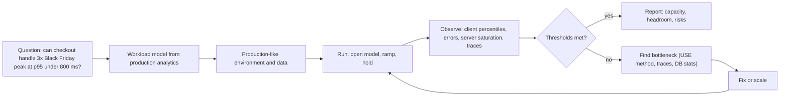
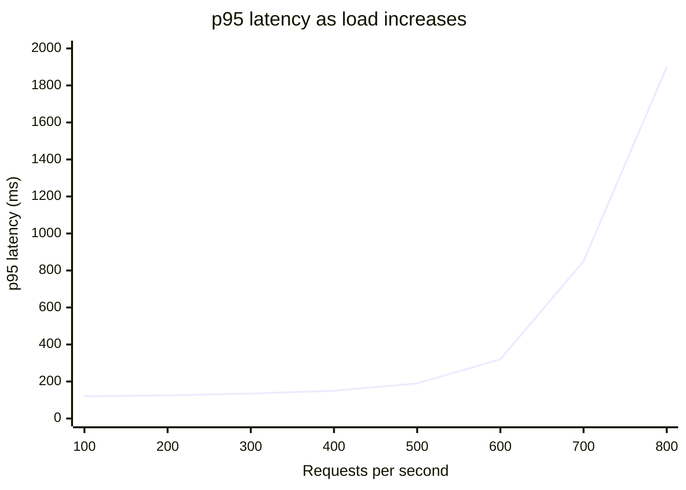
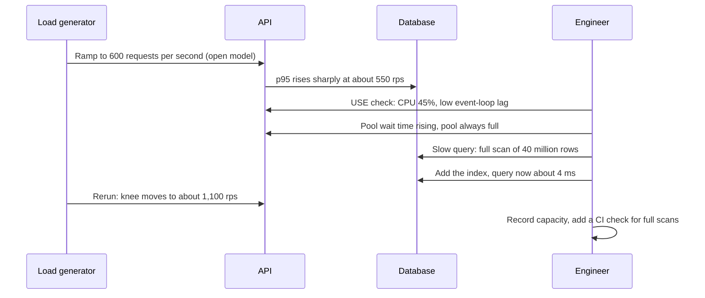

## TL;DR

- Performance testing answers specific questions: **does it meet its latency SLO at expected load, where does it break, how does it degrade, and does it stay healthy over time?** Different test types (load, stress, spike, soak, breakpoint) answer different questions. Decide the question before writing a script.
- A test is only as good as its **workload model**: realistic mix of operations, data, think times and arrival patterns. Use an **open model** (requests arrive at a fixed rate) for public services. A closed model hides overload, because slow responses automatically slow the load.
- Measure **percentiles** (p95, p99) and **throughput together with errors**, from both client and server sides. Beware **coordinated omission**, where a load generator that waits for slow responses under-reports latency dramatically.
- Run tests in a **production-like environment** with production-like data volumes, and observe everything (traces, saturation metrics, database stats) so a failure leads to a **bottleneck**, not just a number.
- Make performance **continuous**: small checks in CI with thresholds, regular full load tests before big launches, and capacity planning based on measured limits plus headroom.

## Core Concepts

### Test types

| Type | Question it answers | Shape |
|---|---|---|
| **Smoke** | Does the script and environment work at all? | A few users for a minute |
| **Load** | Do we meet our SLOs at expected peak load? | Ramp to expected peak, hold for 30–60 minutes |
| **Stress** | How does the system behave above peak, and does it degrade gracefully? | Ramp beyond peak in steps |
| **Spike** | Can we survive a sudden surge (a marketing email, a TV advert)? | Jump from normal to many times normal in seconds |
| **Soak (endurance)** | Do memory leaks, connection leaks or growing queues appear over hours? | Steady realistic load for 4–24 hours |
| **Breakpoint (capacity)** | What is the maximum sustainable throughput? | Increase load until SLOs or errors break |
| **Scalability** | Does adding instances increase capacity proportionally? | Repeat a load test at 1, 2, 4… instances |

### Workload modelling

A realistic workload model specifies:
- **The mix of operations**, from production analytics: for example 60% browse, 25% search, 10% add to basket, 5% checkout.
- **Arrival rate** at peak (requests or sessions per second), including daily and seasonal peaks and expected growth.
- **Think time and pacing** between user actions.
- **Data variety**: many different users, products and search terms, so caches behave realistically. Replaying one product id a million times tests your cache, not your system.
- **Payload sizes** and client behaviour (connection reuse, retries).

### Open versus closed models

- **Closed model**: a fixed number of virtual users, each sending a request and waiting for the response before sending the next. When the system slows down, the load automatically drops. Realistic for systems with a fixed population (call-centre agents, batch workers), but it hides overload for public services.
- **Open model**: requests arrive at a target rate regardless of how fast responses come back, as with real internet traffic. When the system slows down, requests pile up, exactly as they would in production.

Use an open model (in k6, `constant-arrival-rate` or `ramping-arrival-rate` executors) for most web APIs.

```ts
// k6 script (TypeScript is supported natively in recent k6 versions): open model, realistic mix, SLO thresholds.
import http from 'k6/http';
import { check, sleep } from 'k6';
import { SharedArray } from 'k6/data';

const products = new SharedArray('products', () => JSON.parse(open('./products.json')) as string[]);

export const options = {
  scenarios: {
    browse: {
      executor: 'ramping-arrival-rate',
      startRate: 50, timeUnit: '1s', preAllocatedVUs: 200, maxVUs: 2000,
      stages: [
        { target: 400, duration: '10m' },   // ramp to expected peak
        { target: 400, duration: '30m' },   // hold
        { target: 0, duration: '2m' },
      ],
      exec: 'browse',
    },
    checkout: {
      executor: 'constant-arrival-rate', rate: 20, timeUnit: '1s', duration: '42m',
      preAllocatedVUs: 100, maxVUs: 500, exec: 'checkout',
    },
  },
  thresholds: {
    'http_req_duration{scenario:browse}': ['p(95)<300', 'p(99)<800'],
    'http_req_duration{scenario:checkout}': ['p(95)<800'],
    http_req_failed: ['rate<0.005'],
  },
};

export function browse() {
  const id = products[Math.floor(Math.random() * products.length)];
  const res = http.get(`${__ENV.BASE_URL}/api/products/${id}`, { tags: { name: 'GET /products/:id' } });
  check(res, { 'status 200': (r) => r.status === 200 });
  sleep(Math.random() * 2);   // think time
}

export function checkout() {
  const res = http.post(`${__ENV.BASE_URL}/api/checkout`, JSON.stringify({ basketId: 'synthetic' }), {
    headers: { 'Content-Type': 'application/json' }, tags: { name: 'POST /checkout' },
  });
  check(res, { 'accepted': (r) => r.status === 202 });
}
```

### Metrics that matter

- **Latency percentiles** (p50, p95, p99, max) per operation, not averages.
- **Throughput** (requests per second) and **error rate**, reported together. A fast response that's an error isn't success.
- **Saturation** on the server side: CPU, memory, garbage collection, thread or event-loop lag, connection pool usage, queue depths, database locks and I/O. These explain *why*.
- **Client-side health**: the load generator itself must not be the bottleneck (watch its CPU and network).

### Coordinated omission

If a load generator sends the next request only after the previous one returns, a 5-second stall produces **one** slow sample instead of the hundreds of requests that real users would have sent (and experienced as slow) during that stall. The reported p99 looks fine while users suffer. Gil Tene named this **coordinated omission**. Avoid it with open-model (arrival-rate) generators that measure from the intended send time, and compare against server-side and real-user data.

### Little's Law and capacity

**L = λ × W**: average concurrency (L) equals arrival rate (λ) times time in the system (W). At 500 requests per second with 200 ms average latency, about 100 requests are in flight. It sizes virtual users, connection pools and thread pools, and explains why latency increases cause concurrency (and resource use) to explode.

As load rises, latency stays roughly flat until a resource nears saturation, then rises sharply (queueing). The **Universal Scalability Law** (Neil Gunther) explains why throughput eventually *falls* when adding load or nodes: contention (serialised work) and coherency costs (coordination between nodes).

### Environments and data

- **Production-like**: same instance types, configuration, topology and dependencies (or realistic stubs with real latencies), and **production-scale data volumes**, since query plans change with table size.
- **Isolation**: don't share the environment with other tests during a run. Note noisy-neighbour effects in shared clouds.
- **Third parties**: stub or use sandbox endpoints with realistic latency and rate limits. Don't load test a payment provider without agreement.
- **Test data**: synthetic or masked, large and varied, and reset between runs so results are comparable.

### Performance testing in CI

Full load tests are too slow for every pull request, but a few things can run continuously:
- **Micro-benchmarks** for hot code paths, with regression thresholds.
- **A short, small load test** against an ephemeral environment on main, with thresholds on p95 and errors. It catches large regressions (an N+1 query, a missing index).
- **Query analysis**: tests that fail on N+1 queries or full table scans on large tables.
- **Bundle size and web performance budgets** for frontends.

Schedule full load and soak tests (nightly or weekly) and before major launches.

### Worked example: sizing instances and connection pools from a load test

A checkout API expects a launch peak of **1,200 requests per second**, three times normal. The SLO is p95 under 300 ms.

**Step 1, measure one instance:** a breakpoint test on a single instance shows p95 stays under 300 ms up to about 200 requests per second, then rises sharply. Planning at about 75% of that knee gives **150 requests per second per instance** of safe working capacity.

**Step 2, instances for the peak:** 1,200 ÷ 150 = **8 instances**.

**Step 3, survive losing a zone:** the service runs across 3 availability zones. If one zone fails, the other two must still carry the peak, so the fleet needs 8 ÷ (2/3) = **12 instances**, 4 per zone.

**Step 4, database connections with Little's Law:** each request holds a database connection for about 20 ms on average.
- Average connections in use = arrival rate × time held = 1,200 × 0.020 = **24**.
- Bursts and slow queries need headroom. Allowing about 3× gives roughly 72 across the fleet, or 6 per instance. Round up to a pool of **8 per instance**.
- Total: 12 × 8 = 96 connections, within the database's limit of 200, which other services also share.
- After losing a zone: 8 instances × 8 = 64 connections, still more than 2.5 times the average need.

**Step 5, verify the plan:** run a load test at 1,200 requests per second with **one zone's instances removed**, and check p95, error rate, pool wait time and database CPU. Arithmetic gives a starting point, but only the test shows hidden limits such as lock contention or a downstream rate limit.

| Quantity | Value |
|---|---|
| Safe throughput per instance | 150 requests per second |
| Instances (zone-loss tolerant) | 12 |
| Pool size per instance | 8 |
| Average connections in use at peak | 24 |
| Total connections | 96 of 200 |

## How It Works

### A load test run



### Latency versus load



The knee of the curve, here around 500–600 requests per second, is where a resource approaches saturation. Plan capacity well below it.

### Finding the bottleneck in a load test



## When to Use / Trade-offs

| Approach | Use when | Limits | Cost |
|---|---|---|---|
| Synthetic load test in staging | Before launches and major changes | Environment and data differences from production | Environment and test maintenance |
| Load test in production (off-peak, with test tenants) | Staging can't reproduce production scale | Risk to real users, needs safeguards and test data isolation | Careful planning, kill switches |
| Shadow or mirrored traffic | Validating a new version or system with real request patterns | Side effects must be suppressed, double load on dependencies | Traffic mirroring infrastructure |
| Canary analysis | Catching regressions under real load during rollout | Only small traffic share, slow-burn issues hidden | Progressive delivery tooling |
| Micro-benchmarks | Hot paths, libraries | Not representative of system behaviour | Low |
| Profiling (CPU, memory, flame graphs) | Explaining a bottleneck found by load tests | Needs a reproducing load | Low to moderate |

Tools: **k6** (JavaScript/TypeScript, open-model executors, Grafana Cloud for distributed runs), **Gatling** (Scala, Java, Kotlin and JavaScript DSLs), **Apache JMeter** (GUI and plugins, older but widespread), **Locust** (Python), **Artillery** (YAML and JavaScript), plus managed services such as Azure Load Testing and AWS's Distributed Load Testing solution.

## Common Pitfalls & Anti-patterns

- **Testing without a question** — "run a load test" without a target load, SLO or decision it informs.
- **Closed model for public traffic** — the generator slows down when the system does, hiding overload and producing flattering results.
- **Averages** — a 120 ms average can hide a 4-second p99.
- **Tiny or repetitive data** — everything comes from cache, and the database never sees realistic queries.
- **Unrealistic environment** — a quarter-size database with an empty table, or dependencies stubbed with zero latency.
- **The load generator as the bottleneck** — one laptop can't generate 10,000 requests per second with realistic connections.
- **Ignoring errors** — "throughput was great" while 30% of responses were 503s.
- **Testing too late** — a load test a week before launch, with no time to fix what it finds.
- **No observability during tests** — a failed test with no traces or saturation metrics teaches nothing.
- **Warm-up ignored** — JIT compilation, cache warming and autoscaling lag distort the first minutes. Report steady-state separately.

## Real-world Scenario

**Context:** A ticketing platform expected a major concert on-sale with an estimated 40,000 requests per second at the opening minute, about 25 times normal peak. A previous on-sale had failed after 3 minutes, and the team's load tests (closed model, 2,000 virtual users, staging database at 5% of production size) had shown "p95 under 200 ms".

**Decision:**
1. **Workload model** from the last on-sale's edge logs: a spike from 1,500 to 40,000 requests per second in under 60 seconds, 70% queue-status polling, 20% seat-map reads, 10% reservation attempts on a small set of popular sections.
2. **Open-model spike test** with k6 distributed across 20 generator instances, against a production-sized copy of the database with masked data.
3. **Full observability**: traces, database lock and connection metrics, event-loop lag, and autoscaling events.
4. **Findings**: autoscaling took 4 minutes to add capacity (far too slow for the spike), the reservation path held row locks on popular seats for the whole payment call, and the connection pool limit of 20 per instance throttled everything at about 9,000 requests per second.
5. **Fixes**: pre-scaled capacity before the on-sale (static stability), a virtual waiting room at the edge to admit users at a controlled rate, short seat holds via conditional updates instead of long locks, pool sizes derived from Little's Law, and seat-map reads served from a cache refreshed every second.
6. **Rerun** until p95 stayed under 500 ms at 1.5 times the expected peak, then a soak test of the waiting room for 2 hours.

**Outcome:** The on-sale peaked at 46,000 requests per second. p95 stayed at 340 ms, the waiting room admitted users smoothly, and all seats sold in 11 minutes with no errors beyond the 0.1% threshold.

**What I'd do differently:** Build the workload model from production data first, before writing any script. The old tests weren't wrong in their code. They were answering a question nobody had.

## Interview Questions

### What are the main types of performance test, and what question does each answer? {#test-types}

**Level:** Foundation

**Model answer:**
- **Smoke**: does the test and environment work? A tiny load for a short time.
- **Load**: do we meet SLOs at expected peak? Ramp to peak and hold.
- **Stress**: what happens beyond peak, and does it degrade gracefully (shedding load, clear errors) rather than collapsing?
- **Spike**: can we absorb a sudden jump in traffic, and how long until we recover?
- **Soak/endurance**: do problems appear over time, such as memory leaks, connection leaks, growing queues, log disk filling or token expiry?
- **Breakpoint/capacity**: what's the maximum sustainable throughput before SLOs break? This feeds capacity planning.
- **Scalability**: does capacity grow proportionally as instances are added?

Choosing the type starts from the question and the decision it informs, for example "can we launch with this infrastructure?" or "how much headroom do we have?".

**What the interviewer is looking for:**
Distinct purposes and shapes, and starting from the question.

**Follow-ups:**
- Which would you run before a big marketing campaign?
- How long should a soak test run?

**Red flags:**
- Treating all performance tests as "load testing" with one script.
- Not knowing what a soak test finds.

### What is a workload model, and how do you build a realistic one? {#workload-model}

**Level:** Foundation

**Model answer:**
A workload model describes the load the test should reproduce:
- **Operations and their mix**: which endpoints or user journeys, and in what proportions.
- **Arrival rates**: normal and peak requests or sessions per second, seasonal peaks, and growth.
- **User behaviour**: think times, session length, pacing, and client behaviour such as retries and connection reuse.
- **Data**: the range of users, items and queries touched, so caches and databases behave realistically.
- **Payloads**: sizes and content.

Build it from **production data**: access logs, APM or tracing data, analytics (journeys and funnels), and database statistics. For new systems, estimate from business forecasts and comparable systems, and state assumptions explicitly. Revisit it as usage changes.

**What the interviewer is looking for:**
Mix, rates, behaviour and data, all derived from production data where possible.

**Follow-ups:**
- How would you model a launch for a product with no traffic yet?
- How do you represent background jobs in the model?

**Red flags:**
- Hammering one endpoint with one id.
- No basis for the target load.

### How does Little's Law help with load testing and capacity planning? {#littles-law-load}

**Level:** Foundation

**Model answer:**
Little's Law: **L = λ × W**, where L is the average number of requests in the system (concurrency), λ is the arrival rate and W is the average time each spends in the system.

Uses:
- **Sizing virtual users**: to generate 1,000 requests per second with a 2-second user cycle (response time plus think time), you need about 2,000 virtual users in a closed model.
- **Sizing pools**: at 500 requests per second and 40 ms average database time, about 20 database connections are busy on average. Add headroom for variance.
- **Understanding collapse**: if latency rises from 200 ms to 2 s at the same arrival rate, concurrency rises ten times, exhausting threads, connections and memory, which raises latency further.
- **Sanity checks**: if the test reports 1,000 requests per second with 100 virtual users and 500 ms latency, something's wrong (100 / 0.5 = 200 requests per second at most).

**What the interviewer is looking for:**
The formula and practical applications, especially pool sizing and why latency growth causes resource exhaustion.

**Follow-ups:**
- Why do you need headroom above the Little's Law average?
- How does this relate to open versus closed load models?

**Red flags:**
- Not knowing the formula.
- Sizing pools by guesswork.

### What should a performance test report contain? {#perf-test-report}

**Level:** Foundation

**Model answer:**
- **The question and result**: "Can checkout handle 3× peak at p95 under 800 ms? Yes, up to 3.4×, with these caveats."
- **Workload model**: operations, mix, rates, data and duration, and how they were derived.
- **Environment**: versions, instance types and counts, data volumes, and differences from production.
- **Results per operation**: throughput, p50, p95, p99 and max latency, error rates, and how they changed over the test (graphs, not just totals).
- **Server-side observations**: saturation metrics (CPU, memory, GC, pools, queues, database), and the bottleneck reached.
- **Capacity conclusion**: sustainable throughput, headroom over expected peak, and where the knee of the curve is.
- **Risks and recommendations**: what to fix, what was out of scope, and what to monitor in production.
- **Reproducibility**: script versions and how to rerun.

Comparison with the previous baseline matters: trends reveal regressions.

**What the interviewer is looking for:**
A decision-oriented report with context, percentiles, server-side analysis and a capacity conclusion.

**Follow-ups:**
- How would you present the result to a non-technical launch committee?
- How do you compare runs fairly?

**Red flags:**
- A single average response time.
- No statement of environment differences.

### What's the difference between open and closed load models, and why does it matter? {#open-vs-closed}

**Level:** Senior

**Model answer:**
- **Closed model**: a fixed population of virtual users, each waiting for a response (and think time) before sending the next request. Throughput depends on response time: if the system slows down, fewer requests are sent.
- **Open model**: requests arrive at a specified rate, independent of response times, like real internet traffic where new users keep arriving whether or not the site is slow.

Why it matters:
- A closed model **hides overload**. As the system slows down, load drops automatically, so you see moderate latency instead of the queue build-up and collapse that would happen in production.
- It also causes **coordinated omission**: slow periods produce few samples.
- Real public services behave as open systems (with some closed elements, such as users retrying).

Use **open models** for public APIs and websites (in k6, `constant-arrival-rate` or `ramping-arrival-rate`). Use closed models for systems with a genuinely fixed population, such as a set of batch workers or agents.

**What the interviewer is looking for:**
The feedback loop in closed models and why open models reveal real overload behaviour.

**Follow-ups:**
- How do you pick `maxVUs` for an arrival-rate test?
- What happens in an open-model test when the system can't keep up?

**Red flags:**
- Only knowing "number of virtual users" as a load parameter.
- Using closed models for public traffic without awareness.

### What is coordinated omission, and how do you avoid it? {#coordinated-omission}

**Level:** Senior

**Model answer:**
Coordinated omission happens when the load generator (or measurement system) **waits for slow responses before sending more requests**, so it doesn't record the requests that would have been sent, and delayed, during a stall.

Example: a generator sends one request every 10 ms. The server stalls for 2 seconds. A real system would have received 200 requests during the stall, all delayed by up to 2 seconds. The generator, waiting on its one outstanding request, records a single 2-second sample and then continues. The result: p99 looks great while real users would have had terrible latency.

Avoiding it:
- Use **open-model (arrival-rate) generators** that keep sending on schedule regardless of responses, with enough virtual users or connections to do so.
- Measure latency from the **intended** send time, not the actual one (tools such as wrk2 and HdrHistogram's correction do this).
- **Cross-check** with server-side latency and real-user monitoring.
- Treat any test where the generator couldn't sustain the target rate (k6 reports dropped iterations) as invalid or a sign of overload.

**What the interviewer is looking for:**
A clear explanation with an example, and practical mitigations.

**Follow-ups:**
- Can coordinated omission affect production monitoring too?
- How would you tell from k6 output that the target rate wasn't achieved?

**Red flags:**
- Never having heard of it at a senior level.
- Trusting client-side percentiles from a closed-model test.

### How do you make a load test environment realistic enough to trust? {#test-environment}

**Level:** Senior

**Model answer:**
- **Infrastructure**: the same instance types, configuration, autoscaling rules, network topology and versions as production. Scaled-down environments can work if you understand how results scale, but validate that with a scalability test.
- **Data volume and shape**: production-scale tables and indexes (query plans change with size), realistic distributions (skewed popularity, a few very large customers), and varied test data so caches see realistic hit rates.
- **Dependencies**: real internal dependencies where possible. Third parties replaced with stubs that reproduce their latency distribution, error rates and rate limits, not instant responses.
- **Warm-up**: run long enough to get past JIT warm-up, cache filling and scaling events, and report steady state separately.
- **Isolation**: no other tests running at the same time, and awareness of shared cloud resources.
- **Load generation**: enough generators, close enough to the system (or deliberately distant to include network latency), monitored so they aren't the bottleneck.
- **Configuration drift checks** against production before each major run.

Where staging can't match production, consider controlled **production load tests** (off-peak, synthetic tenants, kill switches) or shadow traffic.

**What the interviewer is looking for:**
Data realism, dependency realism, warm-up and generator capacity, plus alternatives when staging falls short.

**Follow-ups:**
- How would you make a masked production-sized database available for tests?
- When would you test in production?

**Red flags:**
- A staging database with a few thousand rows.
- Zero-latency stubs for every dependency.

### How do you include performance testing in CI/CD without slowing pipelines down? {#performance-in-ci}

**Level:** Senior

**Model answer:**
Use layers with different costs:
1. **On every pull request (seconds to minutes)**: micro-benchmarks for hot paths with regression thresholds, query checks that fail on N+1 queries or unindexed scans against seeded data, and frontend bundle-size budgets.
2. **On merge to main (minutes)**: a short load test (5–10 minutes) against an ephemeral or shared performance environment at a modest fixed load, with thresholds on p95 and error rate compared against a baseline. It catches big regressions without trying to measure capacity.
3. **Nightly or weekly**: full load, stress and soak tests on a production-like environment, with trend dashboards.
4. **Before major launches**: dedicated capacity and spike tests.
5. **In production**: canary analysis comparing latency and errors of the new version against the old, with automatic rollback.

Practices that make it work: keep test scripts in the repository and version them with the code, fix noisy environments to keep results stable (and use relative thresholds against a baseline to reduce false failures), and make failures actionable by attaching traces and comparisons.

**What the interviewer is looking for:**
A layered approach with fast checks early and full tests on a schedule, baseline comparisons and canary analysis.

**Follow-ups:**
- How do you deal with flaky performance thresholds?
- Who owns the performance test suite?

**Red flags:**
- A 1-hour load test on every pull request.
- Performance testing only once a year.

### A load test shows latency rising sharply at 600 requests per second. How do you find the bottleneck? {#finding-bottlenecks}

**Level:** Senior

**Model answer:**
1. **Confirm the test is valid**: the generator reached the target rate, wasn't itself saturated, and errors are counted.
2. **Use the USE method** (utilisation, saturation, errors) on every resource along the path: CPU, memory and GC on application instances, event-loop lag (Node.js) or thread pool queues (JVM), **connection pools** (application to database, HTTP client pools), database CPU, I/O, locks and slow queries, caches (hit rate, evictions, CPU), queues and downstream services, and the load balancer and network.
3. **Look at traces** for slow requests at the knee: which span grows? Waiting for a connection, a specific query, a downstream call, or serialisation?
4. **Find the first saturated resource**. Queueing in front of it causes latency to rise everywhere downstream. Common culprits: a small database connection pool, a missing index exposed at scale, lock contention on hot rows, synchronous logging, a CPU-heavy serialisation step, or a rate-limited third party.
5. **Change one thing at a time** and rerun to confirm the knee moves.
6. **Profile** (flame graphs) when the bottleneck is CPU in your own code.

**What the interviewer is looking for:**
Validating the test, a systematic resource method, traces and the first saturated resource, and iterating one change at a time.

**Follow-ups:**
- CPU is at 40% but latency is still rising. What could it be?
- How would you tell lock contention from a slow query?

**Red flags:**
- "Add more instances" without diagnosis.
- Changing several things between runs.

### How do you manage test data and state for load tests? {#load-test-data}

**Level:** Senior

**Model answer:**
- **Volume and realism**: generate or mask data to production scale, with realistic distributions (popular and long-tail products, large and small customers).
- **Variety in requests**: parameterise scripts from large data files (k6 `SharedArray`, CSV feeders) so requests touch many different records and caches behave realistically.
- **Write-heavy tests**: create data the test needs during setup (users, carts), use unique ids per virtual user to avoid artificial contention (unless contention is what you're testing), and clean up or reset afterwards.
- **Resetting state**: restore the database from a known snapshot between runs, so results are comparable and tables don't grow over repeated tests.
- **Authentication**: pre-generate tokens or test accounts, and avoid making the identity provider the bottleneck unless login is under test (then test it deliberately).
- **Side effects**: suppress emails, SMS, payments and webhooks to real systems with test modes or stubs.
- **Privacy**: no raw production personal data. Use synthetic or masked data.

**What the interviewer is looking for:**
Realistic variety, controlled state between runs, side-effect suppression and privacy.

**Follow-ups:**
- How would you test contention on a single hot item (a flash sale)?
- How do you load test an endpoint that charges a card?

**Red flags:**
- The same user and product for every request.
- Real emails sent during load tests.

### How would you plan capacity for a launch expected to bring ten times normal traffic? {#capacity-planning-launch}

**Level:** Architect

**Model answer:**
1. **Forecast the load** with the business: expected users, conversion funnel, the timing of the peak (a campaign at 9 am, a spike in the first minutes), and a pessimistic case. Translate into requests per second per endpoint using the current workload model.
2. **Measure current limits**: breakpoint tests per critical journey to find sustainable throughput per instance and per dependency (databases, caches, third parties with rate limits).
3. **Identify constraints that don't scale horizontally**: the primary database, locks on hot rows, third-party limits, serial processes. These usually need design changes (caching, queues, read replicas, partitioning, async processing) rather than more instances.
4. **Decide the scaling approach**: pre-scale before the event (autoscaling is often too slow for spikes), plus autoscaling for the long tail. Raise cloud quotas and vendor limits in advance.
5. **Protect the system**: rate limiting and load shedding, a waiting room for extreme spikes, graceful degradation of non-critical features, and feature flags to switch off expensive extras.
6. **Validate**: spike and load tests at 1.5–2 times the forecast, a soak test, and a game day rehearsing the launch with on-call teams.
7. **On the day**: a war room, dashboards per journey, pre-agreed decision rules (when to enable the waiting room or disable features), and vendor contacts on standby.
8. **Afterwards**: compare actual traffic to forecast and update the model.

**What the interviewer is looking for:**
From forecast to tested capacity, attention to non-scalable constraints, protection mechanisms and launch-day operations.

**Follow-ups:**
- The forecast is uncertain by a factor of three. How do you plan?
- How do you handle a third party that can only take 200 requests per second?

**Red flags:**
- "Autoscaling will handle it."
- No protection mechanisms if the forecast is wrong.

### Design a performance engineering strategy for an organisation with 40 services. {#perf-strategy-org}

**Level:** Architect

**Model answer:**
**Principles**: performance is owned by service teams, enabled by a platform. Focus on user journeys and SLOs, not on testing every service in isolation.

**Building blocks:**
1. **SLOs per critical journey** (latency and availability), which define what "fast enough" means.
2. **Shared tooling**: a standard load testing tool (for example k6) with libraries for authentication, data generation and common scenarios, results stored in a shared dashboard with history, and a distributed execution service.
3. **Environments**: a production-like performance environment with production-scale masked data, bookable and resettable, plus ephemeral environments for smaller tests.
4. **Workload models** maintained from production analytics and refreshed quarterly.
5. **Layers of testing**: CI checks (benchmarks, query checks, small load tests with baselines), nightly journey-level load tests, quarterly or pre-launch capacity and soak tests, and canary analysis in production.
6. **Observability**: traces and saturation metrics available during tests, linked from test results.
7. **Capacity planning**: a model per journey showing current headroom against forecast, reviewed with product and finance before peak seasons.
8. **Enablement**: a small performance engineering group or guild that coaches teams, reviews designs for performance risks and runs large-scale tests, rather than doing all testing centrally.

**Measure**: SLO attainment, regressions caught before production, capacity headroom per journey, and incidents caused by performance.

**What the interviewer is looking for:**
Team ownership with platform support, journey-level SLOs, layered testing, environments and data, and capacity planning.

**Follow-ups:**
- How do you prevent the performance environment becoming a bottleneck itself?
- How do you get teams to maintain their test scripts?

**Red flags:**
- A central QA team running all performance tests before releases.
- Testing services only in isolation.

### When and how would you run load tests in production? {#production-load-testing}

**Level:** Architect

**Model answer:**
**When**: staging can't reproduce production scale or topology (CDN behaviour, real data volumes, shared infrastructure, third-party behaviour), or you need confidence for an extreme event.

**How to do it safely:**
- **Timing**: off-peak hours, announced to on-call teams and stakeholders, with a clear owner and abort criteria.
- **Synthetic traffic isolation**: dedicated test tenants or accounts, tagged requests (headers) so the system can recognise them, exclusion from analytics and billing, and no side effects (test modes for payments, suppressed emails).
- **Gradual ramp** with **automatic abort** when SLOs for real users degrade (burn-rate alerts wired to stop the test).
- **Capacity margin**: keep real user traffic plus test traffic within known safe limits, and ramp in small steps.
- **Cleanup**: remove test data, or keep it isolated in test tenants.

**Alternatives that reduce risk:**
- **Shadow (mirrored) traffic**: copy real requests to a new version or system, discarding its responses and suppressing side effects.
- **Traffic replay** from production logs into a scaled environment.
- **Canary analysis** with real traffic for new versions.

**What the interviewer is looking for:**
Clear reasons, strong safety mechanisms (isolation, automatic abort, side-effect suppression) and lower-risk alternatives.

**Follow-ups:**
- How would you prevent test traffic skewing business metrics?
- What could go wrong with mirroring write requests?

**Red flags:**
- Load testing production without telling anyone.
- No automatic abort criteria.

### Why might adding more instances stop improving throughput, and how do you find out where that point is? {#scalability-curve}

**Level:** Architect

**Model answer:**
Throughput rarely scales linearly with instances because of:
- **Contention**: work that's serialised on a shared resource, such as a single database primary, a lock on hot rows, a single-partition queue or a global counter. Adding instances adds waiting, not throughput (Amdahl's law).
- **Coherency costs**: coordination between nodes, such as cache invalidation, distributed locks, cluster membership traffic and cross-node synchronisation. These grow with the number of nodes and can make throughput **decrease** as you add more.

Neil Gunther's **Universal Scalability Law** models both effects. Fitting it to measured data predicts where returns diminish and where throughput peaks.

**Finding the point:**
1. Run the same load test at 1, 2, 4, 8 (and more) instances, measuring maximum sustainable throughput each time.
2. Plot throughput against instances, and fit the USL (or simply look for the curve flattening).
3. At each step, check which shared resource is saturating.

**Improving it:** remove serialisation (partition data, shard hot keys, use queues with more partitions, replace global locks with optimistic concurrency), reduce coordination (local caches with event-driven invalidation, avoid chatty cluster protocols), and scale the shared resources (read replicas, database sharding).

**What the interviewer is looking for:**
Contention and coherency, the USL, an empirical method, and concrete design responses.

**Follow-ups:**
- What does negative scaling look like in practice?
- How does a single Kafka partition limit consumer scaling?

**Red flags:**
- Assuming linear scaling.
- Not distinguishing compute from shared stateful resources.

### Your system passed its load tests, then struggled under real launch traffic. What are the likely reasons, and how do you close the gap? {#lab-vs-production-gap}

**Level:** Architect

**Model answer:**
**Likely reasons:**
- **Workload model mismatch**: a different operation mix (more searches, more logins), a different peak shape (a sharp spike rather than a ramp), or bot traffic not modelled.
- **Data differences**: real data volumes and skew (a few huge customers, a viral product), cold caches, different query plans.
- **Closed-model testing** that hid overload, or coordinated omission in the measurements.
- **Dependencies**: third parties slower or rate-limited in reality, stubbed in the test with zero latency.
- **Infrastructure differences**: autoscaling too slow, cloud quotas, CDN configuration, connection limits at load balancers, cold JIT and caches on newly started instances.
- **Client behaviour**: retries and polling from real clients (mobile apps retrying aggressively), creating amplification not present in the test.
- **Untested paths**: background jobs, cron tasks and admin operations running during the launch.

**Closing the gap:**
- Build workload models from production data, including spike shapes, bots and client retry behaviour, and update them after every major event.
- Production-scale masked data and realistic dependency stubs.
- Open-model tests, with server-side measurement as the source of truth.
- Pre-scaling and quota checks as part of launch readiness.
- Production validation through canaries, shadow traffic or controlled production tests.
- A post-launch review comparing actual against modelled traffic, feeding the next test.

**What the interviewer is looking for:**
A broad, realistic list of gaps across workload, data, method, dependencies and infrastructure, and a feedback loop.

**Follow-ups:**
- Which of these would you check first after the launch?
- How do you model client retries?

**Red flags:**
- "Load tests can't predict production, so they're not worth it."
- Blaming the infrastructure without analysis.

### What is a performance baseline, and how do you use one to catch regressions? {#performance-baseline}

**Level:** Foundation

**Model answer:**
A **performance baseline** is a recorded measurement of how a system performs under a defined workload in a defined environment: latency percentiles, throughput, error rate and resource use. Without one, "is it slower?" has no answer.

**Make it repeatable:**
- **Fix the conditions:** the same environment size, configuration, data volume, workload model and test duration.
- **Warm up** before measuring, so caches, connection pools and just-in-time compilers reach a steady state.
- **Run it several times** to see the natural variation. If p95 normally varies by ±8% between runs, a 5% change means nothing.

**Use it:**
- **Compare every new version** against the baseline under the same conditions, looking at distributions and percentiles, not just averages.
- **Set thresholds** from the measured variation: for example, fail if p95 is more than 15% worse than the baseline, or exceeds the SLO.
- **Update the baseline deliberately** when a change is accepted, and record why, so the baseline doesn't drift upwards one small regression at a time.

**Keep results comparable over time:** store results with the version, configuration and environment details. A chart of p95 per release shows gradual degradation that individual comparisons miss.

**What the interviewer is looking for:**
A defined workload and environment, warm-up, repeated runs to measure variation, comparisons and thresholds based on that variation, deliberate updates, and tracking over time.

**Follow-ups:**
- How do you get stable results in a shared cloud environment?
- What would you do if results vary by 30% between identical runs?

**Red flags:**
- Comparing a single run against another single run.
- Quietly updating the baseline every time a test fails.

### How do you load test a database-heavy service realistically? {#database-load-testing}

**Level:** Senior

**Model answer:**
Databases are where load tests most often give **false confidence**, because their performance depends heavily on data volume, data distribution and cache state.

**Get the data right:**
- **Production-like volume:** a query that's instant on 10,000 rows may scan 40 million in production, and the query planner may pick different plans at different sizes.
- **Realistic distribution:** skewed data matters. Some customers have 10 orders and some have 100,000. Hot rows and hot partitions only appear with realistic skew.
- **Masked or synthetic data** rather than copies of production personal data.

**Get the cache state right:**
- Decide whether you're testing a **cold or warm** cache, and make it deliberate. Repeating the same few IDs measures the cache, not the database.
- Randomise access across a realistic set of keys.

**Watch the database, not just the API:**
- Query latency per statement, plans, locks and lock waits, deadlocks, connection counts, buffer cache hit ratio, I/O and replication lag.
- **Connection pool wait time** in the application often shows saturation before the database looks busy.

**Test the write path and contention:** concurrent updates to the same rows, long transactions, background jobs and batch processes running at the same time as user traffic, as they would in production.

**Include maintenance and growth:** autovacuum or index maintenance during the test, and a run with data grown to next year's expected size.

**What the interviewer is looking for:**
Production-like volume and skew, deliberate cache state, database-level metrics including locks and pool waits, write contention and background work, and testing for future growth.

**Follow-ups:**
- How do you create 50 million realistic rows for a test?
- Why might read replicas not help under your load test?

**Red flags:**
- Load testing against a near-empty database.
- Hitting the same handful of records with every request.

### How do you run a soak test, and what are you looking for? {#soak-testing}

**Level:** Senior

**Model answer:**
A **soak (endurance) test** runs a realistic, steady load for a long time, typically 4–24 hours or more, to find problems that only appear over time. A system can pass a 30-minute load test and still fall over after six hours.

**What it finds:**
- **Memory leaks:** heap that grows and never returns to its previous level after garbage collection.
- **Resource leaks:** file handles, sockets, threads or database connections that are never released.
- **Growing queues and backlogs:** a consumer slightly slower than producers, so lag grows steadily.
- **Storage growth:** logs, temporary files or tables that fill disks over time.
- **Time-based events:** token and certificate refreshes, cache expiry waves, scheduled jobs, log rotation, and daily batch processes colliding with traffic.
- **Gradual slowdowns:** fragmentation, longer garbage-collection pauses, or indexes that grow.

**How to run it:**
- Use a **realistic workload mix** at normal to high load (for example 70–80% of peak), not maximum stress.
- **Run long enough to cover the cycles** you care about, such as a full day of scheduled jobs.
- **Monitor trends, not just thresholds:** chart memory after garbage collection, open connections, queue depth and disk use over the whole run. A steady upward slope is the warning sign, even if nothing has failed yet.
- Compare the first hour with the last hour for latency and errors.

**What the interviewer is looking for:**
The purpose of long runs, the classes of time-dependent problems, realistic sustained load, covering daily cycles, and analysing trends across the run.

**Follow-ups:**
- Memory rises steadily for 6 hours, then the process restarts. How do you investigate?
- How do you fit soak tests into a weekly release cycle?

**Red flags:**
- Treating a soak test as a longer stress test at maximum load.
- Looking only at whether the test "passed" at the end.

### How do you load test an asynchronous, queue-based system? {#async-load-testing}

**Level:** Architect

**Model answer:**
In an asynchronous system, the API often responds instantly ("202 Accepted") while the real work happens later. A load test that measures only the API response time can look perfect while **queues grow without limit** behind it.

**Measure end-to-end, not just the front door:**
- **Time from accepted to completed:** for example, from `OrderPlaced` to `OrderConfirmed`, using correlation IDs and timestamps.
- **Consumer lag and queue depth** over time, per queue or partition.
- **Throughput of each stage:** the slowest consumer sets the system's real capacity.

**Know what "sustainable" means:** a system is keeping up only if **lag stays flat** under the test load. If lag grows steadily, the system is over capacity, even if no errors appear yet. Run long enough to see the trend.

**Test the behaviours that matter for queues:**
- **Bursts:** how long does a backlog from a spike take to drain, and does that meet the business need?
- **Autoscaling on lag:** do consumers scale out fast enough, and does scaling hit limits such as partition counts or database connections?
- **Backpressure:** what happens when queues fill? Producers should slow down, shed load or reject clearly, rather than run out of memory.
- **Failures and retries:** poison messages, dead-letter queues, and retry storms when a downstream dependency slows down.
- **Ordering and duplicates under load,** if the design depends on them.

**Downstream effects:** consumers often hit databases and third-party APIs. Include their limits, or realistic stubs, in the test.

**What the interviewer is looking for:**
End-to-end timing with correlation, lag and queue depth as the main signals, flat lag as the definition of sustainable, burst and drain tests, autoscaling and backpressure, failure and retry behaviour, and downstream limits.

**Follow-ups:**
- Lag grows slowly at 70% of the target load. What do you check?
- How do you generate realistic event traffic for a test?

**Red flags:**
- Declaring success because the API returned 202 quickly.
- Short tests that never show the lag trend.

### How do you include cost in performance and capacity decisions? {#cost-aware-capacity}

**Level:** Architect

**Model answer:**
Meeting the SLO is necessary, but **how much it costs to meet it** matters as much at scale. Load testing is the best tool for finding the **cheapest configuration that meets the SLO with the headroom you need**.

**Measure cost per unit of work:**
- Convert test results into **cost per thousand requests** or per transaction: instance cost per hour ÷ sustainable throughput per hour.
- Compare configurations: instance types and sizes, CPU architectures (such as Arm-based instances, often cheaper per request), memory settings, and the number of instances versus their size.

**Test the options:**
- Run the same workload on several configurations and plot **cost per request against p95 latency**. The best choice is often not the biggest instance, and sometimes not the smallest.
- Check scaling efficiency: if doubling instances gives only 1.5 times the throughput, the extra instances are expensive.

**Choose headroom deliberately:** headroom costs money, so base it on real risks: zone failure, traffic forecasts, and how quickly autoscaling responds. Fast, reliable autoscaling allows less standing headroom.

**Optimise code where it pays:** profiling under load often finds hot spots, such as serialisation, logging or inefficient queries. Fixing them reduces cost on every request forever.

**Make it continuous:**
- Track **cost per request per release** alongside latency, so cost regressions are caught like performance regressions.
- Share unit costs with product teams, so features with high per-request cost are visible.

**Don't over-optimise:** engineering time is also a cost. Focus on the services where compute spend is large.

**What the interviewer is looking for:**
Cost per unit of work from test results, comparing configurations empirically, plotting cost against latency, deliberate headroom, code optimisation where it pays, tracking cost per release, and proportionality.

**Follow-ups:**
- Arm instances are 20% cheaper but your p99 is 10% worse. How do you decide?
- How do you include managed database costs in the calculation?

**Red flags:**
- Choosing instance sizes by habit or by guesswork.
- Ignoring cost until the monthly bill arrives.

## Cheat Sheet

### Test types and models

- **Load test** — expected peak, held long enough to check SLOs.
- **Stress / spike / soak / breakpoint** — beyond peak, sudden surge, long duration, find the maximum.
- **Workload model** — operation mix, arrival rates, think time, data variety and payloads, from production data.
- **Open model** — requests arrive at a set rate regardless of response time. Use it for public services.
- **Closed model** — fixed virtual users waiting for responses. Hides overload for public traffic.

### Measurement

- **Percentiles, not averages** — report p50, p95, p99 and max per operation, together with error rate.
- **Coordinated omission** — generators that wait during stalls under-report latency. Measure from the intended send time.
- **Little's Law** — concurrency = arrival rate × time in system. Use it to size VUs and pools.
- **USE method** — check utilisation, saturation and errors for every resource to find the bottleneck.
- **Knee of the curve** — where latency rises sharply as a resource saturates. Plan capacity well below it.
- **Universal Scalability Law** — contention and coherency costs make throughput flatten or fall as nodes are added.

### Practice

- **Realistic environment** — production-like infrastructure, production-scale data, realistic dependency latency.
- **CI performance checks** — micro-benchmarks, N+1 checks and a short baseline load test on main.
- **Launch capacity** — forecast, measure limits, fix non-scalable constraints, pre-scale, protect, rehearse.
- **Production testing safety** — test tenants, tagged traffic, gradual ramp, automatic abort, no side effects.

### Revisit

- **Instances from a load test** — peak ÷ safe per-instance throughput, then divide by the share of zones that survive a zone loss.
- **Pool sizing with Little's Law** — average connections = arrival rate × time each request holds one, plus headroom for bursts.
- **Performance baseline** — fixed conditions, warm-up, repeated runs; set thresholds from the measured variation.
- **Database load tests** — production-like volume and skew, deliberate cache state, and watching locks and pool waits.
- **Soak tests** — hours of realistic load to reveal leaks, growing queues and time-based events; analyse the trends.
- **Async capacity** — a queue-based system is keeping up only when consumer lag stays flat.
- **Cost-aware capacity** — find the cheapest configuration that meets the SLO with deliberate headroom; track cost per request.

## Further Reading

- [Grafana k6 documentation](https://grafana.com/docs/k6/latest/) — scenarios, executors (open and closed models), thresholds and distributed runs.
- [k6: Open and closed models](https://grafana.com/docs/k6/latest/using-k6/scenarios/concepts/open-vs-closed/) — why arrival-rate executors matter.
- [Gatling documentation](https://docs.gatling.io/) — load testing with code-based simulations.
- [The USE Method](https://www.brendangregg.com/usemethod.html) — Brendan Gregg's method for finding resource bottlenecks.
- [How NOT to Measure Latency](https://www.infoq.com/presentations/latency-response-time/) — Gil Tene's talk introducing coordinated omission.
- [Azure Load Testing documentation](https://learn.microsoft.com/en-us/azure/load-testing/) — managed, large-scale load testing with JMeter and Locust.
