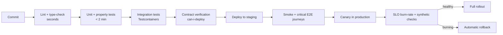
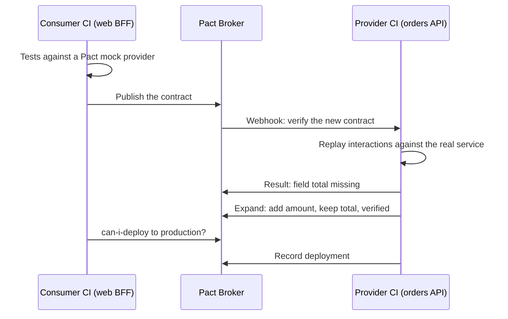

## TL;DR

- A testing strategy exists to **reduce the risk of change at an acceptable cost**. Optimise for confidence per second of feedback, not for a coverage number.
- **Test behaviour through public interfaces**, not implementation details. Tests that break on every refactor are a tax, not a safety net.
- The pyramid, trophy and honeycomb are **heuristics for where to spend**, depending on architecture: logic-heavy code favours unit tests; integration-heavy services favour integration tests.
- **Contract tests** replace most cross-service end-to-end tests; keep a thin layer of end-to-end tests for critical journeys.
- **Flaky tests destroy trust** faster than missing tests. Quarantine, fix, or delete, and treat flakiness as a defect with an owner.

## Core Concepts

### Levels of testing

| Level | Scope | Speed | What it proves |
|---|---|---|---|
| Unit | A function/class/module with collaborators faked | ms | Logic and edge cases |
| Integration | Your code + real infrastructure (DB, queue) in a container | 100s of ms–s | Wiring, queries, serialisation, transactions |
| Component / service | One deployable with external deps stubbed | s | The service's behaviour via its API |
| Contract | Consumer expectations vs provider behaviour | ms–s | Services agree on the interface |
| End-to-end | The whole system through the UI/API | s–min | Critical journeys work together |
| Non-functional | Performance, security, accessibility, resilience | varies | Qualities, not features |

### Pyramid vs trophy vs honeycomb

- **Pyramid** (Mike Cohn): many unit tests, fewer integration tests, few E2E tests. Fits logic-rich code.
- **Testing Trophy** (Kent C. Dodds): emphasises integration tests for frontends, plus static analysis at the base.
- **Honeycomb** (Spotify): for microservices, mostly integration tests of each service, few implementation-detail unit tests and few integrated (cross-service) tests.

The shared message: put most effort where bugs actually occur in *your* architecture, and push checks down to the fastest layer that can catch them.

### Test doubles

- **Stub**: returns canned answers.
- **Fake**: a working lightweight implementation (in-memory repository).
- **Mock**: verifies interactions (was `send` called with X?).
- **Spy**: records calls on a real object.

Prefer **fakes** for your own ports and **real dependencies in containers** (Testcontainers) for infrastructure. Over-mocking couples tests to implementation and lets integration bugs through.

```ts
// A fake for a port defined by the domain — reusable across many tests.
class InMemoryOrders implements OrderRepository {
  private store = new Map<string, Order>();
  async get(id: string) { return this.store.get(id); }
  async save(order: Order) { this.store.set(order.id, order); }
}

it('marks the order paid with the gateway reference', async () => {
  const orders = new InMemoryOrders();
  await orders.save(Order.place('o1', 4_999));
  const payOrder = makePayOrder({ orders, payments: { charge: async () => ({ reference: 'pi_1' }) } });

  await payOrder('o1');

  expect((await orders.get('o1'))?.status).toBe('PAID'); // assert on state, not on calls
});
```

### Property-based testing

Instead of hand-picked examples, state a property that must hold for all inputs and let the tool generate (and shrink) counter-examples.

```ts
import fc from 'fast-check';

it('money allocation never loses or invents pennies', () => {
  fc.assert(
    fc.property(fc.integer({ min: 0, max: 1_000_000 }), fc.integer({ min: 1, max: 50 }), (total, parts) => {
      const shares = allocate(total, parts);
      expect(shares).toHaveLength(parts);
      expect(shares.reduce((a, b) => a + b, 0)).toBe(total);
      expect(Math.max(...shares) - Math.min(...shares)).toBeLessThanOrEqual(1);
    }),
  );
});
```

### Contract testing

Consumer-driven contracts (e.g. **Pact**): the consumer's tests record the requests it makes and the responses it relies on. The provider's CI verifies it still satisfies every consumer's contract. A broker shows which versions are compatible (`can-i-deploy`). This catches breaking API changes before deploy, without standing up the whole system.

### Measuring test quality

- **Coverage** shows what is *not* tested. It says little about whether tested code is tested well.
- **Mutation testing** (Stryker) changes the code (e.g. `>` → `>=`) and checks a test fails. The surviving mutants show weak assertions.
- Track **flaky rate**, **suite duration**, **escaped defects** (bugs found in production), and **change failure rate**.

### Testing in production

Feature flags, canary releases, synthetic monitoring and SLO-based alerting are part of the strategy. Pre-production testing reduces risk; it never removes it.

### Worked example: 100% coverage, 50% mutation score

A pricing module has this rule and these tests:

```ts
export const qualifiesForFreeDelivery = (basketTotal: number) => basketTotal >= 50;

it('gives free delivery on large baskets', () => expect(qualifiesForFreeDelivery(80)).toBe(true));
it('charges delivery on small baskets', () => expect(qualifiesForFreeDelivery(20)).toBe(false));
```

**Line and branch coverage are both 100%.** A mutation testing tool such as Stryker now makes small changes ("mutants") and reruns the tests. A good test suite should fail for each one:

| Mutant | Code | Tests fail? | Result |
|---|---|---|---|
| 1 | `basketTotal > 50` | No: 80 and 20 give the same answers | **Survived** |
| 2 | `basketTotal <= 50` | Yes | Killed |
| 3 | `true` | Yes: the 20 case fails | Killed |
| 4 | `basketTotal >= 51` | No | **Survived** |

**Mutation score: 2 of 4 = 50%.** The surviving mutants show that nothing tests the **boundary**: a customer spending exactly £50 could lose free delivery and no test would notice.

**Adding two boundary tests kills both survivors:**

```ts
it('gives free delivery at exactly £50', () => expect(qualifiesForFreeDelivery(50)).toBe(true));
it('charges delivery just below £50', () => expect(qualifiesForFreeDelivery(49.99)).toBe(false));
```

The mutation score rises to 100%, while coverage doesn't change at all. **Coverage shows what code ran; mutation testing shows whether the tests would notice it being wrong.**

## How It Works



Fast, cheap checks run first. Each stage gates the next, and production checks close the loop.

### Consumer-driven contract testing with a broker



## When to Use / Trade-offs

| Technique | Use when | Avoid when | Cost |
|---|---|---|---|
| Unit tests | Complex logic, algorithms, domain rules | Thin glue code that just wires things | Can couple to implementation if too fine-grained |
| Integration tests (Testcontainers) | DB queries, transactions, messaging, serialisation | Pure logic | Slower; Docker in CI |
| Contract tests | Multiple teams/services sharing APIs or events | One team owns both sides and deploys together | Broker and workflow setup |
| E2E tests | A handful of critical revenue/safety journeys | Covering every edge case | Slow, flaky, expensive to maintain |
| Property-based | Invariants: money, parsing, serialisation round-trips | Simple CRUD | Learning curve, slower runs |
| Mutation testing | Critical modules where test quality matters | Whole large codebases on every commit | CPU time |
| Snapshot tests | Stable serialised output (e.g. API schemas) | Large UI trees | Rubber-stamp updates |

## Common Pitfalls & Anti-patterns

- **The ice-cream cone** — mostly manual and E2E tests, few unit/integration tests; slow and brittle.
- **Testing implementation details** — asserting on private methods, call order or internal state; refactors break everything.
- **Mocking what you don't own** — mocking the AWS SDK or ORM; tests pass while production fails. Wrap it in your own port and integration-test the adapter.
- **Coverage targets as goals** — 90% mandated coverage produces assertion-free tests.
- **Shared mutable test data** — tests that pass alone and fail together; order-dependent suites.
- **Sleep-based waits** — `sleep(2000)` instead of awaiting a condition: slow *and* flaky.
- **Ignoring flaky tests** — "just re-run it" trains everyone to ignore red builds.

## Real-world Scenario

**Context:** A platform team's CI took 48 minutes, with a 12% flaky failure rate on the main branch. Engineers batched changes to avoid waiting, so deployments dropped to twice a week and change failure rate rose.

**Decision:**
1. Measured: 70% of time was 600 Selenium E2E tests; most covered edge cases already tested lower down.
2. Cut E2E to 25 critical journeys; moved the rest to component tests with Testcontainers and API-level tests.
3. Introduced Pact between the web BFF and three backend services.
4. Built a flaky-test quarantine: auto-detect on retry-pass, ticket to the owning team, 2-week SLA, deletion if unfixed.
5. Parallelised and sharded the remaining suites; cached dependencies.

**Outcome:** CI fell to 11 minutes, flaky failures to under 1%, deploy frequency rose to several per day, and change failure rate fell from 18% to 7%.

**What I'd do differently:** Track flaky rate and suite time on a team dashboard from day one. The decline was gradual and nobody noticed until it was severe.

## Interview Questions

### What is the difference between unit, integration and end-to-end tests, and how do you decide the mix? {#test-levels}

**Level:** Foundation

**Model answer:**
Unit tests check a small unit of behaviour in isolation and run in milliseconds. Integration tests check your code with real infrastructure (database, broker), catching wiring, query and serialisation bugs. End-to-end tests drive the whole deployed system as a user would. They give the most realism but are slow and brittle. The mix depends on where risk lives: logic-heavy code gets more unit tests, integration-heavy services get more integration tests, and E2E is reserved for a few critical journeys. Push each check to the lowest, fastest level that can catch the bug.

**What the interviewer is looking for:**
Trade-offs of speed, realism and maintenance cost, and adapting the mix to the architecture rather than reciting the pyramid.

**Follow-ups:**
- Where do contract tests fit?
- How would the mix differ for a React frontend vs a payments service?

**Red flags:**
- "We aim for 100% E2E coverage."
- Not being able to explain what an integration test actually integrates.

### How do you deal with flaky tests across a large engineering organisation? {#flaky-tests}

**Level:** Senior

**Model answer:**
Treat flakiness as a defect with an owner and an SLA:
- **Detect** automatically (a test that fails then passes on retry for the same commit) and track a flaky rate per suite/team.
- **Quarantine** quickly so it no longer blocks the main branch, but keep running and reporting it.
- **Route** to the owning team with a ticket, with a deadline to fix or delete.
- **Fix root causes**: shared state, time and timezone dependence, ordering assumptions, sleep-based waits, unawaited promises, resource leaks, test-environment contention.
- **Prevent** with lint rules (no arbitrary sleeps), hermetic test data, and running new tests repeatedly before merge.

**What the interviewer is looking for:**
A system rather than heroics, and knowledge of the usual root causes.

**Follow-ups:**
- How do you stop quarantine from becoming a graveyard?
- What metrics would you show leadership?

**Red flags:**
- "Retry three times automatically and move on."
- Blaming CI infrastructure without evidence.

### When does mocking become harmful? {#mocking}

**Level:** Senior

**Model answer:**
When mocks encode *how* the code works instead of *what* it achieves: verifying exact call sequences, mocking internal collaborators, or mocking third-party libraries you don't own. Such tests break on harmless refactors and still pass when real integrations fail (wrong SQL, changed SDK behaviour). Better: fakes for your own ports, real infrastructure via Testcontainers for adapters, assertions on observable outcomes (state, output, emitted events), and mocks only for interactions that *are* the behaviour (e.g. "an email is sent").

**What the interviewer is looking for:**
Understanding of test coupling and the "don't mock what you don't own" principle.

**Follow-ups:**
- How do you test code that depends on the current time?
- What makes a good fake?

**Red flags:**
- Every dependency mocked by default.
- Tests asserting private method calls.

### What is consumer-driven contract testing, and when is it worth the effort? {#contract-testing}

**Level:** Senior

**Model answer:**
Consumers write tests describing the requests they send and the parts of responses they depend on. These generate contracts (e.g. Pact files) published to a broker. Providers verify every consumer's contract in their own CI. Before deploying, `can-i-deploy` checks that the version is compatible with what's in the target environment. It catches breaking changes early and replaces most brittle cross-service E2E tests. It's worth it when several teams own interacting services with independent release cycles; it's overhead when one team deploys both sides together.

**What the interviewer is looking for:**
The workflow (not just the term), the deployment-safety benefit, and when not to use it.

**Follow-ups:**
- How do you handle contracts for asynchronous messages?
- How does this differ from schema validation with OpenAPI?

**Red flags:**
- Confusing contract tests with E2E tests.
- Providers writing the contracts for consumers.

### Your CI pipeline takes 45 minutes and teams are batching changes. What do you do? {#slow-test-suite}

**Level:** Architect

**Model answer:**
1. **Measure**: time per stage and per test, flaky rate, queue time. Find the top 10% of slowest tests; it's often a small set.
2. **Rebalance the portfolio**: move E2E edge-case coverage down to component/integration/unit level; keep E2E to critical journeys. Add contract tests to replace cross-service E2E.
3. **Parallelise and shard**, cache dependencies and Docker layers, and use test impact analysis to run affected tests first on PRs, with the full suite on merge.
4. **Fail fast**: lint, type-check and unit tests first.
5. **Fix or quarantine flaky tests**.
6. **Set a budget**: e.g. PR feedback < 10 min, with a dashboard and an owner. Treat regressions like performance bugs.

Link it to outcomes: lead time and deploy frequency (DORA) will improve, which is the business case.

**What the interviewer is looking for:**
Data-led diagnosis, portfolio thinking, organisational follow-through (budgets, ownership), and connecting it to delivery metrics.

**Follow-ups:**
- What risks does test impact analysis introduce?
- How would you get product leadership to fund this work?

**Red flags:**
- "Buy bigger CI runners" as the only answer.
- Deleting tests without understanding what risk they covered.

### Leadership wants to mandate 80% code coverage for all services. How do you respond? {#coverage-targets}

**Level:** Architect

**Model answer:**
I'd agree with the intent (better quality, fewer escaped defects) but push back on the mechanism. A coverage target becomes the goal (Goodhart's law): people write assertion-free tests, test trivial getters, and avoid refactoring. Coverage shows what isn't tested, not how well the rest is tested.

Instead, propose:
- **Outcome metrics**: change failure rate, escaped defects, time to restore.
- **Risk-based expectations**: critical domains (payments, auth) get mutation testing and property tests.
- **Diff coverage** on new code as a *signal* in PR review rather than a hard gate.
- **Review test quality** as part of code review.

Offer to pilot it with two teams and report back.

**What the interviewer is looking for:**
Influencing leadership constructively: aligning on intent, offering a better measurable alternative, and running an experiment.

**Follow-ups:**
- What's mutation testing and how would you roll it out cost-effectively?
- What would convince you that a coverage gate is right for a specific codebase?

**Red flags:**
- Blindly enforcing the mandate.
- Dismissing it without an alternative.

### What makes a good unit test? {#good-unit-test}

**Level:** Foundation

**Model answer:**
A good unit test is **fast, deterministic, isolated and readable**, and it **fails for one clear reason** when behaviour breaks, and *only* then.

- **Arrange, act, assert:** set up, perform one behaviour, check the outcome. Several assertions are fine if they describe one outcome.
- **Test through the public interface.** Assert on return values, state visible to callers, or messages sent at a boundary, not on private methods or the order of internal calls. That is what lets you refactor without rewriting tests.
- **Name the behaviour:** `rejects_orders_over_the_credit_limit` is better than `test_validate_2`. The test name is documentation.
- **Keep it self-contained:** no shared mutable state, no dependence on test order, clock or network.
- **Make failures useful:** the message should say what was expected and what happened.

"Unit" means a unit of *behaviour*, not necessarily one class. A test that exercises three collaborating classes in memory is still a fast, isolated unit test.

```ts
it('applies a 10% discount for gold customers', () => {
  const price = priceFor({ tier: 'gold' }, 200_00);
  expect(price).toBe(180_00);
});
```

**What the interviewer is looking for:**
Behaviour over implementation, determinism, readable intent and a sensible definition of "unit".

**Follow-ups:**
- When is it right to test a private method?
- How many assertions should a test have?

**Red flags:**
- Defining a unit strictly as "one class with everything else mocked".
- Tests that need editing every time code is refactored.

### What are stubs, mocks, fakes and spies, and when do you use each? {#test-doubles}

**Level:** Foundation

**Model answer:**
They are all **test doubles**: stand-ins for a real dependency.
- **Stub:** returns canned answers so the code under test can proceed (`getRate()` returns `1.2`). You don't assert on it.
- **Fake:** a working, simplified implementation, such as an in-memory repository or a fake clock. It behaves realistically across many calls and is often the best choice.
- **Mock:** pre-programmed with expectations and *verifies interactions* ("`send` was called once with this email"). Use it when the interaction *is* the behaviour, for example "an email is sent" at a system boundary.
- **Spy:** wraps or records calls on something so you can assert afterwards. It is often a real object with recording.
- **Dummy:** passed only to satisfy a parameter and never used.

Guidelines:
- Prefer real objects, then fakes.
- Use stubs for queries and mocks only for commands that cross a boundary you own.
- Over-mocking couples tests to implementation and lets them pass while the real integration is broken.

**What the interviewer is looking for:**
Accurate vocabulary (Meszaros's terms) and a principled preference order.

**Follow-ups:**
- How would you test code that sends emails?
- What is the risk of a fake drifting from the real implementation, and how do you mitigate it?

**Red flags:**
- Calling everything a "mock" and mocking every collaborator.
- Mocking value objects or the class under test.

### What is test-driven development, and when does it help or not? {#tdd}

**Level:** Foundation

**Model answer:**
TDD is a short loop: write a failing test for the next small behaviour (**red**), write the simplest code to pass it (**green**), then improve the design with the tests as a safety net (**refactor**).

Benefits:
- It forces you to define behaviour and API before implementation, which pushes towards small, decoupled units.
- It gives you a regression suite as a by-product and very short feedback loops.
- It works especially well for domain logic, parsers, calculations and bug fixes (write the failing test that reproduces the bug first).

It helps less with exploratory spikes where you don't yet know the shape (spike, then throw away or test-drive the real version), UI layout, and glue code that is mostly framework configuration. There, integration tests written right after the code may serve better.

Common misconceptions: TDD is not "100% coverage" and not "write all the tests first". It is a design technique. Outside-in TDD (starting from an acceptance test) and inside-out (starting from domain units) are both valid.

**What the interviewer is looking for:**
The cycle, especially the refactor step that people skip, and a pragmatic view of where it fits.

**Follow-ups:**
- How do you test-drive code that talks to a database?
- How would you introduce TDD to a sceptical team?

**Red flags:**
- Dismissing it without having tried it, or treating it as a religion.
- Skipping the refactor step entirely.

### How do you test code that depends on time, randomness or external APIs? {#nondeterminism}

**Level:** Senior

**Model answer:**
Make the non-determinism an **injectable dependency** and control it in tests.
- **Time:** inject a `Clock` (or use fake timers) rather than calling `Date.now()` throughout the code. Test boundaries explicitly: month end, DST changes, leap years, time zones, expiry exactly at the cut-off.
- **Randomness and ids:** inject the random source or id generator, or seed it. For property-based tests, record the seed so failures reproduce.
- **External HTTP APIs:**
  - Unit level: wrap the API in your own port (`PaymentGateway`) and use a fake.
  - Adapter level: integration-test against a stub server (WireMock, MSW, a provider sandbox) including error cases: timeouts, 429, 500, malformed bodies.
  - Contract level: verify the agreement (consumer-driven contracts, or recorded responses checked against the provider's schema).
- **Concurrency and async:** await conditions or events, never `sleep`. Use deterministic schedulers where the language offers them. Run race-prone tests many times in CI to flush out flakiness.

```ts
const clock = new FakeClock('2026-03-29T00:59:00Z');
const svc = new SessionService(clock);
clock.advance({ minutes: 2 }); // crosses the UK clocks-forward boundary
```

**What the interviewer is looking for:**
Dependency injection of non-determinism, testing the edge cases, layered testing of third-party integrations, and never sleeping.

**Follow-ups:**
- How do you test retry and backoff logic without slow tests?
- What would you check in a recorded HTTP fixture to stop it going stale?

**Red flags:**
- Tests that pass or fail depending on the time of day they run.
- Hitting real third-party production APIs from CI.

### What does "testing in production" mean, and how do you do it safely? {#testing-in-production}

**Level:** Senior

**Model answer:**
Pre-production environments never fully match production's data, traffic, scale or configuration, so mature teams verify *in* production, deliberately and with guardrails:

- **Progressive delivery:** canary releases (1%, then 10%, then 50% of traffic) with automated analysis of SLIs against the baseline and automatic rollback.
- **Feature flags:** deploy dark, enable for internal users, then a beta cohort, then everyone. Decoupling deploy from release makes rollback a flag flip.
- **Synthetic monitoring:** scripted user journeys that run continuously against production, using test accounts flagged so they're excluded from analytics and billing.
- **Shadow traffic:** mirror real requests to a new version and compare the responses without serving them to users.
- **Chaos engineering:** inject failures (kill instances, add latency) in controlled experiments with a defined blast radius and a stop button.
- **Observability as the oracle:** SLOs, error-budget burn and business metrics (orders per minute) decide whether a release is healthy.

Safety requirements: fast rollback, small blast radius, test data that can't leak into real reports or invoices, and agreement with compliance teams on what is allowed.

**What the interviewer is looking for:**
Understanding that this complements pre-production testing rather than replacing it, plus concrete mechanisms and guardrails.

**Follow-ups:**
- What would automated canary analysis compare?
- How do you stop synthetic orders reaching the warehouse?

**Red flags:**
- "Testing in production" meaning "we don't test".
- Canaries with no automated health criteria.

### How do you test a React frontend effectively? {#frontend-testing}

**Level:** Senior

**Model answer:**
Spend most effort on **component and integration tests that use the UI the way a user does**, plus a thin layer of end-to-end tests.

- **Component tests** with Testing Library: query by role and accessible name (`getByRole('button', { name: 'Place order' })`), interact with `user-event` and assert on what is visible. This also checks accessibility and survives refactors.
- **Network:** mock at the HTTP boundary with **MSW** (Mock Service Worker), not by mocking your fetch hooks, so data-loading code is really exercised. Cover loading, empty and error states.
- **Pure logic** (reducers, formatters, validation) gets plain unit tests.
- **End-to-end** (Playwright): a handful of critical journeys (sign in, checkout) against a deployed environment, run in CI with traces and screenshots on failure.
- **Visual regression** for design-system components (Storybook plus a visual diff tool), and automated **accessibility checks** (axe) in component tests and end-to-end runs.
- **Avoid** shallow rendering and snapshot tests of whole component trees. They break on every markup change and assert nothing meaningful.

**What the interviewer is looking for:**
User-centric queries, network-level mocking, a sensible split between component and end-to-end tests, and accessibility and visual checks.

**Follow-ups:**
- How do you keep Playwright tests from becoming flaky?
- What do you test in a custom hook?

**Red flags:**
- Asserting on component state or CSS class names.
- Hundreds of large snapshots.

### Design the test strategy for a platform of 40 microservices owned by 8 teams. {#microservices-test-strategy}

**Level:** Architect

**Model answer:**
Principle: **each team can release its service independently with confidence**. So most testing must happen at the service boundary, not in a shared end-to-end environment.

**Inside each service (team-owned):**
- Unit tests on domain logic.
- Integration tests with real dependencies in containers (Testcontainers for the database and broker).
- Component tests that run the service in-process with its external services faked.

**Between services:**
- **Consumer-driven contract tests** (Pact or schema-based) for synchronous APIs, and **schema registry compatibility checks** for events.
- A deploy gate (`can-i-deploy`, or compatibility checks in CI) blocks breaking changes before they merge.

**End-to-end:** a small suite of critical business journeys (around 10–20 tests, not hundreds), owned jointly and run post-deploy in staging and as synthetic monitors in production. Failures route to the owning team.

**Environments:** ephemeral per-PR environments for the service under change, with dependencies stubbed or pointing at shared stable versions. Avoid one fragile shared integration environment that everyone queues for.

**Production verification:** canary analysis, feature flags and SLO-based release health.

**Platform team support:** templates, Pact broker, test data tooling, flaky-test dashboards. Quality remains the teams' responsibility.

**Measures:** change failure rate, escaped defects by type (contract, logic, config), pipeline time, flake rate.

**What the interviewer is looking for:**
Independent deployability as the goal, contracts in place of large end-to-end suites, clear ownership and production verification, with metrics to steer.

**Follow-ups:**
- How do you test a flow that spans five services asynchronously?
- Teams say contract testing is too much overhead. How do you respond?

**Red flags:**
- A huge shared end-to-end suite as the main safety net.
- A release train because services "must be tested together".

### You must refactor a 15-year-old monolith with almost no tests. Where do you start? {#legacy-code-testing}

**Level:** Architect

**Model answer:**
Don't start with "write unit tests for everything". The code wasn't designed for them, and the effort stalls. Work outward from the change you need to make.

1. **Pin current behaviour with characterisation tests** at a coarse level: HTTP-level or approval (golden-master) tests that record today's outputs for a broad set of inputs, including weird ones from production logs. They assert *what it does*, bugs included.
2. **Find seams** (Feathers' term): places where you can substitute behaviour without editing the code, such as constructor parameters, interfaces or configuration. Use safe, mechanical, tool-assisted refactorings (extract method, introduce parameter) to create them.
3. **Cover the area being changed** with finer-grained tests as the seams appear. Follow the "boy scout" rule: every change leaves the touched code better tested.
4. **Prioritise by risk and churn:** files that change often and break often (from git history and incident data) earn tests first. Stable, untouched code may never need them.
5. **Add production safety nets:** feature flags, canaries, shadowing old and new paths with output comparison (a scientist-style experiment), plus better monitoring.
6. **Strangle rather than rewrite:** new capability lives in a new module or service behind an interface, with the old path removed once traffic moves.

Make the progress visible (coverage of changed lines, incident trend) and agree with product that refactoring time is part of each feature, not a separate project.

**What the interviewer is looking for:**
Characterisation tests, seams, a risk-based focus, production verification and an incremental, business-aligned plan.

**Follow-ups:**
- The code has static calls to the database everywhere. How do you create a seam?
- How do you convince the business to fund this?

**Red flags:**
- Proposing a big-bang rewrite.
- Mandating 80% unit coverage before any change is allowed.

### Who owns quality in an engineering organisation, and what is the role of QA specialists? {#quality-ownership}

**Level:** Architect

**Model answer:**
**The team that builds a service owns its quality**, including test automation, release safety and production behaviour. Quality that is handed to a separate QA gate creates queues, slow feedback and a "throw it over the wall" mindset. DORA research associates developer-owned test automation with better delivery performance.

QA specialists remain valuable, but the role shifts from *gatekeeper* to *coach and multiplier*:
- Exploratory testing and risk analysis on new features: finding the unknown unknowns that automation doesn't look for.
- Building test tooling, frameworks and test data capabilities.
- Teaching test design, pairing with developers on difficult areas, and reviewing test strategy in design reviews.
- Owning specialist areas: performance, accessibility, security testing in collaboration with the security team.

Organisation-level levers:
- A definition of done that includes automated tests and observability.
- Paved-road tooling.
- Quality metrics: change failure rate, escaped defects, customer-reported issues and flake rate, reviewed by teams rather than used to rank them.
- Time for engineers to fix flaky tests and reduce test debt.

**What the interviewer is looking for:**
"Built-in quality" with team ownership, a nuanced and respectful view of QA's evolving role, and organisational mechanisms.

**Follow-ups:**
- How would you move from a separate QA team to embedded quality without losing expertise?
- What would you do if a team's escaped-defect rate keeps rising?

**Red flags:**
- "We don't need testers anymore."
- Quality measured by the number of bugs QA finds.

### What is property-based testing, and when is it worth using? {#property-based-testing}

**Level:** Foundation

**Model answer:**
In **example-based testing** you choose inputs and expected outputs. In **property-based testing** you state a rule that must hold **for all valid inputs**, and a library generates hundreds of random inputs to try to break it. When it finds a failing input, it **shrinks** it to the smallest example that still fails, which makes debugging easy.

The idea comes from Haskell's QuickCheck. Common libraries are **fast-check** (JavaScript and TypeScript), **Hypothesis** (Python) and **jqwik** (Java).

**Good properties to test:**
- **Round trips:** `parse(serialise(x))` equals `x`.
- **Invariants:** splitting a bill never loses or invents pennies; a sorted list has the same elements as the input.
- **Equivalence with a simpler model:** an optimised implementation gives the same results as a slow, obviously correct one.
- **Idempotence:** applying an operation twice gives the same result as once.
- **No crashes:** a parser never throws an unexpected error on any input.

**When it's worth it:** money and calculations, parsers and serialisation, data transformations, state machines, and anything with many edge cases people forget, such as empty lists, Unicode, very large numbers and time zones.

**When it isn't:** simple CRUD code, or behaviour that's easier to specify with a few clear examples.

**Practical tips:** keep generators realistic, fix the random seed when reproducing a failure, and add a failing case found by the tool as a permanent example test.

**What the interviewer is looking for:**
The difference from example-based tests, generation and shrinking, types of useful properties, where it pays off, and practical habits.

**Follow-ups:**
- What property would you test for a currency conversion function?
- How do you stop property tests making CI slow?

**Red flags:**
- Properties that restate the implementation.
- Using it everywhere instead of where edge cases matter.

### How does mutation testing work, and how would you introduce it? {#mutation-testing}

**Level:** Senior

**Model answer:**
**Mutation testing** measures how good tests are at catching bugs. A tool makes small changes ("mutants") to the code, such as swapping `>=` for `>`, removing a line, or replacing a condition with `true`, then runs the tests. If a test fails, the mutant is **killed**. If all tests still pass, it **survived**, which shows a gap in the assertions. The **mutation score** is the percentage of mutants killed.

Coverage only shows that code *ran* during tests. Code can be 100% covered by tests that assert nothing useful. Mutation testing shows whether the tests would **notice the code being wrong**.

**Tools:** Stryker (JavaScript, TypeScript, C# and Scala), PIT (Java) and mutmut (Python).

**Introduce it carefully, because it's CPU-heavy:**
- **Start with critical modules:** pricing, permissions, money calculations and core domain rules.
- **Run incrementally:** only on changed files in pull requests, with full runs nightly or weekly.
- **Review survivors, don't chase 100%:** some mutants are **equivalent** (they don't change behaviour) and can't be killed. Look at survivors to find missing boundary tests and weak assertions.
- **Set thresholds per module,** and ratchet them up rather than imposing one number everywhere.

**What it teaches teams:** survivors usually reveal the same patterns: missing boundary values, tests that assert only "no error was thrown", and assertions on mocks instead of results.

**What the interviewer is looking for:**
How mutants are killed or survive, why it complements coverage, tools, a focused and incremental rollout, handling equivalent mutants, and the patterns survivors reveal.

**Follow-ups:**
- What is an equivalent mutant, and how do you deal with it?
- Would you make mutation score a pipeline gate?

**Red flags:**
- Running full mutation testing on every commit of a large codebase.
- Treating the mutation score as a target to game.

### How do you keep a large test suite maintainable? {#maintainable-test-suites}

**Level:** Senior

**Model answer:**
Tests are code that changes as often as the product. A suite that's hard to read and update slows teams down, and they start deleting or skipping tests. Optimise for **clarity when a test fails** and **low cost when behaviour changes**.

**Write readable tests:**
- **One behaviour per test,** with a name that describes it: "rejects a refund larger than the captured amount".
- **Arrange, act, assert,** clearly separated.
- **DAMP rather than DRY:** "descriptive and meaningful phrases". Some repetition in tests is fine if it makes each test understandable on its own.
- **Show only what matters:** hide irrelevant setup behind builders, so the test shows the one field that affects the outcome.

```ts
// A test data builder: sensible defaults, override only what the test is about.
const anOrder = (overrides: Partial<Order> = {}): Order =>
  ({ id: 'o1', status: 'PAID', total: 4_999, currency: 'GBP', items: [aLineItem()], ...overrides });

it('refuses refunds on unpaid orders', () => {
  expect(() => refund(anOrder({ status: 'PENDING' }), 1_000)).toThrow(NotRefundable);
});
```

**Reduce coupling to implementation:**
- Test through **public behaviour,** not private methods or internal calls.
- Prefer **fakes and real dependencies** over deep mock setups that break on every refactor.
- For UI and end-to-end tests, use **user-facing selectors** (roles and labels) and abstractions such as page objects, so a layout change touches one place.

**Look after the suite:**
- Track **duration, flakiness and failures per test,** and fix or delete the worst offenders.
- **Delete redundant tests** covering the same behaviour at several levels.
- Review tests in code review with the same care as production code.

**What the interviewer is looking for:**
Readable, behaviour-named tests, builders for setup, DAMP over DRY, testing behaviour not implementation, resilient UI selectors and page objects, and active suite maintenance.

**Follow-ups:**
- A small refactor broke 200 tests. What does that tell you?
- When is it right to delete a test?

**Red flags:**
- Huge shared fixtures that every test depends on.
- Tests that verify the exact sequence of internal method calls.

### How do you test event-driven and asynchronous systems? {#testing-event-driven}

**Level:** Architect

**Model answer:**
Asynchronous systems break the usual test assumptions: results appear **eventually**, messages can be **duplicated, delayed or reordered**, and behaviour emerges from several services reacting to events. A strategy needs tests at several levels.

**Unit level, the handlers:**
- Test each event handler as a function: given this event and this state, these changes happen and these events are emitted.
- Cover **duplicates** (idempotency), **out-of-order** events and **unknown event versions**.

**Integration level, with real infrastructure:**
- Run the real broker (Kafka, RabbitMQ or a cloud emulator) in Testcontainers, and test serialisation, consumer configuration, retries and dead-letter behaviour.
- Test the **transactional outbox** or equivalent: a database change and its event are published together or not at all.

**Contracts for events:**
- **Schemas in a registry** with compatibility rules checked in CI, and consumer-driven contract tests for message formats (Pact supports messages).

**End-to-end, sparingly:**
- A few critical flows across services, asserting on outcomes with **polling and timeouts** ("within 10 seconds, the order is CONFIRMED"), never fixed sleeps.
- Use **correlation IDs** so a test can find its own messages and traces among others.

**Failure and load behaviour:**
- Inject failures: a consumer crashes mid-batch, the broker is unavailable, a poison message arrives. Check nothing is lost or processed twice in a harmful way.
- Test **consumer lag and backpressure** under load.

**In production:** monitor end-to-end flow health, such as the time from `OrderPlaced` to `OrderShipped`, and run synthetic transactions.

**What the interviewer is looking for:**
Handler unit tests including duplicates and ordering, integration tests with a real broker, outbox testing, event contracts and schema compatibility, polling-based end-to-end tests with correlation IDs, failure injection, lag testing, and production flow monitoring.

**Follow-ups:**
- How do you test a saga that spans four services?
- Why are fixed sleeps in tests a problem?

**Red flags:**
- `sleep(5000)` before every assertion.
- Only testing the happy path with exactly-once delivery assumed.

### A shared staging environment is always broken and blocks ten teams. What's your environment strategy? {#test-environments}

**Level:** Architect

**Model answer:**
A single shared staging environment becomes a bottleneck as teams grow: one team's broken deploy blocks everyone, test data is polluted, and nobody owns its health. The aim is to **need the shared environment less**, and to make what remains reliable.

**Reduce what needs a shared environment:**
- **Contract tests** catch most integration breakages between services without deploying them together.
- **Component tests** run each service with its real database (Testcontainers) and stubs for its neighbours.
- **Ephemeral environments** per pull request for the service being changed, with dependencies stubbed or pointed at stable shared versions.

**Make the shared environment trustworthy:**
- **Deploy to it only through the pipeline,** with the same checks as production, so it reflects real release candidates.
- **Assign ownership:** a platform team owns its health, with an SLO and alerts, like any other service.
- **Isolate test data:** each test creates its own data with unique identifiers, or each team has its own tenant, so tests don't collide.
- **Automated smoke tests** after each deploy, with fast rollback of the change that broke it.

**Test more in production, safely:**
- Feature flags, canary releases and dark launches move the final verification to real conditions.
- Synthetic monitoring of critical journeys in production.

**Watch the cost:** ephemeral environments must be torn down automatically, and stubbed dependencies need a process to stay accurate.

**Measure:** hours of staging downtime, the number of teams blocked, lead time, and how many defects the shared environment catches that earlier stages missed. If it catches very few, invest less in it.

**What the interviewer is looking for:**
Reducing dependence on shared environments with contract and component tests and ephemeral environments, owning and stabilising what remains, test data isolation, testing in production safely, cost control, and measuring the environment's value.

**Follow-ups:**
- How do you keep stubbed dependencies accurate?
- Which tests genuinely need a fully integrated environment?

**Red flags:**
- Adding a second shared staging environment as the main fix.
- Nobody owning the environment's health.

## Cheat Sheet

- **Test behaviour, not implementation** — assert on outcomes via public interfaces.
- **Pyramid / trophy / honeycomb** — heuristics; spend effort where bugs occur in your architecture.
- **Fake vs mock** — fakes are working lightweight implementations; mocks verify interactions.
- **Don't mock what you don't own** — wrap third-party code in a port and integration-test the adapter.
- **Testcontainers** — real DB/broker in Docker for integration tests.
- **Contract testing** — consumers define expectations; providers verify; `can-i-deploy` gates releases.
- **Property-based testing** — assert invariants over generated inputs; failures shrink to minimal cases.
- **Mutation testing** — mutate code; surviving mutants reveal weak tests.
- **Coverage** — shows what's untested, not what's well tested.
- **Flaky test** — non-deterministic result for the same code; quarantine, own, fix or delete.
- **Shift-left and shift-right** — test early in CI *and* verify in production with canaries and SLOs.
- **Characterisation test** — records what legacy code does today (bugs included) so you can refactor safely.
- **Seam** — a place where behaviour can be substituted without editing the code there (Feathers).
- **MSW** — Mock Service Worker; mocks the network so frontend data-loading code really runs in tests.

### Revisit

- **Mutation score** — the percentage of small code changes your tests catch; it exposes weak assertions that coverage hides.
- **Boundary tests** — surviving `>=` to `>` mutants mean nothing tests the exact boundary value.
- **can-i-deploy** — the Pact Broker checks a version is verified against the versions live in the target environment.
- **Property-based testing** — state a rule for all inputs; the tool generates cases and shrinks failures to the smallest example.
- **DAMP tests** — descriptive and meaningful phrases: readable, self-contained tests beat over-abstracted DRY ones.
- **Async tests** — idempotency, ordering and failure cases, a real broker, event contracts, and polling instead of sleeps.
- **Environment strategy** — contract and component tests plus ephemeral environments reduce dependence on shared staging.

## Further Reading

- [Martin Fowler: The Practical Test Pyramid](https://martinfowler.com/articles/practical-test-pyramid.html) — a thorough, pragmatic walkthrough.
- [Pact documentation](https://docs.pact.io/) — consumer-driven contract testing.
- [Testcontainers](https://testcontainers.com/) — real dependencies in tests.
- [fast-check](https://fast-check.dev/) — property-based testing for TypeScript/JavaScript.
- [Stryker Mutator](https://stryker-mutator.io/) — mutation testing for JS/TS, C# and Scala.
