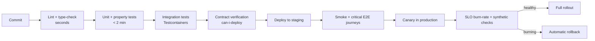

## TL;DR

- A testing strategy exists to **reduce the risk of change at an acceptable cost**. Optimise for confidence per second of feedback, not for a coverage number.
- **Test behaviour through public interfaces**, not implementation details. Tests that break on every refactor are a tax, not a safety net.
- The pyramid, trophy and honeycomb are **heuristics for where to spend**, depending on architecture: logic-heavy code favours unit tests; integration-heavy services favour integration tests.
- **Contract tests** replace most cross-service end-to-end tests; keep a thin layer of end-to-end tests for critical journeys.
- **Flaky tests destroy trust** faster than missing tests. Quarantine, fix, or delete, and treat flakiness as a defect with an owner.

## Core Concepts

### Levels of testing

| Level | Scope | Speed | What it proves |
|---|---|---|---|
| Unit | A function/class/module with collaborators faked | ms | Logic and edge cases |
| Integration | Your code + real infrastructure (DB, queue) in a container | 100s of ms–s | Wiring, queries, serialisation, transactions |
| Component / service | One deployable with external deps stubbed | s | The service's behaviour via its API |
| Contract | Consumer expectations vs provider behaviour | ms–s | Services agree on the interface |
| End-to-end | The whole system through the UI/API | s–min | Critical journeys work together |
| Non-functional | Performance, security, accessibility, resilience | varies | Qualities, not features |

### Pyramid vs trophy vs honeycomb

- **Pyramid** (Mike Cohn): many unit tests, fewer integration tests, few E2E tests. Fits logic-rich code.
- **Testing Trophy** (Kent C. Dodds): emphasises integration tests for frontends, plus static analysis at the base.
- **Honeycomb** (Spotify): for microservices, mostly integration tests of each service, few implementation-detail unit tests and few integrated (cross-service) tests.

The shared message: put most effort where bugs actually occur in *your* architecture, and push checks down to the fastest layer that can catch them.

### Test doubles

- **Stub**: returns canned answers.
- **Fake**: a working lightweight implementation (in-memory repository).
- **Mock**: verifies interactions (was `send` called with X?).
- **Spy**: records calls on a real object.

Prefer **fakes** for your own ports and **real dependencies in containers** (Testcontainers) for infrastructure. Over-mocking couples tests to implementation and lets integration bugs through.

```ts
// A fake for a port defined by the domain — reusable across many tests.
class InMemoryOrders implements OrderRepository {
  private store = new Map<string, Order>();
  async get(id: string) { return this.store.get(id); }
  async save(order: Order) { this.store.set(order.id, order); }
}

it('marks the order paid with the gateway reference', async () => {
  const orders = new InMemoryOrders();
  await orders.save(Order.place('o1', 4_999));
  const payOrder = makePayOrder({ orders, payments: { charge: async () => ({ reference: 'pi_1' }) } });

  await payOrder('o1');

  expect((await orders.get('o1'))?.status).toBe('PAID'); // assert on state, not on calls
});
```

### Property-based testing

Instead of hand-picked examples, state a property that must hold for all inputs and let the tool generate (and shrink) counter-examples.

```ts
import fc from 'fast-check';

it('money allocation never loses or invents pennies', () => {
  fc.assert(
    fc.property(fc.integer({ min: 0, max: 1_000_000 }), fc.integer({ min: 1, max: 50 }), (total, parts) => {
      const shares = allocate(total, parts);
      expect(shares).toHaveLength(parts);
      expect(shares.reduce((a, b) => a + b, 0)).toBe(total);
      expect(Math.max(...shares) - Math.min(...shares)).toBeLessThanOrEqual(1);
    }),
  );
});
```

### Contract testing

Consumer-driven contracts (e.g. **Pact**): the consumer's tests record the requests it makes and the responses it relies on. The provider's CI verifies it still satisfies every consumer's contract. A broker shows which versions are compatible (`can-i-deploy`). This catches breaking API changes before deploy, without standing up the whole system.

### Measuring test quality

- **Coverage** shows what is *not* tested. It says little about whether tested code is tested well.
- **Mutation testing** (Stryker) changes the code (e.g. `>` → `>=`) and checks a test fails. The surviving mutants show weak assertions.
- Track **flaky rate**, **suite duration**, **escaped defects** (bugs found in production), and **change failure rate**.

### Testing in production

Feature flags, canary releases, synthetic monitoring and SLO-based alerting are part of the strategy. Pre-production testing reduces risk; it never removes it.

## How It Works



Fast, cheap checks run first. Each stage gates the next, and production checks close the loop.

## When to Use / Trade-offs

| Technique | Use when | Avoid when | Cost |
|---|---|---|---|
| Unit tests | Complex logic, algorithms, domain rules | Thin glue code that just wires things | Can couple to implementation if too fine-grained |
| Integration tests (Testcontainers) | DB queries, transactions, messaging, serialisation | Pure logic | Slower; Docker in CI |
| Contract tests | Multiple teams/services sharing APIs or events | One team owns both sides and deploys together | Broker and workflow setup |
| E2E tests | A handful of critical revenue/safety journeys | Covering every edge case | Slow, flaky, expensive to maintain |
| Property-based | Invariants: money, parsing, serialisation round-trips | Simple CRUD | Learning curve, slower runs |
| Mutation testing | Critical modules where test quality matters | Whole large codebases on every commit | CPU time |
| Snapshot tests | Stable serialised output (e.g. API schemas) | Large UI trees | Rubber-stamp updates |

## Common Pitfalls & Anti-patterns

- **The ice-cream cone** — mostly manual and E2E tests, few unit/integration tests; slow and brittle.
- **Testing implementation details** — asserting on private methods, call order or internal state; refactors break everything.
- **Mocking what you don't own** — mocking the AWS SDK or ORM; tests pass while production fails. Wrap it in your own port and integration-test the adapter.
- **Coverage targets as goals** — 90% mandated coverage produces assertion-free tests.
- **Shared mutable test data** — tests that pass alone and fail together; order-dependent suites.
- **Sleep-based waits** — `sleep(2000)` instead of awaiting a condition: slow *and* flaky.
- **Ignoring flaky tests** — "just re-run it" trains everyone to ignore red builds.

## Real-world Scenario

**Context:** A platform team's CI took 48 minutes, with a 12% flaky failure rate on the main branch. Engineers batched changes to avoid waiting, so deployments dropped to twice a week and change failure rate rose.

**Decision:**
1. Measured: 70% of time was 600 Selenium E2E tests; most covered edge cases already tested lower down.
2. Cut E2E to 25 critical journeys; moved the rest to component tests with Testcontainers and API-level tests.
3. Introduced Pact between the web BFF and three backend services.
4. Built a flaky-test quarantine: auto-detect on retry-pass, ticket to the owning team, 2-week SLA, deletion if unfixed.
5. Parallelised and sharded the remaining suites; cached dependencies.

**Outcome:** CI fell to 11 minutes, flaky failures to under 1%, deploy frequency rose to several per day, and change failure rate fell from 18% to 7%.

**What I'd do differently:** Track flaky rate and suite time on a team dashboard from day one. The decline was gradual and nobody noticed until it was severe.

## Interview Questions

### What is the difference between unit, integration and end-to-end tests, and how do you decide the mix? {#test-levels}

**Level:** Foundation

**Model answer:**
Unit tests check a small unit of behaviour in isolation and run in milliseconds. Integration tests check your code with real infrastructure (database, broker), catching wiring, query and serialisation bugs. End-to-end tests drive the whole deployed system as a user would. They give the most realism but are slow and brittle. The mix depends on where risk lives: logic-heavy code gets more unit tests, integration-heavy services get more integration tests, and E2E is reserved for a few critical journeys. Push each check to the lowest, fastest level that can catch the bug.

**What the interviewer is looking for:**
Trade-offs of speed, realism and maintenance cost, and adapting the mix to the architecture rather than reciting the pyramid.

**Follow-ups:**
- Where do contract tests fit?
- How would the mix differ for a React frontend vs a payments service?

**Red flags:**
- "We aim for 100% E2E coverage."
- Not being able to explain what an integration test actually integrates.

### How do you deal with flaky tests across a large engineering organisation? {#flaky-tests}

**Level:** Senior

**Model answer:**
Treat flakiness as a defect with an owner and an SLA:
- **Detect** automatically (a test that fails then passes on retry for the same commit) and track a flaky rate per suite/team.
- **Quarantine** quickly so it no longer blocks the main branch, but keep running and reporting it.
- **Route** to the owning team with a ticket, with a deadline to fix or delete.
- **Fix root causes**: shared state, time and timezone dependence, ordering assumptions, sleep-based waits, unawaited promises, resource leaks, test-environment contention.
- **Prevent** with lint rules (no arbitrary sleeps), hermetic test data, and running new tests repeatedly before merge.

**What the interviewer is looking for:**
A system rather than heroics, and knowledge of the usual root causes.

**Follow-ups:**
- How do you stop quarantine from becoming a graveyard?
- What metrics would you show leadership?

**Red flags:**
- "Retry three times automatically and move on."
- Blaming CI infrastructure without evidence.

### When does mocking become harmful? {#mocking}

**Level:** Senior

**Model answer:**
When mocks encode *how* the code works instead of *what* it achieves: verifying exact call sequences, mocking internal collaborators, or mocking third-party libraries you don't own. Such tests break on harmless refactors and still pass when real integrations fail (wrong SQL, changed SDK behaviour). Better: fakes for your own ports, real infrastructure via Testcontainers for adapters, assertions on observable outcomes (state, output, emitted events), and mocks only for interactions that *are* the behaviour (e.g. "an email is sent").

**What the interviewer is looking for:**
Understanding of test coupling and the "don't mock what you don't own" principle.

**Follow-ups:**
- How do you test code that depends on the current time?
- What makes a good fake?

**Red flags:**
- Every dependency mocked by default.
- Tests asserting private method calls.

### What is consumer-driven contract testing, and when is it worth the effort? {#contract-testing}

**Level:** Senior

**Model answer:**
Consumers write tests describing the requests they send and the parts of responses they depend on. These generate contracts (e.g. Pact files) published to a broker. Providers verify every consumer's contract in their own CI. Before deploying, `can-i-deploy` checks that the version is compatible with what's in the target environment. It catches breaking changes early and replaces most brittle cross-service E2E tests. It's worth it when several teams own interacting services with independent release cycles; it's overhead when one team deploys both sides together.

**What the interviewer is looking for:**
The workflow (not just the term), the deployment-safety benefit, and when not to use it.

**Follow-ups:**
- How do you handle contracts for asynchronous messages?
- How does this differ from schema validation with OpenAPI?

**Red flags:**
- Confusing contract tests with E2E tests.
- Providers writing the contracts for consumers.

### Your CI pipeline takes 45 minutes and teams are batching changes. What do you do? {#slow-test-suite}

**Level:** Architect

**Model answer:**
1. **Measure**: time per stage and per test, flaky rate, queue time. Find the top 10% of slowest tests; it's often a small set.
2. **Rebalance the portfolio**: move E2E edge-case coverage down to component/integration/unit level; keep E2E to critical journeys. Add contract tests to replace cross-service E2E.
3. **Parallelise and shard**, cache dependencies and Docker layers, and use test impact analysis to run affected tests first on PRs, with the full suite on merge.
4. **Fail fast**: lint, type-check and unit tests first.
5. **Fix or quarantine flaky tests**.
6. **Set a budget**: e.g. PR feedback < 10 min, with a dashboard and an owner. Treat regressions like performance bugs.

Link it to outcomes: lead time and deploy frequency (DORA) will improve, which is the business case.

**What the interviewer is looking for:**
Data-led diagnosis, portfolio thinking, organisational follow-through (budgets, ownership), and connecting it to delivery metrics.

**Follow-ups:**
- What risks does test impact analysis introduce?
- How would you get product leadership to fund this work?

**Red flags:**
- "Buy bigger CI runners" as the only answer.
- Deleting tests without understanding what risk they covered.

### Leadership wants to mandate 80% code coverage for all services. How do you respond? {#coverage-targets}

**Level:** Architect

**Model answer:**
I'd agree with the intent (better quality, fewer escaped defects) but push back on the mechanism. A coverage target becomes the goal (Goodhart's law): people write assertion-free tests, test trivial getters, and avoid refactoring. Coverage shows what isn't tested, not how well the rest is tested.

Instead, propose:
- **Outcome metrics**: change failure rate, escaped defects, time to restore.
- **Risk-based expectations**: critical domains (payments, auth) get mutation testing and property tests.
- **Diff coverage** on new code as a *signal* in PR review rather than a hard gate.
- **Review test quality** as part of code review.

Offer to pilot it with two teams and report back.

**What the interviewer is looking for:**
Influencing leadership constructively: aligning on intent, offering a better measurable alternative, and running an experiment.

**Follow-ups:**
- What's mutation testing and how would you roll it out cost-effectively?
- What would convince you that a coverage gate is right for a specific codebase?

**Red flags:**
- Blindly enforcing the mandate.
- Dismissing it without an alternative.

## Cheat Sheet

- **Test behaviour, not implementation** — assert on outcomes via public interfaces.
- **Pyramid / trophy / honeycomb** — heuristics; spend effort where bugs occur in your architecture.
- **Fake vs mock** — fakes are working lightweight implementations; mocks verify interactions.
- **Don't mock what you don't own** — wrap third-party code in a port and integration-test the adapter.
- **Testcontainers** — real DB/broker in Docker for integration tests.
- **Contract testing** — consumers define expectations; providers verify; `can-i-deploy` gates releases.
- **Property-based testing** — assert invariants over generated inputs; failures shrink to minimal cases.
- **Mutation testing** — mutate code; surviving mutants reveal weak tests.
- **Coverage** — shows what's untested, not what's well tested.
- **Flaky test** — non-deterministic result for the same code; quarantine, own, fix or delete.
- **Shift-left and shift-right** — test early in CI *and* verify in production with canaries and SLOs.

## Further Reading

- [Martin Fowler: The Practical Test Pyramid](https://martinfowler.com/articles/practical-test-pyramid.html) — a thorough, pragmatic walkthrough.
- [Pact documentation](https://docs.pact.io/) — consumer-driven contract testing.
- [Testcontainers](https://testcontainers.com/) — real dependencies in tests.
- [fast-check](https://fast-check.dev/) — property-based testing for TypeScript/JavaScript.
- [Stryker Mutator](https://stryker-mutator.io/) — mutation testing for JS/TS, C# and Scala.
